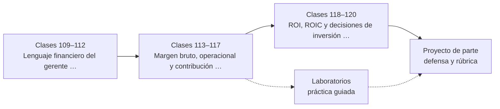

# Parte 09 — Finanzas y contabilidad para gerentes

<!-- parte:inicio -->

> ← [Parte 08 — Sistemas de gestión, KPI y OKR](../08-management-systems-kpis-okrs/README.md) · [Temario](../../SYLLABUS.md) · [Parte 10 — Ventas, desarrollo comercial y negociación](../10-sales-commercial-negotiation/README.md) →

*Leer la economía real del negocio y decidir con números*

**Etapa:** 3 — Gestión de negocio  
**Duración:** 12 clases · 30 horas  
**Resultado de salida:** Leer la economía real del negocio y decidir con flujo de caja, márgenes, retorno y escenarios.

🟣 [Ver las 6 etapas](../../SYLLABUS.md) · 12 clases (109–120) · 4 laboratorios · [proyecto de parte](project.md)

## 🎯 De qué trata esta parte

Un gerente que no lee estados financieros delega el control a quien sí. Esta parte da el lenguaje mínimo para interpretar resultados, balance y caja, y para decidir inversiones con retorno y escenarios.

El eje es que **utilidad no es caja**: se distingue lo que se gana de lo que se cobra, y se aprende a ver el negocio por sus márgenes, su capital de trabajo y su economía unitaria.

## 🧱 Con qué hay que llegar

| Parte | Qué aporta |
|---|---|
| [08 — Sistemas de gestión, KPI y OKR](../08-management-systems-kpis-okrs/README.md) | Indicadores y revisión. |
| [01 — Pensamiento crítico y toma de decisiones](../01-critical-thinking-and-decisions/README.md) | Probabilidad, trade-offs y escenarios. |

Cada clase supone la anterior: el orden importa, y saltarse una deja sin base a las que vienen después.

## 📚 Resultados de la parte

Al terminar esta parte podrás:

1. **Leer** estado de resultados, balance y flujo de caja.
2. **Calcular** márgenes, punto de equilibrio y capital de trabajo.
3. **Construir** presupuesto y forecast con supuestos explícitos.
4. **Evaluar** unit economics: CAC, LTV, churn y payback.
5. **Decidir** inversiones con ROI, ROIC y fundamentos de valoración.

## 🗺️ Mapa de la parte

## 🧭 Cómo se encadenan las 12 clases

Las clases **109 a 112** enseñan a leer: lenguaje financiero, resultados, balance y caja.

Las clases **113 a 117** enseñan a gestionar: márgenes, capital de trabajo, presupuesto, break-even y economía unitaria.

Las clases **118 a 120** enseñan a decidir: retorno, valoración y el capstone de comité de inversión.

## 📘 Las 12 clases

| # | Clase | Qué se trabaja | Entregable | Min |
|---:|---|---|---|---:|
| 109 | [Lenguaje financiero del gerente](classes/109-lenguaje-financiero-del-gerente/README.md) | devengo, ingreso, gasto | [modelo-financiero-y-memo-de-decision](../../templates/modelo-financiero-y-memo-de-decision.md) | 150 |
| 110 | [Estado de resultados](classes/110-estado-de-resultados/README.md) | margen bruto, resultado operativo, EBITDA | [leadership-decision-brief](../../templates/leadership-decision-brief.md) | 150 |
| 111 | [Balance y posición financiera](classes/111-balance-y-posicion-financiera/README.md) | activo, pasivo, patrimonio | [modelo-financiero-y-memo-de-decision](../../templates/modelo-financiero-y-memo-de-decision.md) | 150 |
| 112 | [Flujo de caja](classes/112-flujo-de-caja/README.md) | operating cash flow, investing cash flow, financing cash flow | [modelo-financiero-y-memo-de-decision](../../templates/modelo-financiero-y-memo-de-decision.md) | 150 |
| 113 | [Margen bruto, operacional y contribución](classes/113-margen-bruto-operacional-y-contribucion/README.md) | gross margin, operating margin, contribution margin | [modelo-financiero-y-memo-de-decision](../../templates/modelo-financiero-y-memo-de-decision.md) | 150 |
| 114 | [Capital de trabajo](classes/114-capital-de-trabajo/README.md) | working capital, DSO, DIO | [modelo-financiero-y-memo-de-decision](../../templates/modelo-financiero-y-memo-de-decision.md) | 150 |
| 115 | [Presupuesto y forecast](classes/115-presupuesto-y-forecast/README.md) | budget, forecast, variance | [modelo-financiero-y-memo-de-decision](../../templates/modelo-financiero-y-memo-de-decision.md) | 150 |
| 116 | [Costos fijos, variables y break-even](classes/116-costos-fijos-variables-y-break-even/README.md) | fixed cost, variable cost, contribution per unit | [risk-governance-brief](../../templates/risk-governance-brief.md) | 150 |
| 117 | [Unit economics: CAC, LTV, churn y payback](classes/117-unit-economics-cac-ltv-churn-y-payback/README.md) | CAC, LTV, churn | [modelo-financiero-y-memo-de-decision](../../templates/modelo-financiero-y-memo-de-decision.md) | 150 |
| 118 | [ROI, ROIC y decisiones de inversión](classes/118-roi-roic-y-decisiones-de-inversion/README.md) | ROI, NOPAT, invested capital | [modelo-financiero-y-memo-de-decision](../../templates/modelo-financiero-y-memo-de-decision.md) | 150 |
| 119 | [Valoración: fundamentos](classes/119-valoracion-fundamentos/README.md) | enterprise value, equity value, DCF | [modelo-financiero-y-memo-de-decision](../../templates/modelo-financiero-y-memo-de-decision.md) | 150 |
| 120 | [Capstone: comité de inversión](classes/120-capstone-comite-de-inversion/README.md) | investment memo, NPV, hurdle rate | [leadership-decision-brief](../../templates/leadership-decision-brief.md) | 150 |

## ⚠️ Riesgos característicos

- Confundir utilidad con caja.
- Proyectar con supuestos que nadie declara.
- Evaluar una inversión sin escenario adverso.
- Usar un indicador sin conocer su definición.

## 🔤 Glosario de la parte

57 conceptos definidos en las clases, con la definición operacional que usa cada una.

| Concepto | Definición operacional |
|---|---|
| **activo** | recurso controlado del que se esperan beneficios futuros. |
| **break-even units** | costos fijos/margen de contribución unitario. |
| **budget** | plan aprobado que asigna recursos y objetivos. |
| **CAC** | gasto incremental o total de adquisición dividido por nuevos clientes según definición explícita. |
| **cash conversion** | diferencia temporal entre resultado contable y cobro/pago real. |
| **cash conversion cycle** | DSO + DIO − DPO. |
| **cash flow** | movimiento real de efectivo en un periodo. |
| **churn** | proporción de clientes o revenue perdido en un periodo. |
| **cohort** | grupo de clientes adquirido en periodo o condición comparable. |
| **contribution margin** | ventas−costos variables atribuibles. |
| **contribution per unit** | precio menos costo variable unitario. |
| **DCF** | valor presente de flujos futuros esperados. |
| **devengo** | reconocimiento económico cuando se genera el derecho u obligación, no cuando entra o sale efectivo. |
| **DIO** | días promedio de inventario. |
| **DPO** | días promedio de cuentas por pagar. |
| **driver-based model** | forecast construido desde variables causales del negocio. |
| **DSO** | días promedio de cuentas por cobrar. |
| **EBITDA** | aproximación a resultado antes de intereses, impuestos, depreciación y amortización, no flujo de caja. |
| **enterprise value** | valor de operaciones para proveedores de deuda y equity. |
| **equity value** | valor residual para accionistas después de ajustes por deuda/caja. |
| **financing cash flow** | flujos con acreedores y propietarios. |
| **fixed cost** | costo que no cambia inmediatamente con volumen dentro del rango relevante. |
| **forecast** | estimación actualizada basada en evidencia reciente. |
| **free cash flow** | efectivo disponible después de inversiones necesarias, según definición utilizada. |
| **gasto** | consumo de recursos reconocido en el periodo. |
| **gross margin** | (ventas−costo de ventas)/ventas. |
| **hurdle rate** | retorno mínimo requerido según riesgo. |
| **ingreso** | valor reconocido por bienes o servicios según reglas contables aplicables. |
| **invested capital** | capital operativo financiado por deuda y equity según definición. |
| **investing cash flow** | flujos por adquisición o venta de activos e inversiones. |
| **investment memo** | documento que sintetiza tesis, cash flows, riesgos y decisión. |
| **leverage** | uso de deuda y obligaciones que amplifica exposición de los propietarios. |
| **liquidez** | capacidad de atender obligaciones de corto plazo. |
| **LTV** | valor económico esperado de contribución de un cliente durante su vida. |
| **margen bruto** | ventas menos costo de ventas, como porcentaje de ventas. |
| **margin of safety** | ventas reales o esperadas por encima del break-even. |
| **multiple** | relación entre valor y una métrica como EBITDA o revenue. |
| **NOPAT** | resultado operativo después de impuestos normalizados. |
| **NPV** | valor presente de flujos incrementales descontados menos inversión. |
| **operating cash flow** | efectivo generado o consumido por operación. |
| **operating margin** | resultado operativo/ventas. |
| **partida no recurrente** | efecto material que no representa desempeño repetible. |
| **pasivo** | obligación presente que requerirá recursos. |
| **patrimonio** | interés residual después de pasivos. |
| **payback** | tiempo para recuperar CAC con margen de contribución. |
| **post-audit** | revisión posterior de supuestos versus resultados. |
| **real option** | valor de poder expandir, esperar o abandonar. |
| **resultado normalizado** | resultado ajustado para analizar capacidad recurrente. |
| **resultado operativo** | resultado del negocio antes de estructura financiera e impuestos según presentación. |
| **ROI** | beneficio neto atribuible/inversión, fórmula que debe declararse. |
| **ROIC** | NOPAT/capital invertido. |
| **scenario** | conjunto coherente de supuestos alternativos. |
| **terminal value** | valor de flujos más allá del horizonte explícito. |
| **variable cost** | costo que cambia con volumen dentro del rango relevante. |
| **variance** | diferencia entre actual y referencia. |
| **WACC** | costo promedio ponderado de las fuentes de capital. |
| **working capital** | activos corrientes operativos menos pasivos corrientes operativos según definición de análisis. |

## 📦 Qué queda como evidencia

- Un modelo financiero simple con supuestos.
- Un análisis de unit economics.
- Un memo de decisión de inversión.
- El capstone: comité de inversión.

## 🔗 Cómo se conecta

Alimenta la parte 10 y 11 (economía comercial), la 18 (finanzas corporativas) y el runway de las partes 20 y 23.

## 🧪 Cómo se trabaja

Son **12 clases de 150 minutos** —30 horas— con **4 laboratorios** y un proyecto integrador. Cada clase trae su propósito, sus conceptos, un caso, práctica, errores frecuentes, preguntas de comprobación, entregable y fuentes, y se evalúa con su `assessment.md`. Los laboratorios se resuelven con datos propios o sintéticos, nunca con datos reales de terceros, y la parte se cierra con el proyecto y su defensa. Las reglas de recorrido están en [la guía de navegación](../../docs/NAVIGATION.md).

<!-- parte:fin -->

## Laboratorios

- [Lab 01 — P&L clinic](labs/lab-01.md)
- [Lab 02 — Cash runway model](labs/lab-02.md)
- [Lab 03 — Unit economics case](labs/lab-03.md)
- [Lab 04 — Capital allocation committee](labs/lab-04.md)

## Proyecto de parte

Analizar una unidad de negocio, detectar riesgos de caja y asignar capital entre tres iniciativas.

## Bibliografía rectora

- Richard Brealey, Stewart Myers & Franklin Allen — *Principles of Corporate Finance* (Finanzas corporativas)
- Stephen Ross, Randolph Westerfield et al. — *Corporate Finance* (Finanzas corporativas)
- Tim Koller, Marc Goedhart & David Wessels — *Valuation: Measuring and Managing the Value of Companies* (Valoración)
- Aswath Damodaran — *Investment Valuation* (Valoración)
- Charles Horngren et al. — *Cost Accounting: A Managerial Emphasis* (Contabilidad gerencial)

## Criterio de aprobación

80/100 y entrega del proyecto integrador.
