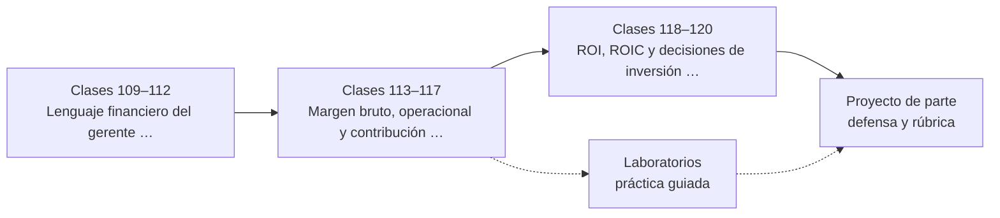

# Parte 09 — Finanzas y contabilidad para gerentes

<!-- parte:inicio -->

> ← [Parte 08 — Sistemas de gestión, KPI y OKR](../08-management-systems-kpis-okrs/README.md) · [Temario](../../SYLLABUS.md) · [Parte 10 — Ventas, desarrollo comercial y negociación](../10-sales-commercial-negotiation/README.md) →

*Leer la economía real del negocio y decidir con números*

**Etapa:** 3 — Gestión de negocio  
**Duración:** 12 clases · 30 horas  
**Resultado de salida:** Leer la economía real del negocio y decidir con flujo de caja, márgenes, retorno y escenarios.

🟣 [Ver las 6 etapas](../../SYLLABUS.md) · 12 clases (109–120) · 4 laboratorios · [proyecto de parte](project.md)

## 🎯 De qué trata esta parte

Un gerente que no lee estados financieros delega el control a quien sí. Esta parte da el lenguaje mínimo para interpretar resultados, balance y caja, y para decidir inversiones con retorno y escenarios.

El eje es que **utilidad no es caja**: se distingue lo que se gana de lo que se cobra, y se aprende a ver el negocio por sus márgenes, su capital de trabajo y su economía unitaria.

## 🧱 Con qué hay que llegar

| Parte | Qué aporta |
|---|---|
| [08 — Sistemas de gestión, KPI y OKR](../08-management-systems-kpis-okrs/README.md) | Indicadores y revisión. |
| [01 — Pensamiento crítico y toma de decisiones](../01-critical-thinking-and-decisions/README.md) | Probabilidad, trade-offs y escenarios. |

Cada clase supone la anterior: el orden importa, y saltarse una deja sin base a las que vienen después.

## 📚 Resultados de la parte

Al terminar esta parte podrás:

1. **Leer** estado de resultados, balance y flujo de caja.
2. **Calcular** márgenes, punto de equilibrio y capital de trabajo.
3. **Construir** presupuesto y forecast con supuestos explícitos.
4. **Evaluar** unit economics: CAC, LTV, churn y payback.
5. **Decidir** inversiones con ROI, ROIC y fundamentos de valoración.

## 🗺️ Mapa de la parte

## 🧭 Cómo se encadenan las 12 clases

Las clases **109 a 112** enseñan a leer: lenguaje financiero, resultados, balance y caja.

Las clases **113 a 117** enseñan a gestionar: márgenes, capital de trabajo, presupuesto, break-even y economía unitaria.

Las clases **118 a 120** enseñan a decidir: retorno, valoración y el capstone de comité de inversión.

## 📘 Las 12 clases

| # | Clase | Qué se trabaja | Entregable | Min |
|---:|---|---|---|---:|
| 109 | [Lenguaje financiero del gerente](classes/109-lenguaje-financiero-del-gerente/README.md) | Estado de resultados, Balance (estado de situación), Estado de flujo de efectivo | [modelo-financiero-y-memo-de-decision](../../templates/modelo-financiero-y-memo-de-decision.md) | 150 |
| 110 | [Estado de resultados](classes/110-estado-de-resultados/README.md) | Ingresos, Costo de ventas, Margen bruto | [leadership-decision-brief](../../templates/leadership-decision-brief.md) | 150 |
| 111 | [Balance y posición financiera](classes/111-balance-y-posicion-financiera/README.md) | Activo corriente, Pasivo corriente, Liquidez | [modelo-financiero-y-memo-de-decision](../../templates/modelo-financiero-y-memo-de-decision.md) | 150 |
| 112 | [Flujo de caja](classes/112-flujo-de-caja/README.md) | Flujo operativo, Flujo de inversión, Flujo de financiamiento | [cash-runway](../../templates/cash-runway.md) | 150 |
| 113 | [Margen bruto, operacional y contribución](classes/113-margen-bruto-operacional-y-contribucion/README.md) | Margen bruto, Margen de contribución, Margen operacional | [modelo-financiero-y-memo-de-decision](../../templates/modelo-financiero-y-memo-de-decision.md) | 150 |
| 114 | [Capital de trabajo](classes/114-capital-de-trabajo/README.md) | Capital de trabajo operativo, Días de cobro (DSO), Días de inventario (DIO) | [modelo-financiero-y-memo-de-decision](../../templates/modelo-financiero-y-memo-de-decision.md) | 150 |
| 115 | [Presupuesto y forecast](classes/115-presupuesto-y-forecast/README.md) | Presupuesto, Forecast, Meta | [modelo-financiero-y-memo-de-decision](../../templates/modelo-financiero-y-memo-de-decision.md) | 150 |
| 116 | [Costos fijos, variables y break-even](classes/116-costos-fijos-variables-y-break-even/README.md) | Costo variable, Costo fijo, Costo escalonado | [risk-governance-brief](../../templates/risk-governance-brief.md) | 150 |
| 117 | [Unit economics: CAC, LTV, churn y payback](classes/117-unit-economics-cac-ltv-churn-y-payback/README.md) | CAC, ARPU, Margen por cliente | [modelo-financiero-y-memo-de-decision](../../templates/modelo-financiero-y-memo-de-decision.md) | 150 |
| 118 | [ROI, ROIC y decisiones de inversión](classes/118-roi-roic-y-decisiones-de-inversion/README.md) | ROI, ROIC, Costo de capital | [modelo-financiero-y-memo-de-decision](../../templates/modelo-financiero-y-memo-de-decision.md) | 150 |
| 119 | [Valoración: fundamentos](classes/119-valoracion-fundamentos/README.md) | Valor presente, Flujo de caja libre, Costo de capital (WACC) | [modelo-financiero-y-memo-de-decision](../../templates/modelo-financiero-y-memo-de-decision.md) | 150 |
| 120 | [Capstone: comité de inversión](classes/120-capstone-comite-de-inversion/README.md) | Memo de inversión, Tesis, Caso base y escenarios | [leadership-decision-brief](../../templates/leadership-decision-brief.md) | 150 |

## ⚠️ Riesgos característicos

- Confundir utilidad con caja.
- Proyectar con supuestos que nadie declara.
- Evaluar una inversión sin escenario adverso.
- Usar un indicador sin conocer su definición.

## 🔤 Glosario de la parte

70 conceptos definidos en las clases, con la definición operacional que usa cada una.

| Concepto | Definición operacional |
|---|---|
| **Activo corriente** | Recurso que se espera convertir en efectivo o usar en menos de un año. |
| **Alternativa cero** | No invertir o mantener la situación actual. |
| **Apalancamiento financiero** | Uso de deuda para financiar activos. |
| **Apalancamiento operativo** | Sensibilidad del resultado operacional al cambio en ventas por la presencia de costos fijos. |
| **ARPU** | Ingreso promedio por cliente en un período. |
| **Balance (estado de situación)** | Informe de activos, pasivos y patrimonio a una fecha. |
| **Base de caja** | Se registra cuando se recibe o se paga el efectivo. |
| **Base devengada** | Se reconoce el ingreso o el gasto cuando ocurre el hecho, no cuando se cobra o paga. |
| **CAC** | Costo de adquisición por cliente nuevo: gasto de ventas y marketing / clientes nuevos. |
| **Calendario de caja** | Proyección de entradas y salidas por semana. |
| **Capital de trabajo operativo** | Cuentas por cobrar + inventario − cuentas por pagar operativas. |
| **Caso base y escenarios** | Proyección central y alternativas adversa y favorable. |
| **Churn** | Proporción de clientes (o de ingresos) que se pierden en un período. |
| **Ciclo de conversión de efectivo (CCC)** | DIO + DSO − DPO. |
| **Colchón de liquidez** | Caja o líneas disponibles que protegen ante imprevistos. |
| **Costo de capital** | Retorno mínimo exigido por quienes financian, según el riesgo. |
| **Costo de capital (WACC)** | Tasa que remunera a acreedores y accionistas según el riesgo. |
| **Costo de ventas** | Costo directo de los bienes o servicios vendidos. |
| **Costo directo** | Costo que se asigna a un producto o cliente sin ambigüedad. |
| **Costo escalonado** | Fijo dentro de tramos de actividad; salta al cambiar de tramo. |
| **Costo fijo** | No cambia con el volumen dentro de un rango relevante. |
| **Costo indirecto (overhead)** | Costo compartido que debe asignarse con un criterio. |
| **Costo variable** | Cambia en proporción al volumen. |
| **Descuento por pronto pago** | Rebaja por cobrar antes (por ejemplo, 2/10 neto 30). |
| **Desvío (varianza)** | Diferencia entre lo real y lo presupuestado o pronosticado. |
| **Días de cobro (DSO)** | Cuentas por cobrar / ventas × días. |
| **Días de inventario (DIO)** | Inventario / costo de ventas × días. |
| **Días de pago (DPO)** | Cuentas por pagar / costo de ventas × días. |
| **Estado de flujo de efectivo** | Informe del efectivo que entra y sale, clasificado por actividad. |
| **Estado de resultados** | Informe de ingresos, costos y gastos de un período. |
| **Flujo de caja libre** | Caja operativa menos inversiones necesarias para sostener el negocio. |
| **Flujo de financiamiento** | Caja de préstamos, aportes y pagos a acreedores y dueños. |
| **Flujo de inversión** | Caja usada o recibida por compra o venta de activos de largo plazo. |
| **Flujo incremental** | Flujo adicional que ocurre por decidir la inversión. |
| **Flujo operativo** | Caja generada o consumida por la actividad principal. |
| **Forecast** | Mejor estimación actualizada de los resultados del período o de los siguientes. |
| **Ingresos** | Importe por la venta de bienes o servicios en el período. |
| **Liquidez** | Capacidad de pagar obligaciones de corto plazo. |
| **LTV** | Valor del cliente durante su vida: margen por período × duración esperada, descontado. |
| **Margen bruto** | Ingresos menos costo de ventas. |
| **Margen de contribución** | (Ingresos − costos variables) / ingresos. |
| **Margen de seguridad** | Distancia entre las ventas reales y el punto de equilibrio. |
| **Margen neto** | Utilidad neta / ingresos. |
| **Margen operacional** | Resultado operacional / ingresos. |
| **Margen por cliente** | Ingreso menos costos de servir al cliente. |
| **Memo de inversión** | Documento que presenta la tesis, el análisis y la decisión solicitada. |
| **Meta** | Nivel de resultado que se busca lograr. |
| **Múltiplo** | Relación entre el valor y una medida (ingresos, EBITDA, utilidad). |
| **Norma contable** | Conjunto de reglas para preparar los estados (por ejemplo, IFRS). |
| **Partida extraordinaria o no recurrente** | Efecto puntual que no se espera repetir. |
| **Pasivo corriente** | Obligación que vence en menos de un año. |
| **Patrimonio** | Capital aportado más utilidades retenidas; activos menos pasivos. |
| **Payback** | Tiempo para recuperar el CAC con el margen del cliente. |
| **Premortem** | Ejercicio de imaginar el fracaso y sus causas antes de decidir. |
| **Presupuesto** | Plan financiero del período con asignación de recursos y compromisos. |
| **Presupuesto móvil** | Horizonte que se extiende de forma continua (por ejemplo, 12 meses hacia adelante). |
| **Punto de equilibrio (break-even)** | Volumen en que los ingresos igualan los costos totales. |
| **Resultado operacional (EBIT)** | Margen bruto menos gastos operativos. |
| **Revisión posterior** | Comparación de lo real con lo proyectado tras la inversión. |
| **ROI** | Ganancia de una inversión dividida por su costo. |
| **ROIC** | Resultado operacional después de impuestos dividido por el capital invertido. |
| **Solvencia** | Capacidad de sostener la estructura de deuda a largo plazo. |
| **Supuesto** | Premisa sobre el entorno o la operación que sostiene las cifras. |
| **Tesis** | Razón por la cual la inversión crea valor. |
| **TIR** | Tasa de descuento que hace el VPN igual a cero. |
| **Utilidad neta** | Resultado final tras intereses e impuestos. |
| **Valor de la empresa (enterprise value)** | Valor de las operaciones para todos los proveedores de capital. |
| **Valor presente** | Equivalente hoy de un flujo futuro, descontado por tiempo y riesgo. |
| **Valor terminal** | Valor de los flujos posteriores al horizonte explícito. |
| **VPN (valor presente neto)** | Suma de flujos descontados menos la inversión inicial. |

## 📦 Qué queda como evidencia

- Un modelo financiero simple con supuestos.
- Un análisis de unit economics.
- Un memo de decisión de inversión.
- El capstone: comité de inversión.

## 🔗 Cómo se conecta

Alimenta la parte 10 y 11 (economía comercial), la 18 (finanzas corporativas) y el runway de las partes 20 y 23.

## 🧪 Cómo se trabaja

Son **12 clases de 150 minutos** —30 horas— con **4 laboratorios** y un proyecto integrador. Cada clase trae su propósito, sus conceptos, un caso, práctica, errores frecuentes, preguntas de comprobación, entregable y fuentes, y se evalúa con su `assessment.md`. Los laboratorios se resuelven con datos propios o sintéticos, nunca con datos reales de terceros, y la parte se cierra con el proyecto y su defensa. Las reglas de recorrido están en [la guía de navegación](../../docs/NAVIGATION.md).

<!-- parte:fin -->

## Laboratorios

- [Lab 01 — P&L clinic](labs/lab-01.md)
- [Lab 02 — Cash runway model](labs/lab-02.md)
- [Lab 03 — Unit economics case](labs/lab-03.md)
- [Lab 04 — Capital allocation committee](labs/lab-04.md)

## Proyecto de parte

Analizar una unidad de negocio, detectar riesgos de caja y asignar capital entre tres iniciativas.

## Bibliografía rectora

- Richard Brealey, Stewart Myers & Franklin Allen — *Principles of Corporate Finance* (Finanzas corporativas)
- Stephen Ross, Randolph Westerfield et al. — *Corporate Finance* (Finanzas corporativas)
- Tim Koller, Marc Goedhart & David Wessels — *Valuation: Measuring and Managing the Value of Companies* (Valoración)
- Aswath Damodaran — *Investment Valuation* (Valoración)
- Charles Horngren et al. — *Cost Accounting: A Managerial Emphasis* (Contabilidad gerencial)

## Criterio de aprobación

80/100 y entrega del proyecto integrador.
