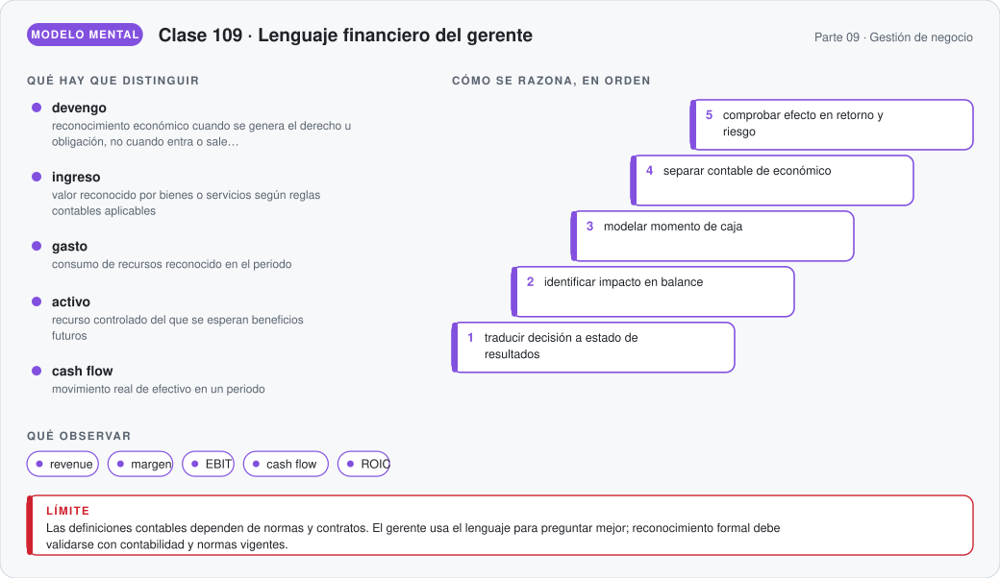

# Clase 109 — Lenguaje financiero del gerente

<!-- nav:inicio -->
> **Parte 09 · Finanzas y contabilidad para gerentes** — clase 1 de 12 · [índice de la parte](../../README.md) · [temario](../../../../SYLLABUS.md)
<!-- nav:fin -->

**Parte:** 09 — Finanzas y contabilidad para gerentes  
**Nivel:** Etapa 3 — Manager → Gerente  
**Duración sugerida:** 150–180 minutos · **Estándar:** deep-class-v2

## 🎯 Propósito

Un gerente que no lee estados financieros delega en otros la comprensión de su propio negocio. No se trata de convertirse en contador, sino de hablar el idioma en que la empresa registra su desempeño: qué es ingreso y qué es caja, qué es costo y qué es gasto, qué es activo y qué es deuda, qué es utilidad y qué es valor. Las discusiones entre áreas suelen ser, en el fondo, confusiones de vocabulario: ventas dice que fue un gran mes; finanzas dice que no hay caja; operaciones dice que el margen es estrecho; todos pueden tener razón porque miran distintos estados con distintas definiciones.

La clase se apoya en los textos de análisis de estados financieros de Palepu, Healy y Peek y de Penman, en el texto de contabilidad intermedia de Kieso, Weygandt y Warfield y en la advertencia de Schilit, Perler y Engelhart sobre los trucos contables. Al terminar sabrás ubicar los tres estados básicos y su relación, distinguir devengado de caja, leer una cifra con su definición y formular las preguntas que un gerente debe hacer antes de decidir.

## 📚 Resultados de aprendizaje

Al finalizar podrás:

1. **Explicar** qué responde cada estado financiero y qué no muestra.
2. **Distinguir** devengado de caja, costo de gasto y utilidad de efectivo.
3. **Relacionar** los tres estados entre sí con un ejemplo numérico.
4. **Formular** preguntas gerenciales a partir de las cifras.
5. **Reconocer** señales de que una cifra requiere una explicación más cuidadosa.

## 🧭 Agenda

| Tramo | Qué se hace |
|---|---|
| 0–20 min | Recuperación: anota tres cifras financieras que usas en tu trabajo y cómo se definen. |
| 20–60 min | Tres estados, devengado y caja, vocabulario esencial. |
| 60–105 min | Ejemplo trabajado: tres estados de una pequeña empresa de servicios. |
| 105–150 min | Caso ejecutivo y práctica de lectura. |
| 150–175 min | Límites y entregable. |

## 🧩 Conceptos centrales

| Concepto | Definición | Cómo se reconoce |
|---|---|---|
| **Estado de resultados** | Informe de ingresos, costos y gastos de un período. | Termina en la utilidad (o pérdida) del período. |
| **Balance (estado de situación)** | Informe de activos, pasivos y patrimonio a una fecha. | Cumple activos = pasivos + patrimonio. |
| **Estado de flujo de efectivo** | Informe del efectivo que entra y sale, clasificado por actividad. | Explica el cambio de caja entre dos fechas. |
| **Base devengada** | Se reconoce el ingreso o el gasto cuando ocurre el hecho, no cuando se cobra o paga. | Hay cuentas por cobrar y por pagar. |
| **Base de caja** | Se registra cuando se recibe o se paga el efectivo. | Coincide con el movimiento bancario. |
| **Norma contable** | Conjunto de reglas para preparar los estados (por ejemplo, IFRS). | Las notas lo indican. |

## 🧠 Modelo mental

**Cómo leer el diagrama.** Tres columnas: el **estado de resultados** responde si la actividad generó ganancia; el **balance** muestra qué tiene y qué debe la empresa en un momento; el **flujo de caja** explica cuánto efectivo entró y salió. Cada columna termina con lo que ese estado no muestra, que es exactamente lo que muestran los otros dos. Por eso la nota insiste: se leen juntos. Quien mira solo uno se engaña con facilidad.

## 📖 Desarrollo

### 1. Por qué un gerente necesita este lenguaje

Las cifras financieras son el resumen de todas las decisiones de la empresa: precios, costos, inversiones, plazos de cobro, financiamiento. Un gerente de operaciones que no entiende cómo su política de inventario afecta la caja, o un gerente comercial que no ve cómo un descuento afecta el margen, decide con información parcial. Palepu, Healy y Peek presentan el análisis de estados financieros como una herramienta para entender el negocio, no solo para auditarlo: de las cifras se deducen la estrategia, la eficiencia operativa y los riesgos.

### 2. El estado de resultados

Muestra, para un período (un mes, un trimestre, un año), cuánto se **vendió**, qué **costó** producirlo, qué **gastos** requirió la operación y qué **utilidad** quedó. Su fortaleza es que mide la rentabilidad de la actividad; su limitación, que se elabora con base devengada y con criterios contables que pueden variar. Una venta registrada en diciembre pero cobrada en marzo es ingreso de diciembre. La utilidad no es efectivo disponible: es una medida de resultado, sujeta a reglas de reconocimiento (clase 110).

### 3. El balance

Es una foto en una fecha. A la izquierda (o arriba), los **activos**: lo que la empresa controla y espera que le genere beneficios (efectivo, cuentas por cobrar, inventario, equipos). A la derecha (o abajo), cómo se **financió**: con **pasivos** (deuda, proveedores, obligaciones) y con **patrimonio** (capital aportado más utilidades retenidas). Siempre se cumple activos = pasivos + patrimonio. Del balance se lee la **liquidez** (si puede pagar lo que vence pronto) y la **solvencia** (si su estructura de deuda es sostenible), conceptos distintos (clase 111).

### 4. El flujo de efectivo

Explica **por qué cambió la caja**. Se clasifica en tres actividades: **operación** (la caja que genera el negocio), **inversión** (compra o venta de equipos, inversiones) y **financiamiento** (préstamos, aportes de capital, pagos de deuda, dividendos). Es el estado que revela si una empresa con utilidades está consumiendo efectivo porque su capital de trabajo crece o porque paga inversiones. Para un gerente, es el más cercano a la pregunta «¿tendremos con qué pagar?» (clase 112).

### 5. Devengado frente a caja

La contabilidad devengada pretende reflejar mejor el desempeño económico, relacionando ingresos y costos del mismo período, aunque el efectivo se mueva antes o después. La contabilidad de caja es más simple y evidente, pero puede ocultar compromisos. Ejemplo: una consultora entrega un proyecto en diciembre y factura en enero; con base devengada, el ingreso es de diciembre; con base de caja, de enero o febrero. El gerente debe saber qué base se usa en cada reporte y qué efectos tiene sobre su lectura.

### 6. Costo, gasto, inversión

Son términos que se confunden. Un **costo** es un sacrificio de recursos para obtener un bien o servicio; cuando se consume para producir y vender, se registra como **costo de ventas**. Un **gasto** es un consumo de recursos de un período que no se asigna a un producto (administración, ventas, arriendos de oficina). Una **inversión** es un desembolso del cual se espera un beneficio durante varios períodos y se registra como activo (y luego se deprecia). Clasificar un desembolso como gasto o como activo cambia la utilidad del período sin cambiar la caja, lo que abre un espacio para manipulación (Schilit y otros).

### 7. Preguntas que debe hacer un gerente

Ante cualquier cifra: ¿cómo se define?, ¿con qué base y qué norma?, ¿cómo se compara con el período anterior y con el plan?, ¿qué cambió en las políticas contables?, ¿qué la sostiene en caja? ¿qué parte es recurrente y cuál puntual? Y ante el conjunto: ¿concuerdan los tres estados? Schilit, Perler y Engelhart catalogan señales de alerta: ingresos reconocidos de forma anticipada, gastos capitalizados sin justificación, crecimiento de cuentas por cobrar mayor que el de ventas, utilidades que no se convierten en caja. Ninguna prueba un fraude, pero cada una merece una pregunta.

## 📚 Lectura comparada

| Obra | Qué aporta | Qué no resuelve | Pregunta para contrastar |
|---|---|---|---|
| Palepu, Healy y Peek | Análisis de estados para entender el negocio. | Es un texto de nivel alto. | ¿Qué estrategia revelan las cifras? |
| Penman | Lectura de estados orientada a la valoración. | Más técnico. | ¿Qué parte del resultado es recurrente? |
| Kieso, Weygandt y Warfield | Reglas contables y su lógica. | Es de preparación contable. | ¿Qué criterio contable se aplicó? |
| Schilit, Perler y Engelhart | Señales de alerta de manipulación. | Un catálogo no prueba el fraude. | ¿Qué cifra no se convierte en caja? |
| IFRS Foundation | Normas que definen cómo se reconocen y presentan las partidas. | Son normas, no manuales de gestión. | ¿Qué norma rige tus estados? |

## 🧮 Ejemplo trabajado

**Situación (hipotética).** Una consultora comienza el año con USD 40.000 en caja, sin cuentas por cobrar y sin deudas. En el trimestre vende servicios por USD 300.000, de los cuales cobra USD 180.000. Paga sueldos y gastos por USD 210.000 y compra equipos por USD 30.000 al contado. Pide un préstamo de USD 50.000.

**Estado de resultados del trimestre (simplificado, sin depreciación ni impuestos).** Ingresos 300.000; gastos 210.000; utilidad 90.000.

**Flujo de caja.** Operación: cobros 180.000 − pagos 210.000 = −30.000. Inversión: −30.000. Financiamiento: +50.000. Cambio de caja: −10.000; caja final 30.000.

**Balance al cierre.** Activos: caja 30.000; cuentas por cobrar 120.000 (300.000 − 180.000); equipos 30.000; total 180.000. Pasivos: préstamo 50.000. Patrimonio: 40.000 iniciales + 90.000 de utilidad = 130.000. Total pasivo + patrimonio = 180.000. Cuadra.

| Lectura | Conclusión |
|---|---|
| Resultados | Una utilidad de USD 90.000: buen trimestre. |
| Flujo | La caja bajó USD 10.000: el negocio operativo consumió efectivo. |
| Balance | USD 120.000 en cuentas por cobrar: dos tercios de los activos son promesas de pago de clientes. |

**Preguntas gerenciales.** ¿Cuándo cobrará los USD 120.000? ¿Cuántos días tarda en cobrar (aquí, 120.000 / 300.000 × 90 ≈ 36 días)? ¿Podrá pagar sueldos del próximo mes con 30.000 en caja? ¿Es sostenible depender de un préstamo?

**Qué muestra.** (1) Utilidad y caja divergen. (2) Los tres estados se conectan: la utilidad aumenta el patrimonio, las ventas no cobradas aparecen como cuentas por cobrar. (3) Cada estado dio una pregunta distinta.

## 🔀 Comparación y límites

**Contabilidad financiera frente a contabilidad de gestión.** La financiera sigue normas para informar a terceros; la de gestión adapta los datos a las decisiones internas (costos por producto, cliente o canal). El gerente usa ambas y entiende que las cifras pueden diferir, con razón.

**Límites.** Los estados financieros siguen reglas que pueden no reflejar el valor económico: el costo histórico de un activo puede ser muy distinto de su valor actual, y los intangibles (marca, relaciones, conocimiento) suelen no aparecer. La contabilidad admite juicios y estimaciones. Esta clase no reemplaza al contador ni al auditor, y los criterios de reconocimiento y presentación deben verificarse en la norma contable aplicable vigente y con asesoría profesional.

## 🪜 De profesional a owner

| Nivel | Cómo usa el lenguaje financiero |
|---|---|
| **Profesional** | Entiende cómo su trabajo afecta ingresos, costos y caja. |
| **Jefe / Team Lead** | Lee el estado de resultados de su área y explica desvíos. |
| **Gerente** | Lee los tres estados, conecta decisiones con cifras y hace preguntas precisas. |
| **CEO / Director** | Exige coherencia entre estrategia y estados, y vigila señales de alerta. |
| **Founder / Owner** | Gobierna la caja y no confunde utilidad con efectivo. |

## 🏢 Caso ejecutivo

Una empresa de software con 80 personas reporta al directorio una utilidad trimestral de USD 1,2 millones, el doble que el año anterior. El gerente comercial lo celebra; el director financiero advierte que la caja bajó USD 900.000 en el mismo trimestre y que las cuentas por cobrar subieron de 45 a 82 días de ventas. El gerente de producto explica que se capitalizaron USD 600.000 de desarrollo de un nuevo módulo como activo, en vez de llevarlos a gastos. Un director del directorio pregunta si «la empresa está ganando dinero o no».

Entrega un **informe de lectura financiera** que contenga: (a) qué responde cada estado y qué ocultan por separado; (b) el análisis de la divergencia entre utilidad y caja con los tres factores mencionados; (c) las preguntas que harías sobre la capitalización del desarrollo y la política de cobro; (d) qué cifras necesitas ver y con qué definición; (e) la respuesta a «¿gana dinero?» con una posición matizada; (f) qué normas contables y asesoría profesional consultarías para validar el tratamiento.

## 🧪 Práctica

1. Elige una cifra de tu área y escribe su definición, base y fuente.
2. Construye los tres estados simplificados para un ejemplo de tres movimientos.
3. Explica por qué una venta cobrada a 60 días aumenta la utilidad pero no la caja.
4. Lista cinco preguntas que harías ante un aumento de utilidad con caída de caja.
5. Distingue tres desembolsos de tu área como costo, gasto o inversión.

## ⚠️ Errores frecuentes

| Error | Por qué ocurre | Cómo corregirlo |
|---|---|---|
| Confundir utilidad con caja | Ambas parecen «ganancia» | Leer el flujo de caja. |
| Mirar un solo estado | Es el que se conoce | Leer los tres juntos. |
| No conocer la definición de una cifra | Se asume que es común | Preguntar fórmula, base y fuente. |
| Confundir costo, gasto e inversión | Los términos se usan como sinónimos | Aclarar el tratamiento. |
| Creer que las cifras son exactas | Parecen objetivas | Reconocer estimaciones y juicios. |
| Ignorar las notas | Se mira solo el cuadro | Leer políticas y supuestos. |

## ❓ Preguntas de comprobación

1. ¿Qué pregunta responde cada estado financiero?
2. ¿Qué diferencia hay entre base devengada y base de caja?
3. ¿Por qué utilidad y caja pueden divergir?
4. ¿Qué diferencia hay entre costo, gasto e inversión?
5. ¿Qué se cumple siempre en el balance?
6. ¿Qué señales de alerta describen Schilit y sus coautores?
7. ¿Qué límite tienen los estados financieros como medida de valor?

Claves de respuesta

1. El de resultados, si la actividad generó ganancia; el balance, qué tiene y qué debe la empresa; el flujo, cuánto efectivo entró y salió.
2. La devengada reconoce ingresos y gastos cuando ocurren los hechos; la de caja, cuando se cobra o se paga.
3. Porque los ingresos pueden no estar cobrados, los gastos no pagados y hay inversiones y financiamiento que no pasan por resultados.
4. El costo es un sacrificio de recursos para producir o vender; el gasto, un consumo del período sin asignación a un producto; la inversión, un desembolso con beneficio durante varios períodos.
5. Activos = pasivos + patrimonio.
6. Por ejemplo: ingresos reconocidos de forma anticipada, gastos capitalizados sin justificación, cuentas por cobrar que crecen más que las ventas y utilidades que no se convierten en caja.
7. Siguen reglas contables que pueden diferir del valor económico y suelen omitir intangibles.

## 📥 Entregable

Guarda en `portfolio/109-lenguaje-financiero-del-gerente/`:

- `modelo-financiero-y-memo-de-decision.md` (plantilla [Modelo financiero y memo de decisión](../../../../templates/modelo-financiero-y-memo-de-decision.md)) con el informe de lectura del caso ejecutivo;
- `decision-journal.md` con las definiciones de las cifras clave y las preguntas para el área financiera.

## 📗 Fuentes y verificación

- Krishna G. Palepu, Paul M. Healy & Erik Peek — *Business Analysis and Valuation* (South-Western College Pub, 1996). **Uso en esta clase:** análisis de estados para entender el negocio. Lectura selectiva sobre **lenguaje financiero del gerente**. **Localizador:** [ISBN-13 9780324375817](https://openlibrary.org/isbn/9780324375817).
- Stephen H. Penman — *Financial Statement Analysis and Security Valuation* (McGraw-Hill/Irwin, 2001). **Uso en esta clase:** lectura de estados orientada a la valoración. Lectura selectiva sobre **lenguaje financiero del gerente**. **Localizador:** [ISBN-13 9780072903331](https://openlibrary.org/isbn/9780072903331).
- Donald E. Kieso, Jerry J. Weygandt & Terry D. Warfield — *Intermediate Accounting* (John Wiley & Sons, Incorporated, 2006). **Uso en esta clase:** reglas contables y su lógica. Lectura selectiva sobre **lenguaje financiero del gerente**. **Localizador:** [ISBN-13 9780470098189](https://openlibrary.org/isbn/9780470098189).
- Howard Schilit, Jeremy Perler & Yoni Engelhart — *Financial Shenanigans* (McGraw-Hill Education on Brilliance Audio, 2018). **Uso en esta clase:** señales de alerta de manipulación contable. Lectura selectiva sobre **lenguaje financiero del gerente**. **Localizador:** [ISBN-13 9781978605459](https://openlibrary.org/isbn/9781978605459).
- IFRS Foundation — *IFRS Accounting Standards*. **Uso en esta clase:** normas que definen reconocimiento y presentación. **Fuente primaria:** <https://www.ifrs.org/>.

> **Regla de fuentes para Lenguaje financiero del gerente:** las obras anteriores estructuran las perspectivas de esta materia; cualquier norma, ley o estándar vivo mencionado debe comprobarse nuevamente en su fuente primaria vigente, en particular las normas contables y tributarias aplicables. Los ejemplos y casos son hipotéticos, con cifras ilustrativas. El desarrollo es original y no reproduce capítulos protegidos.

<!-- pie:inicio -->
---

| Anterior | Índice | Siguiente |
|---|---|---|
| [← 108 · Capstone: operating review gerencial](../../../08-management-systems-kpis-okrs/classes/108-capstone-operating-review-gerencial/README.md) | [Parte 09](../../README.md) · [Programa](../../../../SYLLABUS.md) | [110 · Estado de resultados →](../110-estado-de-resultados/README.md) |
<!-- pie:fin -->
