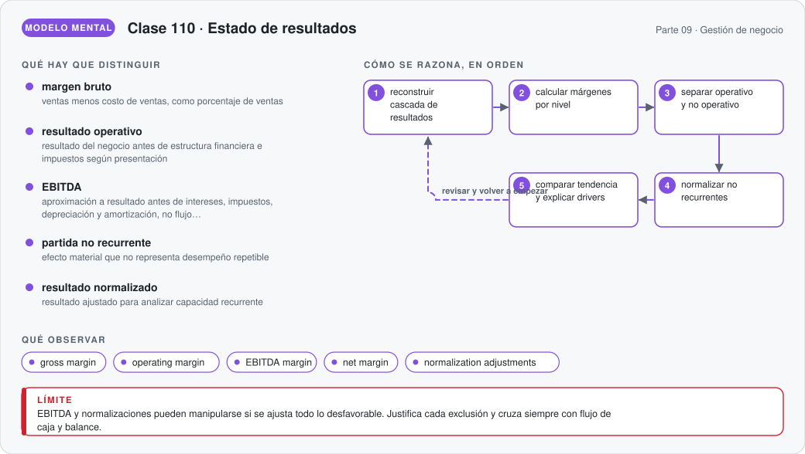

# Clase 110 — Estado de resultados

<!-- nav:inicio -->
> **Parte 09 · Finanzas y contabilidad para gerentes** — clase 2 de 12 · [índice de la parte](../../README.md) · [temario](../../../../SYLLABUS.md)
<!-- nav:fin -->

**Parte:** 09 — Finanzas y contabilidad para gerentes  
**Nivel:** Etapa 3 — Manager → Gerente  
**Duración sugerida:** 150–180 minutos · **Estándar:** deep-class-v2

## 🎯 Propósito

El estado de resultados cuenta, de arriba abajo, qué le ocurrió al dinero que entró por ventas: cuánto se fue en producir lo vendido, cuánto en operar la empresa, cuánto en financiarla y cuánto en impuestos, y cuánto quedó para los dueños. Cada línea es una pregunta gerencial: ¿el producto deja margen?, ¿la estructura de gastos es proporcional a la escala?, ¿la deuda pesa demasiado? Leerlo bien permite ubicar **dónde** se pierde la rentabilidad, que es el primer paso para corregirla.

La clase se apoya en el análisis de estados de Palepu, Healy y Peek, en la visión de Penman sobre separar lo operativo de lo financiero y en el tratamiento de costos de Horngren y colegas. Al terminar sabrás leer un estado de resultados por escalones, calcular márgenes y variaciones, distinguir lo recurrente de lo extraordinario y reconocer cómo las decisiones de reconocimiento de ingresos y de clasificación de costos cambian la utilidad.

## 📚 Resultados de aprendizaje

Al finalizar podrás:

1. **Leer** el estado de resultados por escalones: ingresos, margen bruto, resultado operacional, antes de impuestos y neto.
2. **Calcular** márgenes y variaciones entre períodos y frente al plan.
3. **Separar** lo recurrente de lo extraordinario.
4. **Explicar** cómo el reconocimiento de ingresos y la clasificación de costos afectan la utilidad.
5. **Formular** hipótesis sobre dónde se origina un problema de rentabilidad.

## 🧭 Agenda

| Tramo | Qué se hace |
|---|---|
| 0–20 min | Recuperación: recuerda el último estado de resultados que viste y señala qué línea no entendiste. |
| 20–60 min | Escalones, reconocimiento, recurrente y extraordinario. |
| 60–105 min | Ejemplo trabajado: análisis de una cadena de cafeterías. |
| 105–150 min | Caso ejecutivo y práctica de lectura. |
| 150–175 min | Límites y entregable. |

## 🧩 Conceptos centrales

| Concepto | Definición | Cómo se reconoce |
|---|---|---|
| **Ingresos** | Importe por la venta de bienes o servicios en el período. | Primera línea del estado. |
| **Costo de ventas** | Costo directo de los bienes o servicios vendidos. | Se resta de los ingresos. |
| **Margen bruto** | Ingresos menos costo de ventas. | Mide lo que deja el producto antes de operar. |
| **Resultado operacional (EBIT)** | Margen bruto menos gastos operativos. | Rentabilidad del negocio antes de financiamiento e impuestos. |
| **Partida extraordinaria o no recurrente** | Efecto puntual que no se espera repetir. | Venta de un activo, indemnización, reestructuración. |
| **Utilidad neta** | Resultado final tras intereses e impuestos. | Última línea. |

## 🧠 Modelo mental

**Cómo leer el diagrama.** Cinco pasos descendentes. Cada uno resta un tipo de costo y responde una pregunta: ¿el producto deja margen? (bruto), ¿el negocio operativo es rentable? (operacional), ¿pesa la deuda y otras partidas no operativas? (antes de impuestos), ¿cuánto queda a los dueños? (neta). Si la utilidad es baja, el diagrama sirve para ubicar en qué escalón se consume la rentabilidad.

## 📖 Desarrollo

### 1. Leer de arriba abajo

Se comienza por los **ingresos** y su evolución: crecimiento total y por línea, precio frente a volumen y concentración en clientes. Luego el **costo de ventas** y el **margen bruto**, que indican si el producto o servicio es sano. Después los **gastos operativos** (comerciales, administrativos, de investigación y desarrollo) y el **resultado operacional**, que mide el negocio sin los efectos de cómo se financia. Más abajo, **intereses**, **otros ingresos o gastos** e **impuestos** llevan a la **utilidad neta**. Palepu, Healy y Peek recomiendan leer en porcentajes de ingresos para comparar con períodos y con competidores.

### 2. Reconocimiento de ingresos

Cuándo se reconoce un ingreso afecta la utilidad del período. Las normas contables (por ejemplo, IFRS 15 en el marco IFRS) establecen que se reconoce cuando se transfiere el control del bien o servicio al cliente, en un monto que refleja lo que la empresa espera recibir. En contratos de varios años, con entregables o licencias, la decisión implica estimaciones. Para el gerente, la implicancia es práctica: una venta firmada no es necesariamente un ingreso del período, y el ritmo de facturación y de reconocimiento puede diferir del de la caja. La norma aplicable debe consultarse en su fuente vigente.

### 3. Costo de ventas y clasificación

Qué entra en el costo de ventas (materiales, mano de obra directa, parte de los costos indirectos de producción) y qué en gastos operativos depende de la naturaleza del negocio y de la política contable. Dos empresas del mismo rubro pueden mostrar márgenes brutos distintos solo porque clasifican de forma diferente (por ejemplo, el soporte al cliente). Horngren y sus colegas muestran cómo la asignación de costos indirectos afecta el costo por producto y, con ello, las decisiones de precio y mezcla. Se comparan los márgenes con la misma definición.

### 4. Gastos operativos y apalancamiento

Los gastos operativos suelen tener un componente fijo importante. Cuando los ingresos crecen y los gastos fijos no, el resultado operacional crece más que proporcionalmente (**apalancamiento operativo**); cuando los ingresos caen, ocurre lo contrario. Por eso dos empresas con el mismo margen bruto pueden tener resultados operacionales muy distintos si una tiene una estructura fija más pesada. Se analiza la relación gastos/ingresos y su evolución, preguntando qué parte crece con la escala y cuál es decisión de la gerencia.

### 5. Lo recurrente y lo no recurrente

Penman insiste en separar lo que describe el negocio habitual de lo puntual: venta de activos, reestructuraciones, litigios, ajustes de valor. Una utilidad inflada por la venta de un edificio no predice la del año siguiente. Se revisan las notas y las líneas de «otros» para identificar partidas inusuales, y se calcula un **resultado operacional normalizado**. Las empresas también suelen presentar medidas «ajustadas» (por ejemplo, EBITDA ajustado) que excluyen partidas a criterio de la gerencia; se verifica su conciliación con la medida contable y su consistencia entre períodos.

### 6. Variaciones y causas

El análisis de desvíos compara con el período anterior y con el presupuesto, y descompone la variación: **volumen** (se vendió más o menos), **precio** (a qué precio), **mezcla** (qué productos o clientes) y **costo** (unitario). Un aumento de ingresos de 10 % puede esconder una caída de volumen compensada por un alza de precios, con consecuencias muy distintas. La pregunta central es qué decisión explica la diferencia y quién la controla. Sin esa descomposición, la discusión de resultados se vuelve una lista de cifras sin responsables.

### 7. Señales de alerta

Schilit, Perler y Engelhart documentan prácticas que inflan el resultado: reconocer ingresos de forma anticipada, diferir gastos capitalizándolos sin justificación, usar partidas extraordinarias para esconder costos recurrentes, cambiar estimaciones (vidas útiles, provisiones) para suavizar resultados. No son pruebas de fraude, sino indicios para investigar. Una verificación simple: comparar la **utilidad con el flujo de caja operativo**; si la utilidad sube y la caja no, hay que entender por qué (clase 112).

## 📚 Lectura comparada

| Obra | Qué aporta | Qué no resuelve | Pregunta para contrastar |
|---|---|---|---|
| Palepu, Healy y Peek | Lectura de márgenes y comparación con pares. | Es un marco amplio. | ¿Cuál es el margen frente a competidores? |
| Penman | Separar resultado operativo de financiero y lo recurrente de lo puntual. | Más técnico. | ¿Qué parte del resultado se repetirá? |
| Horngren et al. | Clasificación y asignación de costos. | Pensado para contabilidad de costos. | ¿Cómo se asigna el costo indirecto? |
| Schilit et al. | Señales de alerta en el resultado. | No prueba el fraude. | ¿Por qué cambió esta estimación? |
| IFRS Foundation | Criterios de reconocimiento de ingresos. | Es norma, no guía de gestión. | ¿Cuándo se transfiere el control? |

## 🧮 Ejemplo trabajado

**Situación (hipotética).** Una cadena de cafeterías con 20 locales presenta su estado de resultados anual (cifras en USD miles).

| Línea | Año anterior | Año actual | % de ingresos actual |
|---|---|---|---|
| Ingresos | 12.000 | 13.800 | 100 % |
| Costo de ventas | 4.200 | 5.100 | 37,0 % |
| **Margen bruto** | 7.800 | 8.700 | 63,0 % |
| Gastos de locales (arriendos, personal) | 5.400 | 6.480 | 47,0 % |
| Administración y marketing | 1.300 | 1.450 | 10,5 % |
| **Resultado operacional** | 1.100 | 770 | 5,6 % |
| Intereses | 200 | 340 | 2,5 % |
| Otros ingresos (venta de un local) | 0 | 300 | 2,2 % |
| Resultado antes de impuestos | 900 | 730 | 5,3 % |

**Lectura.** Los ingresos crecen 15 %, pero el resultado operacional cae 30 %. El margen bruto baja de 65 % a 63 % (el costo de ventas sube más que los ingresos: insumos o promociones), los gastos de locales suben de 45 % a 47 % de ingresos (arriendos y sueldos) y los intereses suben por nueva deuda. Sin la venta del local (300), el resultado antes de impuestos habría sido de 430, menos de la mitad del año anterior.

**Preguntas.** ¿La caída del margen bruto es por precios de insumos o por descuentos? ¿Los locales nuevos están en etapa de maduración o son poco rentables? ¿Los ingresos subieron por más tráfico o por más precio? ¿La deuda financió locales que aún no rinden?

**Decisiones posibles.** Analizar el resultado por local para identificar los que no cubren su costo; revisar la política de precios y la compra de insumos; frenar nuevas aperturas hasta que los locales recientes maduren; cuidar el nivel de deuda.

**Qué muestra.** (1) La utilidad del año se sostenía en una venta puntual. (2) El problema estaba en el margen bruto y los gastos de locales, no en las ventas. (3) La lectura en porcentajes reveló lo que los valores absolutos escondían.

## 🔀 Comparación y límites

**Utilidad contable frente a utilidad económica.** La contable resta costos explícitos; la económica también resta el costo del capital que usa el negocio (clase 118). Una empresa puede tener utilidad contable y destruir valor si su retorno es menor al costo de su capital.

**Límites.** Los resultados dependen de estimaciones y criterios (vidas útiles, provisiones, reconocimiento), y de las políticas de cada empresa. Las comparaciones entre empresas exigen homogeneizar definiciones. El ejemplo es ilustrativo. Para decisiones con consecuencias contables, tributarias o de información a terceros, se debe consultar la norma vigente y a profesionales contables y tributarios.

## 🪜 De profesional a owner

| Nivel | Cómo usa el estado de resultados |
|---|---|
| **Profesional** | Entiende en qué línea impacta su trabajo. |
| **Jefe / Team Lead** | Lee el resultado de su centro y explica desvíos de costo. |
| **Gerente** | Lee márgenes, analiza variaciones y propone correcciones. |
| **CEO / Director** | Separa lo recurrente de lo puntual y exige definiciones consistentes. |
| **Founder / Owner** | Conoce su margen por producto y cliente y toma decisiones con él. |

## 🏢 Caso ejecutivo

Una empresa de transporte de carga reporta utilidad récord en el año: USD 4,5 millones, un 40 % más que el anterior. El análisis revela que USD 2,2 millones provienen de la venta de 12 camiones antiguos, que el costo de combustible se contabilizó parcialmente como inventario, que una provisión por litigios se redujo en USD 600.000 por «mejor probabilidad de éxito» y que los ingresos crecieron solo 5 %. El directorio quiere distribuir un dividendo extraordinario basado en la utilidad. El gerente general afirma que «el negocio mejoró».

Entrega un **análisis del estado de resultados** que contenga: (a) la lectura por escalones con porcentajes; (b) el resultado operacional normalizado, con las partidas que quitarías y por qué; (c) las hipótesis sobre el efecto de la clasificación del combustible y de la provisión; (d) las señales de alerta a investigar; (e) la recomendación sobre el dividendo, matizada, con la información adicional que pedirías; (f) qué normas y asesoría profesional consultarías.

## 🧪 Práctica

1. Reexpresa un estado de resultados en porcentajes de ingresos y compara dos períodos.
2. Descompone una variación de ingresos en volumen, precio y mezcla.
3. Identifica las partidas no recurrentes y calcula un resultado normalizado.
4. Escribe tres preguntas sobre la clasificación de costos de tu área.
5. Compara la utilidad con la caja operativa y explica la diferencia.

## ⚠️ Errores frecuentes

| Error | Por qué ocurre | Cómo corregirlo |
|---|---|---|
| Mirar solo la última línea | Es la más visible | Leer por escalones. |
| Aceptar utilidades con partidas puntuales | Se extrapola el resultado | Normalizar lo recurrente. |
| Comparar márgenes con definiciones distintas | No se revisan las notas | Homogeneizar. |
| Atribuir cambios a una sola causa | Se simplifica | Descomponer en volumen, precio, mezcla y costo. |
| No verificar con la caja | Se confía en la utilidad | Comparar con el flujo operativo. |
| Usar medidas «ajustadas» sin conciliación | Se toma lo presentado | Pedir la conciliación. |

## ❓ Preguntas de comprobación

1. ¿Cuáles son los escalones del estado de resultados y qué pregunta responde cada uno?
2. ¿Por qué se lee en porcentajes de ingresos?
3. ¿Qué es el apalancamiento operativo?
4. ¿Qué diferencia hay entre resultado recurrente y no recurrente?
5. ¿Cómo se descompone una variación de ingresos?
6. ¿Qué señales de alerta pueden inflar el resultado?
7. ¿Qué límite tiene la utilidad contable?

Claves de respuesta

1. Ingresos, margen bruto, resultado operacional, antes de impuestos y utilidad neta; se pregunta por el margen del producto, la rentabilidad operativa, el peso de la deuda y lo que queda a los dueños.
2. Para comparar entre períodos y con otras empresas independientemente de su tamaño.
3. El efecto de que, con costos fijos, el resultado operacional varía más que proporcionalmente con los ingresos.
4. Lo recurrente describe el negocio habitual; lo no recurrente es puntual y no se espera repetir.
5. En volumen, precio, mezcla y costo unitario.
6. Reconocer ingresos antes de tiempo, capitalizar gastos sin justificación, esconder costos en partidas extraordinarias y cambiar estimaciones para suavizar resultados.
7. No resta el costo del capital y depende de estimaciones y criterios contables.

## 📥 Entregable

Guarda en `portfolio/110-estado-de-resultados/`:

- `leadership-decision-brief.md` (plantilla [Leadership Decision Brief](../../../../templates/leadership-decision-brief.md)) con el análisis del caso ejecutivo;
- `modelo-financiero-y-memo-de-decision.md` (plantilla [Modelo financiero y memo de decisión](../../../../templates/modelo-financiero-y-memo-de-decision.md)) con el estado reexpresado y normalizado;
- `decision-journal.md` con las partidas ajustadas y las preguntas abiertas.

## 📗 Fuentes y verificación

- Krishna G. Palepu, Paul M. Healy & Erik Peek — *Business Analysis and Valuation* (South-Western College Pub, 1996). **Uso en esta clase:** lectura de márgenes y comparación con pares. Lectura selectiva sobre **estado de resultados**. **Localizador:** [ISBN-13 9780324375817](https://openlibrary.org/isbn/9780324375817).
- Stephen H. Penman — *Financial Statement Analysis and Security Valuation* (McGraw-Hill/Irwin, 2001). **Uso en esta clase:** separar lo operativo de lo financiero y lo recurrente de lo puntual. Lectura selectiva sobre **estado de resultados**. **Localizador:** [ISBN-13 9780072903331](https://openlibrary.org/isbn/9780072903331).
- Charles Horngren et al. — *Cost Accounting: A Managerial Emphasis* (Prentice Hall College Div, 2002). **Uso en esta clase:** clasificación y asignación de costos. Lectura selectiva sobre **estado de resultados**. **Localizador:** [ISBN-13 9780130650061](https://openlibrary.org/isbn/9780130650061).
- Howard Schilit, Jeremy Perler & Yoni Engelhart — *Financial Shenanigans* (McGraw-Hill Education on Brilliance Audio, 2018). **Uso en esta clase:** señales de alerta en el resultado. Lectura selectiva sobre **estado de resultados**. **Localizador:** [ISBN-13 9781978605459](https://openlibrary.org/isbn/9781978605459).
- IFRS Foundation — *IFRS Accounting Standards*. **Uso en esta clase:** criterios de reconocimiento de ingresos. **Fuente primaria:** <https://www.ifrs.org/>.

> **Regla de fuentes para Estado de resultados:** las obras anteriores estructuran las perspectivas de esta materia; cualquier norma, ley o estándar vivo mencionado (incluidos los criterios de reconocimiento de ingresos) debe comprobarse nuevamente en su fuente primaria vigente. Los ejemplos y casos son hipotéticos, con cifras ilustrativas. El desarrollo es original y no reproduce capítulos protegidos.

<!-- pie:inicio -->
---

| Anterior | Índice | Siguiente |
|---|---|---|
| [← 109 · Lenguaje financiero del gerente](../109-lenguaje-financiero-del-gerente/README.md) | [Parte 09](../../README.md) · [Programa](../../../../SYLLABUS.md) | [111 · Balance y posición financiera →](../111-balance-y-posicion-financiera/README.md) |
<!-- pie:fin -->
