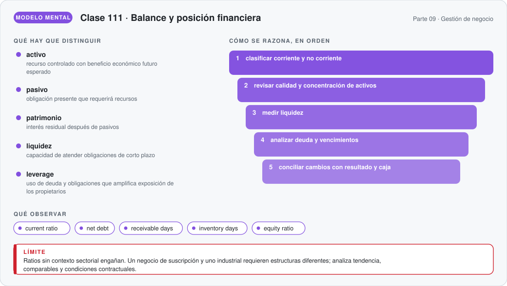

# Clase 111 — Balance y posición financiera

<!-- nav:inicio -->
> **Parte 09 · Finanzas y contabilidad para gerentes** — clase 3 de 12 · [índice de la parte](../../README.md) · [temario](../../../../SYLLABUS.md)
<!-- nav:fin -->

**Parte:** 09 — Finanzas y contabilidad para gerentes  
**Nivel:** Etapa 3 — Manager → Gerente  
**Duración sugerida:** 150–180 minutos · **Estándar:** deep-class-v2

## 🎯 Propósito

El estado de resultados cuenta una película; el balance es una fotografía. Muestra, en una fecha, qué recursos controla la empresa, con qué los financió y qué le queda a los dueños. De esa foto se lee algo que ninguna otra cifra muestra con tanta claridad: la **resistencia** de la empresa. ¿Puede pagar lo que vence? ¿Depende demasiado de la deuda? ¿Qué parte de sus activos son promesas de cobro o inventarios difíciles de vender? Muchas empresas rentables quiebran por falta de liquidez; otras sobreviven a años de pérdidas porque su balance es sólido.

La clase se apoya en el análisis de Palepu, Healy y Peek, en la contabilidad de Kieso, Weygandt y Warfield, en la teoría de estructura de capital de Brealey, Myers y Allen y en la guía de Ross, Westerfield y Jaffe. Al terminar sabrás leer un balance, distinguir liquidez de solvencia, calcular razones básicas, entender la calidad de los activos y reconocer los riesgos de una estructura financiera frágil.

## 📚 Resultados de aprendizaje

Al finalizar podrás:

1. **Leer** el balance por bloques: activos, pasivos y patrimonio.
2. **Distinguir** liquidez de solvencia y calcular razones básicas.
3. **Evaluar** la calidad de los activos y el perfil de vencimientos de los pasivos.
4. **Interpretar** la estructura de financiamiento y su riesgo.
5. **Anticipar** señales de tensión financiera antes de que se agote la caja.

## 🧭 Agenda

| Tramo | Qué se hace |
|---|---|
| 0–20 min | Recuperación: ¿qué pasaría en tu empresa si mañana un banco no renovara una línea de crédito? |
| 20–60 min | Activos, pasivos, patrimonio, liquidez y solvencia. |
| 60–105 min | Ejemplo trabajado: balance de una distribuidora con un vencimiento de deuda. |
| 105–150 min | Caso ejecutivo y práctica de razones. |
| 150–175 min | Límites y entregable. |

## 🧩 Conceptos centrales

| Concepto | Definición | Cómo se reconoce |
|---|---|---|
| **Activo corriente** | Recurso que se espera convertir en efectivo o usar en menos de un año. | Caja, cuentas por cobrar, inventario. |
| **Pasivo corriente** | Obligación que vence en menos de un año. | Proveedores, deuda de corto plazo. |
| **Liquidez** | Capacidad de pagar obligaciones de corto plazo. | Razón corriente, prueba ácida. |
| **Solvencia** | Capacidad de sostener la estructura de deuda a largo plazo. | Deuda sobre patrimonio, cobertura de intereses. |
| **Patrimonio** | Capital aportado más utilidades retenidas; activos menos pasivos. | Puede ser negativo. |
| **Apalancamiento financiero** | Uso de deuda para financiar activos. | Aumenta retorno y riesgo. |

## 🧠 Modelo mental

**Cómo leer el diagrama.** Tres columnas que se relacionan por la ecuación activos = pasivos + patrimonio. Los **activos** son lo que la empresa controla; la pregunta gerencial es cuánto valen realmente. Los **pasivos** son lo que debe; la pregunta es cuándo vencen y cuánto cuestan. El **patrimonio** es lo que queda para los dueños; la pregunta es si crece o se consume. Al leerlos juntos se ve si la estructura es sostenible.

## 📖 Desarrollo

### 1. Los activos y su calidad

Los activos se ordenan por liquidez. **Efectivo** y equivalentes son lo más líquido. **Cuentas por cobrar** dependen de que los clientes paguen, y su calidad se juzga por su antigüedad y concentración. El **inventario** depende de que se venda: un inventario antiguo o de baja rotación puede valer mucho menos que su valor en libros. Los **activos fijos** (equipos, edificios) se registran a costo menos depreciación y no se convierten en caja fácilmente. Los **intangibles** y el **menor valor de inversiones (goodwill)** dependen de supuestos que pueden no cumplirse. Un activo en libros no es necesariamente caja disponible.

### 2. Los pasivos y su perfil de vencimiento

Los pasivos se leen por **monto, costo y vencimiento**. Proveedores y gastos acumulados son de corto plazo y suelen no tener interés explícito; la deuda financiera tiene costo y condiciones (garantías, **covenants**, vencimientos). El **perfil de vencimientos** importa tanto como el nivel de deuda: una empresa con una deuda moderada que vence casi toda en un año puede estar en peor situación que otra con más deuda repartida en diez años. Los pasivos contingentes (litigios, garantías) y los compromisos fuera de balance también afectan el riesgo.

### 3. El patrimonio

El patrimonio es el residuo: activos menos pasivos. Crece con las utilidades que se retienen y con los aportes de capital, y disminuye con pérdidas y dividendos. Un patrimonio que se erosiona señala que la empresa consume valor; uno negativo indica que las deudas superan los activos registrados. Para los dueños, el patrimonio contable no es el valor de mercado de la empresa, que puede ser muy superior (marcas, tecnología) o inferior (activos sobrevalorados). Brealey, Myers y Allen subrayan que el valor depende de los flujos futuros, no de lo que se pagó por los activos en el pasado.

### 4. Liquidez

La liquidez responde: ¿puedo pagar lo que vence pronto? La **razón corriente** (activos corrientes / pasivos corrientes) y la **prueba ácida** (activos corrientes sin inventario / pasivos corrientes) son aproximaciones. Un valor sobre 1 indica que los activos de corto plazo cubren las obligaciones de corto plazo, pero depende de su calidad: cuentas por cobrar vencidas o inventario obsoleto inflan la razón. Más relevante que la razón es el **calendario de caja** proyectado (clase 112): qué entra y qué sale cada semana. Una empresa puede cumplir una razón sana y quedarse sin caja por una concentración de pagos.

### 5. Solvencia y estructura de capital

La solvencia responde: ¿la estructura es sostenible? Se miden razones como **deuda neta sobre EBITDA** (años de generación operativa para pagar la deuda neta), **deuda sobre patrimonio** y **cobertura de intereses** (resultado operacional / intereses). Ross, Westerfield y Jaffe y Brealey, Myers y Allen explican el **apalancamiento**: la deuda es más barata que el capital propio y aumenta el retorno cuando el negocio rinde más que su costo, pero también aumenta el riesgo, porque los intereses se pagan aun si las ventas caen. No existe una razón óptima universal: depende de la estabilidad del negocio y del acceso a financiamiento.

### 6. Compromisos y covenants

Muchos préstamos incluyen **covenants**: condiciones que la empresa debe cumplir (por ejemplo, mantener una razón de deuda neta sobre EBITDA bajo cierto valor). Su incumplimiento puede permitir al acreedor exigir el pago anticipado. Un gerente debe conocer los covenants de sus contratos, proyectarlos y avisar con anticipación si están en riesgo. Las decisiones de inversión, dividendos o recompras también pueden estar limitadas por ellos. Los detalles de cada contrato y sus consecuencias legales se verifican con los documentos y con asesoría jurídica.

### 7. Señales de tensión

Algunas señales tempranas: **cuentas por cobrar** que crecen más que las ventas; **inventario** que aumenta sin que suban las ventas; **proveedores** que se pagan cada vez más tarde; **deuda de corto plazo** usada para financiar activos de largo plazo; **uso creciente** de líneas de crédito; **patrimonio** que se erosiona; **covenants** ajustados. Ninguna prueba un problema por sí sola; en conjunto, anticipan un riesgo de liquidez. Palepu, Healy y Peek recomiendan relacionar el balance con el flujo de caja y la estrategia: ¿el crecimiento se está financiando de manera sostenible?

## 📚 Lectura comparada

| Obra | Qué aporta | Qué no resuelve | Pregunta para contrastar |
|---|---|---|---|
| Palepu, Healy y Peek | Análisis integrado de liquidez, solvencia y estrategia. | Marco general. | ¿Qué dice el balance de la estrategia? |
| Kieso, Weygandt y Warfield | Reglas de medición de activos y pasivos. | Se centra en preparación contable. | ¿Cómo se midió este activo? |
| Brealey, Myers y Allen | Estructura de capital y riesgo. | Teoría con supuestos. | ¿Cuánta deuda soporta el negocio? |
| Ross, Westerfield y Jaffe | Razones financieras y apalancamiento. | Es un texto de finanzas corporativas. | ¿Qué razón es relevante para este rubro? |
| Penman | Separar activos operativos y financieros. | Más técnico. | ¿Qué parte de los activos es operativa? |

## 🧮 Ejemplo trabajado

**Situación (hipotética).** Una distribuidora de materiales de construcción presenta este balance (USD miles).

| Activos | Monto | Pasivos y patrimonio | Monto |
|---|---|---|---|
| Efectivo | 400 | Proveedores | 2.200 |
| Cuentas por cobrar | 3.800 | Deuda bancaria (vence en 8 meses) | 3.000 |
| Inventario | 4.200 | Otros pasivos corrientes | 600 |
| **Activo corriente** | **8.400** | **Pasivo corriente** | **5.800** |
| Equipos y bodegas | 3.600 | Deuda bancaria de largo plazo | 2.000 |
| | | Patrimonio | 4.200 |
| **Total** | **12.000** | **Total** | **12.000** |

**Razones.** Razón corriente: 8.400 / 5.800 = 1,45. Prueba ácida: (8.400 − 4.200) / 5.800 = 0,72. Deuda total sobre patrimonio: 5.000 / 4.200 = 1,19. Si el EBITDA anual es de 1.800, la deuda neta (5.000 − 400 = 4.600) equivale a 2,6 veces el EBITDA.

**Lectura.** La razón corriente parece cómoda, pero 4.200 son inventario y la prueba ácida es de 0,72. Las cuentas por cobrar equivalen a un 40 % de las ventas anuales de unos USD 9,5 millones (cerca de 146 días), un plazo largo. En ocho meses vence una deuda de 3.000 y la caja es de 400.

**Escenarios.** (a) Si se renueva, la empresa sigue; (b) si el banco no renueva y el covenant de deuda neta sobre EBITDA de 3,0 se ajusta, hay riesgo. (c) Reducir cuentas por cobrar de 146 a 100 días libera unos USD 1,2 millones; reducir 15 % el inventario libera 630.

**Decisiones.** Negociar la renovación con anticipación mostrando un plan de capital de trabajo; mejorar cobranza y rotación de inventario; evitar pagar dividendos hasta refinanciar; proyectar caja semanal por ocho meses.

**Qué muestra.** (1) La razón corriente ocultaba un problema de calidad de activos. (2) El perfil de vencimientos importaba más que el nivel de deuda. (3) El plan se enfocó en liberar caja antes de la fecha crítica.

## 🔀 Comparación y límites

**Liquidez frente a solvencia.** Una empresa solvente puede tener problemas de liquidez en el corto plazo (activos valiosos pero poco líquidos), y una líquida puede ser insolvente (caja prestada que supera lo que produce). Los dos riesgos se manejan con herramientas distintas.

**Límites.** El balance usa valores contables que pueden diferir del valor de mercado. Es una foto en una fecha: puede incluir operaciones de «maquillaje» al cierre (por ejemplo, retrasar pagos o acelerar cobros). Las razones no tienen un valor universalmente correcto y se comparan con el rubro. Los covenants y garantías se leen en los contratos. Y los análisis de insolvencia o reestructuración tienen consecuencias legales que requieren asesoría especializada y la normativa vigente.

## 🪜 De profesional a owner

| Nivel | Cómo usa el balance |
|---|---|
| **Profesional** | Entiende cómo sus decisiones afectan inventario, cobranza y pagos. |
| **Jefe / Team Lead** | Cuida su capital de trabajo (inventario, cobros) y avisa de tensiones. |
| **Gerente** | Lee liquidez y solvencia, proyecta caja y covenants. |
| **CEO / Director** | Decide la estructura de capital y los márgenes de seguridad. |
| **Founder / Owner** | Evita crecer más rápido de lo que su balance puede financiar. |

## 🏢 Caso ejecutivo

Una empresa de agroindustria creció 60 % en dos años financiando bodegas y maquinaria con deuda de corto plazo renovable. Las cuentas por cobrar pasaron de 55 a 95 días, el inventario creció 40 %, y los proveedores se pagan a 110 días en promedio (antes 60). Su razón corriente es 1,3, pero su prueba ácida es 0,6. Un banco informa que revisará las líneas de crédito en cuatro meses y que un covenant de deuda neta sobre EBITDA de 3,5 podría ajustarse a 3,0. El EBITDA bajó 12 % este año por precios de materias primas. El directorio quiere seguir expandiéndose.

Entrega un **diagnóstico de posición financiera** que contenga: (a) la lectura del balance por bloques y la calidad de los activos; (b) razones de liquidez y solvencia y su proyección con los cambios previstos; (c) el perfil de vencimientos y el riesgo de covenants; (d) las señales de tensión identificadas; (e) un plan de 120 días para fortalecer el balance con acciones concretas y su efecto en caja; (f) la recomendación al directorio sobre la expansión y las verificaciones jurídicas de los contratos de deuda.

## 🧪 Práctica

1. Calcula razón corriente, prueba ácida y deuda neta sobre EBITDA para un balance.
2. Evalúa la antigüedad de las cuentas por cobrar y la rotación de inventario.
3. Construye el perfil de vencimientos de deuda de los próximos 24 meses.
4. Identifica tres señales de tensión y cómo las seguirías.
5. Propón dos acciones para liberar caja y estima su efecto.

## ⚠️ Errores frecuentes

| Error | Por qué ocurre | Cómo corregirlo |
|---|---|---|
| Confiar en la razón corriente | Parece suficiente | Evaluar calidad de activos y prueba ácida. |
| Mirar el nivel de deuda sin el vencimiento | Se ignora el calendario | Perfil de vencimientos. |
| Financiar largo plazo con corto plazo | Es más barato o más fácil | Calzar plazos. |
| Ignorar covenants | Están en un contrato archivado | Proyectarlos y monitorearlos. |
| Confundir patrimonio con valor | Es una cifra contable | Distinguir valor contable y económico. |
| No relacionar balance con caja | Se leen por separado | Proyectar el flujo. |

## ❓ Preguntas de comprobación

1. ¿Qué responde cada bloque del balance?
2. ¿Qué diferencia hay entre liquidez y solvencia?
3. ¿Por qué la razón corriente puede engañar?
4. ¿Por qué importa el perfil de vencimientos?
5. ¿Qué es un covenant?
6. ¿Cuál es el efecto del apalancamiento?
7. ¿Qué señales anticipan tensión de liquidez?

Claves de respuesta

1. Los activos, qué controla la empresa y cuánto valen; los pasivos, qué debe, cuándo vence y cuánto cuesta; el patrimonio, lo que queda a los dueños.
2. La liquidez es pagar lo que vence pronto; la solvencia es sostener la estructura de deuda a largo plazo.
3. Porque incluye activos de baja calidad (cuentas vencidas, inventario obsoleto) que no se convierten en caja.
4. Porque una deuda moderada que vence toda en un año puede ser más riesgosa que una mayor repartida en el tiempo.
5. Una condición de un contrato de deuda que la empresa debe cumplir; su incumplimiento puede llevar al pago anticipado.
6. Aumenta el retorno si el negocio rinde más que el costo de la deuda, y aumenta el riesgo porque los intereses se pagan aunque caigan las ventas.
7. Cuentas por cobrar e inventario que crecen más que las ventas, pagos a proveedores cada vez más tarde, deuda corta para activos largos, uso creciente de líneas y covenants ajustados.

## 📥 Entregable

Guarda en `portfolio/111-balance-y-posicion-financiera/`:

- `modelo-financiero-y-memo-de-decision.md` (plantilla [Modelo financiero y memo de decisión](../../../../templates/modelo-financiero-y-memo-de-decision.md)) con el diagnóstico del caso ejecutivo;
- `cash-runway.md` (plantilla [Cash runway](../../../../templates/cash-runway.md)) con la proyección de caja de 120 días;
- `decision-journal.md` con las razones, los vencimientos y los covenants.

## 📗 Fuentes y verificación

- Krishna G. Palepu, Paul M. Healy & Erik Peek — *Business Analysis and Valuation* (South-Western College Pub, 1996). **Uso en esta clase:** análisis integrado de liquidez, solvencia y estrategia. Lectura selectiva sobre **balance y posición financiera**. **Localizador:** [ISBN-13 9780324375817](https://openlibrary.org/isbn/9780324375817).
- Donald E. Kieso, Jerry J. Weygandt & Terry D. Warfield — *Intermediate Accounting* (John Wiley & Sons, Incorporated, 2006). **Uso en esta clase:** reglas de medición de activos y pasivos. Lectura selectiva sobre **balance y posición financiera**. **Localizador:** [ISBN-13 9780470098189](https://openlibrary.org/isbn/9780470098189).
- Richard Brealey, Stewart Myers & Franklin Allen — *Principles of Corporate Finance* (McGraw-Hill International Book Co, 1984). **Uso en esta clase:** estructura de capital y riesgo. Lectura selectiva sobre **balance y posición financiera**. **Localizador:** [ISBN-13 9780070662025](https://openlibrary.org/isbn/9780070662025).
- Stephen Ross, Randolph Westerfield et al. — *Corporate Finance* (McGraw-Hill Education, 2018). **Uso en esta clase:** razones financieras y apalancamiento. Lectura selectiva sobre **balance y posición financiera**. **Localizador:** [ISBN-13 9781259918940](https://openlibrary.org/isbn/9781259918940).
- Stephen H. Penman — *Financial Statement Analysis and Security Valuation* (McGraw-Hill/Irwin, 2001). **Uso en esta clase:** separar activos operativos y financieros. Lectura selectiva sobre **balance y posición financiera**. **Localizador:** [ISBN-13 9780072903331](https://openlibrary.org/isbn/9780072903331).

> **Regla de fuentes para Balance y posición financiera:** las obras anteriores estructuran las perspectivas de esta materia; cualquier norma, ley o estándar vivo mencionado debe comprobarse nuevamente en su fuente primaria vigente, incluidos los contratos de deuda y la normativa concursal aplicable. Los ejemplos y casos son hipotéticos, con cifras ilustrativas. El desarrollo es original y no reproduce capítulos protegidos.

<!-- pie:inicio -->
---

| Anterior | Índice | Siguiente |
|---|---|---|
| [← 110 · Estado de resultados](../110-estado-de-resultados/README.md) | [Parte 09](../../README.md) · [Programa](../../../../SYLLABUS.md) | [112 · Flujo de caja →](../112-flujo-de-caja/README.md) |
<!-- pie:fin -->
