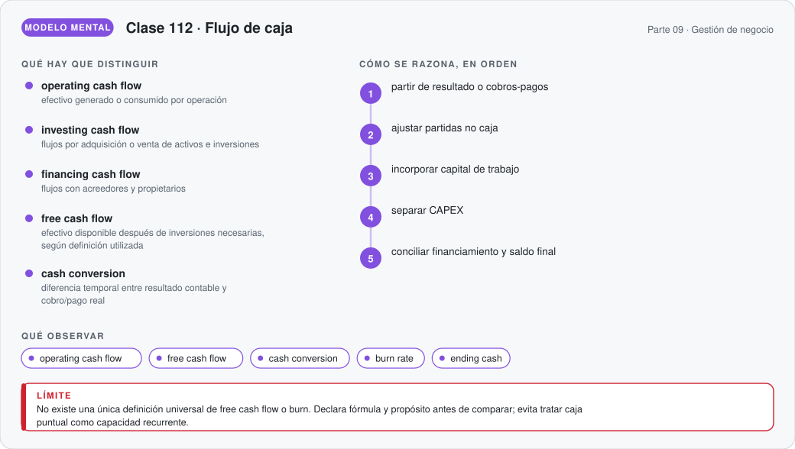

# Clase 112 — Flujo de caja

<!-- nav:inicio -->
> **Parte 09 · Finanzas y contabilidad para gerentes** — clase 4 de 12 · [índice de la parte](../../README.md) · [temario](../../../../SYLLABUS.md)
<!-- nav:fin -->

**Parte:** 09 — Finanzas y contabilidad para gerentes  
**Nivel:** Etapa 3 — Manager → Gerente  
**Duración sugerida:** 150–180 minutos · **Estándar:** deep-class-v2

## 🎯 Propósito

Las empresas no quiebran por tener pérdidas: quiebran porque no pueden pagar lo que deben el día en que vence. La utilidad es una opinión contable; la caja es un hecho. Por eso el flujo de caja es la información más cercana a la supervivencia, y gestionarlo exige dos miradas: la **retrospectiva** (por qué cambió la caja en el período) y la **prospectiva** (cuánta caja habrá en las próximas semanas y meses, y qué tan sensible es a lo que no controlamos).

La clase se apoya en el estado de flujo de efectivo según Palepu, Healy y Peek y Penman, en la teoría de flujos libres de Brealey, Myers y Allen y en la lógica de planificación financiera de Ross, Westerfield y Jaffe. Al terminar sabrás explicar la diferencia entre utilidad y caja, leer los tres flujos (operación, inversión y financiamiento), calcular el flujo de caja libre y construir un calendario de caja de corto plazo con escenarios.

## 📚 Resultados de aprendizaje

Al finalizar podrás:

1. **Explicar** por qué utilidad y caja divergen y construir el puente entre ambas.
2. **Leer** los flujos de operación, inversión y financiamiento.
3. **Calcular** el flujo de caja libre y entender qué mide.
4. **Proyectar** el calendario de caja a 13 semanas con escenarios.
5. **Definir** el margen de seguridad de liquidez y las acciones de respuesta.

## 🧭 Agenda

| Tramo | Qué se hace |
|---|---|
| 0–20 min | Recuperación: ¿cuántas semanas de pagos cubre hoy la caja de tu empresa o de tu hogar sin nuevos ingresos? |
| 20–60 min | Puente utilidad–caja, flujos y calendario. |
| 60–105 min | Ejemplo trabajado: una empresa que crece con utilidades y se queda sin caja. |
| 105–150 min | Caso ejecutivo y práctica de proyección. |
| 150–175 min | Límites y entregable. |

## 🧩 Conceptos centrales

| Concepto | Definición | Cómo se reconoce |
|---|---|---|
| **Flujo operativo** | Caja generada o consumida por la actividad principal. | Utilidad ajustada por partidas no monetarias y capital de trabajo. |
| **Flujo de inversión** | Caja usada o recibida por compra o venta de activos de largo plazo. | Compra de equipos, adquisiciones. |
| **Flujo de financiamiento** | Caja de préstamos, aportes y pagos a acreedores y dueños. | Deuda nueva, pagos de capital, dividendos. |
| **Flujo de caja libre** | Caja operativa menos inversiones necesarias para sostener el negocio. | Lo que queda para acreedores y dueños. |
| **Calendario de caja** | Proyección de entradas y salidas por semana. | Muestra el saldo mínimo y cuándo ocurre. |
| **Colchón de liquidez** | Caja o líneas disponibles que protegen ante imprevistos. | Se mide en semanas de gastos. |

## 🧠 Modelo mental

**Cómo leer el diagrama.** Una tabla que parte de la **utilidad neta** y llega al **flujo de caja operativo** con ajustes. Se **suma** la depreciación porque no sale caja. Se **resta** el aumento de cuentas por cobrar y de inventario, porque la empresa vendió o compró sin que el efectivo se moviera todavía. Se **suma** el aumento de cuentas por pagar, que financia la operación. La nota señala el efecto más peligroso: una empresa que crece rápido consume caja en capital de trabajo aunque tenga utilidades.

## 📖 Desarrollo

### 1. Por qué la caja manda

Una empresa con utilidad pero sin caja no puede pagar sueldos, proveedores ni impuestos; una con pérdidas pero con caja puede sobrevivir años. Brealey, Myers y Allen definen el valor de una empresa como el valor presente de sus flujos de caja futuros, no de sus utilidades contables: son los flujos los que pagan a acreedores y accionistas. Para el gerente, esto significa que cada decisión (plazos, inventarios, inversiones, descuentos) debe evaluarse también por su efecto en la caja y en su calendario.

### 2. El puente de la utilidad a la caja

El método indirecto parte de la utilidad neta y la corrige: **suma** gastos que no son salida de caja (depreciación, amortización, provisiones) y **ajusta por el cambio en el capital de trabajo operativo**. Si las cuentas por cobrar suben, la empresa vendió pero no cobró: resta caja. Si el inventario sube, compró o produjo sin vender: resta caja. Si las cuentas por pagar suben, financió con proveedores: suma caja. El resultado es el **flujo de caja operativo**. Palepu, Healy y Peek recomiendan compararlo con la utilidad: una brecha persistente invita a investigar la calidad del resultado.

### 3. Operación, inversión y financiamiento

El estado de flujo de efectivo clasifica el movimiento de caja en tres actividades. **Operación**: lo que genera el negocio. **Inversión**: compra y venta de activos de largo plazo, adquisiciones y colocaciones. **Financiamiento**: préstamos nuevos y pagos, aportes de capital, dividendos. Una empresa sana típicamente genera caja operativa positiva, invierte para sostener o crecer y ajusta el financiamiento en consecuencia. Una combinación peligrosa es **operación negativa financiada con deuda**: se consume caja del negocio con préstamos, lo que no es sostenible salvo en una etapa de crecimiento con fuente de capital asegurada.

### 4. Flujo de caja libre

El **flujo de caja libre** es la caja operativa menos las inversiones necesarias para mantener y hacer crecer el negocio (inversión en activos fijos y, a veces, en capital de trabajo). Representa la caja que la empresa podría distribuir a acreedores y dueños sin dañar su operación. Es la base de la valoración por flujos descontados (clase 119). Hay variantes —libre para la empresa (antes de intereses) y libre para el accionista (después)— y la elección debe ser consistente con la tasa de descuento. Un flujo libre negativo no es malo por sí mismo si financia crecimiento rentable.

### 5. El calendario de caja de corto plazo

La proyección de 13 semanas es una herramienta de supervivencia. Se construye con: **saldo inicial**; **entradas** por cobranza proyectada (por antigüedad de las cuentas, no por fecha de facturación); **salidas**: sueldos, proveedores, impuestos, arriendos, servicio de deuda, inversiones comprometidas; y **saldo final** de cada semana. Se identifica el **saldo mínimo** y la semana en que ocurre. Se actualiza semanalmente comparando lo proyectado con lo real: las diferencias enseñan dónde se equivocan los supuestos de cobranza o de pagos.

### 6. Escenarios y margen de seguridad

Se construyen al menos tres escenarios: **base**, **adverso** (por ejemplo, cobranza 15 días más lenta y ventas 10 % menores) y **severo** (un cliente grande que no paga). Para cada uno, se calcula el saldo mínimo y se define qué acciones se activarían: acelerar cobranza, diferir inversiones, negociar plazos con proveedores, activar líneas de crédito. El **colchón de liquidez** se expresa en semanas de gasto operativo; la cifra apropiada depende de la volatilidad del negocio y del acceso a financiamiento. Conviene definir **disparadores**: si la caja cae bajo X semanas, se activan acciones preparadas.

### 7. Las palancas de la caja

Las palancas más rápidas están en el capital de trabajo: **cobrar antes** (facturación oportuna, cobranza activa, incentivos por pronto pago), **pagar a plazos razonables** sin dañar relaciones críticas, **reducir inventario** y **vender lo que no rota**. Otras: renegociar precios, diferir inversiones no críticas, vender activos no estratégicos y alterar la estructura de deuda. Cada palanca tiene costos (descuentos, pérdida de crédito de proveedores, riesgos operativos) que se evalúan. Una regla de prudencia: no depender de una sola palanca ni de que el próximo trimestre «mejore».

## 📚 Lectura comparada

| Obra | Qué aporta | Qué no resuelve | Pregunta para contrastar |
|---|---|---|---|
| Palepu, Healy y Peek | Lectura del flujo y comparación con la utilidad. | Marco de análisis, no de planificación. | ¿La utilidad se convierte en caja? |
| Penman | Separar flujos operativos de financieros. | Más técnico. | ¿Qué flujo es sostenible? |
| Brealey, Myers y Allen | El valor como flujos futuros descontados. | Teoría con supuestos. | ¿Qué flujo libre genera el negocio? |
| Ross, Westerfield y Jaffe | Planificación financiera y capital de trabajo. | Orientado a grandes empresas. | ¿Cuántas semanas de caja hay? |
| Schilit et al. | Señales de que la utilidad no se convierte en caja. | Catálogo de alertas. | ¿Por qué divergen utilidad y caja? |

## 🧮 Ejemplo trabajado

**Situación (hipotética).** Una empresa de equipamiento médico crece 50 % en el año. Cifras anuales (USD miles).

| Partida | Año anterior | Año actual |
|---|---|---|
| Ventas | 8.000 | 12.000 |
| Utilidad neta | 640 | 1.000 |
| Depreciación | 200 | 260 |
| Cuentas por cobrar (final) | 1.200 | 2.400 |
| Inventario (final) | 1.000 | 2.200 |
| Cuentas por pagar (final) | 800 | 1.100 |

**Puente utilidad–caja del año actual.**

| Concepto | USD miles |
|---|---|
| Utilidad neta | 1.000 |
| + Depreciación | 260 |
| − Aumento de cuentas por cobrar (2.400 − 1.200) | −1.200 |
| − Aumento de inventario (2.200 − 1.000) | −1.200 |
| + Aumento de cuentas por pagar (1.100 − 800) | +300 |
| **Flujo de caja operativo** | **−840** |

**Lectura.** Con una utilidad de 1.000, la operación consumió 840 de caja. Si además se invirtieron 500 en equipos, la necesidad de financiamiento fue de 1.340. Los días de cobro subieron de 55 a 73 (2.400 / 12.000 × 365) y los de inventario crecieron en proporción.

**Calendario de 13 semanas.** Con caja inicial de 600, salidas semanales de 190 y cobranzas lentas, el saldo mínimo proyectado en la semana 7 es de −120 en el escenario adverso. Acciones preparadas: acelerar cobranza de tres clientes que concentran 40 % de las cuentas por cobrar, diferir una compra de equipos y activar una línea de crédito de 400 (con costo).

**Decisión.** Antes de aprobar un nuevo crecimiento de 30 %, se exige un plan de financiamiento del capital de trabajo adicional: unas USD 1.700 en cuentas por cobrar e inventario. Se evalúan alternativas: factoring de cuentas por cobrar, línea de crédito o aporte de capital.

**Qué muestra.** (1) Crecer con utilidades consumió caja. (2) El calendario de corto plazo anticipó la semana crítica. (3) Las acciones estaban definidas antes de necesitarlas.

## 🔀 Comparación y límites

**Flujo de caja frente a EBITDA.** El EBITDA aproxima la caja operativa antes de capital de trabajo, impuestos e inversiones; no es caja. Confundirlos lleva a subestimar las necesidades de financiamiento.

**Límites.** Las proyecciones de caja dependen de supuestos de cobranza y de ventas que se equivocan; se actualizan y se contrastan. El método indirecto oculta la composición de cobros y pagos. Los flujos de un período pueden estar afectados por operaciones puntuales de fin de año (por ejemplo, adelantar cobros). Las obligaciones tributarias, laborales y de deuda tienen fechas y consecuencias legales que se verifican en la normativa y los contratos.

## 🪜 De profesional a owner

| Nivel | Cómo participa en la gestión de caja |
|---|---|
| **Profesional** | Factura a tiempo, documenta entregas y avisa de retrasos que afecten cobros. |
| **Jefe / Team Lead** | Gestiona inventario, compras o cobranza de su equipo. |
| **Gerente** | Lee el calendario de caja y activa las palancas. |
| **CEO / Director** | Fija el colchón y los disparadores y decide el financiamiento. |
| **Founder / Owner** | Mira la caja semanal y la trata como indicador de supervivencia. |

## 🏢 Caso ejecutivo

Una empresa de tecnología educativa vende licencias anuales a colegios, con facturación en marzo y cobranza entre abril y julio. Sus gastos son uniformes durante el año. Tras tres años de crecimiento, el año pasado tuvo una utilidad de USD 900.000, pero en septiembre la caja llegó a USD 50.000 y debió retrasar pagos a proveedores. Este año planea contratar 20 personas y lanzar un producto nuevo, con inversión de USD 700.000. Un colegio grande, que representa el 15 % de las ventas, informa que pagará en octubre en lugar de junio. El banco ofrece una línea de crédito a 12 meses con covenants de liquidez.

Entrega un **plan de gestión de caja** con: (a) el puente utilidad–caja del año pasado y la explicación de la estacionalidad; (b) el calendario de 13 semanas y de 12 meses con tres escenarios; (c) el saldo mínimo y las semanas críticas; (d) las palancas de caja con su costo y su efecto; (e) la decisión sobre la contratación y el producto nuevo con condiciones; (f) los covenants a verificar en el contrato de crédito y la asesoría necesaria.

## 🧪 Práctica

1. Construye el puente de utilidad a caja operativa con datos de un caso.
2. Calcula el flujo de caja libre y compáralo con la utilidad.
3. Arma un calendario de caja de 13 semanas con saldo inicial, entradas y salidas.
4. Define un escenario adverso y las acciones que activarías.
5. Calcula el colchón de liquidez en semanas de gasto operativo.

## ⚠️ Errores frecuentes

| Error | Por qué ocurre | Cómo corregirlo |
|---|---|---|
| Confundir utilidad con caja | Se mira el estado de resultados | Leer el flujo de caja. |
| No proyectar | Se confía en el saldo actual | Calendario de 13 semanas. |
| Un solo escenario | Se asume lo mejor | Base, adverso y severo. |
| Proyectar la cobranza por facturación | Se ignora el comportamiento de pago | Proyectar por antigüedad real. |
| Crecer sin financiar el capital de trabajo | Se piensa en ventas | Calcular la necesidad adicional. |
| Reaccionar tarde | Se espera a quedarse sin caja | Disparadores y acciones preparadas. |

## ❓ Preguntas de comprobación

1. ¿Por qué utilidad y caja pueden divergir?
2. ¿Qué ajustes separan la utilidad del flujo operativo?
3. ¿Qué mide el flujo de caja libre?
4. ¿Qué compone un calendario de caja de 13 semanas?
5. ¿Por qué se usan escenarios?
6. ¿Qué es un colchón de liquidez?
7. ¿Qué palancas rápidas existen sobre la caja?

Claves de respuesta

1. Porque hay ingresos no cobrados, gastos no pagados, gastos sin salida de caja, y movimientos de inversión y financiamiento que no pasan por resultados.
2. Se suma la depreciación y se ajusta por el cambio en cuentas por cobrar, inventario y cuentas por pagar.
3. La caja operativa que queda tras las inversiones necesarias, disponible para acreedores y dueños.
4. Saldo inicial, entradas por cobranza proyectada, salidas por sueldos, proveedores, impuestos, deuda e inversiones y saldo final semanal.
5. Porque los supuestos fallan y se necesita saber qué ocurre y qué acciones activar en situaciones adversas.
6. Caja o líneas disponibles que protegen ante imprevistos, medida en semanas de gasto operativo.
7. Cobrar antes, negociar plazos de pago, reducir inventario, diferir inversiones, vender activos no estratégicos y ajustar el financiamiento.

## 📥 Entregable

Guarda en `portfolio/112-flujo-de-caja/`:

- `cash-runway.md` (plantilla [Cash runway](../../../../templates/cash-runway.md)) con el calendario de caja y los escenarios del caso ejecutivo;
- `modelo-financiero-y-memo-de-decision.md` (plantilla [Modelo financiero y memo de decisión](../../../../templates/modelo-financiero-y-memo-de-decision.md)) con el puente utilidad–caja y la decisión sobre la inversión;
- `decision-journal.md` con los disparadores y las acciones preparadas.

## 📗 Fuentes y verificación

- Krishna G. Palepu, Paul M. Healy & Erik Peek — *Business Analysis and Valuation* (South-Western College Pub, 1996). **Uso en esta clase:** lectura del flujo de efectivo y comparación con la utilidad. Lectura selectiva sobre **flujo de caja**. **Localizador:** [ISBN-13 9780324375817](https://openlibrary.org/isbn/9780324375817).
- Stephen H. Penman — *Financial Statement Analysis and Security Valuation* (McGraw-Hill/Irwin, 2001). **Uso en esta clase:** separar flujos operativos y financieros. Lectura selectiva sobre **flujo de caja**. **Localizador:** [ISBN-13 9780072903331](https://openlibrary.org/isbn/9780072903331).
- Richard Brealey, Stewart Myers & Franklin Allen — *Principles of Corporate Finance* (McGraw-Hill International Book Co, 1984). **Uso en esta clase:** el valor como flujos futuros descontados. Lectura selectiva sobre **flujo de caja**. **Localizador:** [ISBN-13 9780070662025](https://openlibrary.org/isbn/9780070662025).
- Stephen Ross, Randolph Westerfield et al. — *Corporate Finance* (McGraw-Hill Education, 2018). **Uso en esta clase:** planificación financiera y capital de trabajo. Lectura selectiva sobre **flujo de caja**. **Localizador:** [ISBN-13 9781259918940](https://openlibrary.org/isbn/9781259918940).
- Howard Schilit, Jeremy Perler & Yoni Engelhart — *Financial Shenanigans* (McGraw-Hill Education on Brilliance Audio, 2018). **Uso en esta clase:** señales de que la utilidad no se convierte en caja. Lectura selectiva sobre **flujo de caja**. **Localizador:** [ISBN-13 9781978605459](https://openlibrary.org/isbn/9781978605459).

> **Regla de fuentes para Flujo de caja:** las obras anteriores estructuran las perspectivas de esta materia; cualquier norma, ley o estándar vivo mencionado debe comprobarse nuevamente en su fuente primaria vigente, incluidas las obligaciones tributarias y los contratos de deuda. Los ejemplos y casos son hipotéticos, con cifras ilustrativas. El desarrollo es original y no reproduce capítulos protegidos.

<!-- pie:inicio -->
---

| Anterior | Índice | Siguiente |
|---|---|---|
| [← 111 · Balance y posición financiera](../111-balance-y-posicion-financiera/README.md) | [Parte 09](../../README.md) · [Programa](../../../../SYLLABUS.md) | [113 · Margen bruto, operacional y contribución →](../113-margen-bruto-operacional-y-contribucion/README.md) |
<!-- pie:fin -->
