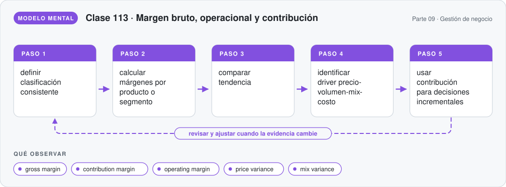

# Clase 113 — Margen bruto, operacional y contribución

<!-- nav:inicio -->
> **Parte 09 · Finanzas y contabilidad para gerentes** — clase 5 de 12 · [índice de la parte](../../README.md) · [temario](../../../../SYLLABUS.md)
<!-- nav:fin -->

**Parte:** 09 — Finanzas y contabilidad para gerentes  
**Nivel:** Etapa 3 — Manager → Gerente  
**Duración sugerida:** 150–180 minutos · **Estándar:** deep-class-v2

## 🎯 Propósito

«El margen» no existe: existen varios márgenes, y cada uno responde una pregunta diferente. Cuando un gerente comercial habla de margen pensando en el **bruto**, el financiero en el **operacional** y el de operaciones en el de **contribución**, la conversación termina en un desacuerdo que no es de fondo sino de definición. Elegir el margen correcto para una decisión es tan importante como calcularlo bien: para evaluar un descuento se usa el margen de contribución; para evaluar un producto, el bruto y su asignación de costos; para evaluar la organización, el operacional.

La clase se apoya en la contabilidad de costos de Horngren y colegas, en la crítica de Kaplan y Cooper a la asignación tradicional de costos indirectos y en la lectura de márgenes de Palepu, Healy y Peek. Al terminar sabrás calcular y distinguir los cuatro márgenes, elegir el adecuado para cada decisión, evitar los errores típicos de la asignación de costos fijos y analizar la rentabilidad por producto, cliente y canal.

## 📚 Resultados de aprendizaje

Al finalizar podrás:

1. **Calcular** margen bruto, de contribución, operacional y neto.
2. **Elegir** el margen apropiado para cada tipo de decisión.
3. **Analizar** rentabilidad por producto, cliente o canal.
4. **Reconocer** los efectos de asignar costos indirectos de forma arbitraria.
5. **Evaluar** el efecto de precio, volumen y mezcla sobre el margen.

## 🧭 Agenda

| Tramo | Qué se hace |
|---|---|
| 0–20 min | Recuperación: ¿cuál es «el margen» que se usa en tu empresa y cómo se define? |
| 20–60 min | Cuatro márgenes, decisiones, asignación de costos y mezcla. |
| 60–105 min | Ejemplo trabajado: decidir si aceptar un pedido con descuento. |
| 105–150 min | Caso ejecutivo y práctica por cliente. |
| 150–175 min | Límites y entregable. |

## 🧩 Conceptos centrales

| Concepto | Definición | Cómo se reconoce |
|---|---|---|
| **Margen bruto** | (Ingresos − costo de ventas) / ingresos. | Rentabilidad del producto antes de la operación. |
| **Margen de contribución** | (Ingresos − costos variables) / ingresos. | Lo que cada venta aporta a cubrir costos fijos. |
| **Margen operacional** | Resultado operacional / ingresos. | Rentabilidad del negocio tras gastos operativos. |
| **Margen neto** | Utilidad neta / ingresos. | Lo que queda a los dueños. |
| **Costo directo** | Costo que se asigna a un producto o cliente sin ambigüedad. | Materiales, comisión de venta. |
| **Costo indirecto (overhead)** | Costo compartido que debe asignarse con un criterio. | Arriendo de planta, administración. |

## 🧠 Modelo mental

**Cómo leer el diagrama.** Cuatro peldaños; cada uno descuenta más costos. El **bruto** responde si el producto deja margen. El de **contribución** indica cuánto aporta cada venta a cubrir los costos fijos y orienta decisiones marginales como un descuento o un pedido especial. El **operacional** evalúa el negocio con su estructura de gastos. El **neto** muestra lo que queda para los dueños. Cada decisión pide un peldaño distinto, y confundirlos produce decisiones erradas.

## 📖 Desarrollo

### 1. Cuatro márgenes, cuatro preguntas

El **margen bruto** (ingresos menos costo de ventas) mide la rentabilidad del producto o servicio antes de los gastos de operar. El **margen de contribución** (ingresos menos todos los costos variables, incluidos los de venta y distribución) mide cuánto aporta cada venta para cubrir los costos fijos y generar utilidad. El **margen operacional** descuenta los gastos operativos y evalúa el negocio. El **margen neto** descuenta intereses e impuestos. Se calculan en porcentaje y en valor absoluto; ambos importan: un margen alto sobre pocas ventas puede producir menos dinero que uno bajo sobre muchas.

### 2. Costos variables, fijos y la contribución

Los costos **variables** cambian con el volumen (materiales, comisiones, fletes); los **fijos** no cambian en el corto plazo (arriendos, sueldos base). El margen de contribución reconoce esa diferencia y permite decisiones **marginales**: ¿conviene aceptar un pedido adicional a un precio menor si la capacidad está disponible? Si el precio supera el costo variable, el pedido aporta a cubrir costos fijos que ya existen. Pero un precio bajo repetido deteriora la estructura de precios y la expectativa de clientes, y puede no ser sostenible si la capacidad se necesita para pedidos mejores.

### 3. Asignación de costos indirectos

Para calcular la rentabilidad por producto o cliente, hay que asignar costos compartidos. Horngren y colegas describen criterios (horas de mano de obra, horas máquina, ventas) y sus límites. Kaplan y Cooper critican que la asignación tradicional distribuye los indirectos según el volumen y distorsiona los costos: productos de bajo volumen y alta complejidad consumen muchos recursos de apoyo que no se les asignan, y subsidian los de alto volumen; propusieron el **costeo basado en actividades**, que asigna según los **generadores de costo** reales (número de pedidos, cambios de producción, atención al cliente). Es más preciso pero más costoso de mantener.

### 4. Rentabilidad por producto, cliente y canal

Con costos adecuados se pueden analizar márgenes por **producto** (qué vender), por **cliente** (a quién y cómo servir) y por **canal** (dónde). Hallazgos habituales: una parte pequeña de los clientes genera la mayor parte de la utilidad, y otra porción genera pérdida al incluir los costos de servirla (entregas especiales, soporte, descuentos). El análisis conduce a decisiones: ajustar precios, cambiar condiciones, reducir la complejidad, cambiar el modelo de servicio o, en casos extremos, dejar de servir. Kaplan y Cooper describen estas curvas de rentabilidad acumulada de clientes.

### 5. Precio, volumen y mezcla

Una variación del margen total puede explicarse por tres factores: **precio** (se vendió más caro o más barato), **volumen** (se vendió más o menos) y **mezcla** (se vendió más de los productos de alto o bajo margen). El margen porcentual de la empresa puede caer aunque cada producto mantenga su margen, si la mezcla se desplaza hacia productos de menor margen. Por eso un comité debe pedir la descomposición: si el margen cayó por mezcla, el remedio es distinto que si cayó por precio o por costo.

### 6. Descuentos y su costo real

Un descuento reduce el margen en una proporción mayor de lo que parece. Si el margen de contribución es del 30 % y se da un descuento del 10 % sin cambiar el costo, el margen de contribución cae a 22,2 % ((90 − 70) / 90) y para mantener el aporte total hay que vender un 50 % más de volumen (porque cada unidad aporta 20 en lugar de 30). Las decisiones de descuento deben evaluarse con la **elasticidad esperada** (cuánto volumen adicional generan) y con sus efectos en la percepción de precio y en otros clientes.

### 7. Márgenes y estrategia

Los márgenes reflejan la estrategia: precio premium con costos altos, liderazgo en costos con márgenes bajos y volumen alto, nichos especializados. Comparar con competidores exige entender el modelo de negocio, no solo la cifra. Un margen alto puede estar sosteniendo una estructura ineficiente; uno bajo puede ser parte de un modelo de alto volumen y capital de trabajo eficiente. La pregunta clave es si el margen es **sostenible** frente a la competencia y si compensa el capital y el riesgo (clase 118).

## 📚 Lectura comparada

| Obra | Qué aporta | Qué no resuelve | Pregunta para contrastar |
|---|---|---|---|
| Horngren et al. | Comportamiento de costos, contribución y asignación. | Es un texto de contabilidad de costos. | ¿Qué costos varían con la venta? |
| Kaplan y Cooper | Costeo por actividades y rentabilidad por cliente. | Su implantación es costosa. | ¿Qué generadores de costo consumen tus clientes? |
| Palepu, Healy y Peek | Lectura de márgenes y comparación con pares. | Marco general. | ¿Qué estrategia explica este margen? |
| Brealey, Myers y Allen | Decisiones marginales y valor. | Teoría con supuestos. | ¿El aporte compensa el costo del capital? |
| Penman | Márgenes operativos y calidad del resultado. | Más técnico. | ¿El margen es recurrente? |

## 🧮 Ejemplo trabajado

**Situación (hipotética).** Una fábrica de muebles vende una línea de escritorios a USD 400 la unidad. Costos variables por unidad: materiales 150, mano de obra directa 60, comisión y flete 40: total 250. Costos fijos mensuales: USD 90.000. Vende 800 unidades al mes.

| Cálculo | Valor |
|---|---|
| Margen de contribución unitario | 400 − 250 = 150 (37,5 %) |
| Contribución total | 800 × 150 = 120.000 |
| Resultado antes de impuestos | 120.000 − 90.000 = 30.000 |
| Punto de equilibrio | 90.000 / 150 = 600 unidades |

**Pedido especial.** Una cadena pide 300 unidades a USD 320, con capacidad disponible y sin comisiones (el flete se mantiene). Costo variable del pedido: materiales 150 + mano de obra 60 + flete 25 = 235. Contribución del pedido: (320 − 235) × 300 = 25.500. Con costos fijos ya cubiertos, mejora el resultado en 25.500.

**Cuidados.** (a) Si la capacidad se llena, se pierde la posibilidad de vender a 400: el costo de oportunidad es 150 por unidad; (b) la cadena podría esperar el mismo precio en el futuro; (c) otros clientes pueden enterarse. Decisión: aceptar el pedido por única vez, con una cláusula de que es un precio de lanzamiento, y evitar usar el precio como referencia.

**Análisis por cliente.** Con costeo por actividades, se descubre que el cliente A (30 % de las ventas) exige entregas urgentes y devoluciones frecuentes, con un costo de servicio de 14 % de sus ventas; su margen operacional es de 2 %, frente a 11 % del promedio. El cliente B (5 % de ventas) tiene 18 %. Se negocian condiciones con A y se amplía la relación con B.

**Qué muestra.** (1) El margen de contribución guió la decisión marginal. (2) El costo de oportunidad cambió la lectura. (3) Costear por cliente reveló una rentabilidad distinta de la aparente.

## 🔀 Comparación y límites

**Margen frente a retorno.** El margen mide cuánto queda por cada venta; el retorno mide cuánto queda por cada dólar invertido (clase 118). Un negocio de margen bajo con rotación alta puede rendir más que otro de margen alto con rotación lenta.

**Límites.** La asignación de costos indirectos es en parte arbitraria y cambia el resultado por producto o cliente; se declara el criterio. La división entre costos fijos y variables depende del horizonte: a largo plazo casi todos son variables. Las decisiones de precio tienen efectos competitivos y legales (por ejemplo, prácticas de precios discriminatorios o predatorios) que se verifican con asesoría. Los números del ejemplo son ilustrativos.

## 🪜 De profesional a owner

| Nivel | Cómo usa los márgenes |
|---|---|
| **Profesional** | Entiende cuánto margen deja lo que vende o produce. |
| **Jefe / Team Lead** | Usa la contribución para decisiones de precio y de pedidos. |
| **Gerente** | Analiza rentabilidad por producto, cliente y canal. |
| **CEO / Director** | Vigila la mezcla y la sostenibilidad del margen frente al capital empleado. |
| **Founder / Owner** | Conoce su margen real por cliente y no vende por debajo de lo que lo sostiene. |

## 🏢 Caso ejecutivo

Una empresa de servicios de limpieza industrial atiende 120 clientes. Su margen bruto total es del 32 %, estable. El gerente comercial presiona por cerrar contratos con descuentos del 12 % para ganar volumen; el gerente de operaciones advierte que los contratos más grandes exigen turnos nocturnos y supervisión adicional; finanzas calcula que los costos indirectos (supervisión, transporte, administración) son el 18 % de las ventas y se asignan por igual a todos los clientes. Un análisis por cliente muestra que el 15 % de los clientes genera más del 100 % de la utilidad operacional y que 30 clientes operan con pérdida al considerar su costo de servicio.

Entrega un **análisis de márgenes** que contenga: (a) los cuatro márgenes de la empresa con su definición; (b) la evaluación del descuento del 12 % con su efecto en la contribución y el volumen necesario; (c) una propuesta de costeo por actividades simplificado y sus generadores; (d) el análisis de rentabilidad por cliente y las acciones sobre los 30 clientes en pérdida; (e) cómo se vigilará la mezcla; (f) los aspectos de precios y de contratos que se consultarán con asesoría legal.

## 🧪 Práctica

1. Calcula los cuatro márgenes con datos de un caso.
2. Evalúa un descuento del 10 % con margen de contribución del 35 %: ¿qué aumento de volumen compensa?
3. Define tres generadores de costo para tus costos indirectos.
4. Calcula la rentabilidad de tres clientes con costo de servicio.
5. Descompone una variación de margen en precio, volumen y mezcla.

## ⚠️ Errores frecuentes

| Error | Por qué ocurre | Cómo corregirlo |
|---|---|---|
| Hablar de «margen» sin definir | Se supone un único margen | Nombrar cuál y cómo se calcula. |
| Usar margen bruto para decisiones marginales | Es el más conocido | Usar contribución. |
| Asignar indirectos por ventas | Es simple | Usar generadores de costo. |
| Aceptar pedidos bajo costo variable | Se busca volumen | Verificar contribución y costo de oportunidad. |
| Ignorar la mezcla | Se mira el promedio | Descomponer precio, volumen y mezcla. |
| Descontar sin estimar el volumen necesario | Se asume que se compensa | Calcular el aumento requerido. |

## ❓ Preguntas de comprobación

1. ¿Qué diferencia hay entre margen bruto y margen de contribución?
2. ¿Para qué decisiones se usa el margen de contribución?
3. ¿Qué critican Kaplan y Cooper de la asignación tradicional de indirectos?
4. ¿Qué factores explican una variación del margen?
5. ¿Por qué un descuento exige mucho más volumen para compensar?
6. ¿Qué significa costo de oportunidad en un pedido especial?
7. ¿Qué límite tiene la asignación de costos indirectos?

Claves de respuesta

1. El bruto descuenta el costo de ventas; el de contribución descuenta todos los costos variables, incluidos los de venta y distribución.
2. Para decisiones marginales: descuentos, pedidos especiales, mezcla de productos.
3. Que reparte los indirectos según el volumen y subsidia los productos o clientes de bajo volumen y alta complejidad; proponen asignar por generadores de costo.
4. Precio, volumen, mezcla y costo unitario.
5. Porque el descuento reduce el aporte por unidad; con margen de 30 % y 10 % de descuento, el aporte baja de 30 a 20 y se necesita un 50 % más de volumen.
6. El beneficio al que se renuncia por usar la capacidad en ese pedido en vez de en la mejor alternativa.
7. Es parcialmente arbitraria; el criterio influye en la rentabilidad calculada y debe declararse.

## 📥 Entregable

Guarda en `portfolio/113-margen-bruto-operacional-y-contribucion/`:

- `modelo-financiero-y-memo-de-decision.md` (plantilla [Modelo financiero y memo de decisión](../../../../templates/modelo-financiero-y-memo-de-decision.md)) con el análisis de márgenes del caso ejecutivo;
- `commercial-decision-brief.md` (plantilla [Commercial decision brief](../../../../templates/commercial-decision-brief.md)) con la decisión sobre el descuento y los clientes en pérdida;
- `decision-journal.md` con los criterios de asignación y el seguimiento de la mezcla.

## 📗 Fuentes y verificación

- Charles Horngren et al. — *Cost Accounting: A Managerial Emphasis* (Prentice Hall College Div, 2002). **Uso en esta clase:** comportamiento de costos, contribución y asignación. Lectura selectiva sobre **margen bruto, operacional y contribución**. **Localizador:** [ISBN-13 9780130650061](https://openlibrary.org/isbn/9780130650061).
- Robert S. Kaplan & Robin Cooper — *Cost & Effect* (Harvard Business School Press, 1998). **Uso en esta clase:** costeo por actividades y rentabilidad por cliente. Lectura selectiva sobre **margen bruto, operacional y contribución**. **Localizador:** [ISBN-13 9780875847887](https://openlibrary.org/isbn/9780875847887).
- Krishna G. Palepu, Paul M. Healy & Erik Peek — *Business Analysis and Valuation* (South-Western College Pub, 1996). **Uso en esta clase:** lectura de márgenes y comparación con pares. Lectura selectiva sobre **margen bruto, operacional y contribución**. **Localizador:** [ISBN-13 9780324375817](https://openlibrary.org/isbn/9780324375817).
- Richard Brealey, Stewart Myers & Franklin Allen — *Principles of Corporate Finance* (McGraw-Hill International Book Co, 1984). **Uso en esta clase:** decisiones marginales y valor. Lectura selectiva sobre **margen bruto, operacional y contribución**. **Localizador:** [ISBN-13 9780070662025](https://openlibrary.org/isbn/9780070662025).
- Stephen H. Penman — *Financial Statement Analysis and Security Valuation* (McGraw-Hill/Irwin, 2001). **Uso en esta clase:** márgenes operativos y calidad del resultado. Lectura selectiva sobre **margen bruto, operacional y contribución**. **Localizador:** [ISBN-13 9780072903331](https://openlibrary.org/isbn/9780072903331).

> **Regla de fuentes para Margen bruto, operacional y contribución:** las obras anteriores estructuran las perspectivas de esta materia; cualquier norma, ley o estándar vivo mencionado debe comprobarse nuevamente en su fuente primaria vigente, incluidas las normas de libre competencia aplicables a decisiones de precios. Los ejemplos y casos son hipotéticos, con cifras ilustrativas. El desarrollo es original y no reproduce capítulos protegidos.

<!-- pie:inicio -->
---

| Anterior | Índice | Siguiente |
|---|---|---|
| [← 112 · Flujo de caja](../112-flujo-de-caja/README.md) | [Parte 09](../../README.md) · [Programa](../../../../SYLLABUS.md) | [114 · Capital de trabajo →](../114-capital-de-trabajo/README.md) |
<!-- pie:fin -->
