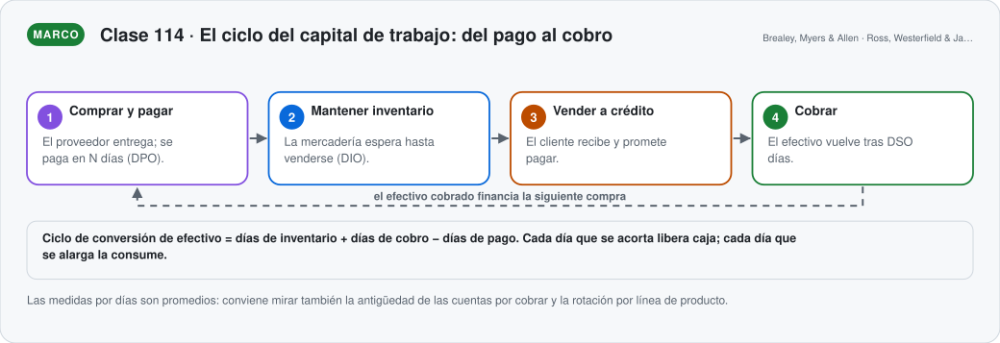

# Clase 114 — Capital de trabajo

<!-- nav:inicio -->
> **Parte 09 · Finanzas y contabilidad para gerentes** — clase 6 de 12 · [índice de la parte](../../README.md) · [temario](../../../../SYLLABUS.md)
<!-- nav:fin -->

**Parte:** 09 — Finanzas y contabilidad para gerentes  
**Nivel:** Etapa 3 — Manager → Gerente  
**Duración sugerida:** 150–180 minutos · **Estándar:** deep-class-v2

## 🎯 Propósito

El capital de trabajo es el dinero atrapado en el ciclo operativo: la mercadería que se compró y aún no se vende, las ventas que aún no se cobran, menos lo que se debe a los proveedores. Es invisible en el estado de resultados y, sin embargo, determina cuánta caja necesita un negocio para funcionar y crecer. Un negocio con buenos márgenes y un ciclo de capital de trabajo largo necesita financiar cada dólar de crecimiento; uno con proveedores que financian la operación puede crecer con poca inversión. La gestión del capital de trabajo es, por eso, una de las fuentes de caja más inmediatas.

La clase se apoya en los textos de finanzas corporativas de Brealey, Myers y Allen y de Ross, Westerfield y Jaffe y en el análisis de Palepu, Healy y Peek sobre capital de trabajo y eficiencia operativa. Al terminar sabrás calcular los días de inventario, de cobro y de pago, el ciclo de conversión de efectivo, estimar las necesidades de financiamiento por crecimiento y decidir sobre inventario, crédito a clientes y plazos con proveedores.

## 📚 Resultados de aprendizaje

Al finalizar podrás:

1. **Calcular** días de inventario, de cobro y de pago, y el ciclo de conversión de efectivo.
2. **Estimar** la necesidad de capital de trabajo por crecimiento.
3. **Evaluar** el costo y el beneficio de una política de crédito o de descuentos por pronto pago.
4. **Decidir** sobre niveles de inventario con criterio económico.
5. **Negociar** plazos con proveedores sin poner en riesgo la continuidad.

## 🧭 Agenda

| Tramo | Qué se hace |
|---|---|
| 0–20 min | Recuperación: ¿cuántos días pasan desde que pagas un insumo hasta que cobras la venta que genera? |
| 20–60 min | Ciclo de conversión, políticas y financiamiento. |
| 60–105 min | Ejemplo trabajado: descuento por pronto pago y reducción de inventario. |
| 105–150 min | Caso ejecutivo y práctica de cálculo. |
| 150–175 min | Límites y entregable. |

## 🧩 Conceptos centrales

| Concepto | Definición | Cómo se reconoce |
|---|---|---|
| **Capital de trabajo operativo** | Cuentas por cobrar + inventario − cuentas por pagar operativas. | Dinero inmovilizado en el ciclo. |
| **Días de cobro (DSO)** | Cuentas por cobrar / ventas × días. | Cuánto tarda en cobrarse una venta. |
| **Días de inventario (DIO)** | Inventario / costo de ventas × días. | Cuánto tarda en venderse el inventario. |
| **Días de pago (DPO)** | Cuentas por pagar / costo de ventas × días. | Cuánto tarda en pagarse a proveedores. |
| **Ciclo de conversión de efectivo (CCC)** | DIO + DSO − DPO. | Días que el efectivo permanece inmovilizado. |
| **Descuento por pronto pago** | Rebaja por cobrar antes (por ejemplo, 2/10 neto 30). | Equivale a un costo financiero. |

## 🧠 Modelo mental

**Cómo leer el diagrama.** Cuatro etapas en ciclo. Se **compra** y se paga al proveedor tras DPO días; la mercadería **espera** en inventario DIO días; se **vende a crédito**; y el cliente **paga** tras DSO días. El efectivo vuelve y financia la siguiente compra. El tiempo entre que el efectivo sale (pago) y vuelve (cobro) es el ciclo de conversión de efectivo; cada día de ese ciclo debe financiarse con caja, deuda o capital.

## 📖 Desarrollo

### 1. Qué es el capital de trabajo operativo

Es la inversión permanente que el negocio necesita para operar: **cuentas por cobrar** (ventas a crédito aún no cobradas) más **inventario** menos **cuentas por pagar** a proveedores. Crece con las ventas: si el negocio duplica sus ventas manteniendo sus plazos, el capital de trabajo también se duplica. Ross, Westerfield y Jaffe lo presentan como una inversión que, aunque se recupere al liquidar el negocio, debe financiarse mientras opere. Por eso un crecimiento rápido es hambriento de caja (clase 112).

### 2. Los días de capital de trabajo

Tres medidas expresan la eficiencia: **DSO** (días de cobro), **DIO** (días de inventario) y **DPO** (días de pago), calculadas con promedios del período. Se suman en el **ciclo de conversión de efectivo**: CCC = DIO + DSO − DPO. Un CCC de 60 días significa que cada peso de venta diaria requiere 60 días de financiamiento. Reducir el CCC libera caja: acortar el cobro, bajar inventarios o alargar los pagos (con prudencia). Palepu, Healy y Peek recomiendan comparar con empresas del rubro y seguir su evolución: un deterioro puede indicar problemas de cobranza o de rotación.

### 3. Crédito a clientes

Otorgar crédito aumenta ventas y cuesta capital de trabajo y riesgo de impago. La política de crédito define **a quién** (evaluación del cliente), **cuánto** (límites), **cuánto plazo** y **qué se hace ante la mora**. La decisión se evalúa comparando el margen de las ventas adicionales con el costo de financiar las cuentas por cobrar (tasa × días / 365) y el riesgo de incobrabilidad. Un **descuento por pronto pago** (por ejemplo, 2 % si paga en 10 días en lugar de 30) equivale a una tasa muy alta anualizada: aproximadamente 37 % ( 2/98 × 365/20 ). Si el costo del financiamiento alternativo es menor, conviene ofrecer el descuento o aprovecharlo como comprador.

### 4. Inventario

El inventario cumple funciones: **amortiguar variabilidad** de demanda y suministro, **aprovechar** economías de compra y **asegurar** el servicio. Pero cuesta: capital inmovilizado, almacenaje, obsolescencia, mermas, seguros. La decisión es un equilibrio entre el costo de mantener y el de no tener (ventas perdidas, urgencias). Se clasifica por rotación y valor (por ejemplo, un esquema ABC) para aplicar políticas distintas: los productos de alta rotación y alto margen se protegen; los de baja rotación se revisan con rigor. Reducir inventario sin entender la variabilidad (clase 090) puede dañar el servicio.

### 5. Proveedores

Pagar a plazo es financiamiento sin interés explícito, pero no es gratuito: los proveedores pueden compensar con precios más altos, y retrasar pagos más allá de lo pactado daña la relación y el acceso a crédito. Una política prudente: pactar plazos razonables, aprovechar descuentos por pronto pago cuando su tasa implícita supere el costo de financiamiento, y cuidar a los proveedores críticos (clase 093). Algunos programas de financiamiento a proveedores (como el *confirming*) pueden facilitar plazos largos para el comprador y pago anticipado para el proveedor, pero deben evaluarse por su efecto contable y de riesgo.

### 6. Financiar el crecimiento

La necesidad de capital de trabajo adicional por crecimiento se estima como el **capital de trabajo como porcentaje de ventas** multiplicado por el aumento de ventas. Si el capital de trabajo operativo es del 25 % de las ventas y las ventas crecen USD 4 millones, se necesitan unos USD 1 millón adicionales. Las fuentes: reducir el ciclo, usar líneas de crédito de corto plazo, factoring de cuentas por cobrar, financiamiento de inventario o aportes de capital. Financiar capital de trabajo permanente con deuda de corto plazo crea riesgo de refinanciamiento (clase 111).

### 7. Riesgos y buenas prácticas

Riesgos: **concentración** de cuentas por cobrar en pocos clientes, **antigüedad** creciente, **obsolescencia** del inventario, **dependencia** de plazos de proveedores que pueden cambiar. Buenas prácticas: reportes de **antigüedad de cuentas por cobrar**, provisiones prudentes, **conteos de inventario**, indicadores semanales de DSO, DIO y DPO, **responsables** por cada componente (cobranza, compras, logística) y metas coherentes entre áreas (si ventas es premiada por volumen y no por cobro, el crédito se amplía sin control).

## 📚 Lectura comparada

| Obra | Qué aporta | Qué no resuelve | Pregunta para contrastar |
|---|---|---|---|
| Brealey, Myers y Allen | Capital de trabajo y política de crédito. | Teoría con supuestos. | ¿El costo del crédito compensa el margen? |
| Ross, Westerfield y Jaffe | Ciclo operativo y de efectivo; financiamiento de corto plazo. | Grandes empresas. | ¿Cuántos días necesitas financiar? |
| Palepu, Healy y Peek | Eficiencia operativa y comparación con pares. | Marco general. | ¿Cómo evolucionan tus días frente al sector? |
| Horngren et al. | Costos de inventario y decisiones asociadas. | Contabilidad de costos. | ¿Qué cuesta mantener inventario? |
| Goldratt y Cox | Inventario como señal de problemas de flujo. | Perspectiva de operaciones. | ¿Qué acumula inventario? |

## 🧮 Ejemplo trabajado

**Situación (hipotética).** Una distribuidora de repuestos con ventas anuales de USD 24 millones y costo de ventas de USD 18 millones tiene: cuentas por cobrar USD 4,0 millones, inventario USD 4,5 millones, cuentas por pagar USD 2,0 millones.

| Medida | Cálculo | Resultado |
|---|---|---|
| DSO | 4,0 / 24 × 365 | 61 días |
| DIO | 4,5 / 18 × 365 | 91 días |
| DPO | 2,0 / 18 × 365 | 41 días |
| CCC | 91 + 61 − 41 | 111 días |
| Capital de trabajo operativo | 4,0 + 4,5 − 2,0 | USD 6,5 millones (27 % de las ventas) |

**Mejoras evaluadas.**

1. **Cobranza**: reducir DSO de 61 a 50 días libera 24 × 11 / 365 = USD 0,72 millones.
2. **Inventario**: bajar DIO de 91 a 75 libera 18 × 16 / 365 = USD 0,79 millones, con revisión de los productos de baja rotación.
3. **Proveedores**: subir DPO de 41 a 50 días libera 18 × 9 / 365 = USD 0,44 millones; pero un proveedor crítico ofrece un 1,5 % de descuento por pagar en 15 días en vez de 45 (tasa anualizada cercana a 18 %).

**Decisión sobre el descuento.** La empresa financia su capital de trabajo con una línea de crédito al 11 % anual. Tomar el descuento implica pagar 30 días antes a cambio de 1,5 %, lo que equivale a unos 18 % anuales: conviene aprovecharlo, usando la línea para financiar el pago anticipado, que cuesta menos que el beneficio.

**Impacto total.** Las dos primeras mejoras liberan USD 1,5 millones; con una línea de crédito al 11 %, eso evita unos USD 165.000 de interés anual. Se define un plan con responsables, metas trimestrales y controles de servicio (para que no baje la disponibilidad de repuestos).

**Qué muestra.** (1) Los días explicaron el consumo de caja. (2) Cada mejora se cuantificó. (3) La decisión del descuento se tomó comparando tasas.

## 🔀 Comparación y límites

**Capital de trabajo frente a inversión en activos fijos.** El capital de trabajo es flexible y se recupera al reducir el negocio; los activos fijos son más rígidos. Pero ambos inmovilizan caja y se evalúan con el mismo criterio de retorno sobre capital (clase 118).

**Límites.** Los días calculados con saldos de fin de período pueden ser engañosos si hay estacionalidad: se usan promedios. Reducir inventario o endurecer el crédito puede perder ventas y clientes; se evalúa el efecto comercial. Las operaciones de factoring, confirming u otras tienen efectos contables, tributarios y legales que se verifican con asesoría. Y los plazos de pago a proveedores pueden estar regulados por la normativa aplicable.

## 🪜 De profesional a owner

| Nivel | Cómo gestiona el capital de trabajo |
|---|---|
| **Profesional** | Factura y documenta con exactitud; compra y recibe con control. |
| **Jefe / Team Lead** | Gestiona cobranza, compras o inventario de su equipo con indicadores. |
| **Gerente** | Define políticas de crédito, inventario y proveedores y sus metas. |
| **CEO / Director** | Alinea incentivos y decide el financiamiento del crecimiento. |
| **Founder / Owner** | Cuida cada día de ciclo porque su caja es limitada. |

## 🏢 Caso ejecutivo

Una empresa de alimentos envasados vende a supermercados con plazos de 60 a 90 días. Su producción exige comprar envases e ingredientes con plazos de 30 días y mantener 75 días de inventario. Crece 25 % anual y debe financiar USD 3 millones de capital de trabajo adicional. Un supermercado que representa el 22 % de las ventas pide ampliar su plazo a 120 días como condición para un contrato de tres años; el gerente comercial quiere aceptar. El gerente financiero propone un descuento por pronto pago de 1,2 % a 15 días o factorizar las facturas con un costo equivalente al 14 % anual.

Entrega un **análisis de capital de trabajo** que contenga: (a) el cálculo de DSO, DIO, DPO y CCC con sus supuestos; (b) la necesidad de financiamiento por crecimiento con y sin el nuevo plazo; (c) la evaluación del contrato: margen adicional frente al costo de financiar 120 días y al riesgo de concentración; (d) la comparación entre descuento por pronto pago y factoring con sus tasas anualizadas; (e) las mejoras de inventario y de proveedores; (f) la recomendación con los controles de cobranza y las verificaciones jurídicas y tributarias que corresponden.

## 🧪 Práctica

1. Calcula DSO, DIO, DPO y CCC con datos de un caso.
2. Estima la caja liberada al reducir cada indicador en 10 días.
3. Calcula la tasa anualizada de un descuento 2/10 neto 30.
4. Estima el capital de trabajo adicional para un crecimiento del 20 %.
5. Define tres indicadores semanales de seguimiento y sus responsables.

## ⚠️ Errores frecuentes

| Error | Por qué ocurre | Cómo corregirlo |
|---|---|---|
| Vender a crédito sin costear | Se mira solo el margen | Incluir costo financiero y riesgo. |
| Reducir inventario sin entender el servicio | Se busca caja rápida | Clasificar y proteger lo crítico. |
| Alargar pagos sin cuidar proveedores | Se busca financiamiento barato | Plazos acordados y relación. |
| No medir antigüedad de cobros | Se mira el promedio | Reporte de antigüedad. |
| Financiar permanente con corto plazo | Es más fácil | Calzar plazos. |
| Incentivos solo por volumen | Se premia vender | Incluir cobro y margen. |

## ❓ Preguntas de comprobación

1. ¿Qué compone el capital de trabajo operativo?
2. ¿Cómo se calcula el ciclo de conversión de efectivo?
3. ¿Por qué el crecimiento rápido consume caja?
4. ¿Qué tasa implícita tiene un descuento 2/10 neto 30 y cómo se usa?
5. ¿Qué equilibrio busca la gestión del inventario?
6. ¿Qué riesgos tiene alargar los pagos a proveedores?
7. ¿Qué límite tiene calcular los días con saldos de fin de período?

Claves de respuesta

1. Cuentas por cobrar más inventario menos cuentas por pagar operativas.
2. DIO más DSO menos DPO.
3. Porque con los mismos plazos necesita más cuentas por cobrar e inventario antes de cobrar.
4. Cerca de 37 % anualizada; conviene tomar el descuento si el financiamiento alternativo cuesta menos.
5. Entre el costo de mantener (capital, obsolescencia, almacenaje) y el costo de no tener (ventas perdidas y urgencias).
6. Daño a la relación, pérdida de crédito o descuentos y, a veces, precios más altos.
7. Con estacionalidad pueden ser engañosos; se usan promedios.

## 📥 Entregable

Guarda en `portfolio/114-capital-de-trabajo/`:

- `modelo-financiero-y-memo-de-decision.md` (plantilla [Modelo financiero y memo de decisión](../../../../templates/modelo-financiero-y-memo-de-decision.md)) con el análisis del caso ejecutivo;
- `cash-runway.md` (plantilla [Cash runway](../../../../templates/cash-runway.md)) con el efecto de las mejoras en la caja;
- `decision-journal.md` con las políticas de crédito, inventario y proveedores y sus responsables.

## 📗 Fuentes y verificación

- Richard Brealey, Stewart Myers & Franklin Allen — *Principles of Corporate Finance* (McGraw-Hill International Book Co, 1984). **Uso en esta clase:** capital de trabajo y política de crédito. **Localizador:** [ISBN-13 9780070662025](https://openlibrary.org/isbn/9780070662025).
- Stephen Ross, Randolph Westerfield et al. — *Corporate Finance* (McGraw-Hill Education, 2018). **Uso en esta clase:** ciclo operativo y de efectivo y financiamiento de corto plazo. Lectura selectiva sobre **capital de trabajo**. **Localizador:** [ISBN-13 9781259918940](https://openlibrary.org/isbn/9781259918940).
- Krishna G. Palepu, Paul M. Healy & Erik Peek — *Business Analysis and Valuation* (South-Western College Pub, 1996). **Uso en esta clase:** eficiencia operativa y comparación con pares. Lectura selectiva sobre **capital de trabajo**. **Localizador:** [ISBN-13 9780324375817](https://openlibrary.org/isbn/9780324375817).
- Charles Horngren et al. — *Cost Accounting: A Managerial Emphasis* (Prentice Hall College Div, 2002). **Uso en esta clase:** costos de inventario y decisiones asociadas. Lectura selectiva sobre **capital de trabajo**. **Localizador:** [ISBN-13 9780130650061](https://openlibrary.org/isbn/9780130650061).
- Eliyahu M. Goldratt & Jeff Cox — *The Goal* (HighBridge Audio, 2014). **Uso en esta clase:** inventario como señal de problemas de flujo. Lectura selectiva sobre **capital de trabajo**. **Localizador:** [ISBN-13 9781622313945](https://openlibrary.org/isbn/9781622313945).

> **Regla de fuentes para Capital de trabajo:** las obras anteriores estructuran las perspectivas de esta materia; cualquier norma, ley o estándar vivo mencionado debe comprobarse nuevamente en su fuente primaria vigente, incluidos los plazos de pago regulados y el tratamiento contable y tributario del factoring. Los ejemplos y casos son hipotéticos, con cifras ilustrativas. El desarrollo es original y no reproduce capítulos protegidos.

<!-- pie:inicio -->
---

| Anterior | Índice | Siguiente |
|---|---|---|
| [← 113 · Margen bruto, operacional y contribución](../113-margen-bruto-operacional-y-contribucion/README.md) | [Parte 09](../../README.md) · [Programa](../../../../SYLLABUS.md) | [115 · Presupuesto y forecast →](../115-presupuesto-y-forecast/README.md) |
<!-- pie:fin -->
