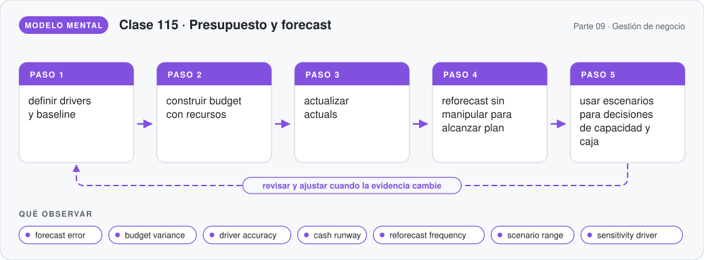

# Clase 115 — Presupuesto y forecast

<!-- nav:inicio -->
> **Parte 09 · Finanzas y contabilidad para gerentes** — clase 7 de 12 · [índice de la parte](../../README.md) · [temario](../../../../SYLLABUS.md)
<!-- nav:fin -->

**Parte:** 09 — Finanzas y contabilidad para gerentes  
**Nivel:** Etapa 3 — Manager → Gerente  
**Duración sugerida:** 150–180 minutos · **Estándar:** deep-class-v2

## 🎯 Propósito

Cada año, en casi todas las empresas, se repite un ritual: durante semanas, las áreas negocian cifras que luego sirven de referencia para evaluar su desempeño y pagar bonos. Quienes participan saben que la cifra no es un pronóstico sino el resultado de una negociación: se piden recursos de más y se acuerdan metas de menos. El presupuesto, que debería ser una herramienta de planificación, se vuelve un instrumento de juego. Pocos temas de gestión tienen tanto consenso crítico y tan poco cambio práctico.

La clase se apoya en el análisis de Jensen sobre cómo vincular pagos a presupuestos premia la mentira, en el tratamiento de planificación financiera de Brealey, Myers y Allen y de Palepu, Healy y Peek y en la contabilidad de gestión de Horngren y colegas. Al terminar sabrás distinguir presupuesto, forecast y meta, diseñar un proceso que reduzca el juego, construir un forecast móvil con escenarios y gestionar los desvíos con diagnóstico y no con castigo.

## 📚 Resultados de aprendizaje

Al finalizar podrás:

1. **Distinguir** presupuesto, forecast y meta, y la función de cada uno.
2. **Construir** un presupuesto a partir de supuestos explícitos.
3. **Diseñar** un forecast móvil con escenarios y disparadores.
4. **Anticipar** los incentivos que distorsionan el proceso.
5. **Analizar** desvíos por causas y decidir acciones.

## 🧭 Agenda

| Tramo | Qué se hace |
|---|---|
| 0–20 min | Recuperación: ¿tu presupuesto del año se parece más a una predicción o a una negociación? |
| 20–60 min | Funciones, proceso, forecast, incentivos y desvíos. |
| 60–105 min | Ejemplo trabajado: del presupuesto al forecast trimestral. |
| 105–150 min | Caso ejecutivo y práctica. |
| 150–175 min | Límites y entregable. |

## 🧩 Conceptos centrales

| Concepto | Definición | Cómo se reconoce |
|---|---|---|
| **Presupuesto** | Plan financiero del período con asignación de recursos y compromisos. | Se aprueba al inicio y sirve de referencia. |
| **Forecast** | Mejor estimación actualizada de los resultados del período o de los siguientes. | Se revisa de forma periódica. |
| **Meta** | Nivel de resultado que se busca lograr. | Puede ser más ambiciosa que el pronóstico. |
| **Supuesto** | Premisa sobre el entorno o la operación que sostiene las cifras. | Se declara y se revisa. |
| **Desvío (varianza)** | Diferencia entre lo real y lo presupuestado o pronosticado. | Se descompone en causas. |
| **Presupuesto móvil** | Horizonte que se extiende de forma continua (por ejemplo, 12 meses hacia adelante). | Siempre mira el mismo plazo. |

## 🧠 Modelo mental

**Cómo leer el diagrama.** Dos paneles con tres características cada uno. El **presupuesto** es un compromiso: fija metas y asigna recursos, se mantiene como referencia, y su riesgo es que, si se liga a bonos, se negocia a la baja. El **forecast** es una expectativa: refleja la mejor estimación, se actualiza con la información y su riesgo es que, sin disciplina, se ajusta para coincidir con lo que pasa y no enseña nada. La nota recoge la advertencia de Jensen sobre separar planificación y evaluación.

## 📖 Desarrollo

### 1. Tres cosas distintas

Es común usar «presupuesto», «meta» y «pronóstico» como sinónimos y esa confusión genera los problemas. El **pronóstico** (forecast) dice lo que se espera que ocurra. La **meta** dice lo que se quiere lograr (puede ser mayor al pronóstico para estirar el esfuerzo). El **presupuesto** asigna recursos y fija compromisos. Cuando un mismo número cumple las tres funciones, queda mal para todas: si se fija ambicioso para motivar, es mal pronóstico; si se fija conservador para cumplir, es mala meta. Separarlos, o al menos declarar cuál es cuál, mejora cada función.

### 2. Qué dice Jensen

Jensen sostiene que el proceso típico de presupuestos paga a las personas por mentir: se premia a quien logra un presupuesto bajo y lo cumple (el gerente que subestima su capacidad), y se castiga a quien reporta con honestidad un potencial mayor. Se genera un juego: las áreas ocultan información, piden más recursos de los necesarios y evitan superar con holgura la meta para no subir la del año siguiente. Su propuesta central es **desvincular la evaluación y la compensación de la negociación de la meta**, pagando por el desempeño real frente a una referencia no negociada (por ejemplo, el desempeño del año anterior o de competidores).

### 3. Construir un presupuesto con supuestos

Un presupuesto útil parte de **supuestos explícitos y compartidos**: crecimiento del mercado, precios, mezcla, tasas de conversión, productividad, inflación de costos, tipo de cambio. A partir de ellos se proyectan ingresos, costos, inversiones y caja, en ese orden. Se conectan las áreas: el plan de ventas alimenta el de producción, compras y personal; el de personas alimenta los gastos; las inversiones alimentan la depreciación y la caja. Se hace una **revisión de consistencia** (el crecimiento supuesto es compatible con la capacidad y con el capital de trabajo, clase 114).

### 4. Forecast móvil

Un **forecast móvil** (*rolling forecast*) actualiza cada mes o trimestre la proyección para los próximos 12 meses o los trimestres siguientes. En lugar de congelar un número en enero y medir contra él todo el año, se renueva la visión: ¿qué esperamos ahora?, ¿qué cambió?, ¿qué decisiones debemos tomar? El foco se mueve de explicar por qué no se cumplió el presupuesto a decidir qué hacer con lo que se sabe hoy. Para que funcione, es breve, usa pocos **impulsores** (volumen, precio, tasa de conversión) y se asocia a decisiones de recursos.

### 5. Escenarios y disparadores

Un forecast con un solo número ofrece falsa precisión. Se prepara un escenario **base**, uno **optimista** y uno **adverso**, definidos por supuestos distintos sobre pocos impulsores, y se acompañan con **disparadores**: si la tasa de conversión baja de X por dos meses, se activa un plan de contención; si supera Y, se libera inversión adicional. Los escenarios permiten decidir qué compromisos fijos adquirir (contratar, firmar arriendos) y cuáles mantener flexibles. Brealey, Myers y Allen plantean el análisis de sensibilidad y de escenarios como parte de la planificación financiera.

### 6. Análisis de desvíos

Cuando el resultado difiere del plan, se **descompone** el desvío: volumen, precio, mezcla, costos unitarios, eficiencia, y se asigna a quien lo controla. Se distingue lo **controlable** de lo **no controlable** (variación del mercado, tipo de cambio). Se separa lo **recurrente** de lo **puntual**. El análisis termina en una decisión: corregir, aceptar, ajustar el plan o revisar un supuesto. Los desvíos desfavorables que llegan sin diagnóstico terminan en culpas; los favorables sin explicación pasan desapercibidos y se pierden aprendizajes.

### 7. Incentivos y cultura

El comportamiento depende de qué se premia. Si el bono depende de cumplir el presupuesto negociado, habrá sandbagging (esconder potencial) y se ajustarán decisiones al cierre (adelantar o postergar ventas y gastos). Alternativas: evaluar por **desempeño relativo** (frente a pares o históricos), por **múltiples medidas** (resultado, calidad, aprendizaje), con **juicio** sobre las circunstancias, y **separar** el proceso de planificación del de compensación. Ninguna solución es perfecta y exige confianza; cualquier cambio en esquemas de pago debe revisar las condiciones contractuales y laborales.

## 📚 Lectura comparada

| Obra | Qué aporta | Qué no resuelve | Pregunta para contrastar |
|---|---|---|---|
| Jensen (2003) | Crítica de los presupuestos ligados a pagos. | Es un ensayo teórico; ofrece pocas recetas operativas. | ¿Qué incentivos distorsionan tu presupuesto? |
| Brealey, Myers y Allen | Planificación financiera, sensibilidad y escenarios. | Teoría con supuestos. | ¿Qué supuesto mueve más el resultado? |
| Palepu, Healy y Peek | Proyección de estados y análisis de supuestos. | Orientado al analista externo. | ¿Qué supuestos explícitos sostienen tus cifras? |
| Horngren et al. | Presupuestos operativos y análisis de varianzas. | Contabilidad de gestión clásica. | ¿Quién controla esta varianza? |
| Kahneman et al. (*Noise*) | Reducir el ruido y el sesgo de las estimaciones. | No es un manual de presupuestos. | ¿Qué sesgo tienen tus proyecciones? |

## 🧮 Ejemplo trabajado

**Situación (hipotética).** Una empresa de software para empresas medianas tiene este presupuesto anual: ingresos USD 12 millones, crecimiento de 20 %, gastos USD 11 millones, utilidad operacional USD 1 millón. En el primer trimestre, los ingresos fueron USD 2,6 millones (presupuesto: 2,8) y los gastos USD 2,7 (presupuesto: 2,7).

**Descomposición del desvío en ingresos (−200).** Nuevos clientes: −260 (se cerraron 14 contratos en lugar de 20, por demoras en dos grandes); renovaciones: +60 (mejor retención). Causa del primero: ciclos de decisión de clientes más largos (de 90 a 120 días) por la incertidumbre económica.

**Forecast móvil.**

| Escenario | Supuesto clave | Ingresos de 12 meses | Utilidad operacional |
|---|---|---|---|
| Adverso | Ciclo de ventas sigue en 120 días y baja la conversión de 22 % a 18 % | 10,9 | −0,4 |
| Base | Ciclo de ventas 110 días; conversión 22 % | 11,5 | 0,4 |
| Optimista | Ciclo vuelve a 90 días | 12,1 | 1,0 |

**Disparadores.** Si en dos meses la conversión baja de 20 %, se congela la contratación prevista de seis personas (ahorro de USD 0,5 millones en el año); si el ciclo de ventas baja de 100 días, se libera.

**Incentivos.** Se decide que el bono comercial se calcule sobre el desempeño frente al año anterior y frente a un indicador de mercado, y no solo frente al presupuesto negociado. La decisión se coordina con recursos humanos y asesoría laboral.

**Qué muestra.** (1) El desvío se explicó por causas y responsables. (2) El forecast cambió decisiones (contratación). (3) Los incentivos se revisaron para reducir el juego.

## 🔀 Comparación y límites

**Presupuesto frente a plan estratégico.** El plan fija dirección y apuestas multianuales; el presupuesto traduce el primer año a recursos y compromisos. Sin plan, el presupuesto proyecta el pasado.

**Límites.** Ningún proceso elimina la incertidumbre. Los forecast móviles exigen disciplina y pueden volverse burocráticos si son largos. Eliminar los presupuestos tradicionales requiere cultura y alternativas de coordinación de recursos. La propuesta de Jensen es una crítica influyente más que una evidencia causal de cada empresa. Las decisiones sobre esquemas de remuneración variable deben respetar la normativa laboral y los contratos.

## 🪜 De profesional a owner

| Nivel | Cómo participa en presupuesto y forecast |
|---|---|
| **Profesional** | Entrega estimaciones honestas y avisa cuando cambian los supuestos. |
| **Jefe / Team Lead** | Propone presupuesto con supuestos y explica desvíos. |
| **Gerente** | Construye el plan de su área, gestiona el forecast y los escenarios. |
| **CEO / Director** | Diseña el proceso para que premie la honestidad y la decisión. |
| **Founder / Owner** | Mantiene un forecast de caja y de ventas simple y lo revisa cada mes. |

## 🏢 Caso ejecutivo

Una empresa de retail con 60 tiendas negocia su presupuesto en un proceso de tres meses. Cada gerente regional pide aumentos de dotación y de inversión; se aprueban recortes arbitrarios de 8 % a todos; las metas de venta se fijan 10 % sobre el año anterior sin importar el mercado local. El bono anual depende de cumplir el presupuesto de ventas y de gasto. Cada año, el 80 % de las regiones lo cumple casi exacto en el último mes, con liquidaciones y facturas adelantadas. El año siguiente, los resultados de enero y febrero son muy débiles. El nuevo director financiero quiere un forecast móvil y cambiar el sistema de bonos.

Entrega un **rediseño del proceso de presupuesto y forecast** que contenga: (a) el diagnóstico de los juegos y su costo; (b) la separación entre meta, pronóstico y presupuesto; (c) el modelo de forecast móvil con impulsores y escenarios; (d) los disparadores de decisión; (e) la propuesta de evaluación y bonos con su transición y las verificaciones laborales necesarias; (f) el análisis de desvíos y la forma de usarlo sin castigo.

## 🧪 Práctica

1. Escribe cinco supuestos explícitos que sostengan el presupuesto de tu área.
2. Descompone un desvío de ingresos en volumen, precio y mezcla.
3. Diseña un forecast de 12 meses con tres escenarios y un disparador.
4. Identifica un incentivo que distorsione tu presupuesto y propón un ajuste.
5. Redacta cómo explicarías un desvío desfavorable sin buscar culpables.

## ⚠️ Errores frecuentes

| Error | Por qué ocurre | Cómo corregirlo |
|---|---|---|
| Mismo número para meta, pronóstico y presupuesto | Se busca simplicidad | Declarar y separar funciones. |
| Pagar por cumplir lo negociado | Parece objetivo | Evaluar con referencias no negociadas y con juicio. |
| Presupuesto sin supuestos | Se proyecta el pasado | Supuestos explícitos y revisión. |
| Forecast que se ajusta al resultado | No hay disciplina | Registrar versiones y medir su precisión. |
| Un único escenario | Se evita la incertidumbre | Base, adverso y optimista. |
| Desvíos sin diagnóstico | Se busca al responsable | Descomponer por causas y controlabilidad. |

## ❓ Preguntas de comprobación

1. ¿Qué diferencia hay entre presupuesto, forecast y meta?
2. ¿Qué crítica hace Jensen al proceso de presupuestos?
3. ¿Qué es un forecast móvil y qué ventaja tiene?
4. ¿Para qué sirven los escenarios y los disparadores?
5. ¿Cómo se analiza un desvío?
6. ¿Qué alternativas hay a pagar por cumplir un presupuesto negociado?
7. ¿Qué límite tiene la propuesta de Jensen?

Claves de respuesta

1. El presupuesto asigna recursos y fija compromisos; el forecast es la mejor estimación actualizada; la meta es el nivel que se busca lograr.
2. Que vincular el pago al cumplimiento de un presupuesto negociado premia la subestimación y la ocultación de información.
3. Una proyección que se renueva de forma continua sobre un horizonte constante; reorienta la discusión hacia decisiones con la información actual.
4. Para decidir qué compromisos fijos asumir y qué hacer si ocurren ciertos hechos, con acciones preparadas.
5. Descomponiéndolo en volumen, precio, mezcla y costos, separando lo controlable de lo no controlable y lo recurrente de lo puntual, y decidiendo una acción.
6. Evaluar por desempeño relativo, múltiples medidas, juicio y separar la planificación de la compensación.
7. Es una crítica influyente y teórica que no prueba por sí sola el efecto en cada empresa, y su aplicación exige cultura y revisión laboral.

## 📥 Entregable

Guarda en `portfolio/115-presupuesto-y-forecast/`:

- `modelo-financiero-y-memo-de-decision.md` (plantilla [Modelo financiero y memo de decisión](../../../../templates/modelo-financiero-y-memo-de-decision.md)) con el forecast y los escenarios del caso ejecutivo;
- `monthly-business-review.md` (plantilla [Monthly business review](../../../../templates/monthly-business-review.md)) con el análisis de desvíos;
- `decision-journal.md` con los supuestos, los disparadores y los cambios de incentivos.

## 📗 Fuentes y verificación

- Michael C. Jensen — *Paying People to Lie: the Truth about the Budgeting Process* (European Financial Management, 2003). **Uso en esta clase:** crítica de los presupuestos ligados a pagos. Lectura selectiva sobre **presupuesto y forecast**. **Localizador:** [DOI 10.1111/1468-036x.00226](https://doi.org/10.1111/1468-036x.00226).
- Richard Brealey, Stewart Myers & Franklin Allen — *Principles of Corporate Finance* (McGraw-Hill International Book Co, 1984). **Uso en esta clase:** planificación financiera, sensibilidad y escenarios. Lectura selectiva sobre **presupuesto y forecast**. **Localizador:** [ISBN-13 9780070662025](https://openlibrary.org/isbn/9780070662025).
- Krishna G. Palepu, Paul M. Healy & Erik Peek — *Business Analysis and Valuation* (South-Western College Pub, 1996). **Uso en esta clase:** proyección de estados y análisis de supuestos. Lectura selectiva sobre **presupuesto y forecast**. **Localizador:** [ISBN-13 9780324375817](https://openlibrary.org/isbn/9780324375817).
- Charles Horngren et al. — *Cost Accounting: A Managerial Emphasis* (Prentice Hall College Div, 2002). **Uso en esta clase:** presupuestos operativos y análisis de varianzas. Lectura selectiva sobre **presupuesto y forecast**. **Localizador:** [ISBN-13 9780130650061](https://openlibrary.org/isbn/9780130650061).
- Daniel Kahneman, Olivier Sibony & Cass R. Sunstein — *Noise* (Little, Brown Spark, 2021). **Uso en esta clase:** reducir el ruido y el sesgo de las estimaciones. Lectura selectiva sobre **presupuesto y forecast**. **Localizador:** [ISBN-13 9780316451383](https://openlibrary.org/isbn/9780316451383).

> **Regla de fuentes para Presupuesto y forecast:** las obras anteriores estructuran las perspectivas de esta materia; cualquier norma, ley o estándar vivo mencionado debe comprobarse nuevamente en su fuente primaria vigente, incluidas las normas laborales sobre remuneración variable. Los ejemplos y casos son hipotéticos, con cifras ilustrativas. El desarrollo es original y no reproduce capítulos protegidos.

<!-- pie:inicio -->
---

| Anterior | Índice | Siguiente |
|---|---|---|
| [← 114 · Capital de trabajo](../114-capital-de-trabajo/README.md) | [Parte 09](../../README.md) · [Programa](../../../../SYLLABUS.md) | [116 · Costos fijos, variables y break-even →](../116-costos-fijos-variables-y-break-even/README.md) |
<!-- pie:fin -->
