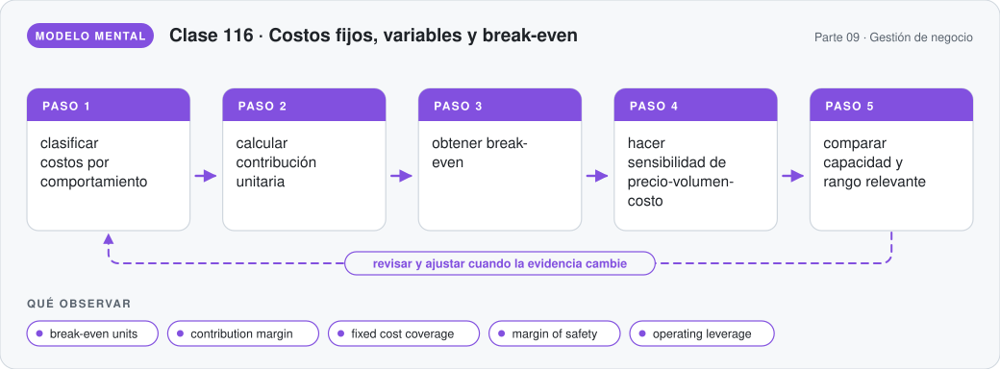

# Clase 116 — Costos fijos, variables y break-even

<!-- nav:inicio -->
> **Parte 09 · Finanzas y contabilidad para gerentes** — clase 8 de 12 · [índice de la parte](../../README.md) · [temario](../../../../SYLLABUS.md)
<!-- nav:fin -->

**Parte:** 09 — Finanzas y contabilidad para gerentes  
**Nivel:** Etapa 3 — Manager → Gerente  
**Duración sugerida:** 150–180 minutos · **Estándar:** deep-class-v2

## 🎯 Propósito

Toda decisión de crecimiento, de precio o de inversión cambia la proporción entre costos que se mueven con las ventas y costos que se mantienen estén o no las ventas. Esa proporción —la **estructura de costos**— determina cuánto debe vender un negocio para no perder, cuánto se amplifica la ganancia cuando las ventas suben y cuánto se hunde cuando bajan. Contratar una persona más, firmar un arriendo, automatizar una línea o cambiar a un modelo de comisiones transforman costos variables en fijos o al revés, y con ello el riesgo operativo de la empresa.

La clase se apoya en el análisis costo–volumen–utilidad de Horngren y colegas, en el tratamiento de Kaplan y Cooper sobre el comportamiento real de los costos y en la lectura de apalancamiento y riesgo de Brealey, Myers y Allen. Al terminar sabrás clasificar costos según su comportamiento, calcular el punto de equilibrio y el margen de seguridad, evaluar el apalancamiento operativo y decidir cómo cambia el riesgo de una estructura con otra.

## 📚 Resultados de aprendizaje

Al finalizar podrás:

1. **Clasificar** costos como fijos, variables o semivariables y reconocer los escalonados.
2. **Calcular** el punto de equilibrio en unidades y en ingresos.
3. **Calcular** el margen de seguridad y el apalancamiento operativo.
4. **Comparar** estructuras de costos alternativas y su riesgo.
5. **Decidir** con análisis de sensibilidad ante cambios de precio, costo y volumen.

## 🧭 Agenda

| Tramo | Qué se hace |
|---|---|
| 0–20 min | Recuperación: clasifica cinco costos de tu área en fijos o variables y pregúntate qué pasa con ellos si las ventas caen 20 %. |
| 20–60 min | Clasificación, punto de equilibrio, apalancamiento y sensibilidad. |
| 60–105 min | Ejemplo trabajado: elegir entre dos estructuras de costos. |
| 105–150 min | Caso ejecutivo y práctica. |
| 150–175 min | Límites y entregable. |

## 🧩 Conceptos centrales

| Concepto | Definición | Cómo se reconoce |
|---|---|---|
| **Costo variable** | Cambia en proporción al volumen. | Materiales, comisiones, fletes. |
| **Costo fijo** | No cambia con el volumen dentro de un rango relevante. | Arriendo, sueldos base. |
| **Costo escalonado** | Fijo dentro de tramos de actividad; salta al cambiar de tramo. | Un supervisor por cada 20 operarios. |
| **Punto de equilibrio (break-even)** | Volumen en que los ingresos igualan los costos totales. | Utilidad cero. |
| **Margen de seguridad** | Distancia entre las ventas reales y el punto de equilibrio. | Cuánto pueden caer las ventas sin pérdidas. |
| **Apalancamiento operativo** | Sensibilidad del resultado operacional al cambio en ventas por la presencia de costos fijos. | Mayor con más costos fijos. |

## 🧠 Modelo mental

**Cómo leer el diagrama.** Una tabla que construye el punto de equilibrio en seis filas: precio, costo variable unitario, **margen de contribución** (la diferencia), **costos fijos**, el **equilibrio** (costos fijos divididos por el margen de contribución) y el **margen de seguridad**. Cada fila se apoya en la anterior. La nota advierte que más costos fijos exigen más ventas para cubrirlos y aumentan la sensibilidad a una caída de ventas.

## 📖 Desarrollo

### 1. Clasificar por comportamiento

Los costos se clasifican según cómo reaccionan al volumen. Los **variables** suben y bajan con él: materiales, comisiones de venta, fletes, costos de pago. Los **fijos** no cambian dentro de un rango de actividad: arriendo de local, sueldos base, licencias de software, seguros. Existen **semivariables** (un componente fijo y uno variable, como una cuenta de electricidad con cargo fijo y consumo) y **escalonados** (se mantienen hasta cierto nivel y luego saltan: otra bodega, otro turno). Horngren y colegas insisten en que la clasificación depende del **horizonte** y del **rango relevante**: a largo plazo casi todos los costos son variables, y en el corto plazo casi todos son fijos.

### 2. Margen de contribución y punto de equilibrio

El **margen de contribución unitario** es el precio menos el costo variable unitario. El **punto de equilibrio en unidades** es costos fijos / margen de contribución unitario; en ingresos, costos fijos / porcentaje de margen de contribución. Para lograr una utilidad objetivo, se suma esa utilidad a los costos fijos antes de dividir. Con una mezcla de productos, se usa el margen de contribución ponderado por la mezcla esperada: un cambio de mezcla altera el equilibrio. El cálculo es sencillo y revelador: dice cuánto hay que vender solo para cubrir la estructura.

### 3. Margen de seguridad y apalancamiento operativo

El **margen de seguridad** es (ventas reales − ventas de equilibrio) / ventas reales: cuánto pueden caer las ventas sin entrar en pérdida. El **grado de apalancamiento operativo** es margen de contribución total / resultado operacional: cuántos por ciento cambia el resultado operacional por cada 1 % de cambio en ventas. Con muchos costos fijos, el apalancamiento es alto: un aumento de ventas multiplica la utilidad, y una caída la destruye con rapidez. Brealey, Myers y Allen lo conectan con el riesgo del negocio: una empresa con alto apalancamiento operativo debería ser prudente con la deuda, que agrega apalancamiento financiero.

### 4. Estructuras alternativas

Un mismo negocio puede organizarse con estructuras de costo distintas. Ejemplos: vendedores con sueldo fijo o con comisión; fabricar en planta propia (más fijos, menos variable) o tercerizar (menos fijos, más variable); arrendar con renta fija o con renta variable sobre ventas; software con servidores propios o en la nube con pago por uso. Cada alternativa cambia el punto de equilibrio y el riesgo: más variable reduce el riesgo y el potencial de utilidad por unidad; más fijo aumenta ambos. La decisión depende de la **incertidumbre de la demanda**, la **escala esperada** y la **capacidad de financiar** el riesgo.

### 5. Escalones y capacidad

Los costos escalonados crean puntos críticos: al superar la capacidad de un tramo, aparece un salto (contratar, arrendar, invertir). El análisis debe considerar **cuántas unidades se pueden producir** con la estructura actual y **cuánto cuesta el siguiente tramo**. Si el siguiente salto es grande, puede convenir resolver con horas extra o tercerización temporal. La rentabilidad por unidad no es constante: un crecimiento que exige un nuevo tramo puede reducir el margen operacional durante un período hasta que se absorba la nueva capacidad.

### 6. Sensibilidad y escenarios

Se analiza el efecto en el equilibrio y en la utilidad de cambios en las variables clave: **precio** (una baja del 5 % puede exigir un aumento del 20 % en volumen para mantener la contribución si el margen es del 30 %), **costo variable**, **costos fijos** y **volumen**. Con escenarios se identifican las variables más sensibles y se definen controles: seguimiento de la que más mueve el resultado, contratos que traspasen riesgo (precios indexados), y planes de contingencia si las ventas caen. Los modelos simples ayudan a entender; las decisiones grandes requieren modelos más detallados.

### 7. Costos hundidos y decisiones marginales

Una decisión se toma con **costos relevantes**: los futuros y diferenciales entre alternativas. Los **costos hundidos** (ya incurridos, irrecuperables) no deben pesar. Un error común: seguir produciendo un producto «porque ya se invirtió en la línea». La pregunta es si el ingreso adicional supera los costos adicionales evitables. Y los costos fijos **comunes** (administración central) se asignan a productos de manera arbitraria; decidir cerrar un producto porque «no cubre su parte de indirectos» puede reducir la utilidad total si su contribución a esos costos es positiva.

## 📚 Lectura comparada

| Obra | Qué aporta | Qué no resuelve | Pregunta para contrastar |
|---|---|---|---|
| Horngren et al. | Análisis costo–volumen–utilidad y comportamiento de costos. | Supone relaciones lineales. | ¿Qué rango de actividad es relevante? |
| Kaplan y Cooper | Comportamiento real de costos y capacidad ociosa. | Su costeo es costoso de aplicar. | ¿Qué recursos son realmente fijos? |
| Brealey, Myers y Allen | Apalancamiento operativo y riesgo del negocio. | Teoría con supuestos. | ¿Cuánto riesgo suma tu estructura? |
| Palepu, Healy y Peek | Estructura de costos como reflejo de la estrategia. | Marco general. | ¿Qué estructura implica tu modelo? |
| Penman | Sostenibilidad de márgenes. | Más técnico. | ¿El margen es recurrente? |

## 🧮 Ejemplo trabajado

**Situación (hipotética).** Una empresa de reparto de comidas debe decidir cómo estructurar su flota. Vende 40.000 pedidos al mes a USD 12 promedio, con costo variable de producto y empaque de USD 5 por pedido.

**Opción A (repartidores propios con sueldo).** Costo de reparto fijo: USD 120.000 mensuales (30 repartidores). Costos fijos del negocio (cocina, plataforma, administración): USD 130.000.

**Opción B (repartidores por pedido).** Costo de reparto USD 2,5 por pedido (variable). Costos fijos: USD 130.000.

| Cálculo | Opción A | Opción B |
|---|---|---|
| Costo variable por pedido | 5,0 | 7,5 |
| Margen de contribución por pedido | 7,0 | 4,5 |
| Costos fijos totales | 250.000 | 130.000 |
| Punto de equilibrio (pedidos) | 35.714 | 28.889 |
| Resultado con 40.000 pedidos | 30.000 | 50.000 |
| Margen de seguridad | 10,7 % | 27,8 % |

**Sensibilidad.** Con una caída de demanda del 25 % (30.000 pedidos): A: 7 × 30.000 − 250.000 = −40.000; B: 4,5 × 30.000 − 130.000 = +5.000. Con un aumento del 25 % (50.000 pedidos): A: 100.000; B: 95.000. Con 60.000 pedidos, A: 170.000; B: 140.000.

**Lectura.** A parte con mayor riesgo y rendimiento potencial a gran escala; B tiene un punto de equilibrio más bajo y es más robusta ante la incertidumbre. Con demanda estable y creciente, A se vuelve preferible desde unos 48.000 pedidos (donde las contribuciones se igualan: 7q − 250.000 = 4,5q − 130.000 → q = 48.000).

**Decisión.** Dado que la demanda es incierta y la caja limitada, se elige B ahora y se fija un disparador: si la demanda supera 50.000 pedidos durante tres meses, evaluar contratar repartidores propios.

**Qué muestra.** (1) La estructura de costos definió el riesgo. (2) Se calculó el volumen de indiferencia. (3) La decisión incluyó un disparador para revisarla.

## 🔀 Comparación y límites

**Break-even contable frente a económico.** El contable cubre costos explícitos; el económico incluye el costo del capital invertido (clase 118). Un negocio puede estar sobre su punto de equilibrio contable y no remunerar su capital.

**Límites.** El modelo supone precios, costos unitarios y mezcla constantes y relaciones lineales dentro de un rango; fuera de él, los costos se comportan distinto. La clasificación fijo–variable es una simplificación. Los costos de oportunidad y de capital no aparecen. Los cambios de estructura que implican contratos laborales o de arriendo tienen condiciones legales y plazos que se verifican con asesoría.

## 🪜 De profesional a owner

| Nivel | Cómo usa la estructura de costos |
|---|---|
| **Profesional** | Entiende qué costos varían con su actividad. |
| **Jefe / Team Lead** | Conoce el punto de equilibrio de su unidad. |
| **Gerente** | Compara estructuras, calcula sensibilidad y define disparadores. |
| **CEO / Director** | Decide cuánto riesgo operativo asumir según la incertidumbre. |
| **Founder / Owner** | Mantiene costos fijos bajos al inicio para sobrevivir a la incertidumbre. |

## 🏢 Caso ejecutivo

Una cadena de gimnasios boutique con 8 sedes tiene costos fijos (arriendo, instructores con contrato indefinido, equipos) de USD 600.000 al mes y un costo variable de USD 4 por clase asistida. Vende membresías mensuales a USD 80 con 6.000 socios activos y una asistencia promedio de 9 clases al mes. Tras una caída de socios de 15 % por competencia, el resultado mensual pasó de USD 120.000 a una pérdida de USD 40.000. El directorio considera tres opciones: (1) cerrar dos sedes, (2) pasar a los instructores a pago por clase y (3) invertir USD 1,2 millones en una nueva sede en un barrio con alta demanda.

Entrega un **análisis de estructura de costos y equilibrio** que contenga: (a) la clasificación de costos y el margen de contribución por socio; (b) el punto de equilibrio actual en socios; (c) el efecto de cada opción en equilibrio, margen de seguridad y riesgo; (d) la sensibilidad a la retención y al precio; (e) los costos hundidos y los relevantes; (f) la recomendación con disparadores y las verificaciones laborales y contractuales necesarias.

## 🧪 Práctica

1. Clasifica los costos de tu área y marca los escalonados.
2. Calcula el punto de equilibrio y el margen de seguridad de un caso.
3. Compara dos estructuras de costo y calcula el volumen de indiferencia.
4. Calcula el efecto de un descuento del 8 % sobre el punto de equilibrio.
5. Identifica un costo hundido que esté pesando en una decisión de tu empresa.

## ⚠️ Errores frecuentes

| Error | Por qué ocurre | Cómo corregirlo |
|---|---|---|
| Tratar todos los costos como fijos o variables | Se simplifica de más | Revisar rango y horizonte. |
| Calcular el equilibrio una sola vez | Se considera estático | Actualizar con precios y costos. |
| Ignorar escalones | Se usa una línea recta | Mapear tramos de capacidad. |
| Decidir por costo hundido | Se quiere justificar lo invertido | Considerar solo costos relevantes. |
| Cerrar un producto por no cubrir su parte de indirectos | Se asignan costos comunes | Mirar la contribución incremental. |
| Cambiar la estructura sin sensibilidad | Se confía en el escenario base | Analizar escenarios y disparadores. |

## ❓ Preguntas de comprobación

1. ¿Qué diferencia hay entre costos fijos, variables y escalonados?
2. ¿Cómo se calcula el punto de equilibrio?
3. ¿Qué mide el margen de seguridad?
4. ¿Qué es el apalancamiento operativo y por qué importa?
5. ¿Qué ventajas y riesgos tiene pasar costos fijos a variables?
6. ¿Qué costos son relevantes para una decisión?
7. ¿Qué límite tiene el análisis de punto de equilibrio?

Claves de respuesta

1. Los variables cambian con el volumen, los fijos no cambian en un rango y los escalonados son fijos por tramos y saltan al cambiar de tramo.
2. Costos fijos divididos por el margen de contribución unitario (o por el porcentaje de contribución para obtenerlo en ingresos).
3. Cuánto pueden caer las ventas antes de entrar en pérdida.
4. La sensibilidad del resultado operacional a cambios de ventas por costos fijos; mayor apalancamiento implica más ganancia al subir y más pérdida al caer.
5. Reduce el punto de equilibrio y el riesgo, pero suele reducir el margen por unidad y el potencial a gran escala.
6. Los futuros y diferenciales entre alternativas; no los hundidos.
7. Supone precios, costos unitarios y mezcla constantes y relaciones lineales dentro de un rango relevante.

## 📥 Entregable

Guarda en `portfolio/116-costos-fijos-variables-y-break-even/`:

- `risk-governance-brief.md` (plantilla [Risk & Governance Brief](../../../../templates/risk-governance-brief.md)) con el análisis de riesgo de estructura del caso ejecutivo;
- `modelo-financiero-y-memo-de-decision.md` (plantilla [Modelo financiero y memo de decisión](../../../../templates/modelo-financiero-y-memo-de-decision.md)) con el cálculo de equilibrio y la sensibilidad;
- `decision-journal.md` con la opción elegida y los disparadores.

## 📗 Fuentes y verificación

- Charles Horngren et al. — *Cost Accounting: A Managerial Emphasis* (Prentice Hall College Div, 2002). **Uso en esta clase:** análisis costo–volumen–utilidad y comportamiento de costos. Lectura selectiva sobre **costos fijos, variables y break-even**. **Localizador:** [ISBN-13 9780130650061](https://openlibrary.org/isbn/9780130650061).
- Robert S. Kaplan & Robin Cooper — *Cost & Effect* (Harvard Business School Press, 1998). **Uso en esta clase:** comportamiento real de costos y capacidad ociosa. Lectura selectiva sobre **costos fijos, variables y break-even**. **Localizador:** [ISBN-13 9780875847887](https://openlibrary.org/isbn/9780875847887).
- Richard Brealey, Stewart Myers & Franklin Allen — *Principles of Corporate Finance* (McGraw-Hill International Book Co, 1984). **Uso en esta clase:** apalancamiento operativo y riesgo del negocio. Lectura selectiva sobre **costos fijos, variables y break-even**. **Localizador:** [ISBN-13 9780070662025](https://openlibrary.org/isbn/9780070662025).
- Krishna G. Palepu, Paul M. Healy & Erik Peek — *Business Analysis and Valuation* (South-Western College Pub, 1996). **Uso en esta clase:** estructura de costos como reflejo de la estrategia. Lectura selectiva sobre **costos fijos, variables y break-even**. **Localizador:** [ISBN-13 9780324375817](https://openlibrary.org/isbn/9780324375817).
- Stephen H. Penman — *Financial Statement Analysis and Security Valuation* (McGraw-Hill/Irwin, 2001). **Uso en esta clase:** sostenibilidad de márgenes. Lectura selectiva sobre **costos fijos, variables y break-even**. **Localizador:** [ISBN-13 9780072903331](https://openlibrary.org/isbn/9780072903331).

> **Regla de fuentes para Costos fijos, variables y break-even:** las obras anteriores estructuran las perspectivas de esta materia; cualquier norma, ley o estándar vivo mencionado debe comprobarse nuevamente en su fuente primaria vigente, incluidas las condiciones laborales y contractuales de los cambios de estructura. Los ejemplos y casos son hipotéticos, con cifras ilustrativas. El desarrollo es original y no reproduce capítulos protegidos.

<!-- pie:inicio -->
---

| Anterior | Índice | Siguiente |
|---|---|---|
| [← 115 · Presupuesto y forecast](../115-presupuesto-y-forecast/README.md) | [Parte 09](../../README.md) · [Programa](../../../../SYLLABUS.md) | [117 · Unit economics: CAC, LTV, churn y payback →](../117-unit-economics-cac-ltv-churn-y-payback/README.md) |
<!-- pie:fin -->
