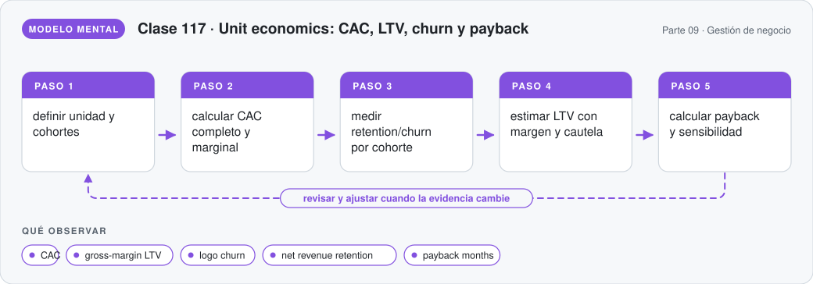

# Clase 117 — Unit economics: CAC, LTV, churn y payback

<!-- nav:inicio -->
> **Parte 09 · Finanzas y contabilidad para gerentes** — clase 9 de 12 · [índice de la parte](../../README.md) · [temario](../../../../SYLLABUS.md)
<!-- nav:fin -->

**Parte:** 09 — Finanzas y contabilidad para gerentes  
**Nivel:** Etapa 3 — Manager → Gerente  
**Duración sugerida:** 150–180 minutos · **Estándar:** deep-class-v2

## 🎯 Propósito

Una empresa puede crecer rápido y perder dinero con cada cliente nuevo. La **economía unitaria** —el análisis de lo que cuesta ganar, servir y retener a un cliente, y de lo que ese cliente deja a lo largo de su vida— muestra si el crecimiento crea valor o lo destruye. Es especialmente útil en negocios de suscripción, servicios recurrentes y plataformas, donde el ingreso llega en el tiempo pero el gasto de adquisición se paga al inicio. Y es especialmente mal usado: razones llamativas como «LTV/CAC de 5» se calculan con supuestos optimistas y sin mirar cuánto tarda la caja en volver.

La clase se apoya en el trabajo de Gupta, Lehmann y Stuart sobre el valor de los clientes como activos, en el análisis de estados de Palepu, Healy y Peek y en la teoría de valoración de Koller y colegas, que vincula el crecimiento con el retorno sobre el capital. Al terminar sabrás calcular CAC, ARPU, margen, churn, LTV y payback, leer cohortes en vez de promedios y reconocer los errores que inflan estas métricas.

## 📚 Resultados de aprendizaje

Al finalizar podrás:

1. **Calcular** CAC, ingreso y margen por cliente, churn, LTV y payback.
2. **Interpretar** la relación LTV/CAC junto con el tiempo de recuperación.
3. **Analizar** cohortes para ver el comportamiento real de retención.
4. **Reconocer** los errores que inflan las métricas.
5. **Decidir** cuánto invertir en adquisición y retención según la economía unitaria.

## 🧭 Agenda

| Tramo | Qué se hace |
|---|---|
| 0–20 min | Recuperación: ¿cuánto cuesta ganar un cliente en tu negocio y cuánto tarda en pagarse? |
| 20–60 min | Métricas, cohortes, relaciones y errores. |
| 60–105 min | Ejemplo trabajado: economía unitaria de un servicio por suscripción. |
| 105–150 min | Caso ejecutivo y práctica. |
| 150–175 min | Límites y entregable. |

## 🧩 Conceptos centrales

| Concepto | Definición | Cómo se reconoce |
|---|---|---|
| **CAC** | Costo de adquisición por cliente nuevo: gasto de ventas y marketing / clientes nuevos. | Incluye todos los costos de captación. |
| **ARPU** | Ingreso promedio por cliente en un período. | Mensual o anual. |
| **Margen por cliente** | Ingreso menos costos de servir al cliente. | Se calcula sobre el margen de contribución. |
| **Churn** | Proporción de clientes (o de ingresos) que se pierden en un período. | Tasa mensual o anual. |
| **LTV** | Valor del cliente durante su vida: margen por período × duración esperada, descontado. | Estimación, no dato. |
| **Payback** | Tiempo para recuperar el CAC con el margen del cliente. | Meses. |

## 🧠 Modelo mental

**Cómo leer el diagrama.** Cinco pasos que siguen la vida de un cliente. Se **adquiere** (CAC); se **activa**, es decir, empieza a recibir valor; se **retiene** (churn y duración); se **monetiza** (ingreso y margen); y se **recupera** la inversión (payback y LTV). La nota recuerda lo esencial: una razón LTV/CAC alta con un payback largo puede ahogar la caja, de modo que se mira la razón y el tiempo.

## 📖 Desarrollo

### 1. Por qué una mirada por cliente

Los estados financieros agregan: el gasto de marketing de un año se resta del resultado del año, aunque los clientes captados generen ingresos durante varios. La economía unitaria **desagrega** y compara el costo de captar y servir a un cliente con lo que genera a lo largo de su relación. Gupta, Lehmann y Stuart plantean valorar los clientes como activos de la empresa: el valor de la empresa es, en parte, el valor presente de los flujos que generarán sus clientes actuales y futuros. Esta perspectiva ayuda a decidir cuánto vale la pena gastar para captar y retener.

### 2. CAC y qué incluye

El **CAC** es el gasto total de ventas y marketing en un período dividido por los clientes nuevos conseguidos. Debe incluir **todos** los costos de captación: publicidad, salarios y comisiones de ventas y marketing, herramientas, eventos y la parte proporcional de gestión. Errores frecuentes: excluir sueldos del equipo de ventas, incluir clientes que no provienen de esas acciones (referidos, orgánicos) o desfasar el gasto y las altas. Se puede calcular un **CAC mezclado** (todo el gasto sobre todos los clientes) y uno **por canal**; el segundo es más útil para decidir dónde invertir, pero exige atribuir con cuidado.

### 3. Ingreso y margen por cliente

El **ARPU** es el ingreso promedio por cliente. Pero el valor depende del **margen**: se descuentan los costos de servir (soporte, infraestructura, costos de entrega, comisiones de pago). Usar ingresos en lugar de margen para calcular el LTV es uno de los errores más comunes y lo infla de forma importante. Si el ARPU es USD 100 al mes y el margen de contribución es 70 %, el aporte mensual es USD 70. También conviene separar clientes por segmento: pueden tener ARPU, margen y retención muy distintos.

### 4. Churn y duración

El **churn** es la proporción de clientes que se pierde en un período. Con un churn mensual constante c, la **duración esperada** es 1/c meses: con 3 % mensual, unos 33 meses; con 6 %, unos 17. Es una aproximación: en la práctica el churn no es constante, suele ser alto al inicio y bajar para quienes superan los primeros meses. Por eso se analizan **cohortes**: grupos de clientes que empezaron en el mismo período, seguidos en el tiempo. El análisis por cohortes revela si la retención mejora o empeora y si el promedio oculta diferencias entre segmentos.

### 5. LTV con cuidado

Una aproximación habitual: LTV = margen mensual por cliente / churn mensual. Con margen de USD 70 y churn de 3 %, el LTV es unos USD 2.333. Es una **simplificación** que ignora el descuento por el tiempo, los cambios de precio, la expansión o la reducción de ingresos por cliente y que el churn cambia con la antigüedad. Se prefieren versiones con un horizonte acotado (por ejemplo, 3 a 5 años) y con descuento. Sobre todo, se reconoce que el LTV es una **estimación** con alta incertidumbre y se trabaja con rangos, no con una cifra única.

### 6. Payback y la razón LTV/CAC

El **payback** es el tiempo para que el margen acumulado del cliente cubra el CAC: CAC / margen mensual. Con CAC de USD 840 y margen de USD 70, el payback es de 12 meses. La razón **LTV/CAC** compara el valor con el costo: reglas prácticas citadas en la industria (por ejemplo, una razón cercana o superior a 3) son orientaciones, no leyes. Lo importante es leerlas juntas: una razón alta con payback de 30 meses implica financiar durante dos años y medio cada cliente nuevo; si el churn de los primeros meses es alto, muchos clientes nunca devolverán el CAC. Koller y colegas vinculan esto con el retorno sobre el capital invertido (clase 118).

### 7. Errores y decisiones

Errores frecuentes: **LTV con ingresos en lugar de margen**, **churn sin cohortes**, **CAC sin costos indirectos**, **promedios que esconden segmentos**, **ignorar el descuento financiero**, **mezclar clientes orgánicos con pagados** y **confundir crecimiento con valor**. Decisiones que se apoyan en la economía unitaria: **cuánto invertir en adquisición** (hasta que el retorno marginal caiga), **qué canales y segmentos priorizar**, **dónde mejorar la retención** (a menudo más barato que adquirir), **cómo fijar precios** y **cuándo crecer** (cuando la economía unitaria es sana y el payback es financiable) o corregir antes.

## 📚 Lectura comparada

| Obra | Qué aporta | Qué no resuelve | Pregunta para contrastar |
|---|---|---|---|
| Gupta, Lehmann y Stuart (2004) | Valorar clientes como activos con flujos futuros. | Supuestos de modelos de valor del cliente. | ¿Qué supuestos sostienen tu LTV? |
| Koller et al. | Crecimiento y retorno sobre el capital como base del valor. | No es un manual de métricas de clientes. | ¿El crecimiento rinde más que el costo del capital? |
| Palepu, Healy y Peek | Relación entre métricas operativas y estados financieros. | Marco general. | ¿Cómo se refleja el CAC en los estados? |
| Horngren et al. | Costos de servir y asignación. | Contabilidad de costos. | ¿Qué costos de servir incluyes? |
| Penman | Calidad de los ingresos recurrentes. | Más técnico. | ¿Qué parte del ingreso es recurrente? |

## 🧮 Ejemplo trabajado

**Situación (hipotética).** Una empresa de software de gestión para consultorios cobra USD 100 al mes por cliente. Costo de servir (soporte, infraestructura, pagos): USD 30. Gasto trimestral de ventas y marketing: USD 420.000, con 500 clientes nuevos pagados en el trimestre. Churn mensual observado: 4 % en los primeros 6 meses y 1,5 % después.

| Cálculo | Resultado |
|---|---|
| CAC | 420.000 / 500 = USD 840 |
| Margen mensual por cliente | 100 − 30 = USD 70 |
| Payback simple | 840 / 70 = 12 meses |
| Retención a 12 meses (aprox.) | 0,96⁶ × 0,985⁶ = 0,783 × 0,913 ≈ 71,5 % |
| Margen acumulado esperado a 12 meses por cliente captado | ≈ USD 70 × ~10 meses-cliente ≈ 700 |

**Lectura por cohorte.** Al incluir el churn, en el mes 12 el margen acumulado esperado por cliente captado es de unos USD 700 (los meses de vida promedio en los 12 primeros son cerca de 10), menor que el CAC de 840: el payback real, considerando la pérdida de clientes, es de unos 15 meses.

**LTV a 5 años (con churn de 1,5 % tras el mes 6 y descuento ignorado por simplicidad).** Aproximadamente USD 70 × (5,4 meses promedio de los primeros 6 + 0,783 × (1 − 0,985^54)/0,015) ≈ 70 × (5,4 + 0,783 × 37,2) ≈ 70 × 34,5 ≈ USD 2.400. LTV/CAC ≈ 2,9.

**Segmentos.** Los clientes captados por referidos tienen CAC de USD 250 y churn de 1,2 %; los de publicidad pagada, CAC de USD 1.150 y churn de 4,5 %: su LTV/CAC es inferior a 1,5.

**Decisiones.** Reducir la inversión en el canal pagado, reforzar el programa de referidos, mejorar el proceso de incorporación en los primeros 60 días (donde se pierde la mayor parte) y probar un aumento de precio con un segmento. Se vigilan cohortes mensuales de retención y payback.

**Qué muestra.** (1) El payback simple de 12 meses era optimista. (2) El churn temprano pesaba. (3) La segmentación cambió la decisión de inversión.

## 🔀 Comparación y límites

**Economía unitaria frente a rentabilidad total.** La unitaria dice si cada cliente deja valor; la rentabilidad total depende, además, de los costos fijos de la empresa. Una economía unitaria sana con costos fijos excesivos puede dejar pérdidas.

**Límites.** Las métricas dependen de supuestos de retención futura, que se equivocan. El CAC sufre problemas de atribución. Las reglas empíricas citadas en la industria no son universales: dependen del sector, de la caja y del acceso a capital. Las cifras de ejemplo son ilustrativas. Y el tratamiento de ingresos recurrentes y de costos de adquisición en los estados financieros sigue la norma contable aplicable, que debe verificarse en su fuente.

## 🪜 De profesional a owner

| Nivel | Cómo usa la economía unitaria |
|---|---|
| **Profesional** | Entiende cómo su trabajo influye en la activación y la retención. |
| **Jefe / Team Lead** | Sigue cohortes y mejora la parte del ciclo que le corresponde. |
| **Gerente** | Decide inversión por canal y segmento con CAC, margen y retención. |
| **CEO / Director** | Evalúa si el crecimiento crea valor y si el payback es financiable. |
| **Founder / Owner** | Mide pronto y evita escalar adquisición con una economía unitaria débil. |

## 🏢 Caso ejecutivo

Una empresa de educación en línea para adultos cobra USD 40 al mes. Su CAC mezclado es USD 260, su margen de contribución es 60 % y declara un churn de 7 % mensual. Su director de crecimiento propone duplicar el presupuesto de marketing porque «el LTV/CAC es de 3,3». El análisis por cohorte muestra que el 45 % de los usuarios abandona en el primer mes y que, tras el tercero, el churn baja a 3 %. El canal de redes sociales tiene CAC de USD 380 y retención muy baja; las alianzas con empresas tienen CAC de USD 110 y churn de 2 %. La caja alcanza para ocho meses de operación.

Entrega un **análisis de economía unitaria** que contenga: (a) el cálculo de CAC, margen, churn, LTV y payback con sus supuestos; (b) el análisis por cohortes y por canal; (c) la revisión del LTV/CAC de 3,3 y por qué podría estar inflado; (d) la capacidad de financiar el payback con la caja disponible; (e) las decisiones de inversión en adquisición y retención; (f) las métricas de seguimiento y las verificaciones sobre ingresos recurrentes y consumidores que correspondan.

## 🧪 Práctica

1. Calcula CAC, margen mensual, payback y LTV simple para un negocio.
2. Arma una tabla de retención por cohorte y estima la duración esperada.
3. Recalcula el LTV/CAC usando margen y no ingresos.
4. Compara dos canales con distinto CAC y churn y decide dónde invertir.
5. Calcula cuántos clientes nuevos puedes financiar con tu caja dado el payback.

## ⚠️ Errores frecuentes

| Error | Por qué ocurre | Cómo corregirlo |
|---|---|---|
| LTV con ingresos | Es más fácil | Usar margen de contribución. |
| Churn sin cohortes | Se usa el promedio | Analizar por cohorte y antigüedad. |
| CAC sin costos indirectos | Solo se cuenta publicidad | Incluir todo el costo de captación. |
| Mirar solo LTV/CAC | La razón parece suficiente | Leerla con el payback y la caja. |
| Un promedio para todos los segmentos | Se simplifica | Segmentar por canal y tipo de cliente. |
| Crecer con payback inalcanzable | Se prioriza crecimiento | Financiar el payback antes de escalar. |

## ❓ Preguntas de comprobación

1. ¿Qué incluye el CAC?
2. ¿Por qué el LTV se calcula con margen y no con ingresos?
3. ¿Qué duración esperada implica un churn mensual del 4 %?
4. ¿Qué es el payback y por qué se lee junto con LTV/CAC?
5. ¿Qué ventaja tiene el análisis por cohortes?
6. ¿Qué errores inflan el LTV?
7. ¿Qué límites tienen estas métricas?

Claves de respuesta

1. Todos los costos de captación: publicidad, sueldos y comisiones de ventas y marketing, herramientas y eventos, divididos por los clientes nuevos.
2. Porque el cliente deja lo que queda tras los costos de servirlo; usar ingresos sobrestima el valor.
3. Cerca de 25 meses (1/0,04).
4. Es el tiempo para recuperar el CAC con el margen; una razón alta con payback largo exige financiar mucho tiempo cada cliente.
5. Muestra cómo cambia la retención con la antigüedad y entre grupos, algo que el promedio oculta.
6. Usar ingresos, churn constante sin cohortes, ignorar el descuento, promedios entre segmentos y mezclar clientes orgánicos con pagados.
7. Dependen de supuestos de retención futura y de atribución; las reglas de la industria no son universales.

## 📥 Entregable

Guarda en `portfolio/117-unit-economics-cac-ltv-churn-y-payback/`:

- `modelo-financiero-y-memo-de-decision.md` (plantilla [Modelo financiero y memo de decisión](../../../../templates/modelo-financiero-y-memo-de-decision.md)) con el análisis del caso ejecutivo;
- `kpi-tree.md` (plantilla [KPI tree](../../../../templates/kpi-tree.md)) con las métricas de economía unitaria y su seguimiento;
- `decision-journal.md` con los supuestos de retención y las decisiones de inversión.

## 📗 Fuentes y verificación

- Sunil Gupta, Donald R. Lehmann & Jennifer Ames Stuart — *Valuing Customers* (Journal of Marketing Research, 2004). **Uso en esta clase:** valorar clientes como activos con flujos futuros. Lectura selectiva sobre **unit economics: cac, ltv, churn y payback**. **Localizador:** [DOI 10.1509/jmkr.41.1.7.25084](https://doi.org/10.1509/jmkr.41.1.7.25084).
- Tim Koller, Marc Goedhart & David Wessels — *Valuation: Measuring and Managing the Value of Companies* (Wiley, 2005). **Uso en esta clase:** crecimiento y retorno sobre el capital como base del valor. Lectura selectiva sobre **unit economics: cac, ltv, churn y payback**. **Localizador:** [ISBN-13 9780471702191](https://openlibrary.org/isbn/9780471702191).
- Krishna G. Palepu, Paul M. Healy & Erik Peek — *Business Analysis and Valuation* (South-Western College Pub, 1996). **Uso en esta clase:** relación entre métricas operativas y estados financieros. Lectura selectiva sobre **unit economics: cac, ltv, churn y payback**. **Localizador:** [ISBN-13 9780324375817](https://openlibrary.org/isbn/9780324375817).
- Charles Horngren et al. — *Cost Accounting: A Managerial Emphasis* (Prentice Hall College Div, 2002). **Uso en esta clase:** costos de servir y asignación. Lectura selectiva sobre **unit economics: cac, ltv, churn y payback**. **Localizador:** [ISBN-13 9780130650061](https://openlibrary.org/isbn/9780130650061).
- Stephen H. Penman — *Financial Statement Analysis and Security Valuation* (McGraw-Hill/Irwin, 2001). **Uso en esta clase:** calidad de los ingresos recurrentes. Lectura selectiva sobre **unit economics: cac, ltv, churn y payback**. **Localizador:** [ISBN-13 9780072903331](https://openlibrary.org/isbn/9780072903331).

> **Regla de fuentes para Unit economics: CAC, LTV, churn y payback:** las obras anteriores estructuran las perspectivas de esta materia; cualquier norma, ley o estándar vivo mencionado debe comprobarse nuevamente en su fuente primaria vigente, incluido el tratamiento contable de ingresos recurrentes y la normativa de protección al consumidor. Los ejemplos y casos son hipotéticos, con cifras ilustrativas. El desarrollo es original y no reproduce capítulos protegidos.

<!-- pie:inicio -->
---

| Anterior | Índice | Siguiente |
|---|---|---|
| [← 116 · Costos fijos, variables y break-even](../116-costos-fijos-variables-y-break-even/README.md) | [Parte 09](../../README.md) · [Programa](../../../../SYLLABUS.md) | [118 · ROI, ROIC y decisiones de inversión →](../118-roi-roic-y-decisiones-de-inversion/README.md) |
<!-- pie:fin -->
