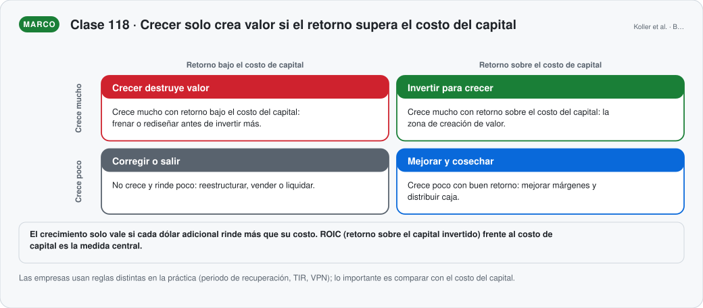

# Clase 118 — ROI, ROIC y decisiones de inversión

<!-- nav:inicio -->
> **Parte 09 · Finanzas y contabilidad para gerentes** — clase 10 de 12 · [índice de la parte](../../README.md) · [temario](../../../../SYLLABUS.md)
<!-- nav:fin -->

**Parte:** 09 — Finanzas y contabilidad para gerentes  
**Nivel:** Etapa 3 — Manager → Gerente  
**Duración sugerida:** 150–180 minutos · **Estándar:** deep-class-v2

## 🎯 Propósito

Invertir es renunciar hoy a dinero con la expectativa de recibir más mañana. Toda empresa toma esa decisión cada día —abrir una sede, comprar una máquina, desarrollar un producto, adquirir otra empresa— y la mayoría de las veces la justifica con una cifra de «ROI» que depende de supuestos poco examinados. La pregunta central no es si una inversión «gana dinero», sino si **gana más de lo que cuesta el capital que usa**, incluido el riesgo. Una empresa puede crecer, ser rentable en términos contables y destruir valor si sus inversiones rinden menos que el costo de financiarlas.

La clase se apoya en el valor presente neto y la tasa interna de retorno de Brealey, Myers y Allen, en el enfoque de creación de valor y ROIC de Koller y colegas, en la evidencia de Graham y Harvey sobre cómo deciden realmente las empresas y en el análisis de Palepu, Healy y Peek. Al terminar sabrás calcular ROI, ROIC, VPN y TIR, entender sus límites, comparar alternativas con flujos de caja incrementales y tomar decisiones con escenarios y sensibilidad.

## 📚 Resultados de aprendizaje

Al finalizar podrás:

1. **Calcular** ROI, ROIC, VPN, TIR y período de recuperación.
2. **Construir** los flujos incrementales de una inversión.
3. **Comparar** el retorno con el costo de capital y el riesgo.
4. **Analizar** la sensibilidad y los escenarios de una decisión.
5. **Reconocer** errores de decisión: costos hundidos, ignorar el capital de trabajo, optimismo.

## 🧭 Agenda

| Tramo | Qué se hace |
|---|---|
| 0–20 min | Recuperación: recuerda una inversión de tu empresa y pregúntate cuál fue su retorno real y contra qué se comparó. |
| 20–60 min | Medidas, flujos incrementales, costo de capital y riesgo. |
| 60–105 min | Ejemplo trabajado: evaluar una nueva línea de producción. |
| 105–150 min | Caso ejecutivo y práctica. |
| 150–175 min | Límites y entregable. |

## 🧩 Conceptos centrales

| Concepto | Definición | Cómo se reconoce |
|---|---|---|
| **ROI** | Ganancia de una inversión dividida por su costo. | Porcentaje simple; no considera el tiempo. |
| **ROIC** | Resultado operacional después de impuestos dividido por el capital invertido. | Mide el retorno del negocio sobre el capital. |
| **Costo de capital** | Retorno mínimo exigido por quienes financian, según el riesgo. | Tasa de descuento. |
| **VPN (valor presente neto)** | Suma de flujos descontados menos la inversión inicial. | Positivo crea valor. |
| **TIR** | Tasa de descuento que hace el VPN igual a cero. | Se compara con el costo de capital. |
| **Flujo incremental** | Flujo adicional que ocurre por decidir la inversión. | Excluye costos hundidos. |

## 🧠 Modelo mental

**Cómo leer el diagrama.** Dos ejes: si el retorno supera o no el costo del capital, y si la empresa crece poco o mucho. Crecer con retorno **bajo** el costo de capital **destruye valor**; crecer con retorno **sobre** el costo de capital es la zona de creación de valor; no crecer y rendir poco pide corregir o salir; rendir bien sin crecer sugiere mejorar y distribuir caja. La clave: el crecimiento no es bueno por sí mismo; vale si cada dólar adicional rinde más que su costo.

## 📖 Desarrollo

### 1. El costo de capital como vara

El capital tiene un costo: los acreedores exigen intereses y los accionistas, un retorno acorde con el riesgo. El **costo promedio ponderado de capital (WACC)** combina ambos. Una inversión crea valor si su retorno supera el costo del capital ajustado por su riesgo. Brealey, Myers y Allen enfatizan que el costo de capital depende del **riesgo del proyecto**, no del de la empresa que lo ejecuta: un proyecto muy riesgoso exige más retorno que el promedio de la empresa. Usar una sola tasa para todo favorece los proyectos riesgosos y rechaza los seguros.

### 2. ROI y sus límites

El **ROI** es (ganancia − inversión) / inversión. Es fácil y comunicable, pero tiene límites: no considera **cuándo** llegan los flujos (un retorno del 50 % en dos años es mejor que el mismo en diez), mezcla definiciones de ganancia (contable o de caja), ignora el **riesgo** y el **capital de trabajo** y, a menudo, se calcula sobre la inversión inicial sin incluir inversiones adicionales. Sirve como una primera aproximación, pero se complementa con medidas que traen los flujos al presente.

### 3. VPN y TIR

El **valor presente neto** descuenta los flujos de caja futuros a la tasa del costo de capital y resta la inversión: VPN = Σ FCₜ / (1+r)ᵗ − I₀. Si es positivo, la inversión crea valor. La **TIR** es la tasa que hace el VPN cero; se acepta si supera el costo de capital. Brealey, Myers y Allen recomiendan el VPN como criterio principal: la TIR puede dar resultados múltiples o engañosos con flujos que cambian de signo, y no distingue escala (una inversión pequeña con TIR alta puede crear menos valor que una grande con TIR menor). Graham y Harvey encontraron que muchas empresas usan en la práctica TIR y períodos de recuperación, además del VPN.

### 4. Período de recuperación

El **período de recuperación (payback)** es el tiempo en que los flujos acumulados cubren la inversión. Es popular por su simpleza y porque refleja el interés en liquidez y riesgo, pero **ignora los flujos posteriores** y el valor del dinero en el tiempo (una versión descontada corrige parcialmente lo segundo). Se usa como criterio complementario, especialmente en entornos de alta incertidumbre, donde recuperar pronto reduce la exposición. Un proyecto con payback corto y baja contribución total puede ser peor que uno con payback más largo y mucho mayor valor.

### 5. Flujos incrementales

La evaluación se hace sobre los **flujos que cambian por decidir**: ingresos adicionales, costos adicionales, impuestos, inversión inicial, **capital de trabajo adicional** y valor residual, y se ignoran los **costos hundidos** (gastos ya hechos que no cambian con la decisión). También se consideran los efectos sobre otras líneas (**canibalización**), los costos de oportunidad (por ejemplo, el uso de un terreno propio) y los costos de financiamiento, que no se incluyen en los flujos porque están en la tasa de descuento. Construir bien los flujos es más importante que el cálculo final.

### 6. ROIC y creación de valor

Koller, Goedhart y Wessels sitúan al **ROIC** como motor de la creación de valor: el valor de una empresa depende de cuánto capital invierte, qué retorno obtiene sobre él, cuánto crece y cuál es su costo de capital. Si el ROIC supera el costo de capital, el crecimiento aumenta el valor; si es menor, crecer lo destruye. El ROIC se calcula como NOPAT (resultado operacional después de impuestos) / capital invertido (capital de trabajo operativo más activos fijos y otros operativos). Se descompone en **margen** y **rotación del capital**: un mismo ROIC puede lograrse con márgenes altos y baja rotación, o al revés (clase 113).

### 7. Riesgo, sensibilidad y sesgos

Las proyecciones son optimistas: los sesgos de planificación (clase 076) hacen que ventas se sobreestimen y costos y plazos se subestimen. Se complementa con **análisis de sensibilidad** (qué ocurre con el VPN si cambia cada supuesto clave), **escenarios** (adverso, base, optimista), **puntos de equilibrio** del proyecto y la **visión desde afuera** (cómo les fue a inversiones similares). También se valoran las **opciones**: invertir en etapas, con la posibilidad de abandonar o ampliar según resultados, tiene un valor que el VPN simple no recoge. Y se definen **criterios de revisión** posteriores a la inversión: comparar lo real con lo proyectado enseña a decidir mejor.

## 📚 Lectura comparada

| Obra | Qué aporta | Qué no resuelve | Pregunta para contrastar |
|---|---|---|---|
| Brealey, Myers y Allen | VPN, TIR, costo de capital y riesgo. | Supuestos de mercados eficientes. | ¿El retorno supera el costo del capital del proyecto? |
| Koller et al. | ROIC, crecimiento y creación de valor. | Más orientado a valoración de empresas. | ¿El crecimiento rinde más que su costo? |
| Graham y Harvey (2001) | Cómo deciden en la práctica las empresas. | Encuesta de directivos de un período. | ¿Qué criterios usa tu empresa y por qué? |
| Palepu, Healy y Peek | Medidas de retorno desde los estados financieros. | Visión de analista. | ¿Qué descomposición del ROIC explica el resultado? |
| Ross, Westerfield y Jaffe | Presupuesto de capital y flujos incrementales. | Texto de finanzas corporativas. | ¿Qué flujos son incrementales? |

## 🧮 Ejemplo trabajado

**Situación (hipotética).** Una empresa de alimentos evalúa una nueva línea de producción: inversión inicial USD 2.000.000, capital de trabajo adicional USD 300.000 al inicio (se recupera al final), vida de 5 años, sin valor residual. Flujos de caja operativos después de impuestos: año 1: 450.000; año 2: 650.000; años 3 a 5: 750.000 cada uno. Costo de capital del proyecto: 10 %.

| Año | Flujo | Factor 10 % | Valor presente |
|---|---|---|---|
| 0 | −2.300.000 | 1,000 | −2.300.000 |
| 1 | 450.000 | 0,909 | 409.091 |
| 2 | 650.000 | 0,826 | 537.190 |
| 3 | 750.000 | 0,751 | 563.486 |
| 4 | 750.000 | 0,683 | 512.260 |
| 5 | 750.000 + 300.000 | 0,621 | 652.001 |
| **VPN** | | | **≈ 374.000** |

**Lectura.** VPN positivo de unos USD 374.000: crea valor al 10 %. La TIR es aproximadamente 15 %. El período de recuperación simple (sin descuento) es de unos 3,6 años.

**Sensibilidad.** Si los flujos operativos son un 15 % menores, el VPN cae a prácticamente cero: el proyecto deja de crear valor. Si el costo de capital sube a 13 % (riesgo mayor), el VPN sigue positivo (unos USD 157.000). El resultado es mucho más sensible a las ventas que a la tasa.

**Visión desde afuera.** Proyectos de ampliación de capacidad de la empresa en los últimos cinco años lograron en promedio flujos 20 % menores que los proyectados. Con ese ajuste (flujos operativos 20 % menores), el VPN es de unos −USD 124.000.

**Decisión.** No aprobar con el plan actual. Alternativas: invertir en una primera fase con una línea más pequeña, con contratos de venta firmados que reduzcan el riesgo; renegociar el costo de la máquina; evaluar tercerizar. Se establece una revisión posterior al año y a los tres años.

**Qué muestra.** (1) El VPN y la sensibilidad cambiaron la lectura. (2) La visión desde afuera corrigió el optimismo. (3) La decisión incluyó una alternativa por etapas.

## 🔀 Comparación y límites

**Retorno financiero frente a valor estratégico.** Algunas inversiones tienen un valor estratégico (entrar a un mercado, proteger una posición) que no se refleja plenamente en flujos proyectados. No se debe usar «lo estratégico» como excusa para evitar el análisis: se explicita qué opción se compra y se estima su valor.

**Límites.** El VPN depende de flujos y tasas inciertas; pequeñas variaciones cambian la decisión. El costo de capital se estima con modelos que tienen supuestos. Las encuestas de práctica empresarial (Graham y Harvey) describen lo que hacen las empresas, no necesariamente lo que conviene. Los impuestos, incentivos y normas contables o regulatorias que afectan los flujos se verifican en la normativa vigente y con asesoría.

## 🪜 De profesional a owner

| Nivel | Cómo participa en decisiones de inversión |
|---|---|
| **Profesional** | Aporta datos realistas y evita inflar los supuestos. |
| **Jefe / Team Lead** | Presenta casos con flujos incrementales y sensibilidades. |
| **Gerente** | Compara alternativas con VPN y riesgo y propone etapas. |
| **CEO / Director** | Exige que el retorno supere el costo del capital y revisa lo invertido. |
| **Founder / Owner** | Invierte donde el retorno justifica el riesgo y el capital escaso. |

## 🏢 Caso ejecutivo

Una cadena de supermercados regionales evalúa abrir 12 nuevas tiendas en tres años, con una inversión total de USD 60 millones. El plan proyecta ventas por tienda de USD 9 millones al tercer año, margen operacional de 5,5 % y ROIC de 13 %. El costo de capital de la empresa es 9 %. Las últimas seis tiendas abiertas alcanzaron ventas 22 % inferiores a las proyectadas en su tercer año y su ROIC es de 6 %. El gerente de expansión argumenta que «cada tienda tiene un ROI de 40 % a cinco años». El director financiero advierte que el capital de trabajo y la canibalización de tiendas cercanas no están incluidos. El directorio debe decidir en 30 días.

Entrega un **memo de decisión de inversión** que contenga: (a) los flujos incrementales de una tienda típica, con capital de trabajo y canibalización; (b) VPN, TIR y período de recuperación al costo de capital y a una tasa de riesgo mayor; (c) la sensibilidad a ventas y márgenes y la visión desde afuera; (d) el ROIC del programa frente al costo de capital; (e) una alternativa por etapas con opciones de abandono; (f) los criterios de revisión posterior y las verificaciones de permisos, arriendos y contratos con asesoría.

## 🧪 Práctica

1. Calcula el VPN y la TIR de una inversión con cinco flujos y una tasa dada.
2. Construye los flujos incrementales de una decisión de tu empresa.
3. Evalúa la sensibilidad a una caída del 15 % en ventas.
4. Calcula el ROIC de una unidad de negocio y descomponlo en margen y rotación.
5. Diseña una alternativa por etapas con un criterio de abandono.

## ⚠️ Errores frecuentes

| Error | Por qué ocurre | Cómo corregirlo |
|---|---|---|
| Usar solo ROI simple | Es fácil de comunicar | Descontar flujos y comparar con el costo de capital. |
| Incluir costos hundidos | Se quiere justificar lo gastado | Considerar solo flujos incrementales. |
| Ignorar el capital de trabajo | No aparece como gasto | Incluir su inversión y recuperación. |
| Una sola tasa para todo | Es simple | Ajustar por riesgo del proyecto. |
| Proyecciones optimistas | Sesgo de planificación | Visión desde afuera, rangos y escenarios. |
| No revisar después de invertir | Se pasa a lo siguiente | Revisión posterior y aprendizaje. |

## ❓ Preguntas de comprobación

1. ¿Qué ventajas tiene el VPN sobre el ROI simple?
2. ¿Cuándo crea valor una inversión?
3. ¿Qué son los flujos incrementales y qué se excluye?
4. ¿Qué limitaciones tiene la TIR?
5. ¿Por qué el crecimiento puede destruir valor?
6. ¿Para qué sirven la sensibilidad y los escenarios?
7. ¿Qué mostró Graham y Harvey sobre la práctica empresarial?

Claves de respuesta

1. Considera el momento de los flujos y el riesgo mediante el costo de capital, y expresa el valor creado en dinero.
2. Cuando su retorno supera el costo del capital ajustado por su riesgo; es decir, cuando el VPN es positivo.
3. Los flujos adicionales causados por la decisión; se excluyen los costos hundidos y se incluyen capital de trabajo, impuestos y canibalización.
4. Puede dar resultados múltiples o engañosos con flujos que cambian de signo y no refleja la escala.
5. Porque si el retorno del capital adicional es menor que su costo, cada dólar invertido resta valor.
6. Para ver qué supuestos mueven más la decisión y qué ocurre si las proyecciones fallan.
7. Que las empresas usan en la práctica varios criterios, entre ellos TIR y período de recuperación, además del VPN, con diferencias según su tamaño y contexto.

## 📥 Entregable

Guarda en `portfolio/118-roi-roic-y-decisiones-de-inversion/`:

- `modelo-financiero-y-memo-de-decision.md` (plantilla [Modelo financiero y memo de decisión](../../../../templates/modelo-financiero-y-memo-de-decision.md)) con el memo de inversión del caso ejecutivo;
- `capital-allocation.md` (plantilla [Capital allocation](../../../../templates/capital-allocation.md)) con la comparación de alternativas y etapas;
- `decision-journal.md` con los supuestos, la sensibilidad y los criterios de revisión posterior.

## 📗 Fuentes y verificación

- Richard Brealey, Stewart Myers & Franklin Allen — *Principles of Corporate Finance* (McGraw-Hill International Book Co, 1984). **Uso en esta clase:** VPN, TIR, costo de capital y riesgo. Lectura selectiva sobre **roi, roic y decisiones de inversión**. **Localizador:** [ISBN-13 9780070662025](https://openlibrary.org/isbn/9780070662025).
- Tim Koller, Marc Goedhart & David Wessels — *Valuation: Measuring and Managing the Value of Companies* (Wiley, 2005). **Uso en esta clase:** ROIC, crecimiento y creación de valor. Lectura selectiva sobre **roi, roic y decisiones de inversión**. **Localizador:** [ISBN-13 9780471702191](https://openlibrary.org/isbn/9780471702191).
- John R. Graham & Campbell R. Harvey — *The theory and practice of corporate finance: evidence from the field* (Journal of Financial Economics, 2001). **Uso en esta clase:** cómo deciden en la práctica las empresas. Lectura selectiva sobre **roi, roic y decisiones de inversión**. **Localizador:** [DOI 10.1016/s0304-405x(01)00044-7](https://doi.org/10.1016/s0304-405x(01)00044-7).
- Krishna G. Palepu, Paul M. Healy & Erik Peek — *Business Analysis and Valuation* (South-Western College Pub, 1996). **Uso en esta clase:** medidas de retorno desde los estados financieros. Lectura selectiva sobre **roi, roic y decisiones de inversión**. **Localizador:** [ISBN-13 9780324375817](https://openlibrary.org/isbn/9780324375817).
- Stephen Ross, Randolph Westerfield et al. — *Corporate Finance* (McGraw-Hill Education, 2018). **Uso en esta clase:** presupuesto de capital y flujos incrementales. Lectura selectiva sobre **roi, roic y decisiones de inversión**. **Localizador:** [ISBN-13 9781259918940](https://openlibrary.org/isbn/9781259918940).

> **Regla de fuentes para ROI, ROIC y decisiones de inversión:** las obras anteriores estructuran las perspectivas de esta materia; cualquier norma, ley o estándar vivo mencionado debe comprobarse nuevamente en su fuente primaria vigente, incluidos los incentivos tributarios y los permisos aplicables. Los ejemplos y casos son hipotéticos, con cifras ilustrativas. El desarrollo es original y no reproduce capítulos protegidos.

<!-- pie:inicio -->
---

| Anterior | Índice | Siguiente |
|---|---|---|
| [← 117 · Unit economics: CAC, LTV, churn y payback](../117-unit-economics-cac-ltv-churn-y-payback/README.md) | [Parte 09](../../README.md) · [Programa](../../../../SYLLABUS.md) | [119 · Valoración: fundamentos →](../119-valoracion-fundamentos/README.md) |
<!-- pie:fin -->
