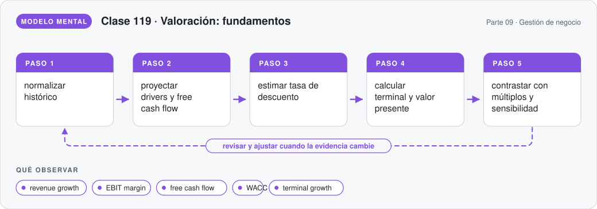

# Clase 119 — Valoración: fundamentos

<!-- nav:inicio -->
> **Parte 09 · Finanzas y contabilidad para gerentes** — clase 11 de 12 · [índice de la parte](../../README.md) · [temario](../../../../SYLLABUS.md)
<!-- nav:fin -->

**Parte:** 09 — Finanzas y contabilidad para gerentes  
**Nivel:** Etapa 3 — Manager → Gerente  
**Duración sugerida:** 150–180 minutos · **Estándar:** deep-class-v2

## 🎯 Propósito

Valorar una empresa, una unidad o un proyecto es responder cuánto vale **hoy** lo que generará en el futuro. Parece una pregunta de banqueros, pero se presenta a diario a gerentes: ¿cuánto vale nuestra división?, ¿pagamos demasiado por esta adquisición?, ¿qué participación debemos ceder a un inversionista?, ¿esta iniciativa agrega valor? Una valoración no es un número exacto sino una **afirmación argumentada** sobre flujos futuros, riesgo y comparables, que debe explicitar sus supuestos y mostrar cuánto cambia el valor si se equivocan.

La clase se apoya en Damodaran, en Koller, Goedhart y Wessels y en Brealey, Myers y Allen, que desarrollan el enfoque de flujos descontados, los múltiplos y el costo de capital. Al terminar sabrás los componentes de una valoración por flujos descontados, qué mide un múltiplo, qué supuestos pesan más, cómo pasar de valor de empresa a valor del patrimonio y cómo detectar valoraciones que parten de la conclusión.

## 📚 Resultados de aprendizaje

Al finalizar podrás:

1. **Explicar** el enfoque de flujos descontados y sus componentes.
2. **Estimar** flujos libres, tasa de descuento y valor terminal con supuestos explícitos.
3. **Interpretar** múltiplos de mercado y sus límites.
4. **Pasar** del valor de la empresa al valor del patrimonio.
5. **Analizar** la sensibilidad del valor y evaluar la solidez de una valoración.

## 🧭 Agenda

| Tramo | Qué se hace |
|---|---|
| 0–20 min | Recuperación: ¿cuánto pagarías hoy por recibir USD 100 en cinco años y qué determina tu respuesta? |
| 20–60 min | Flujos, descuento, valor terminal, múltiplos y puente a patrimonio. |
| 60–105 min | Ejemplo trabajado: valoración de una empresa de servicios con tres escenarios. |
| 105–150 min | Caso ejecutivo y práctica. |
| 150–175 min | Límites y entregable. |

## 🧩 Conceptos centrales

| Concepto | Definición | Cómo se reconoce |
|---|---|---|
| **Valor presente** | Equivalente hoy de un flujo futuro, descontado por tiempo y riesgo. | Flujo / (1 + r)ᵗ. |
| **Flujo de caja libre** | Caja que genera la operación tras impuestos e inversiones necesarias. | Disponible para acreedores y accionistas. |
| **Costo de capital (WACC)** | Tasa que remunera a acreedores y accionistas según el riesgo. | Tasa de descuento de los flujos de la empresa. |
| **Valor terminal** | Valor de los flujos posteriores al horizonte explícito. | Suele ser más de la mitad del valor. |
| **Valor de la empresa (enterprise value)** | Valor de las operaciones para todos los proveedores de capital. | Antes de restar la deuda neta. |
| **Múltiplo** | Relación entre el valor y una medida (ingresos, EBITDA, utilidad). | Se compara con empresas parecidas. |

## 🧠 Modelo mental

**Cómo leer el diagrama.** Una escalera de cuatro peldaños. Se **proyectan los flujos libres** con supuestos explícitos; se **descuentan** al costo de capital, que refleja el riesgo; se estima el **valor terminal** de los años más allá del horizonte; y se pasa **del valor de la empresa al del patrimonio** restando la deuda neta. La nota recuerda la parte más importante: el valor depende mucho de pocos supuestos, y un buen informe muestra cuánto cambia cuando se mueven.

## 📖 Desarrollo

### 1. La idea central

Un activo vale lo que generará en el futuro, traído al presente. Dos fuerzas lo reducen: el **tiempo** (un dólar hoy vale más que uno mañana, porque puede invertirse) y el **riesgo** (un flujo incierto vale menos que uno seguro). El **valor presente** de un flujo se calcula descontándolo a una tasa que combina ambas. Damodaran subraya que toda valoración es una historia respaldada por números: una narrativa sobre el negocio (crecimiento, márgenes, reinversión, riesgo) que se traduce en flujos y se contrasta con la realidad.

### 2. Flujos de caja libre

El **flujo de caja libre para la empresa** es el resultado operacional después de impuestos (NOPAT) más la depreciación, menos la inversión en activos fijos y en capital de trabajo. Se proyecta para un horizonte explícito (cinco a diez años) a partir de supuestos de crecimiento de ingresos, márgenes, tasa de impuestos y reinversión. Koller, Goedhart y Wessels subrayan la coherencia: el crecimiento exige reinversión, y la relación entre ambos se resume en el ROIC (clase 118). Un plan que supone crecer mucho sin invertir o con retornos exagerados es inconsistente.

### 3. La tasa de descuento

Los flujos de la empresa se descuentan con el **WACC**: promedio ponderado del costo de la deuda (después de impuestos) y del costo del capital propio. El costo del capital propio suele estimarse con el modelo de **valoración de activos de capital (CAPM)**: tasa libre de riesgo más beta por la prima de riesgo de mercado; hay ajustes por riesgo país, tamaño y liquidez. Brealey, Myers y Allen explican sus fundamentos y límites. Pequeñas variaciones en la tasa cambian mucho el valor, sobre todo en empresas con flujos lejanos: es una de las variables que más debe someterse a sensibilidad.

### 4. Valor terminal

Más allá del horizonte explícito, la empresa sigue generando flujos. El **valor terminal** los resume con una **perpetuidad con crecimiento** (flujo del año siguiente / (WACC − g)) o con un **múltiplo de salida**. Suele representar más de la mitad del valor total, por lo que es un punto clave. El crecimiento perpetuo **g** no debería superar el crecimiento esperado de la economía; y el retorno sobre el capital en el valor terminal debe ser coherente con la competencia: asumir retornos extraordinarios para siempre es un error frecuente.

### 5. Múltiplos

Un **múltiplo** relaciona el valor con una medida: valor de empresa/EBITDA, precio/utilidad, valor/ingresos. Se aplica a una empresa comparando con **empresas parecidas** (comparables) o con transacciones. Es rápido y refleja el sentimiento del mercado, pero **depende de la calidad de los comparables** (crecimiento, riesgo, márgenes, tamaño) y puede incluir sobrevaloraciones del mercado. Damodaran recomienda entender de qué fundamentos depende cada múltiplo (crecimiento, retorno, riesgo) y no compararlos de forma mecánica. Los múltiplos complementan, no reemplazan, el enfoque de flujos.

### 6. Del valor de la empresa al del patrimonio

El valor presente de los flujos libres da el **valor de la empresa** (de sus operaciones). Para obtener el valor para los dueños se resta la **deuda neta** (deuda financiera menos caja) y otras obligaciones asimilables a deuda (por ejemplo, ciertos pasivos por pensiones o arrendamientos), y se suma el valor de activos no operativos. En empresas pequeñas y cerradas, se consideran descuentos por falta de liquidez y primas o descuentos por control. Estos ajustes tienen un efecto relevante y deben justificarse.

### 7. Sensibilidad y evaluación de una valoración

Un buen informe de valoración muestra: la **historia** del negocio, los **supuestos** y su origen, las **cifras proyectadas**, el **rango de valores** según escenarios, una **tabla de sensibilidad** (por ejemplo, valor frente a WACC y a crecimiento terminal), y la **contrastación con múltiplos**. Se desconfía de valoraciones que parten de un precio deseado y ajustan los supuestos para llegar a él: la dirección correcta va de los supuestos al valor. Y se distingue **valor** (lo que se estima que vale) de **precio** (lo que se paga), que depende de la negociación y de las condiciones del mercado.

## 📚 Lectura comparada

| Obra | Qué aporta | Qué no resuelve | Pregunta para contrastar |
|---|---|---|---|
| Damodaran | Valoración como historia y números; múltiplos y flujos. | Es extensa y requiere juicio. | ¿Qué historia sostiene tus números? |
| Koller, Goedhart y Wessels | Flujos libres, ROIC y coherencia con el crecimiento. | Orientada a empresas grandes. | ¿Es coherente el crecimiento con la reinversión? |
| Brealey, Myers y Allen | Valor presente, riesgo y costo de capital. | Supuestos de mercados eficientes. | ¿Qué tasa refleja el riesgo? |
| Palepu, Healy y Peek | Análisis de estados y proyección para valorar. | Visión de analista. | ¿Qué parte de la historia contable es recurrente? |
| Penman | Valoración a partir de estados financieros. | Más técnico. | ¿Qué parte del valor ya está en la operación actual? |

## 🧮 Ejemplo trabajado

**Situación (hipotética).** Una empresa de servicios de ingeniería con ingresos de USD 20 millones y margen operacional de 12 % evalúa su valor para una posible venta parcial. Deuda neta: USD 4 millones. Tasa de impuestos 25 %.

**Supuestos base.** Crecimiento de ingresos 8 % anual durante cinco años, margen operacional estable, reinversión neta equivalente al 20 % del NOPAT, WACC 10 %, crecimiento terminal 3 %.

| Año | Ingresos | NOPAT (12 % × 0,75) | Reinversión (20 %) | Flujo libre | Valor presente al 10 % |
|---|---|---|---|---|---|
| 1 | 21,6 | 1,94 | 0,39 | 1,55 | 1,41 |
| 2 | 23,3 | 2,10 | 0,42 | 1,68 | 1,39 |
| 3 | 25,2 | 2,27 | 0,45 | 1,82 | 1,37 |
| 4 | 27,2 | 2,45 | 0,49 | 1,96 | 1,34 |
| 5 | 29,4 | 2,65 | 0,53 | 2,12 | 1,32 |
| **Suma de flujos explícitos** | | | | | **6,83** |

**Valor terminal.** Flujo del año 6 ≈ 2,12 × 1,03 = 2,18; valor terminal en el año 5 = 2,18 / (0,10 − 0,03) = 31,2; valor presente = 31,2 / 1,10⁵ ≈ 19,4.

**Valor de la empresa.** 6,83 + 19,4 ≈ USD 26,2 millones. **Valor del patrimonio.** 26,2 − 4 (deuda neta) ≈ USD 22,2 millones. El valor terminal es el 74 % del valor de la empresa.

**Sensibilidad.** Con WACC de 12 %: valor terminal = 2,18 / 0,09 = 24,2; valor presente ≈ 13,7; flujos explícitos ≈ 6,5: empresa ≈ 20,2; patrimonio ≈ 16,2. Con WACC de 9 %: empresa ≈ 30,6. Un cambio de uno a dos puntos de tasa mueve el valor entre −23 % y +17 %.

**Contraste con múltiplos.** El EBITDA estimado es unos USD 3,4 millones; un múltiplo comparable de 7 a 8 veces implica valor de empresa de USD 24 a 27 millones, coherente con el resultado. Se verifica que los comparables tengan crecimiento y riesgo similares.

**Conclusión.** Un rango razonable del valor del patrimonio es de USD 16 a 26 millones, con un punto central de unos 22. La negociación del precio dependerá de las alternativas del comprador y del vendedor.

**Qué muestra.** (1) El valor terminal domina. (2) Uno o dos puntos de tasa mueven el valor entre un 17 % y un 23 %. (3) El resultado se contrastó con múltiplos y se presentó como rango.

## 🔀 Comparación y límites

**Valor frente a precio.** El valor es una estimación basada en fundamentos; el precio es el resultado de una negociación o del mercado. Pueden diferir mucho, y comprender por qué es parte del trabajo.

**Límites.** Toda valoración depende de proyecciones inciertas; el valor terminal y la tasa pesan demasiado. Para empresas jóvenes, sin historial o con negocios muy inciertos, el método requiere escenarios y probabilidades. Los múltiplos dependen de comparables imperfectos. Las normas contables, tributarias y de valoración con fines legales (por ejemplo, fusiones o reportes a reguladores) tienen requisitos propios que se verifican con asesoría especializada. Esta clase no entrega una valoración utilizable como opinión profesional.

## 🪜 De profesional a owner

| Nivel | Cómo usa la valoración |
|---|---|
| **Profesional** | Entiende cómo su trabajo afecta flujos y riesgo. |
| **Jefe / Team Lead** | Estima el valor de una iniciativa con flujos y sensibilidad. |
| **Gerente** | Evalúa unidades y proyectos con flujos descontados y comparables. |
| **CEO / Director** | Usa la valoración para decidir compras, ventas y asignación de capital. |
| **Founder / Owner** | Entiende qué impulsa el valor de su empresa y qué ofrecen los inversionistas. |

## 🏢 Caso ejecutivo

Una empresa familiar de transporte refrigerado con ventas de USD 60 millones recibe una oferta de adquisición de un fondo por USD 85 millones por el 100 % del patrimonio, equivalente a 8,5 veces el EBITDA. La empresa tiene deuda neta de USD 18 millones y flotas con 12 años de antigüedad promedio que requerirán renovación en cuatro años. Los dos socios fundadores discrepan: uno quiere vender; el otro considera que el valor es mayor por un contrato de largo plazo con un cliente que representa el 35 % de los ingresos y vence en tres años. El banco de inversión del comprador presenta un múltiplo basado en transacciones de empresas con flotas nuevas.

Entrega un **informe de valoración y recomendación** que contenga: (a) la historia del negocio y los supuestos de crecimiento, márgenes y reinversión con la renovación de flota; (b) el valor por flujos descontados con tres escenarios (incluida la pérdida del contrato); (c) la revisión de los comparables del comprador y su ajuste; (d) la tabla de sensibilidad frente a WACC y crecimiento terminal; (e) el puente de valor de la empresa a valor del patrimonio; (f) la recomendación sobre la oferta, las condiciones de negociación y las verificaciones legales, contables y tributarias con asesoría.

## 🧪 Práctica

1. Calcula el valor presente de tres flujos futuros a una tasa dada.
2. Proyecta cinco años de flujo libre de una empresa y estima su valor terminal.
3. Calcula el valor con dos tasas distintas y mide la diferencia.
4. Elige dos múltiplos y explica de qué dependen.
5. Escribe cinco supuestos de tu valoración y cómo los validarías.

## ⚠️ Errores frecuentes

| Error | Por qué ocurre | Cómo corregirlo |
|---|---|---|
| Partir del precio deseado | Se quiere justificar una cifra | Ir de los supuestos al valor. |
| Valor terminal sin coherencia | Se asume crecimiento o retorno perpetuo excesivo | g menor al de la economía y retorno coherente. |
| Un solo número | Se busca precisión | Rango y sensibilidad. |
| Comparables inadecuados | Se eligen por conveniencia | Ajustar por crecimiento, riesgo y márgenes. |
| Olvidar la reinversión | Se proyecta solo ingreso | Vincular crecimiento y capital. |
| Confundir valor con precio | Se mezclan | Separar fundamentos de negociación. |

## ❓ Preguntas de comprobación

1. ¿Qué dos fuerzas reducen el valor presente de un flujo futuro?
2. ¿Qué es el flujo de caja libre?
3. ¿Qué representa el WACC y por qué es sensible?
4. ¿Qué es el valor terminal y por qué es crítico?
5. ¿Qué límites tienen los múltiplos?
6. ¿Cómo se pasa del valor de la empresa al del patrimonio?
7. ¿Qué diferencia hay entre valor y precio?

Claves de respuesta

1. El tiempo (un dólar hoy vale más que uno mañana) y el riesgo (un flujo incierto vale menos).
2. La caja que genera la operación después de impuestos e inversiones necesarias, disponible para acreedores y accionistas.
3. La tasa que remunera a acreedores y accionistas según el riesgo; es sensible porque pequeñas variaciones cambian mucho el valor, sobre todo con flujos lejanos.
4. El valor de los flujos posteriores al horizonte explícito; suele ser más de la mitad del valor y depende de supuestos de crecimiento y retorno de largo plazo.
5. Dependen de comparables imperfectos y del sentimiento del mercado, y no reemplazan los fundamentos.
6. Restando la deuda neta y otras obligaciones asimilables, sumando activos no operativos y ajustando por liquidez o control cuando corresponda.
7. El valor es una estimación basada en fundamentos; el precio es lo que se paga en una negociación o en el mercado.

## 📥 Entregable

Guarda en `portfolio/119-valoracion-fundamentos/`:

- `modelo-financiero-y-memo-de-decision.md` (plantilla [Modelo financiero y memo de decisión](../../../../templates/modelo-financiero-y-memo-de-decision.md)) con el informe de valoración del caso ejecutivo;
- `capital-allocation.md` (plantilla [Capital allocation](../../../../templates/capital-allocation.md)) con la comparación entre vender, mantener o renovar;
- `decision-journal.md` con los supuestos, los escenarios y las condiciones de negociación.

## 📗 Fuentes y verificación

- Aswath Damodaran — *Investment Valuation* (John Wiley & Sons, Incorporated, 2012). **Uso en esta clase:** valoración como historia respaldada por números. Lectura selectiva sobre **valoración: fundamentos**. **Localizador:** [ISBN-13 9781118206546](https://openlibrary.org/isbn/9781118206546).
- Tim Koller, Marc Goedhart & David Wessels — *Valuation: Measuring and Managing the Value of Companies* (Wiley, 2005). **Uso en esta clase:** flujos libres, ROIC y coherencia con el crecimiento. Lectura selectiva sobre **valoración: fundamentos**. **Localizador:** [ISBN-13 9780471702191](https://openlibrary.org/isbn/9780471702191).
- Richard Brealey, Stewart Myers & Franklin Allen — *Principles of Corporate Finance* (McGraw-Hill International Book Co, 1984). **Uso en esta clase:** valor presente, riesgo y costo de capital. Lectura selectiva sobre **valoración: fundamentos**. **Localizador:** [ISBN-13 9780070662025](https://openlibrary.org/isbn/9780070662025).
- Krishna G. Palepu, Paul M. Healy & Erik Peek — *Business Analysis and Valuation* (South-Western College Pub, 1996). **Uso en esta clase:** análisis de estados y proyección para valorar. Lectura selectiva sobre **valoración: fundamentos**. **Localizador:** [ISBN-13 9780324375817](https://openlibrary.org/isbn/9780324375817).
- Stephen H. Penman — *Financial Statement Analysis and Security Valuation* (McGraw-Hill/Irwin, 2001). **Uso en esta clase:** valoración a partir de estados financieros. Lectura selectiva sobre **valoración: fundamentos**. **Localizador:** [ISBN-13 9780072903331](https://openlibrary.org/isbn/9780072903331).

> **Regla de fuentes para Valoración: fundamentos:** las obras anteriores estructuran las perspectivas de esta materia; cualquier norma, ley o estándar vivo mencionado debe comprobarse nuevamente en su fuente primaria vigente, incluidos los requisitos de valoración con fines legales o tributarios. Los ejemplos y casos son hipotéticos, con cifras ilustrativas. El desarrollo es original y no reproduce capítulos protegidos.

<!-- pie:inicio -->
---

| Anterior | Índice | Siguiente |
|---|---|---|
| [← 118 · ROI, ROIC y decisiones de inversión](../118-roi-roic-y-decisiones-de-inversion/README.md) | [Parte 09](../../README.md) · [Programa](../../../../SYLLABUS.md) | [120 · Capstone: comité de inversión →](../120-capstone-comite-de-inversion/README.md) |
<!-- pie:fin -->
