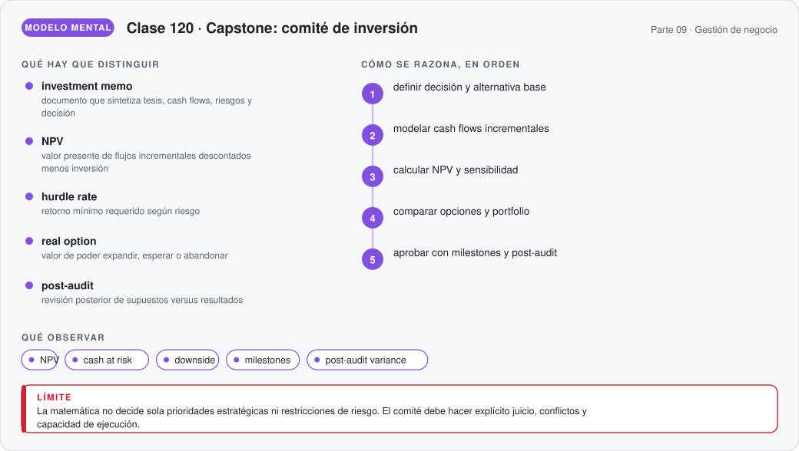

# Clase 120 — Capstone: comité de inversión

<!-- nav:inicio -->
> **Parte 09 · Finanzas y contabilidad para gerentes** — clase 12 de 12 · [índice de la parte](../../README.md) · [temario](../../../../SYLLABUS.md)
<!-- nav:fin -->

**Parte:** 09 — Finanzas y contabilidad para gerentes  
**Nivel:** Etapa 3 — Manager → Gerente  
**Duración sugerida:** 150–180 minutos · **Estándar:** deep-class-v2

## 🎯 Propósito

Un comité de inversión es el lugar donde las finanzas dejan de ser un reporte y se convierten en una decisión. Quien presenta una propuesta tiene incentivos para defenderla; quienes la evalúan suelen tener información incompleta y poco tiempo. Lo que distingue a los comités que deciden bien es la calidad del **proceso**: una tesis clara, números coherentes con los estados financieros, supuestos explícitos, escenarios, alternativas comparadas, riesgos con dueños y una decisión con condiciones y criterios de revisión.

Este capstone integra la parte 09 y se apoya en Brealey, Myers y Allen, Koller y colegas, Damodaran, Palepu, Healy y Peek, Graham y Harvey y Jensen. Al terminar sabrás preparar un memo de inversión, someterlo a un comité simulado que lo cuestiona, defender y ajustar los supuestos y registrar una decisión con condiciones, hitos y criterios para detener o ampliar.

## 📚 Resultados de aprendizaje

Al finalizar podrás:

1. **Estructurar** un memo de inversión con tesis, números, riesgos y decisión solicitada.
2. **Construir** el modelo financiero a partir de supuestos explícitos con escenarios.
3. **Someter** una propuesta a preguntas críticas y ajustar el análisis.
4. **Comparar** alternativas, incluida la de no hacer nada.
5. **Registrar** una decisión con condiciones, hitos y revisión posterior.

## 🧭 Agenda

| Tramo | Qué se hace |
|---|---|
| 0–20 min | Recuperación: ¿qué tres preguntas harías a una propuesta de inversión antes de ver el retorno? |
| 20–60 min | Estructura del memo, modelo, escenarios y proceso del comité. |
| 60–105 min | Ejemplo trabajado: comité sobre un nuevo centro de distribución. |
| 105–150 min | Caso ejecutivo integrado. |
| 150–175 min | Rúbrica, límites y entregable. |

## 🧩 Conceptos centrales

| Concepto | Definición | Cómo se reconoce |
|---|---|---|
| **Memo de inversión** | Documento que presenta la tesis, el análisis y la decisión solicitada. | Se puede evaluar sin la presencia de su autor. |
| **Tesis** | Razón por la cual la inversión crea valor. | Responde por qué ganaremos y qué pasa si no actuamos. |
| **Caso base y escenarios** | Proyección central y alternativas adversa y favorable. | Muestran el rango de resultados. |
| **Alternativa cero** | No invertir o mantener la situación actual. | Es el punto de comparación. |
| **Premortem** | Ejercicio de imaginar el fracaso y sus causas antes de decidir. | Revela riesgos que el entusiasmo oculta. |
| **Revisión posterior** | Comparación de lo real con lo proyectado tras la inversión. | Alimenta aprendizaje del comité. |

## 🧠 Modelo mental

**Cómo leer el diagrama.** Tres columnas que forman el memo. La **tesis** dice qué problema u oportunidad se aborda, por qué ganaremos y qué alternativas se consideraron. Los **números** reúnen los flujos y supuestos (estados, capital de trabajo, presupuesto y escenarios, economía unitaria y retorno frente al costo de capital). **Riesgos y decisión** incluyen qué puede salir mal, qué se pide al comité y con qué condiciones y criterios de detención. Las cifras entre paréntesis remiten a las clases donde se desarrolla cada herramienta.

## 📖 Desarrollo

### 1. La tesis antes del modelo

Un memo comienza con una **tesis** de una página: qué problema u oportunidad aborda, por qué la empresa tiene una ventaja para capturarlo, qué ocurre si no se hace nada y cuáles son las alternativas. Si la tesis no se sostiene sin números, no hay modelo que la rescate; si el modelo se construye antes de entender el negocio, tiende a ser un ejercicio de ajustar supuestos al resultado deseado. Damodaran insiste en que cada valoración es una historia respaldada por números: el comité evalúa primero la historia.

### 2. Números coherentes con los estados

El modelo conecta **estado de resultados, balance y flujo de caja** (clases 109 a 112): ingresos y márgenes (110, 113), capital de trabajo (114), inversión en activos, financiamiento y caja. Se verifica que el balance cuadre y que el flujo explique el cambio de caja. Las proyecciones se anclan en datos históricos y en el presupuesto vigente (115), y el crecimiento se conecta con la reinversión (118). Una revisión de **consistencia** detecta errores frecuentes: crecimiento sin capital de trabajo, márgenes que mejoran sin razón, impuestos olvidados o inversiones de mantenimiento ausentes.

### 3. Supuestos, escenarios y sensibilidad

Los supuestos se presentan en **una sola hoja**, separados del cálculo, con su fuente y su rango plausible, y marcando cuáles mueven el resultado. Se construyen **tres escenarios** con supuestos diferenciados, y una **tabla de sensibilidad** para los dos o tres más influyentes. Se calcula el **punto de equilibrio** de la inversión (116): cuánto debe venderse para recuperar el capital. Siguiendo la advertencia de los sesgos de planificación (clase 076), se agrega la **visión desde afuera**: cómo les fue a inversiones similares de la empresa o del sector.

### 4. Retorno, valor y riesgo

Se calculan **VPN, TIR y período de recuperación** (118) a un costo de capital ajustado por riesgo, y su efecto en el **ROIC** de la empresa. Si la inversión es un negocio con clientes, se examina su **economía unitaria** (117). Si se trata de una adquisición, se hace una **valoración** (119) con rangos y se contrasta el precio con el valor. Se explicitan los **riesgos**: de ejecución, de mercado, de financiamiento, regulatorios, de dependencia de personas o clientes; cada uno con **probabilidad**, **impacto**, **señal de alerta** y **dueño**, siguiendo la lógica de las clases de gestión de riesgos.

### 5. El comité como proceso de decisión

El comité cumple su función cuando **cuestiona con método**. Prácticas útiles, apoyadas en la evidencia sobre sesgos de grupo (clase 104): enviar el memo con anticipación; pedir **juicios individuales por escrito** antes de la discusión; asignar un **abogado del diablo** o un equipo rojo; realizar un **premortem** («imaginemos que fracasó en tres años: ¿por qué?»); separar la discusión de la tesis, de los números y de los riesgos; y registrar los **desacuerdos** y las condiciones. Eisenhardt mostró que los equipos que deciden bien consideran varias alternativas a la vez; el comité debe preguntar siempre por la alternativa cero y por una distinta.

### 6. Decidir con condiciones

Las decisiones no son solo «sí» o «no». Se puede **aprobar por etapas** (liberando fondos al cumplir hitos), **aprobar con condiciones** (contratos firmados, aprobación regulatoria, financiamiento asegurado), **pedir más información** con plazo definido, **aprobar una versión menor** o **rechazar** con razones. Se definen **criterios de detención** antes de comenzar: qué resultado, en qué fecha, hará que se pause o se cierre (clase 083). Y se asigna un **dueño** con autoridad y responsabilidad por resultados, y un calendario de **informes de avance**.

### 7. Revisión posterior y aprendizaje

Pocas empresas comparan sistemáticamente lo proyectado con lo ocurrido. Una **revisión posterior** al primer año y al tercero responde: ¿se cumplieron los supuestos?, ¿qué sorprendió?, ¿qué sesgos aparecieron (optimismo, subestimación de plazos)?, ¿qué haríamos distinto? Graham y Harvey muestran que las empresas usan diversos criterios, y los comités mejoran cuando registran qué criterio usaron y qué resultado produjo. También se revisa **cómo se incentiva** a quien propone (Jensen): si los proponentes son evaluados por la aprobación de sus proyectos y no por sus resultados, el comité recibirá propuestas infladas.

## 📚 Lectura comparada

| Obra | Qué aporta | Qué no resuelve | Pregunta para contrastar |
|---|---|---|---|
| Brealey, Myers y Allen | Criterios de inversión y riesgo. | Supuestos de mercado. | ¿Qué tasa refleja el riesgo? |
| Koller et al. | ROIC y creación de valor. | Visión de valoración de empresas. | ¿El proyecto rinde más que su costo de capital? |
| Damodaran | Narrativa y números en una valoración. | Exige juicio. | ¿Qué historia sostiene la propuesta? |
| Graham y Harvey | Práctica real de decisiones de inversión. | Encuesta de un período. | ¿Qué criterio usa realmente tu comité? |
| Jensen | Incentivos que distorsionan propuestas y presupuestos. | Ensayo teórico. | ¿Qué gana quien propone? |

## 🧮 Ejemplo trabajado

**Situación (hipotética).** El gerente de operaciones de una distribuidora de productos de consumo propone construir un centro de distribución propio por USD 14 millones para reemplazar bodegas arrendadas y atender 30 % más pedidos. Presenta un VPN de USD 5,2 millones, TIR de 17 % y payback de 6 años. El costo de capital de la empresa es 10 %. Le exigen un memo para el comité.

**Tesis.** Reducir el costo logístico por pedido en 18 % y soportar el crecimiento. Alternativas: seguir arrendando y ampliar bodegas (alternativa cero mejorada); contratar un operador logístico; construir en dos fases.

**Revisión del comité.**

| Pregunta | Hallazgo |
|---|---|
| ¿El crecimiento de pedidos del 30 % tiene respaldo? | Sólo 12 % se debe a contratos firmados; el resto es expectativa. |
| ¿Se incluyó capital de trabajo y mantenimiento? | No se incluyó inventario adicional (USD 1,8 M) ni mantenimiento mayor al año 8. |
| ¿Qué dice la visión desde afuera? | Los dos últimos proyectos de infraestructura costaron 24 % más y tardaron 9 meses más. |
| ¿Cuál es la sensibilidad? | Con 15 % menos de ahorro, el VPN cae a USD 1,6 M; con sobrecosto de 24 % y 9 meses de retraso, a USD −0,4 M. |
| ¿Qué pasa con el operador logístico? | Sin inversión inicial; ahorro de 9 % y mayor dependencia de un tercero. |

**Premortem.** Escenarios de fracaso: el crecimiento esperado no llega; el sobrecosto de construcción; el cliente principal cambia de modelo de entrega; la mano de obra no se consigue.

**Decisión del comité.** Aprobar por etapas: (1) 3 millones para el diseño, permisos y una opción de terreno; (2) liberar el resto al lograr contratos que cubran al menos el 25 % del crecimiento proyectado y una cotización de construcción a precio cerrado con garantías; (3) en paralelo, pilotear un operador logístico en una región. Criterios de detención: si en 12 meses los contratos no alcanzan el umbral o el precio supera 10 % lo presupuestado, se pausa y se opta por ampliar bodegas. Dueño: el gerente de operaciones; informes trimestrales; revisión posterior al primer año de operación.

**Qué muestra.** (1) El comité cuestionó supuestos antes del retorno. (2) La sensibilidad y la visión desde afuera cambiaron el VPN. (3) La decisión fue por etapas, con criterios de detención.

## 🔀 Comparación y límites

**Comité de inversión frente a decisión individual.** El comité reduce errores individuales pero introduce sesgos de grupo y dilución de responsabilidad; se mitigan con juicios previos, roles definidos y un dueño claro.

**Límites.** Los números del ejemplo son ilustrativos. Un buen proceso no garantiza buenos resultados, pero mejora la probabilidad. Muchas inversiones tienen componentes estratégicos o de oportunidad que no se capturan en los flujos. Las decisiones con implicancias legales, tributarias, regulatorias o de financiamiento deben validarse con asesoría especializada, y los contratos de construcción y de deuda con abogados.

## 🪜 De profesional a owner

| Nivel | Cómo participa en el comité de inversión |
|---|---|
| **Profesional** | Aporta datos precisos y señala los supuestos débiles. |
| **Jefe / Team Lead** | Prepara el análisis de una propuesta con sensibilidad. |
| **Gerente** | Presenta el memo, defiende con evidencia y acepta condiciones. |
| **CEO / Director** | Preside con método, protege el diálogo franco y decide con condiciones. |
| **Founder / Owner** | Decide con su propio capital y disciplina la intuición con números. |

## 🏢 Caso ejecutivo

Una cadena de clínicas veterinarias con 18 sucursales evalúa tres propuestas para el próximo año, con presupuesto de inversión de USD 8 millones: (A) abrir 6 nuevas clínicas en comunas de ingresos medios (USD 6 millones); (B) adquirir una cadena de 5 clínicas con un descuento aparente (USD 7 millones y deuda asumida de USD 2 millones); (C) un centro de diagnóstico por imágenes compartido (USD 3 millones). Cada gerente defiende la suya. La empresa tiene deuda neta de 2,1 veces su EBITDA y un covenant de 3,0; su costo de capital es 10 %. Las últimas cuatro clínicas alcanzaron su punto de equilibrio en 26 meses en vez de los 14 proyectados.

Entrega un **memo de inversión y acta del comité** que contenga: (a) la tesis de cada propuesta y la alternativa cero; (b) el modelo comparable con supuestos, escenarios y sensibilidad, vinculado a los tres estados y a la caja; (c) VPN, TIR, payback y ROIC frente al costo de capital, ajustados con la visión desde afuera; (d) los riesgos, incluidos el covenant y el capital de trabajo; (e) el desarrollo del comité simulado, con juicios previos, premortem y desacuerdos; (f) la decisión con etapas, condiciones, criterios de detención, dueño y revisión posterior, y las verificaciones legales y contractuales.

## 🧪 Práctica

1. Redacta la tesis de una inversión en una página, con la alternativa cero.
2. Arma una hoja de supuestos con fuente, rango y sensibilidad.
3. Realiza un premortem con tres colegas sobre una propuesta.
4. Escribe una decisión por etapas con criterios de detención.
5. Diseña la revisión posterior a doce meses con tres preguntas.

## ⚠️ Errores frecuentes

| Error | Por qué ocurre | Cómo corregirlo |
|---|---|---|
| Modelo antes de la tesis | Se busca el número | Tesis de una página primero. |
| Sin alternativa cero | Se compara entre inversiones | Incluir no hacer nada y una distinta. |
| Un solo escenario | Se busca simplicidad | Base, adverso y favorable con sensibilidad. |
| Olvidar capital de trabajo y covenants | Se mira el proyecto aislado | Conectar con los tres estados y la deuda. |
| Decisión binaria | Se evita la complejidad | Por etapas y con condiciones. |
| No revisar | Se pasa a lo siguiente | Revisión posterior y aprendizaje. |

## ❓ Preguntas de comprobación

1. ¿Qué contiene un memo de inversión?
2. ¿Por qué se incluye la alternativa cero?
3. ¿Qué verificaciones de consistencia debe hacer un modelo?
4. ¿Para qué sirven la sensibilidad y la visión desde afuera?
5. ¿Qué prácticas mejoran la calidad del debate de un comité?
6. ¿Qué formas puede tener una decisión además de aprobar o rechazar?
7. ¿Qué límite tiene un buen proceso de decisión?

Claves de respuesta

1. Tesis, números con supuestos y escenarios, riesgos con dueños y la decisión solicitada con sus condiciones.
2. Porque es el punto de comparación: toda inversión debe superar no hacer nada y una alternativa distinta.
3. Que el balance cuadre, que el flujo explique la caja, que el crecimiento incluya capital de trabajo y reinversión y que los márgenes y los impuestos estén justificados.
4. Para ver qué supuestos mueven más el resultado y corregir el optimismo con la experiencia de proyectos similares.
5. Juicios individuales previos, abogado del diablo, premortem y registro de desacuerdos y condiciones.
6. Aprobar por etapas, con condiciones, pedir más información con plazo, aprobar una versión menor o rechazar con razones.
7. No garantiza buenos resultados; solo mejora su probabilidad, y muchas inversiones tienen componentes estratégicos difíciles de medir.

## 📥 Entregable

Guarda en `portfolio/120-capstone-comite-de-inversion/`:

- `leadership-decision-brief.md` (plantilla [Leadership Decision Brief](../../../../templates/leadership-decision-brief.md)) con el memo y el acta del caso ejecutivo;
- `modelo-financiero-y-memo-de-decision.md` (plantilla [Modelo financiero y memo de decisión](../../../../templates/modelo-financiero-y-memo-de-decision.md)) con el modelo, los escenarios y la sensibilidad;
- `capital-allocation.md` (plantilla [Capital allocation](../../../../templates/capital-allocation.md)) con la comparación de alternativas y las etapas;
- `decision-journal.md` con los juicios previos, los desacuerdos y la revisión posterior.

## 📗 Fuentes y verificación

- Richard Brealey, Stewart Myers & Franklin Allen — *Principles of Corporate Finance* (McGraw-Hill International Book Co, 1984). **Uso en esta clase:** criterios de inversión y riesgo. Lectura selectiva sobre **capstone: comité de inversión**. **Localizador:** [ISBN-13 9780070662025](https://openlibrary.org/isbn/9780070662025).
- Tim Koller, Marc Goedhart & David Wessels — *Valuation: Measuring and Managing the Value of Companies* (Wiley, 2005). **Uso en esta clase:** ROIC y creación de valor. Lectura selectiva sobre **capstone: comité de inversión**. **Localizador:** [ISBN-13 9780471702191](https://openlibrary.org/isbn/9780471702191).
- Aswath Damodaran — *Investment Valuation* (John Wiley & Sons, Incorporated, 2012). **Uso en esta clase:** narrativa y números en una valoración. Lectura selectiva sobre **capstone: comité de inversión**. **Localizador:** [ISBN-13 9781118206546](https://openlibrary.org/isbn/9781118206546).
- John R. Graham & Campbell R. Harvey — *The theory and practice of corporate finance: evidence from the field* (Journal of Financial Economics, 2001). **Uso en esta clase:** práctica real de decisiones de inversión. Lectura selectiva sobre **capstone: comité de inversión**. **Localizador:** [DOI 10.1016/s0304-405x(01)00044-7](https://doi.org/10.1016/s0304-405x(01)00044-7).
- Michael C. Jensen — *Paying People to Lie: the Truth about the Budgeting Process* (European Financial Management, 2003). **Uso en esta clase:** incentivos que distorsionan propuestas y presupuestos. Lectura selectiva sobre **capstone: comité de inversión**. **Localizador:** [DOI 10.1111/1468-036x.00226](https://doi.org/10.1111/1468-036x.00226).

> **Regla de fuentes para Capstone: comité de inversión:** las obras anteriores estructuran las perspectivas de esta materia; cualquier norma, ley o estándar vivo mencionado debe comprobarse nuevamente en su fuente primaria vigente, incluidos los contratos de deuda y de construcción y la normativa tributaria y regulatoria aplicable. Los ejemplos y casos son hipotéticos y no describen a ninguna empresa real. El desarrollo es original y no reproduce capítulos protegidos.

<!-- pie:inicio -->
---

| Anterior | Índice | Siguiente |
|---|---|---|
| [← 119 · Valoración: fundamentos](../119-valoracion-fundamentos/README.md) | [Parte 09](../../README.md) · [Programa](../../../../SYLLABUS.md) | [121 · Ventas como sistema, no como improvisación →](../../../10-sales-commercial-negotiation/classes/121-ventas-como-sistema-no-como-improvisacion/README.md) |
<!-- pie:fin -->
