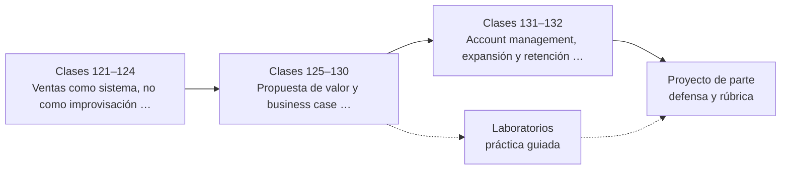

# Parte 10 — Ventas, desarrollo comercial y negociación

<!-- parte:inicio -->

> ← [Parte 09 — Finanzas y contabilidad para gerentes](../09-managerial-finance-accounting/README.md) · [Temario](../../SYLLABUS.md) · [Parte 11 — Marketing, cliente y crecimiento](../11-marketing-customers-growth/README.md) →

*Un sistema comercial repetible, no una racha de ventas*

**Etapa:** 3 — Gestión de negocio  
**Duración:** 12 clases · 30 horas  
**Resultado de salida:** Construir un sistema comercial repetible que encuentre, convierta y retenga clientes rentables.

🟣 [Ver las 6 etapas](../../SYLLABUS.md) · 12 clases (121–132) · 4 laboratorios · [proyecto de parte](project.md)

## 🎯 De qué trata esta parte

Vender bien no es talento sino proceso: a quién, con qué promesa, por qué canal y con qué economía. Esta parte trata las ventas como un sistema medible y la negociación como diseño de acuerdos.

El eje es **intereses antes que posiciones**: descubrir el problema real del cliente, construir un caso de negocio, manejar objeciones sin presionar y conceder solo con contrapartida.

## 🧱 Con qué hay que llegar

| Parte | Qué aporta |
|---|---|
| [09 — Finanzas y contabilidad para gerentes](../09-managerial-finance-accounting/README.md) | Márgenes y economía unitaria. |
| [02 — Comunicación, influencia y presencia ejecutiva](../02-communication-influence-negotiation-basics/README.md) | Escucha, persuasión ética y conversación difícil. |

Cada clase supone la anterior: el orden importa, y saltarse una deja sin base a las que vienen después.

## 📚 Resultados de la parte

Al terminar esta parte podrás:

1. **Definir** el cliente ideal y generar oportunidades.
2. **Diagnosticar** con discovery y construir un business case.
3. **Gestionar** pipeline y forecast con honestidad.
4. **Negociar** por intereses y fijar precio y concesiones.
5. **Expandir** y retener cuentas.

## 🗺️ Mapa de la parte

## 🧭 Cómo se encadenan las 12 clases

Las clases **121 a 124** abren el sistema: ventas como proceso, cliente ideal, prospección y discovery.

Las clases **125 a 130** cubren la conversación comercial: valor, pipeline, objeciones, negociación, precio y cierre.

Las clases **131 y 132** cubren la relación posterior y cierran con el capstone de negociación enterprise.

## 📘 Las 12 clases

| # | Clase | Qué se trabaja | Entregable | Min |
|---:|---|---|---|---:|
| 121 | [Ventas como sistema, no como improvisación](classes/121-ventas-como-sistema-no-como-improvisacion/README.md) | sales process, stage, exit criteria | [commercial-decision-brief](../../templates/commercial-decision-brief.md) | 150 |
| 122 | [ICP y segmentación comercial](classes/122-icp-y-segmentacion-comercial/README.md) | ICP, segment, fit | [risk-governance-brief](../../templates/risk-governance-brief.md) | 150 |
| 123 | [Prospección y generación de oportunidades](classes/123-prospeccion-y-generacion-de-oportunidades/README.md) | prospecting, trigger event, account research | [leadership-decision-brief](../../templates/leadership-decision-brief.md) | 150 |
| 124 | [Discovery y diagnóstico](classes/124-discovery-y-diagnostico/README.md) | situation, problem, implication | [product-evidence-brief](../../templates/product-evidence-brief.md) | 150 |
| 125 | [Propuesta de valor y business case](classes/125-propuesta-de-valor-y-business-case/README.md) | value proposition, business case, ROI | [modelo-financiero-y-memo-de-decision](../../templates/modelo-financiero-y-memo-de-decision.md) | 150 |
| 126 | [Pipeline y forecast comercial](classes/126-pipeline-y-forecast-comercial/README.md) | pipeline, coverage, forecast | [commercial-decision-brief](../../templates/commercial-decision-brief.md) | 150 |
| 127 | [Objeciones y manejo de riesgo percibido](classes/127-objeciones-y-manejo-de-riesgo-percibido/README.md) | objection, concern, reframe | [risk-governance-brief](../../templates/risk-governance-brief.md) | 150 |
| 128 | [Negociación basada en intereses](classes/128-negociacion-basada-en-intereses/README.md) | position, interest, BATNA | [commercial-decision-brief](../../templates/commercial-decision-brief.md) | 150 |
| 129 | [Pricing y concesiones](classes/129-pricing-y-concesiones/README.md) | list price, value-based pricing, discount | [commercial-decision-brief](../../templates/commercial-decision-brief.md) | 150 |
| 130 | [Cierre y próximos pasos](classes/130-cierre-y-proximos-pasos/README.md) | commitment, mutual action plan, procurement | [leadership-decision-brief](../../templates/leadership-decision-brief.md) | 150 |
| 131 | [Account management, expansión y retención](classes/131-account-management-expansion-y-retencion/README.md) | adoption, renewal, expansion | [commercial-decision-brief](../../templates/commercial-decision-brief.md) | 150 |
| 132 | [Capstone: negociación enterprise](classes/132-capstone-negociacion-enterprise/README.md) | negotiation plan, economic buyer, give-get | [commercial-decision-brief](../../templates/commercial-decision-brief.md) | 150 |

## ⚠️ Riesgos característicos

- Hacer forecast con optimismo y sin evidencia.
- Conceder precio sin pedir nada a cambio.
- Vender a clientes que no encajan con la oferta.
- Descuidar la retención por perseguir nuevas cuentas.

## 🔤 Glosario de la parte

59 conceptos definidos en las clases, con la definición operacional que usa cada una.

| Concepto | Definición operacional |
|---|---|
| **account plan** | mapa de objetivos, stakeholders, riesgos y oportunidades. |
| **account research** | investigación mínima para formular relevancia. |
| **adoption** | uso efectivo de capacidades que habilitan valor. |
| **BATNA** | mejor alternativa disponible si no hay acuerdo. |
| **business case** | justificación económica y de riesgo para actuar. |
| **cadence** | secuencia de contactos multicanal. |
| **champion** | persona interna que promueve activamente la solución. |
| **close criteria** | evidencia requerida para considerar ganado. |
| **commit** | deals con alta evidencia de cierre en periodo según regla interna. |
| **commitment** | compromiso observable de la parte compradora. |
| **concern** | riesgo o incertidumbre que aún no es rechazo. |
| **concession** | condición cedida en negociación que debería intercambiarse. |
| **conversion rate** | proporción de oportunidades que pasan entre etapas. |
| **cost of inaction** | costo de mantener el estado actual. |
| **coverage** | ratio entre pipeline relevante y target. |
| **decision process** | personas, criterios y pasos mediante los que se compra. |
| **discount** | factor que reduce precio nominal. |
| **disqualifier** | condición que justifica no perseguir una oportunidad. |
| **economic buyer** | rol con autoridad económica final según contexto. |
| **exit criteria** | evidencia mínima para avanzar de etapa. |
| **expansion** | crecimiento de revenue dentro de cliente existente. |
| **fit** | grado de compatibilidad entre necesidad, solución y restricciones. |
| **forecast** | estimación temporal de cierres y revenue. |
| **give-get** | concesión condicionada a recibir valor equivalente o estratégico. |
| **ICP** | perfil de cliente con alto ajuste esperado entre problema, producto y economía. |
| **implication** | consecuencia económica u operativa del problema. |
| **interest** | necesidad, restricción o preocupación detrás de una posición. |
| **list price** | precio de referencia antes de descuentos. |
| **mutual action plan** | plan compartido de pasos, owners y fechas hacia decisión. |
| **need-payoff** | valor que tendría resolverlo. |
| **negotiation plan** | documento con intereses, BATNA, targets, issues y estrategia. |
| **next step** | acción calendarizada con dueño. |
| **objection** | razón expresada para no avanzar o cambiar condiciones. |
| **pipeline** | conjunto de oportunidades abiertas y su estado. |
| **position** | demanda explícita que una parte presenta. |
| **positive reply** | respuesta que abre una conversación comercial real. |
| **price waterfall** | secuencia desde precio lista hasta precio/net revenue real. |
| **problem** | fricción o brecha reconocida por el comprador. |
| **procurement** | proceso formal de compra. |
| **proof** | evidencia que reduce incertidumbre sobre capacidad de entregar. |
| **prospecting** | identificación y contacto proactivo con potenciales compradores. |
| **redline** | condición contractual o económica que no se acepta. |
| **reframe** | nueva forma de interpretar el problema sin negar la preocupación. |
| **renewal** | decisión de continuar la relación. |
| **reservation value** | límite a partir del cual es preferible la BATNA. |
| **ROI** | retorno estimado de la inversión. |
| **sales process** | secuencia definida de decisiones y evidencias desde oportunidad hasta cliente. |
| **segment** | grupo de clientes con necesidades o comportamiento comparables. |
| **situation** | hechos relevantes del contexto actual. |
| **slippage** | oportunidad cuya close date se desplaza repetidamente. |
| **stage** | estado de una oportunidad basado en evidencia, no optimismo. |
| **stall** | postergación que puede ocultar falta de prioridad o autoridad. |
| **TAM/SAM/SOM** | capas de tamaño de mercado con distinto alcance y accesibilidad. |
| **trigger event** | cambio que aumenta probabilidad o urgencia de necesidad. |
| **value proposition** | razón específica por la que un segmento obtendría valor superior. |
| **value-based pricing** | precio anclado al valor económico percibido y alternativas. |
| **velocity** | ritmo con que el pipeline se convierte en revenue. |
| **walk-away** | decisión de usar BATNA cuando el acuerdo cae bajo límite. |
| **ZOPA** | zona donde los límites de ambas partes permiten acuerdo. |

## 📦 Qué queda como evidencia

- Un perfil de cliente ideal con criterios de exclusión.
- Un pipeline con etapas y criterios de salida.
- Un plan de negociación con intereses y concesiones.
- El capstone: negociación enterprise.

## 🔗 Cómo se conecta

Se complementa con la parte 11 (marketing) y alimenta la parte 20 (primeros clientes) y la 23 (sistema semanal de ventas).

## 🧪 Cómo se trabaja

Son **12 clases de 150 minutos** —30 horas— con **4 laboratorios** y un proyecto integrador. Cada clase trae su propósito, sus conceptos, un caso, práctica, errores frecuentes, preguntas de comprobación, entregable y fuentes, y se evalúa con su `assessment.md`. Los laboratorios se resuelven con datos propios o sintéticos, nunca con datos reales de terceros, y la parte se cierra con el proyecto y su defensa. Las reglas de recorrido están en [la guía de navegación](../../docs/NAVIGATION.md).

<!-- parte:fin -->

## Laboratorios

- [Lab 01 — Discovery call](labs/lab-01.md)
- [Lab 02 — Pipeline review](labs/lab-02.md)
- [Lab 03 — Negotiation planner](labs/lab-03.md)
- [Lab 04 — Enterprise proposal](labs/lab-04.md)

## Proyecto de parte

Vender y negociar una solución B2B con múltiples decisores y presión por descuento.

## Bibliografía rectora

- Neil Rackham — *SPIN Selling* (Ventas)
- Matthew Dixon & Brent Adamson — *The Challenger Sale* (Ventas)
- Roger Fisher, William Ury & Bruce Patton — *Getting to Yes* (Negociación)
- Chris Voss & Tahl Raz — *Never Split the Difference* (Negociación)
- Deepak Malhotra & Max H. Bazerman — *Negotiation Genius* (Negociación)

## Criterio de aprobación

80/100 y entrega del proyecto integrador.
