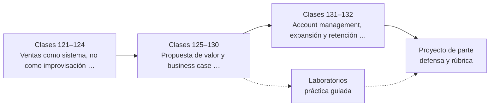

# Parte 10 — Ventas, desarrollo comercial y negociación

<!-- parte:inicio -->

> ← [Parte 09 — Finanzas y contabilidad para gerentes](../09-managerial-finance-accounting/README.md) · [Temario](../../SYLLABUS.md) · [Parte 11 — Marketing, cliente y crecimiento](../11-marketing-customers-growth/README.md) →

*Un sistema comercial repetible, no una racha de ventas*

**Etapa:** 3 — Gestión de negocio  
**Duración:** 12 clases · 30 horas  
**Resultado de salida:** Construir un sistema comercial repetible que encuentre, convierta y retenga clientes rentables.

🟣 [Ver las 6 etapas](../../SYLLABUS.md) · 12 clases (121–132) · 4 laboratorios · [proyecto de parte](project.md)

## 🎯 De qué trata esta parte

Vender bien no es talento sino proceso: a quién, con qué promesa, por qué canal y con qué economía. Esta parte trata las ventas como un sistema medible y la negociación como diseño de acuerdos.

El eje es **intereses antes que posiciones**: descubrir el problema real del cliente, construir un caso de negocio, manejar objeciones sin presionar y conceder solo con contrapartida.

## 🧱 Con qué hay que llegar

| Parte | Qué aporta |
|---|---|
| [09 — Finanzas y contabilidad para gerentes](../09-managerial-finance-accounting/README.md) | Márgenes y economía unitaria. |
| [02 — Comunicación, influencia y presencia ejecutiva](../02-communication-influence-negotiation-basics/README.md) | Escucha, persuasión ética y conversación difícil. |

Cada clase supone la anterior: el orden importa, y saltarse una deja sin base a las que vienen después.

## 📚 Resultados de la parte

Al terminar esta parte podrás:

1. **Definir** el cliente ideal y generar oportunidades.
2. **Diagnosticar** con discovery y construir un business case.
3. **Gestionar** pipeline y forecast con honestidad.
4. **Negociar** por intereses y fijar precio y concesiones.
5. **Expandir** y retener cuentas.

## 🗺️ Mapa de la parte

## 🧭 Cómo se encadenan las 12 clases

Las clases **121 a 124** abren el sistema: ventas como proceso, cliente ideal, prospección y discovery.

Las clases **125 a 130** cubren la conversación comercial: valor, pipeline, objeciones, negociación, precio y cierre.

Las clases **131 y 132** cubren la relación posterior y cierran con el capstone de negociación enterprise.

## 📘 Las 12 clases

| # | Clase | Qué se trabaja | Entregable | Min |
|---:|---|---|---|---:|
| 121 | [Ventas como sistema, no como improvisación](classes/121-ventas-como-sistema-no-como-improvisacion/README.md) | Sistema comercial, Embudo (funnel), Etapa basada en evidencia | [commercial-decision-brief](../../templates/commercial-decision-brief.md) | 150 |
| 122 | [ICP y segmentación comercial](classes/122-icp-y-segmentacion-comercial/README.md) | ICP (perfil de cliente ideal), Segmentación, Persona de comprador | [risk-governance-brief](../../templates/risk-governance-brief.md) | 150 |
| 123 | [Prospección y generación de oportunidades](classes/123-prospeccion-y-generacion-de-oportunidades/README.md) | Prospección, Oportunidad calificada, Canal saliente (outbound) | [leadership-decision-brief](../../templates/leadership-decision-brief.md) | 150 |
| 124 | [Discovery y diagnóstico](classes/124-discovery-y-diagnostico/README.md) | Discovery (diagnóstico), Pregunta de situación, Pregunta de problema | [product-evidence-brief](../../templates/product-evidence-brief.md) | 150 |
| 125 | [Propuesta de valor y business case](classes/125-propuesta-de-valor-y-business-case/README.md) | Propuesta de valor, Valor económico para el cliente (EVC), Business case | [modelo-financiero-y-memo-de-decision](../../templates/modelo-financiero-y-memo-de-decision.md) | 150 |
| 126 | [Pipeline y forecast comercial](classes/126-pipeline-y-forecast-comercial/README.md) | Pipeline, Forecast comercial, Tasa de conversión histórica | [commercial-decision-brief](../../templates/commercial-decision-brief.md) | 150 |
| 127 | [Objeciones y manejo de riesgo percibido](classes/127-objeciones-y-manejo-de-riesgo-percibido/README.md) | Objeción, Riesgo percibido, Aversión a la pérdida | [risk-governance-brief](../../templates/risk-governance-brief.md) | 150 |
| 128 | [Negociación basada en intereses](classes/128-negociacion-basada-en-intereses/README.md) | Posición, Interés, BATNA | [commercial-decision-brief](../../templates/commercial-decision-brief.md) | 150 |
| 129 | [Pricing y concesiones](classes/129-pricing-y-concesiones/README.md) | Precio basado en valor, Precio por niveles (good-better-best), Ancla | [commercial-decision-brief](../../templates/commercial-decision-brief.md) | 150 |
| 130 | [Cierre y próximos pasos](classes/130-cierre-y-proximos-pasos/README.md) | Plan de cierre mutuo, Compromiso verificable, Señal de cortesía | [leadership-decision-brief](../../templates/leadership-decision-brief.md) | 150 |
| 131 | [Account management, expansión y retención](classes/131-account-management-expansion-y-retencion/README.md) | Gestión de cuentas, Salud de la cuenta, Retención | [commercial-decision-brief](../../templates/commercial-decision-brief.md) | 150 |
| 132 | [Capstone: negociación enterprise](classes/132-capstone-negociacion-enterprise/README.md) | Comité de compra, Plan de cuenta enterprise, Paquete de negociación | [commercial-decision-brief](../../templates/commercial-decision-brief.md) | 150 |

## ⚠️ Riesgos característicos

- Hacer forecast con optimismo y sin evidencia.
- Conceder precio sin pedir nada a cambio.
- Vender a clientes que no encajan con la oferta.
- Descuidar la retención por perseguir nuevas cuentas.

## 🔤 Glosario de la parte

71 conceptos definidos en las clases, con la definición operacional que usa cada una.

| Concepto | Definición operacional |
|---|---|
| **Ajuste producto–mercado** | Medida en que el producto resuelve un problema valioso de un segmento. |
| **Alternativa del cliente** | Lo que haría si no compra: nada, hacerlo internamente o contratar a otro. |
| **Ancla** | Referencia inicial que influye en la valoración posterior. |
| **Aversión a la pérdida** | Tendencia a sentir más las pérdidas que las ganancias equivalentes. |
| **BATNA** | Mejor alternativa a un acuerdo negociado. |
| **BATNA y punto de reserva** | Alternativa y límite de cada parte. |
| **Business case** | Análisis de costos, beneficios, riesgos y retorno de una decisión. |
| **Canal entrante (inbound)** | Contacto iniciado por el comprador tras interactuar con contenido o marca. |
| **Canal saliente (outbound)** | Contacto iniciado por el equipo comercial. |
| **Ciclo de venta** | Tiempo desde la primera conversación hasta el cierre. |
| **Cobertura** | Relación entre el valor del pipeline y la meta. |
| **Comité de compra** | Conjunto de personas que influyen o deciden una compra grande. |
| **Compromiso verificable** | Acción que el comprador acepta realizar y que se puede comprobar. |
| **Concesión** | Cesión de algo (precio, plazo, servicio) en una negociación. |
| **Consentimiento y legitimidad** | Base legal y ética para contactar a una persona. |
| **Cortina de humo** | Objeción declarada que oculta otra razón. |
| **Costo por oportunidad calificada** | Gasto del canal dividido por oportunidades calificadas. |
| **Costo total de propiedad** | Todos los costos de adoptar y mantener la solución. |
| **Criterio objetivo** | Estándar independiente de la voluntad de las partes. |
| **Cuello de botella comercial** | Etapa o recurso que limita el resultado total. |
| **Diferenciación** | Atributos que el cliente valora y que otros no ofrecen. |
| **Discovery (diagnóstico)** | Fase en que se entiende el contexto, el problema y su efecto antes de proponer. |
| **Embudo (funnel)** | Secuencia de etapas por las que avanza una oportunidad. |
| **Etapa basada en evidencia** | Etapa que se avanza por un hecho verificable del comprador. |
| **Expansión** | Venta adicional a un cliente actual. |
| **Forecast comercial** | Estimación de ventas cerradas en un período. |
| **Fuga de precio (price leakage)** | Diferencia entre el precio de lista y el realmente cobrado. |
| **Gestión de cuentas** | Gestión continua de la relación con un cliente para lograr valor, renovación y crecimiento. |
| **ICP (perfil de cliente ideal)** | Descripción de los clientes para los que la propuesta es más valiosa y rentable. |
| **Interés** | La necesidad, preocupación o prioridad que motiva una posición. |
| **Matriz de riesgos del acuerdo** | Lista de riesgos con dueño, mitigación y condiciones. |
| **Objeción** | Expresión del comprador de duda, resistencia o condición. |
| **Oportunidad calificada** | Conversación con alguien que tiene un problema, interés y capacidad de decidir o influir. |
| **Oportunidad estancada** | Oportunidad sin avance verificable en un tiempo mayor al típico. |
| **Paquete de negociación** | Conjunto de condiciones acordadas a la vez. |
| **Patrocinador (champion)** | Persona del comprador que impulsa internamente la decisión. |
| **Persona de comprador** | Descripción de quienes intervienen en la compra: decisor, usuario, influyente. |
| **Pipeline** | Conjunto de oportunidades abiertas por etapa, con su valor. |
| **Piso de precio** | Precio por debajo del cual no se vende sin aprobación. |
| **Plan de cierre mutuo** | Documento compartido con los pasos que ambas partes harán hasta la firma. |
| **Plan de cuenta enterprise** | Estrategia por cuenta: valor, relaciones, riesgos, competidores y acciones. |
| **Posición** | Lo que una parte dice que quiere. |
| **Precio basado en valor** | Precio fijado según el valor que el cliente obtiene respecto de su mejor alternativa. |
| **Precio por niveles (good-better-best)** | Oferta en varios paquetes con distintas prestaciones y precios. |
| **Pregunta de implicación** | Explora las consecuencias del problema. |
| **Pregunta de necesidad de solución** | El comprador expresa el valor de resolverlo. |
| **Pregunta de problema** | Explora dificultades o insatisfacciones. |
| **Pregunta de situación** | Recoge hechos del contexto. |
| **Proceso de compras** | Pasos formales de aprobación del comprador. |
| **Pronóstico ponderado** | Suma del valor de cada oportunidad por su probabilidad. |
| **Propuesta de valor** | Declaración de qué problema resuelve, para quién, con qué resultado y por qué es mejor que las alternativas. |
| **Prospección** | Búsqueda activa de posibles clientes que encajan con el ICP. |
| **Prueba social** | Referencia a decisiones de pares como evidencia. |
| **Puesta en marcha** | Inicio de la implantación tras la firma. |
| **Punto de reserva** | Peor resultado que una parte aceptaría antes de retirarse. |
| **Reducción de riesgo** | Garantías, pruebas, fases o referencias que bajan la exposición del comprador. |
| **Resumen de comprensión** | Síntesis de lo entendido para validar con el comprador. |
| **Retención** | Proporción de clientes o de ingresos que se mantiene en un período. |
| **Retención neta de ingresos** | Ingresos de un grupo de clientes hoy respecto de hace un año, incluidos aumentos y bajas. |
| **Revisión de valor** | Reunión periódica para revisar resultados logrados y próximos objetivos. |
| **Riesgo percibido** | Probabilidad e impacto que el comprador atribuye a una decisión equivocada. |
| **Salud de la cuenta** | Evaluación de la probabilidad de que el cliente renueve y crezca. |
| **Segmentación** | División del mercado en grupos con necesidades o comportamientos similares. |
| **Segmento inicial (beachhead)** | Nicho donde se concentra el esfuerzo antes de ampliar. |
| **Señal de cortesía** | Respuesta amable que no implica avance. |
| **Sistema comercial** | Conjunto de etapas, roles, herramientas y métricas que convierte mercado en clientes. |
| **Tasa de conversión** | Proporción de oportunidades que pasa de una etapa a la siguiente. |
| **Tasa de conversión histórica** | Proporción de oportunidades que avanza o cierra desde cada etapa. |
| **Trabajo a realizar (job)** | Progreso que el cliente quiere lograr al contratar. |
| **Valor económico para el cliente (EVC)** | Valor de la mejor alternativa del cliente más el valor adicional que aporta el producto. |
| **ZOPA** | Zona de posible acuerdo entre los puntos de reserva. |

## 📦 Qué queda como evidencia

- Un perfil de cliente ideal con criterios de exclusión.
- Un pipeline con etapas y criterios de salida.
- Un plan de negociación con intereses y concesiones.
- El capstone: negociación enterprise.

## 🔗 Cómo se conecta

Se complementa con la parte 11 (marketing) y alimenta la parte 20 (primeros clientes) y la 23 (sistema semanal de ventas).

## 🧪 Cómo se trabaja

Son **12 clases de 150 minutos** —30 horas— con **4 laboratorios** y un proyecto integrador. Cada clase trae su propósito, sus conceptos, un caso, práctica, errores frecuentes, preguntas de comprobación, entregable y fuentes, y se evalúa con su `assessment.md`. Los laboratorios se resuelven con datos propios o sintéticos, nunca con datos reales de terceros, y la parte se cierra con el proyecto y su defensa. Las reglas de recorrido están en [la guía de navegación](../../docs/NAVIGATION.md).

<!-- parte:fin -->

## Laboratorios

- [Lab 01 — Discovery call](labs/lab-01.md)
- [Lab 02 — Pipeline review](labs/lab-02.md)
- [Lab 03 — Negotiation planner](labs/lab-03.md)
- [Lab 04 — Enterprise proposal](labs/lab-04.md)

## Proyecto de parte

Vender y negociar una solución B2B con múltiples decisores y presión por descuento.

## Bibliografía rectora

- Neil Rackham — *SPIN Selling* (Ventas)
- Matthew Dixon & Brent Adamson — *The Challenger Sale* (Ventas)
- Roger Fisher, William Ury & Bruce Patton — *Getting to Yes* (Negociación)
- Chris Voss & Tahl Raz — *Never Split the Difference* (Negociación)
- Deepak Malhotra & Max H. Bazerman — *Negotiation Genius* (Negociación)

## Criterio de aprobación

80/100 y entrega del proyecto integrador.
