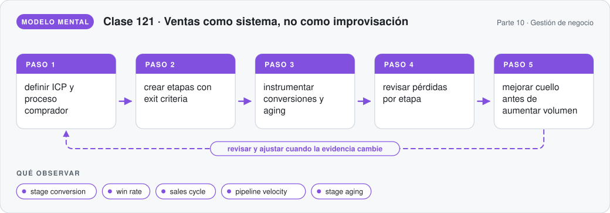

# Clase 121 — Ventas como sistema, no como improvisación

<!-- nav:inicio -->
> **Parte 10 · Ventas, desarrollo comercial y negociación** — clase 1 de 12 · [índice de la parte](../../README.md) · [temario](../../../../SYLLABUS.md)
<!-- nav:fin -->

**Parte:** 10 — Ventas, desarrollo comercial y negociación  
**Nivel:** Etapa 3 — Manager → Gerente  
**Duración sugerida:** 150–180 minutos · **Estándar:** deep-class-v2

## 🎯 Propósito

Muchas empresas dependen de uno o dos vendedores extraordinarios: cuando se van, las ventas caen; cuando se contrata a otros, los resultados varían sin explicación; cuando el dueño deja de vender, la empresa se estanca. La razón es que la venta se vive como un talento y no como un **sistema**: una secuencia de etapas con criterios de entrada y salida, roles definidos, datos de conversión y mejora continua. Un sistema comercial no elimina el talento: lo amplifica y permite que personas promedio logren resultados predecibles.

La clase se apoya en el enfoque de ventas basado en procesos de Ross y Tyler, en la gestión comercial orientada a datos de Roberge y en la visión de Rackham sobre cómo se compra y se vende en cuentas grandes. Al terminar sabrás describir el sistema comercial de una empresa, definir etapas basadas en evidencia, medir la conversión entre ellas, distinguir los roles del equipo y localizar el cuello de botella que limita las ventas.

## 📚 Resultados de aprendizaje

Al finalizar podrás:

1. **Describir** el sistema comercial como una secuencia de etapas con criterios.
2. **Definir** roles y responsabilidades a lo largo del proceso.
3. **Medir** conversiones, tiempos y valor por etapa.
4. **Identificar** el cuello de botella del sistema (clase 089).
5. **Decidir** dónde invertir para aumentar ventas con el menor costo.

## 🧭 Agenda

| Tramo | Qué se hace |
|---|---|
| 0–20 min | Recuperación: reconstruye, de la última venta que cerraste, cada paso y cuánto tardó. |
| 20–60 min | Etapas, roles, métricas y cuello de botella. |
| 60–105 min | Ejemplo trabajado: diagnóstico del embudo de una empresa B2B. |
| 105–150 min | Caso ejecutivo y práctica. |
| 150–175 min | Límites y entregable. |

## 🧩 Conceptos centrales

| Concepto | Definición | Cómo se reconoce |
|---|---|---|
| **Sistema comercial** | Conjunto de etapas, roles, herramientas y métricas que convierte mercado en clientes. | Resultados explicables y repetibles. |
| **Embudo (funnel)** | Secuencia de etapas por las que avanza una oportunidad. | Se mide la proporción que pasa de una a otra. |
| **Etapa basada en evidencia** | Etapa que se avanza por un hecho verificable del comprador. | «El comprador agendó una reunión con finanzas». |
| **Tasa de conversión** | Proporción de oportunidades que pasa de una etapa a la siguiente. | Se calcula por período y segmento. |
| **Ciclo de venta** | Tiempo desde la primera conversación hasta el cierre. | Varía según complejidad. |
| **Cuello de botella comercial** | Etapa o recurso que limita el resultado total. | Se acumulan oportunidades antes de ella. |

## 🧠 Modelo mental

**Cómo leer el diagrama.** Cinco etapas encadenadas. **Segmentar** define a quién se vende; **generar oportunidades** consigue conversaciones con compradores que encajan; **diagnosticar** entiende el problema y su costo; **proponer y negociar** pone valor, precio y condiciones; **cerrar y expandir** convierte y hace crecer la cuenta. La flecha de retorno indica lo esencial de un sistema: lo aprendido en cada etapa corrige las anteriores (por ejemplo, un cliente perdido por precio cambia la segmentación).

## 📖 Desarrollo

### 1. De talento a sistema

Una venta individual puede parecer una conversación afortunada, pero cuando se observan cientos se ven **regularidades**: tipos de cliente que compran más, preguntas que abren conversaciones, momentos en que se pierden oportunidades. Un sistema comercial captura esas regularidades. Ross y Tyler, a partir de su experiencia en ventas de tecnología, proponen **especializar roles** —quien genera oportunidades no es quien cierra— y estructurar el proceso de modo que cada rol se concentre en una tarea medible. Roberge, desde su experiencia en una empresa de software, insiste en **medir**, **entrenar** y **contratar** con datos, tratando la gestión comercial como una disciplina de ingeniería de procesos.

### 2. Etapas y criterios

Se define una secuencia de etapas, cada una con **criterio de entrada** (qué debe ocurrir para estar en ella), **actividad esperada** y **criterio de salida** (qué hecho del comprador permite avanzar). Un buen criterio es observable y proviene del comprador: «aceptó una reunión con quien decide», «compartió sus datos para dimensionar la propuesta», «nombró una fecha de decisión». Un mal criterio depende de la impresión del vendedor: «hay buena relación», «está interesado». Las etapas basadas en evidencia reducen el optimismo y mejoran el pronóstico (clase 126).

### 3. Roles y especialización

Los roles típicos son: **desarrollo de oportunidades** (genera y califica primeras conversaciones), **ejecutivo de cuentas** (diagnostica, propone y cierra), **preventa o ingeniería de soluciones** (aporta la parte técnica), **éxito del cliente o gestión de cuentas** (garantiza uso y renovación) y **operaciones comerciales** (datos, herramientas, procesos). No todas las empresas necesitan todos los roles; en una empresa pequeña, una persona puede asumir varios, pero conviene separar las **funciones** aunque no las personas. La especialización mejora la pericia y la medición, pero introduce traspasos: se cuidan con criterios claros y buena información (clase 086).

### 4. Métricas del sistema

Las métricas esenciales: **volumen** de oportunidades por etapa; **tasa de conversión** entre etapas; **tiempo** en cada etapa y **ciclo total**; **valor medio** de los negocios; **tasa de cierre**; **costo de adquisición** (clase 117); y **productividad por vendedor** (ingresos o cierres por persona y por período). Se miran **por segmento y por canal**, porque los promedios esconden las diferencias. Una conversión baja entre dos etapas indica dónde está el problema: si pocas oportunidades pasan de diagnóstico a propuesta, quizá se califica mal o no se construye el valor; si pocas pasan de propuesta a cierre, puede ser precio, competencia o falta de patrocinador.

### 5. El cuello de botella comercial

Como en cualquier proceso (clase 089), el resultado lo limita una etapa. A veces es la **generación de oportunidades** (no hay suficientes conversaciones); otras, la **calificación** (muchas conversaciones que no compran); a veces el **cierre** (propuestas que no avanzan) o la **capacidad del equipo** (vendedores saturados). Se identifica con los datos de conversión y de acumulación. Invertir en más marketing cuando el problema es la conversión del diagnóstico a la propuesta no aumenta ventas; contratar más vendedores cuando faltan oportunidades produce vendedores ociosos.

### 6. Contexto: ventas simples y complejas

El sistema debe adaptarse al tipo de venta. En **ventas transaccionales** (ciclo corto, un decisor, valor bajo), el proceso se estandariza y automatiza. En **ventas complejas** (ciclo largo, varios decisores, valor alto, cambios en el comprador), Rackham describe que la estrategia por cuenta importa más: mapear roles del comprador, entender su proceso de decisión, adaptar la propuesta y planificar relaciones. En ambos, la lógica es la misma: etapas basadas en evidencia, medición y aprendizaje, pero el grado de personalización difiere.

### 7. Mejora continua y límites del sistema

Un sistema comercial se revisa cada semana (pipeline), cada mes (conversiones, ciclos) y cada trimestre (segmentos, mensajes, canales, roles). Se hacen **revisiones de negocios perdidos y ganados** con preguntas al comprador. Se evita el exceso de formalización que asfixia la capacidad de adaptación: el sistema es una guía que se ajusta con los datos, no un guion rígido. Y se cuida la ética comercial: las métricas no deben empujar a prácticas engañosas, que dañan la reputación y generan reclamos (clase 100: el efecto de convertir medidas en metas).

## 📚 Lectura comparada

| Obra | Qué aporta | Qué no resuelve | Pregunta para contrastar |
|---|---|---|---|
| Ross y Tyler (*Predictable Revenue*) | Especialización de roles y proceso de generación de oportunidades. | Basado en ventas de tecnología B2B. | ¿Qué rol hace cada paso en tu equipo? |
| Roberge | Gestión comercial con datos, contratación y entrenamiento. | Experiencia de una empresa de software. | ¿Qué métrica explica tus resultados? |
| Rackham (*Major Account Sales Strategy*) | Estrategia por cuenta en ventas complejas. | Enfoque de ventas grandes. | ¿Quién decide, influye y bloquea? |
| Dixon y Adamson | Qué conductas distinguen a los mejores vendedores en ventas complejas. | Estudio de un conjunto de empresas. | ¿Tu equipo enseña al comprador algo nuevo? |
| Goldratt y Cox | Restricción del sistema. | No es de ventas. | ¿Dónde se acumulan las oportunidades? |

## 🧮 Ejemplo trabajado

**Situación (hipotética).** Una empresa de software de gestión para clínicas tiene un equipo comercial de seis personas y un objetivo anual de 60 nuevos clientes. Cierra 38. El director comercial piensa contratar a dos vendedores más.

**Datos del último año (embudo).**

| Etapa | Oportunidades | Conversión a la siguiente | Tiempo medio |
|---|---|---|---|
| Primera reunión calificada | 400 | 40 % | 12 días |
| Diagnóstico completado | 160 | 55 % | 20 días |
| Propuesta enviada | 88 | 43 % | 28 días |
| Cierre ganado | 38 | — | — |

**Lectura.** De 400 reuniones salen 38 clientes (9,5 %). Para llegar a 60 con las mismas tasas se necesitarían unas 630 reuniones calificadas (+58 %). Las conversiones de las dos primeras etapas son razonables; la de propuesta a cierre (43 %) es la más baja y la etapa tiene un ciclo largo de 28 días. Cada vendedor gestiona en promedio 35 oportunidades abiertas.

**Hipótesis.** El cuello de botella está en la **conversión de propuesta** (falta de patrocinador, de caso de negocio, de plan de cierre) y en la **capacidad** (35 oportunidades por persona). Contratar vendedores ayudaría a la capacidad, pero no a la calidad de las propuestas.

**Revisión de negocios perdidos.** De 50 propuestas perdidas, 21 señalan «no era prioridad», 14 «precio» y 9 «competencia»; en 31 de 50, el comprador no tenía un patrocinador de nivel directivo identificado.

**Acciones.** (a) Exigir como criterio para enviar una propuesta que exista un patrocinador y una fecha de decisión; (b) incorporar un caso de negocio con números del cliente (clase 125); (c) limitar a 25 oportunidades por vendedor y priorizar; (d) medir el efecto en tres meses; (e) contratar solo si, tras mejorar la conversión, la capacidad sigue siendo la restricción.

**Qué muestra.** (1) El embudo localizó el problema lejos de donde se creía. (2) La revisión de negocios perdidos aportó la causa. (3) Las acciones tenían criterios y medición.

## 🔀 Comparación y límites

**Sistema comercial frente a cultura comercial.** El sistema define el proceso; la cultura define cómo se vive: un sistema que castiga las malas noticias genera pipeline maquillado. Se necesitan ambos.

**Límites.** Las tasas de conversión con pocas oportunidades son inestables y se interpretan con cautela. Los sistemas de etapas pueden volverse rígidos en ventas con mucha complejidad. Los libros citados describen experiencias de empresas y sectores concretos y no prueban que sus recetas sirvan en cualquier contexto. Las prácticas comerciales (contacto con clientes, datos personales, publicidad, contratos) tienen normativa propia que debe consultarse en cada mercado.

## 🪜 De profesional a owner

| Nivel | Cómo participa en el sistema comercial |
|---|---|
| **Profesional** | Registra con exactitud y sigue los criterios de etapa. |
| **Jefe / Team Lead** | Revisa el pipeline de su equipo y entrena según los datos. |
| **Gerente** | Diseña etapas, roles y métricas y localiza el cuello de botella. |
| **CEO / Director** | Decide dónde invertir según el sistema y protege la ética comercial. |
| **Founder / Owner** | Documenta cómo vende para dejar de ser el único que sabe hacerlo. |

## 🏢 Caso ejecutivo

Una empresa de servicios de ingeniería para minería, con 220 empleados, vende proyectos de USD 300.000 a 2 millones con ciclos de 8 a 14 meses. El 70 % de los ingresos viene de dos socios que venden por relaciones personales; los ejecutivos contratados en los últimos tres años cerraron poco. Hay un CRM con 140 oportunidades «activas», de las cuales 60 no tienen actividad en seis meses. El pronóstico trimestral falló por más de 40 % en los dos últimos años. El directorio pide un sistema que no dependa de los socios.

Entrega un **diseño del sistema comercial** que contenga: (a) las etapas con criterios de entrada y salida basados en evidencia; (b) los roles y los traspasos; (c) las métricas y el diagnóstico del cuello de botella con los datos que pedirías; (d) la depuración del pipeline actual; (e) la forma de transferir el conocimiento de los socios; (f) las verificaciones éticas y legales de las prácticas comerciales, y un plan de implantación en 90 días.

## 🧪 Práctica

1. Dibuja las etapas del proceso comercial de tu empresa con criterios de entrada y salida.
2. Calcula la conversión entre etapas con los datos de los últimos seis meses.
3. Identifica la etapa con mayor acumulación de oportunidades.
4. Revisa diez negocios perdidos y clasifica los motivos.
5. Define tres métricas semanales de seguimiento y sus responsables.

## ⚠️ Errores frecuentes

| Error | Por qué ocurre | Cómo corregirlo |
|---|---|---|
| Depender de uno o dos vendedores estrella | La venta se vive como talento | Documentar y sistematizar. |
| Etapas por impresión del vendedor | Es más fácil registrar | Criterios basados en hechos del comprador. |
| Mirar solo el cierre | Es lo que se premia | Medir todo el embudo. |
| Contratar más vendedores como primera respuesta | Parece lo directo | Localizar el cuello de botella. |
| Pipeline lleno de oportunidades muertas | No se depura | Revisión semanal y reglas de antigüedad. |
| Métricas que premian conductas engañosas | Se convierten en metas | Contrapesos y revisión de calidad. |

## ❓ Preguntas de comprobación

1. ¿Qué diferencia hay entre una venta como talento y como sistema?
2. ¿Qué criterio hace buena a una etapa?
3. ¿Qué roles típicos tiene un equipo comercial?
4. ¿Qué métricas esenciales mide el sistema?
5. ¿Cómo se identifica el cuello de botella comercial?
6. ¿Cómo cambia el sistema entre ventas simples y complejas?
7. ¿Qué límite tienen las tasas de conversión?

Claves de respuesta

1. Como talento depende de personas excepcionales; como sistema tiene etapas, roles y datos que permiten resultados repetibles.
2. Que su avance dependa de un hecho observable del comprador, no de la impresión del vendedor.
3. Desarrollo de oportunidades, ejecutivo de cuentas, preventa, éxito o gestión de cuentas y operaciones comerciales.
4. Volumen y conversión por etapa, tiempos y ciclo total, valor medio, tasa de cierre, costo de adquisición y productividad.
5. Con las conversiones y la acumulación de oportunidades por etapa, y con la capacidad del equipo.
6. En ventas simples se estandariza y automatiza; en las complejas pesa más la estrategia por cuenta y el mapa de decisores.
7. Con pocas oportunidades son inestables y se interpretan con rangos y cautela.

## 📥 Entregable

Guarda en `portfolio/121-ventas-como-sistema-no-como-improvisacion/`:

- `commercial-decision-brief.md` (plantilla [Commercial decision brief](../../../../templates/commercial-decision-brief.md)) con el diseño del caso ejecutivo;
- `sales-pipeline.md` (plantilla [Sales pipeline](../../../../templates/sales-pipeline.md)) con etapas, criterios y métricas;
- `decision-journal.md` con el diagnóstico del cuello de botella y las acciones.

## 📗 Fuentes y verificación

- Aaron Ross & Marylou Tyler — *Predictable Revenue* (Pebblestorm, 2020). **Uso en esta clase:** especialización de roles y proceso de generación de oportunidades. Lectura selectiva sobre **ventas como sistema, no como improvisación**. **Localizador:** [ISBN-13 9780984380244](https://openlibrary.org/isbn/9780984380244).
- Mark Roberge — *The Sales Acceleration Formula* (2015). **Uso en esta clase:** gestión comercial con datos, contratación y entrenamiento. Lectura selectiva sobre **ventas como sistema, no como improvisación**. **Localizador:** [ISBN-13 9781119047070](https://openlibrary.org/isbn/9781119047070).
- Neil Rackham — *Major Account Sales Strategy* (McGraw-Hill, 1989). **Uso en esta clase:** estrategia por cuenta en ventas complejas. Lectura selectiva sobre **ventas como sistema, no como improvisación**. **Localizador:** [ISBN-13 9780070511149](https://openlibrary.org/isbn/9780070511149).
- Matthew Dixon & Brent Adamson — *The Challenger Sale* (Portfolio/Penguin, 2011). **Uso en esta clase:** conductas que distinguen a los mejores vendedores. Lectura selectiva sobre **ventas como sistema, no como improvisación**. **Localizador:** [ISBN-13 9781591844358](https://openlibrary.org/isbn/9781591844358).
- Eliyahu M. Goldratt & Jeff Cox — *The Goal* (HighBridge Audio, 2014). **Uso en esta clase:** restricción del sistema. Lectura selectiva sobre **ventas como sistema, no como improvisación**. **Localizador:** [ISBN-13 9781622313945](https://openlibrary.org/isbn/9781622313945).

> **Regla de fuentes para Ventas como sistema, no como improvisación:** las obras anteriores estructuran las perspectivas de esta materia; cualquier norma, ley o estándar vivo mencionado debe comprobarse nuevamente en su fuente primaria vigente, incluidas las normas de publicidad, contacto con clientes y datos personales. Los ejemplos y casos son hipotéticos, con cifras ilustrativas. El desarrollo es original y no reproduce capítulos protegidos.

<!-- pie:inicio -->
---

| Anterior | Índice | Siguiente |
|---|---|---|
| [← 120 · Capstone: comité de inversión](../../../09-managerial-finance-accounting/classes/120-capstone-comite-de-inversion/README.md) | [Parte 10](../../README.md) · [Programa](../../../../SYLLABUS.md) | [122 · ICP y segmentación comercial →](../122-icp-y-segmentacion-comercial/README.md) |
<!-- pie:fin -->
