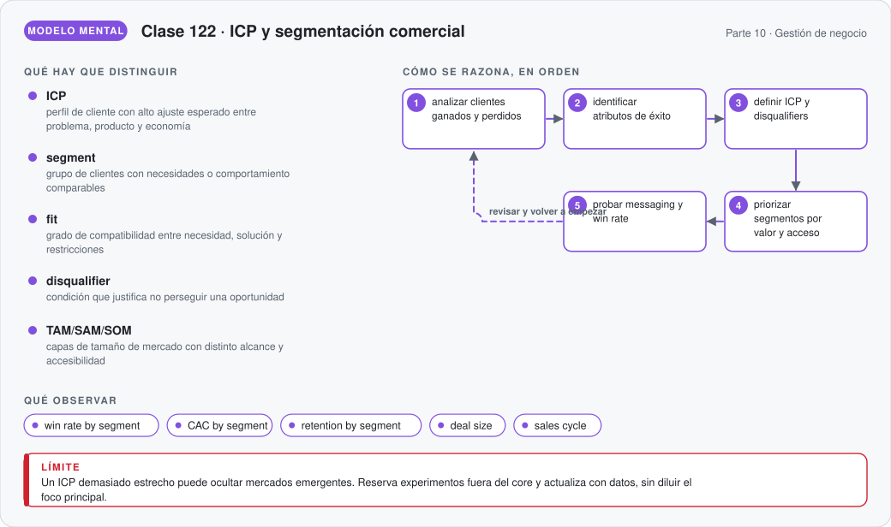

# Clase 122 — ICP y segmentación comercial

<!-- nav:inicio -->
> **Parte 10 · Ventas, desarrollo comercial y negociación** — clase 2 de 12 · [índice de la parte](../../README.md) · [temario](../../../../SYLLABUS.md)
<!-- nav:fin -->

**Parte:** 10 — Ventas, desarrollo comercial y negociación  
**Nivel:** Etapa 3 — Manager → Gerente  
**Duración sugerida:** 150–180 minutos · **Estándar:** deep-class-v2

## 🎯 Propósito

«Nuestro cliente es cualquier empresa que necesite…» es la frase que más cuesta cara a un equipo comercial. Vender a todos significa mensajes genéricos, ciclos largos, descuentos para competir con especialistas, clientes que no obtienen valor y se van. Elegir a quién se vende es la decisión comercial más importante y la que más se posterga porque implica renunciar a oportunidades. El **perfil de cliente ideal (ICP)** describe, con rasgos observables, a las empresas o personas para las que la propuesta funciona mejor y que más valor dejan al negocio.

La clase se apoya en la noción de segmento inicial de Moore en *Crossing the Chasm*, en la gestión por datos de Roberge, en el análisis de Dixon y Adamson sobre cómo los clientes compran y en la visión de rentabilidad por cliente de la clase 113. Al terminar sabrás construir un ICP con datos, segmentar el mercado en grupos accionables, distinguir ICP de cualquier cliente que paga y revisar el perfil con la evidencia de retención y rentabilidad.

## 📚 Resultados de aprendizaje

Al finalizar podrás:

1. **Definir** un ICP con rasgos observables y justificarlo con datos.
2. **Segmentar** el mercado con criterios útiles para decidir.
3. **Evaluar** segmentos por ajuste, valor, accesibilidad y competencia.
4. **Elegir** un segmento inicial y planificar la expansión.
5. **Revisar** el ICP con datos de retención, margen y satisfacción.

## 🧭 Agenda

| Tramo | Qué se hace |
|---|---|
| 0–20 min | Recuperación: lista tus cinco mejores clientes y tus cinco peores; ¿qué rasgos los distinguen? |
| 20–60 min | ICP, segmentación, selección y revisión. |
| 60–105 min | Ejemplo trabajado: construir el ICP de una empresa de software con datos de clientes. |
| 105–150 min | Caso ejecutivo y práctica. |
| 150–175 min | Límites y entregable. |

## 🧩 Conceptos centrales

| Concepto | Definición | Cómo se reconoce |
|---|---|---|
| **ICP (perfil de cliente ideal)** | Descripción de los clientes para los que la propuesta es más valiosa y rentable. | Rasgos verificables: sector, tamaño, problema, contexto. |
| **Segmentación** | División del mercado en grupos con necesidades o comportamientos similares. | Cada grupo se atiende de forma distinta. |
| **Persona de comprador** | Descripción de quienes intervienen en la compra: decisor, usuario, influyente. | Roles y motivaciones. |
| **Segmento inicial (beachhead)** | Nicho donde se concentra el esfuerzo antes de ampliar. | Se domina antes de expandir. |
| **Trabajo a realizar (job)** | Progreso que el cliente quiere lograr al contratar. | Explica por qué compra. |
| **Ajuste producto–mercado** | Medida en que el producto resuelve un problema valioso de un segmento. | Retención alta y recomendación. |

## 🧠 Modelo mental

**Cómo leer el diagrama.** Un cuadrante con dos preguntas: ¿la propuesta se ajusta al problema del cliente? y ¿cuánto valor puede dejar? El **perfil ideal** combina ambos y es donde se concentra el equipo. Las cuentas de **mucho valor pero poco ajuste** se exploran con cuidado, con pocos casos. Las de **mucho ajuste y poco valor** se atienden con canales de bajo contacto. Las de **poco ajuste y poco valor** no se persiguen. La clave: el ICP no es el cliente que acepta pagar sino el que obtiene valor y lo deja.

## 📖 Desarrollo

### 1. Por qué elegir

Moore plantea que, para pasar de los primeros adoptantes al mercado amplio, una empresa debe concentrarse en un **segmento inicial** donde pueda ser la opción dominante, con una propuesta completa para ese grupo, y desde allí expandirse a segmentos adyacentes. Atender a todos tiene costos: mensajes diluidos, soporte que cubre demasiadas necesidades, desarrollo de producto sin foco y competencia contra especialistas. Concentrarse implica decir que no a ciertos clientes que pagarían; es una decisión estratégica y exige respaldo directivo.

### 2. Construir el ICP con datos

El punto de partida son los **clientes actuales**, particularmente los que **más valor reciben y más valor dejan**: alta retención, buen margen, expansión, recomendación. Se analizan sus rasgos: **sector**, **tamaño** (empleados, ingresos), **contexto** (etapa, regulación, tecnología), **problema que resuelven**, **proceso de compra** (quién decide, cuánto tarda) y **disparadores** (el evento que los lleva a buscar una solución). Se contrasta con los clientes que **churnean o son poco rentables** para ver qué los distingue. El ICP resultante son hipótesis a probar con prospectos nuevos, no verdades.

### 3. Segmentación útil

Se segmenta para **decidir diferente**: mensaje, canal, oferta, precio, proceso de ventas. Criterios típicos: **firmográficos** (sector, tamaño, geografía), **comportamentales** (uso, frecuencia, canal de compra), **de necesidades** (problema, trabajo a realizar) y **de valor** (potencial, rentabilidad). Una segmentación sirve si los grupos son **identificables**, **accesibles**, **suficientemente grandes** y **responden distinto**. Christensen y otros proponen mirar el «trabajo» que el cliente contrata: dos clientes de perfil distinto pueden contratar el producto para el mismo trabajo, y dos de perfil similar, para trabajos distintos.

### 4. Evaluar y elegir segmentos

Para cada segmento se estiman: **tamaño y crecimiento**, **intensidad del problema**, **ajuste con la propuesta**, **disposición y capacidad de pago**, **accesibilidad** (canales, costo de llegar), **competencia**, **ciclo de venta** y **potencial de expansión**. Se puntúan con criterios acordados antes (clase 105) y se elige un segmento inicial o un número pequeño. El objetivo no es el mayor mercado posible, sino el segmento donde la empresa puede **ganar y retener** con costos razonables. Una elección sana deja registrado qué segmentos se descartan, por qué y cuándo se revisarán.

### 5. Personas de comprador y comité

En ventas B2B, quien usa el producto no siempre decide ni paga. Se identifican **roles**: **usuario**, **patrocinador** (quien tiene el problema y presupuesto), **decisor económico**, **influyentes técnicos** y **bloqueadores** potenciales (seguridad, legal, compras). Rackham enfatiza entender el proceso de compra de cada cuenta. Para el ICP se describe el **perfil del comité típico** y sus preocupaciones, de modo que mensajes y materiales respondan a cada rol. Un ICP sin personas de comprador es incompleto: define dónde está el cliente, pero no quién decide.

### 6. Disparadores y señales

Los clientes compran cuando ocurre algo: una nueva regulación, un cambio de dirección, un crecimiento que rompe sus procesos, un incidente, una fusión. Identificar **disparadores** permite priorizar cuentas con mayor probabilidad de compra y adaptar el momento del contacto. También hay señales **negativas** (descalificadores): cuentas sin presupuesto, sin dueño del problema, con restricciones que impiden implantar, con un proceso de compra incompatible con el ciclo de venta. Un ICP con criterios de **calificación** y de **descalificación** ahorra tiempo al equipo.

### 7. Revisar y ajustar

El ICP se revisa al menos cada trimestre con datos: **conversión** por segmento, **ciclo**, **valor medio**, **retención**, **margen** y **satisfacción**. Si un segmento convierte bien pero se va rápido, el ICP está mal definido. Si un segmento inesperado muestra excelentes resultados, se prueba expandir. Se evita **sobreajustar** a pocos clientes y se **mantiene la ética comercial**: no vender a quien no se puede servir bien. Un ICP vivo se refleja en materiales, scripts, criterios de calificación y metas del equipo.

## 📚 Lectura comparada

| Obra | Qué aporta | Qué no resuelve | Pregunta para contrastar |
|---|---|---|---|
| Moore (*Crossing the Chasm*) | Segmento inicial y expansión por adyacencia. | Describe el mercado tecnológico de su época. | ¿Dónde puedes ser la opción dominante? |
| Roberge | Datos para definir y ajustar el perfil. | Experiencia de una empresa de software. | ¿Qué rasgos explican retención y conversión? |
| Dixon y Adamson | Cómo compran los clientes y quién influye. | Estudio de ventas complejas. | ¿Quién forma el comité de compra? |
| Rackham | Roles del comprador y análisis de cuentas. | Enfoque de ventas grandes. | ¿Qué rol falta en tu relación? |
| Christensen et al. (*Competing Against Luck*) | El trabajo que el cliente contrata. | Marco conceptual. | ¿Para qué trabajo te contratan? |

## 🧮 Ejemplo trabajado

**Situación (hipotética).** Una empresa de software de gestión de turnos y asistencia para equipos operativos tiene 240 clientes. Analiza retención y rentabilidad a 24 meses por sector y tamaño.

| Segmento | Clientes | Retención a 24 meses | Margen de contribución | Ciclo de venta | Observaciones |
|---|---|---|---|---|---|
| Clínicas y centros de salud (50–300 empleados) | 70 | 91 % | 68 % | 45 días | Piden integración con nómina; recomiendan. |
| Retail con turnos (100–1.000) | 60 | 78 % | 55 % | 70 días | Mucha personalización. |
| Manufactura (200–2.000) | 40 | 64 % | 42 % | 120 días | Proyectos largos; soporte caro. |
| Empresas pequeñas (menos de 50) | 70 | 55 % | 35 % | 10 días | Abandonan rápido; sensibles a precio. |

**Lectura.** Clínicas y centros de salud mediana: mejor retención, margen y ciclo; es el candidato a ICP. Las pequeñas empresas convierten rápido y se van pronto: se atienden con un canal de autoservicio. Manufactura exige mucho y deja poco: no perseguir salvo casos con alto valor.

**ICP resultante.** Clínicas, centros de salud y servicios de atención de 50 a 300 empleados, con turnos rotativos, que usan planilla para asignar turnos, con un jefe de operaciones o de personas como patrocinador, y un disparador de crecimiento (nueva sede) o de una fiscalización laboral. Personas de comprador: jefe de turnos (usuario), gerente de personas (patrocinador), gerente administrativo (decisor económico), TI (integración).

**Descalificadores.** Sin presupuesto; sistemas de nómina sin integración posible; ciclo de decisión mayor a seis meses.

**Decisiones.** Concentrar el 70 % del esfuerzo en el ICP; crear materiales y casos específicos de salud; un canal de autoservicio para empresas pequeñas; dejar manufactura y retail como segundo foco; revisar en dos trimestres con datos de conversión y retención.

**Qué muestra.** (1) El ICP surgió de datos de retención y margen, no de intuición. (2) Se distinguió entre quién paga y quién deja valor. (3) Se tomaron decisiones de foco y de canal.

## 🔀 Comparación y límites

**ICP frente a mercado total.** El mercado total mide cuántos podrían comprar; el ICP, cuántos deberían ser el foco. Un mercado grande con un ICP débil produce crecimiento caro.

**Límites.** Los datos de clientes actuales reflejan quién compró, no quién habría comprado con otra oferta. Muestras pequeñas dan perfiles inestables. Los segmentos cambian con el mercado. Los libros citados describen contextos de tecnología y ventas B2B; su aplicación a otros rubros exige adaptación. La segmentación basada en rasgos personales o decisiones que afecten a consumidores debe respetar las normas de protección de datos y de no discriminación aplicables.

## 🪜 De profesional a owner

| Nivel | Cómo trabaja el ICP |
|---|---|
| **Profesional** | Califica con los criterios del ICP y aporta lo que ve en terreno. |
| **Jefe / Team Lead** | Revisa que su equipo dedique tiempo a cuentas del perfil. |
| **Gerente** | Define el ICP con datos, lo revisa y lo traduce en mensajes y metas. |
| **CEO / Director** | Respalda el foco y decide qué segmentos no se atienden. |
| **Founder / Owner** | Evita vender a cualquiera y concentra su energía donde gana. |

## 🏢 Caso ejecutivo

Una empresa de seguridad informática para pymes tiene 900 clientes en 14 sectores y vende a empresas de 10 a 5.000 empleados. Cada vendedor aplica un guion distinto, el equipo ofrece descuentos para competir y el soporte está saturado con peticiones a medida. Un análisis muestra que el 18 % de los clientes genera el 62 % del margen, que los clientes de menos de 30 empleados se dan de baja al doble de la tasa promedio y que los de empresas de logística de 100 a 500 empleados, con una regulación reciente, tienen la mejor retención. La dirección comercial quiere «mantener todo el mercado»; la gerencia de producto, concentrarse en logística.

Entrega una **definición de ICP y segmentación** que contenga: (a) el análisis de clientes por retención, margen y ciclo con la hipótesis de ICP; (b) los segmentos evaluados con criterios y puntajes; (c) las personas de comprador, disparadores y descalificadores; (d) el segmento inicial y los de expansión, con la forma de atender a los demás; (e) cambios en mensajes, canales, precios y metas; (f) cómo se revisará con datos y qué verificaciones de datos personales y publicidad se harán.

## 🧪 Práctica

1. Analiza tus diez mejores y peores clientes y lista los rasgos que los distinguen.
2. Redacta un ICP en una página con calificadores y descalificadores.
3. Puntúa tres segmentos con cinco criterios.
4. Describe tres roles del comité de compra y sus preocupaciones.
5. Define tres métricas para revisar el ICP cada trimestre.

## ⚠️ Errores frecuentes

| Error | Por qué ocurre | Cómo corregirlo |
|---|---|---|
| Vender a todos | Se teme perder oportunidades | Elegir un segmento inicial. |
| ICP por intuición | Se describe al cliente deseado | Partir de datos de retención y margen. |
| Confundir el que paga con el que obtiene valor | Se mira la venta | Medir retención y rentabilidad. |
| Un solo rol del comprador | Se habla con quien atiende | Mapear el comité. |
| No definir descalificadores | Se acepta toda oportunidad | Criterios de descalificación. |
| ICP que nunca se revisa | Se considera definitivo | Revisión trimestral con datos. |

## ❓ Preguntas de comprobación

1. ¿Qué es un ICP y de dónde se obtiene?
2. ¿Qué es un segmento inicial y por qué conviene?
3. ¿Qué características debe tener una segmentación útil?
4. ¿Qué criterios se usan para evaluar segmentos?
5. ¿Qué papel cumplen los disparadores y los descalificadores?
6. ¿Qué es el trabajo a realizar de un cliente?
7. ¿Qué límite tienen los datos de clientes actuales?

Claves de respuesta

1. La descripción de los clientes para los que la propuesta es más valiosa y rentable; se obtiene de los clientes que más valor reciben y dejan, contrastados con los que se van.
2. Un nicho donde se concentra el esfuerzo para dominarlo antes de ampliar; evita la dilución y permite ser la opción dominante.
3. Que los grupos sean identificables, accesibles, suficientemente grandes y respondan de forma distinta.
4. Tamaño y crecimiento, intensidad del problema, ajuste, capacidad de pago, accesibilidad, competencia, ciclo y potencial de expansión.
5. Los disparadores priorizan cuentas con mayor probabilidad de compra; los descalificadores ahorran tiempo en cuentas sin presupuesto o sin posibilidad de implantación.
6. El progreso que quiere lograr al contratar el producto; explica por qué compra.
7. Reflejan quién compró, no quién habría comprado con otra oferta, y las muestras pequeñas dan perfiles inestables.

## 📥 Entregable

Guarda en `portfolio/122-icp-y-segmentacion-comercial/`:

- `risk-governance-brief.md` (plantilla [Risk & Governance Brief](../../../../templates/risk-governance-brief.md)) con los riesgos de foco y de dependencia de segmentos del caso ejecutivo;
- `commercial-decision-brief.md` (plantilla [Commercial decision brief](../../../../templates/commercial-decision-brief.md)) con el ICP, la segmentación y las decisiones de foco;
- `decision-journal.md` con los datos usados y la revisión trimestral.

## 📗 Fuentes y verificación

- Geoffrey A. Moore — *Crossing the Chasm* (HarperBusiness, 1995). **Uso en esta clase:** segmento inicial y expansión por adyacencia. Lectura selectiva sobre **icp y segmentación comercial**. **Localizador:** [ISBN-13 9780887307171](https://openlibrary.org/isbn/9780887307171).
- Mark Roberge — *The Sales Acceleration Formula* (2015). **Uso en esta clase:** datos para definir y ajustar el perfil de cliente. Lectura selectiva sobre **icp y segmentación comercial**. **Localizador:** [ISBN-13 9781119047070](https://openlibrary.org/isbn/9781119047070).
- Matthew Dixon & Brent Adamson — *The Challenger Sale* (Portfolio/Penguin, 2011). **Uso en esta clase:** cómo compran los clientes y quién influye. Lectura selectiva sobre **icp y segmentación comercial**. **Localizador:** [ISBN-13 9781591844358](https://openlibrary.org/isbn/9781591844358).
- Neil Rackham — *Major Account Sales Strategy* (McGraw-Hill, 1989). **Uso en esta clase:** roles del comprador y análisis de cuentas. Lectura selectiva sobre **icp y segmentación comercial**. **Localizador:** [ISBN-13 9780070511149](https://openlibrary.org/isbn/9780070511149).
- Clayton M. Christensen et al. — *Competing Against Luck* (HarperBusiness, 2016). **Uso en esta clase:** el trabajo que el cliente contrata. Lectura selectiva sobre **icp y segmentación comercial**. **Localizador:** [ISBN-13 9780062435613](https://openlibrary.org/isbn/9780062435613).

> **Regla de fuentes para ICP y segmentación comercial:** las obras anteriores estructuran las perspectivas de esta materia; cualquier norma, ley o estándar vivo mencionado debe comprobarse nuevamente en su fuente primaria vigente, incluidas las normas de protección de datos y no discriminación. Los ejemplos y casos son hipotéticos, con cifras ilustrativas. El desarrollo es original y no reproduce capítulos protegidos.

<!-- pie:inicio -->
---

| Anterior | Índice | Siguiente |
|---|---|---|
| [← 121 · Ventas como sistema, no como improvisación](../121-ventas-como-sistema-no-como-improvisacion/README.md) | [Parte 10](../../README.md) · [Programa](../../../../SYLLABUS.md) | [123 · Prospección y generación de oportunidades →](../123-prospeccion-y-generacion-de-oportunidades/README.md) |
<!-- pie:fin -->
