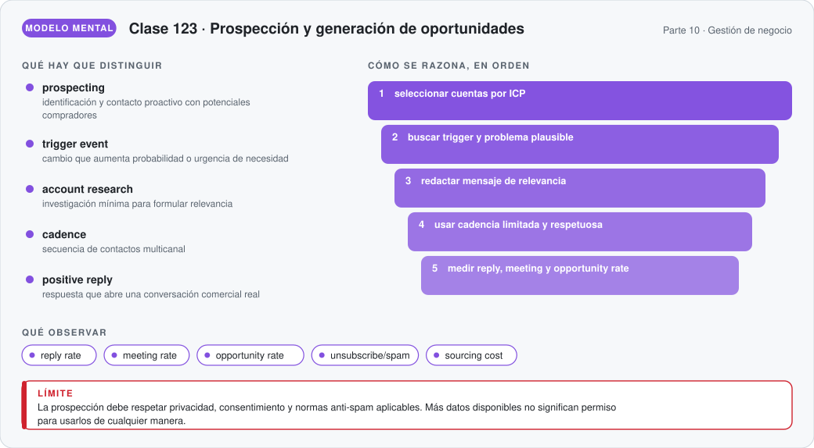

# Clase 123 — Prospección y generación de oportunidades

<!-- nav:inicio -->
> **Parte 10 · Ventas, desarrollo comercial y negociación** — clase 3 de 12 · [índice de la parte](../../README.md) · [temario](../../../../SYLLABUS.md)
<!-- nav:fin -->

**Parte:** 10 — Ventas, desarrollo comercial y negociación  
**Nivel:** Etapa 3 — Manager → Gerente  
**Duración sugerida:** 150–180 minutos · **Estándar:** deep-class-v2

## 🎯 Propósito

Sin oportunidades no hay ventas, pero tampoco sirve cualquier oportunidad. La prospección fracasa de dos maneras opuestas: el equipo no contacta a nadie nuevo porque «no hay tiempo» y depende de lo que llegue solo, o contacta a miles con mensajes genéricos, quema la lista, irrita a posibles clientes y llena el pipeline de conversaciones que no llevan a nada. Generar oportunidades es una actividad disciplinada: elegir a quién contactar, con qué mensaje, por qué canal, con qué frecuencia y cómo medir el resultado, en el marco de la ley y del respeto al interlocutor.

La clase se apoya en las prácticas de especialización de oportunidades de Ross y Tyler, en la gestión por datos de Roberge y en los principios de influencia de Cialdini, aplicados con ética. Al terminar sabrás diseñar un plan de generación de oportunidades con múltiples fuentes, escribir mensajes que ofrecen valor, calificar oportunidades con criterios, medir el costo por oportunidad y reconocer los límites legales y éticos de la prospección.

## 📚 Resultados de aprendizaje

Al finalizar podrás:

1. **Diseñar** un plan de prospección con fuentes saliente, entrante y por recomendación.
2. **Escribir** mensajes breves, relevantes y verificables.
3. **Calificar** oportunidades con criterios explícitos.
4. **Medir** el costo y la conversión por canal.
5. **Respetar** los límites éticos y legales del contacto comercial.

## 🧭 Agenda

| Tramo | Qué se hace |
|---|---|
| 0–20 min | Recuperación: recuerda el último mensaje comercial que respondiste y qué lo hizo distinto. |
| 20–60 min | Fuentes, mensajes, calificación y métricas. |
| 60–105 min | Ejemplo trabajado: comparar tres canales de una empresa de servicios. |
| 105–150 min | Caso ejecutivo y práctica de mensajes. |
| 150–175 min | Límites y entregable. |

## 🧩 Conceptos centrales

| Concepto | Definición | Cómo se reconoce |
|---|---|---|
| **Prospección** | Búsqueda activa de posibles clientes que encajan con el ICP. | Lista de cuentas y contactos elegidos. |
| **Oportunidad calificada** | Conversación con alguien que tiene un problema, interés y capacidad de decidir o influir. | Cumple criterios acordados. |
| **Canal saliente (outbound)** | Contacto iniciado por el equipo comercial. | Correos, llamadas, mensajes, eventos. |
| **Canal entrante (inbound)** | Contacto iniciado por el comprador tras interactuar con contenido o marca. | Formularios, búsquedas, recomendaciones. |
| **Costo por oportunidad calificada** | Gasto del canal dividido por oportunidades calificadas. | Permite comparar canales. |
| **Consentimiento y legitimidad** | Base legal y ética para contactar a una persona. | Se verifica antes de contactar. |

## 🧠 Modelo mental

**Cómo leer el diagrama.** Tres columnas, tres formas de generar conversaciones. En el canal **saliente**, el equipo elige a quién contactar y controla el ritmo, con el riesgo de mensajes genéricos que desgastan la marca. En el **entrante**, el comprador llega por sí mismo, con interés declarado, y el riesgo es el volumen sin calificar y la dependencia de un solo canal. En las **recomendaciones y alianzas**, un tercero presenta, con alta confianza y mejor cierre, pero crece lento. Ninguna es suficiente sola.

## 📖 Desarrollo

### 1. Especializar la generación de oportunidades

Ross y Tyler argumentan que generar oportunidades y cerrar son tareas distintas que se benefician de especialización: quien hace contactos nuevos se concentra en la calidad de las primeras conversaciones y en la calificación; quien cierra se concentra en el diagnóstico y la negociación. En su marco, describen tres tipos de iniciativas: **semillas** (clientes actuales y referidos, de alta probabilidad), **redes** (marketing y contenidos que atraen interesados) y **lanzas** (prospección dirigida a cuentas grandes elegidas). La combinación depende del ciclo de venta, del tamaño de las cuentas y del presupuesto.

### 2. Elegir cuentas y contactos

La prospección comienza con una **lista de cuentas** que cumplen el ICP (clase 122), priorizadas por **disparadores** (nuevos directivos, expansión, regulaciones, publicaciones) y por **valor potencial**. Dentro de cada cuenta, se identifican los **roles** relevantes: quien tiene el problema, quien puede decidir, quien influye. Un contacto con el cargo correcto en la empresa correcta, en el momento correcto, responde a una tasa mucho mayor que un envío masivo. La calidad de los datos (correos válidos, cargos actuales) es parte de la disciplina: datos desactualizados desperdician tiempo y dañan la reputación del remitente.

### 3. Mensajes que ofrecen valor

Un buen mensaje de primer contacto es **corto**, **específico** y **centrado en el destinatario**: muestra que se conoce su contexto (un dato real y verificable), plantea una **hipótesis de problema** relevante, ofrece **valor** (un dato, un caso, una idea) y propone un **próximo paso pequeño** (una conversación de quince minutos). Se evita el lenguaje genérico («líder en soluciones innovadoras»), los datos falsos de personalización y la manipulación. Cialdini describe principios de influencia (reciprocidad, prueba social, autoridad, escasez, afinidad, compromiso); se usan con honestidad: una prueba social real, no inventada; una escasez verdadera, no fabricada.

### 4. Secuencias y seguimiento

Rara vez la primera respuesta es inmediata. Una **secuencia** de contactos espaciados (por ejemplo, 5 a 8 puntos de contacto en 3 semanas, en varios medios) aumenta la probabilidad de conversación, siempre que cada contacto aporte algo nuevo y respete las señales del destinatario (si pide que no lo contacten, se detiene y se registra). Se prueban variantes de mensajes con una muestra y se mide la **tasa de respuesta** y la **tasa de reuniones**. El seguimiento insistente y repetitivo se convierte en acoso y afecta la reputación del remitente y de la empresa.

### 5. Calificar

No toda conversación es una oportunidad. Se define un conjunto de **criterios de calificación**, por ejemplo: **problema** reconocido, **impacto** estimable, **patrocinador** identificado, **presupuesto o capacidad** de inversión y **horizonte** de decisión. Marcos conocidos (como BANT u otros) son listas orientativas; lo importante es que sean **observables** y acordados entre quienes generan y quienes cierran. Una calificación demasiado estricta descarta oportunidades que podrían crecer; demasiado laxa llena el pipeline de conversaciones que consumen tiempo de cierre. Se revisa con datos: ¿qué rasgos tenían las oportunidades que sí cerraron?

### 6. Canal entrante y recomendaciones

El canal **entrante** depende de contenido útil, presencia en los lugares donde el comprador busca, formularios sencillos y respuesta rápida. Se mide **por fuente** la cantidad, la calidad y la conversión. Las **recomendaciones** nacen de clientes satisfechos y de relaciones con terceros (consultores, socios, comunidades): se piden de forma natural en el momento de valor, se facilita la presentación y se agradece. Roberge destaca que medir el origen de cada oportunidad permite invertir donde el costo por oportunidad calificada y la conversión sean mejores, en lugar de repartir por intuición.

### 7. Ética y límites legales

La prospección toca datos personales y comunicaciones comerciales, con normas que varían por país: bases legales para tratar datos y contactar, **derecho a oponerse** y a no ser contactado, reglas para correos y llamadas comerciales, publicidad no engañosa y consentimiento. Además de lo legal, hay una dimensión de respeto: no usar información privada, no engañar sobre quién es uno ni para qué contacta, no presionar. Una reputación comercial dañada tarda años en recuperarse. Antes de lanzar campañas, se verifican las reglas aplicables con asesoría legal.

## 📚 Lectura comparada

| Obra | Qué aporta | Qué no resuelve | Pregunta para contrastar |
|---|---|---|---|
| Ross y Tyler | Roles especializados y tipos de iniciativa (semillas, redes, lanzas). | Contexto de ventas B2B de tecnología. | ¿Qué mezcla de fuentes necesita tu mercado? |
| Roberge | Medir por canal y fuente y optimizar con datos. | Experiencia de una empresa de software. | ¿Cuál es tu costo por oportunidad calificada? |
| Cialdini | Principios de influencia y su uso ético. | No es un manual de prospección. | ¿Tu prueba social es real y verificable? |
| Rackham | Calificar según el problema y el proceso de compra. | Ventas complejas. | ¿Quién decide en esta cuenta? |
| Dixon y Adamson | Aportar una idea nueva al comprador. | Estudio de ventas complejas. | ¿Qué aprendería el cliente de ti? |

## 🧮 Ejemplo trabajado

**Situación (hipotética).** Una consultora de seguridad de la información para empresas de 100 a 1.000 empleados invirtió USD 60.000 en el último semestre en tres canales de generación de oportunidades.

| Canal | Inversión | Contactos / visitas | Reuniones calificadas | Clientes ganados | Costo por reunión calificada | Costo por cliente |
|---|---|---|---|---|---|---|
| Saliente (dos desarrolladores de oportunidades) | 28.000 | 2.400 cuentas contactadas | 48 | 6 | 583 | 4.667 |
| Entrante (contenido y seminarios) | 22.000 | 9.000 visitas; 260 formularios | 36 | 5 | 611 | 4.400 |
| Recomendaciones y alianzas | 10.000 (comisiones y eventos) | 22 presentaciones | 15 | 5 | 667 | 2.000 |

**Lectura.** El costo por reunión calificada es similar entre canales; el **costo por cliente** es menos de la mitad en recomendaciones, porque convierte mejor (33 % de las reuniones frente a 12 %–14 %). El saliente genera más volumen y controla el ritmo; el entrante depende de pocos contenidos que concentran las consultas.

**Calidad de mensajes.** Se prueban dos variantes de primer correo con 300 cuentas cada una: la A (genérica, con descripción de servicios) obtuvo 1,3 % de respuestas y 0,3 % de reuniones; la B (referencia a una norma que afecta al sector, un dato propio y una pregunta concreta) obtuvo 6,2 % de respuestas y 1,7 % de reuniones.

**Decisiones.** (a) Ampliar el programa de recomendaciones (hasta 12 alianzas), con acuerdos claros y sin presión; (b) mantener el saliente con la variante B y listas más cortas con disparadores; (c) invertir en tres contenidos que respondan a las preguntas más frecuentes; (d) revisar los criterios de calificación junto con ejecutivos de cuentas; (e) verificar con asesoría legal las bases para contactar y el manejo de bajas.

**Qué muestra.** (1) El costo por cliente cambió la lectura del costo por reunión. (2) La personalización real mejoró la respuesta. (3) La decisión combinó canales y consideró el marco legal.

## 🔀 Comparación y límites

**Prospección frente a marketing.** El marketing busca atraer a muchos con mensajes de marca y contenido; la prospección busca conversar con cuentas concretas. Funcionan mejor coordinados (clase 133 en adelante).

**Límites.** Las tasas de respuesta dependen del sector, del momento y de la calidad de la lista, y las pruebas con muestras pequeñas son poco concluyentes. El canal saliente puede desgastar mercados pequeños. Atribuir una venta a un solo canal es discutible, porque el comprador interactúa con varios. Los principios de influencia pueden usarse de forma manipuladora; aquí se plantean con honestidad. Las normas de comunicaciones comerciales y de datos deben verificarse en cada jurisdicción.

## 🪜 De profesional a owner

| Nivel | Cómo participa en la generación de oportunidades |
|---|---|
| **Profesional** | Contacta con respeto, calidad de datos y mensajes verificables. |
| **Jefe / Team Lead** | Entrena en mensajes, revisa las secuencias y la calificación. |
| **Gerente** | Diseña la mezcla de canales y mide costo y conversión. |
| **CEO / Director** | Protege la reputación de la empresa frente a prácticas agresivas. |
| **Founder / Owner** | Empieza con conversaciones directas con su ICP antes de escalar canales. |

## 🏢 Caso ejecutivo

Una empresa de software de gestión para constructoras tiene un equipo de cuatro desarrolladores de oportunidades que envían 600 correos semanales con una plantilla única. La respuesta es de 0,8 %. Hace un mes, un cliente grande se quejó de recibir tres correos diferentes en una semana y la empresa fue reportada como spam en un proveedor de correo. El gerente comercial exige más volumen para llegar a la meta de reuniones; el gerente de marketing propone reforzar el contenido; el de producto, pedir referencias a clientes actuales. El asesor legal advierte que no está claro de dónde provienen algunas de las listas compradas.

Entrega un **plan de generación de oportunidades** que contenga: (a) la lista de cuentas por ICP y disparadores; (b) la mezcla de canales con costos esperados y métricas; (c) dos variantes de mensaje y el diseño de la prueba; (d) criterios de calificación acordados con ejecutivos de cuentas; (e) las medidas para reparar la reputación del dominio y los límites de frecuencia; (f) la revisión legal de las bases de datos y del tratamiento de bajas.

## 🧪 Práctica

1. Arma una lista de 30 cuentas del ICP con un disparador observable para cada una.
2. Redacta un primer mensaje de menos de 90 palabras con una hipótesis y un próximo paso.
3. Define cinco criterios de calificación observables.
4. Calcula el costo por oportunidad calificada y por cliente de dos canales.
5. Escribe tus reglas de frecuencia y de manejo de solicitudes de no contacto.

## ⚠️ Errores frecuentes

| Error | Por qué ocurre | Cómo corregirlo |
|---|---|---|
| Volumen sin relevancia | Se mide por actividad | Listas cortas con disparadores. |
| Mensajes genéricos | Es más rápido | Personalización real y valor. |
| Medir solo reuniones | Es lo visible | Medir costo por cliente. |
| Una sola fuente | Es la que funciona hoy | Diversificar canales. |
| Calificación vaga | Se evitan discusiones | Criterios observables y acordados. |
| Ignorar el marco legal | Se piensa en resultados | Verificar bases y bajas antes de lanzar. |

## ❓ Preguntas de comprobación

1. ¿Qué son semillas, redes y lanzas?
2. ¿Qué caracteriza a un buen mensaje de primer contacto?
3. ¿Por qué se calcula el costo por cliente además del costo por reunión?
4. ¿Qué criterios sirven para calificar una oportunidad?
5. ¿Qué riesgos tiene el canal saliente y cuáles el entrante?
6. ¿Cómo se usan los principios de influencia con ética?
7. ¿Qué dimensiones legales deben verificarse?

Claves de respuesta

1. Tres tipos de iniciativa: semillas (clientes y referidos), redes (marketing y contenido) y lanzas (prospección dirigida a cuentas grandes).
2. Es corto, específico, centrado en el destinatario, con una hipótesis de problema, algo de valor y un próximo paso pequeño.
3. Porque canales con costo similar por reunión pueden tener conversiones muy distintas a cliente.
4. Problema reconocido, impacto estimable, patrocinador, capacidad de inversión y horizonte de decisión, observables y acordados.
5. El saliente puede desgastar la marca con mensajes genéricos; el entrante puede dar volumen sin calificar y depender de un canal.
6. Con pruebas reales y verificables, sin inventar escasez ni presión, y respetando las señales del destinatario.
7. Bases legales para tratar datos y contactar, derecho a no ser contactado, reglas para correos y llamadas comerciales y publicidad no engañosa.

## 📥 Entregable

Guarda en `portfolio/123-prospeccion-y-generacion-de-oportunidades/`:

- `leadership-decision-brief.md` (plantilla [Leadership Decision Brief](../../../../templates/leadership-decision-brief.md)) con el plan del caso ejecutivo;
- `sales-pipeline.md` (plantilla [Sales pipeline](../../../../templates/sales-pipeline.md)) con las fuentes, los criterios de calificación y las métricas;
- `decision-journal.md` con las pruebas de mensajes, las decisiones de canal y la revisión legal.

## 📗 Fuentes y verificación

- Aaron Ross & Marylou Tyler — *Predictable Revenue* (Pebblestorm, 2020). **Uso en esta clase:** roles especializados y tipos de iniciativa de prospección. Lectura selectiva sobre **prospección y generación de oportunidades**. **Localizador:** [ISBN-13 9780984380244](https://openlibrary.org/isbn/9780984380244).
- Mark Roberge — *The Sales Acceleration Formula* (2015). **Uso en esta clase:** medir por canal y optimizar con datos. Lectura selectiva sobre **prospección y generación de oportunidades**. **Localizador:** [ISBN-13 9781119047070](https://openlibrary.org/isbn/9781119047070).
- Robert B. Cialdini — *Influence* (HarperCollins Publishers and Blackstone Audio, 2016). **Uso en esta clase:** principios de influencia y su uso ético. Lectura selectiva sobre **prospección y generación de oportunidades**. **Localizador:** [ISBN-13 9781624608049](https://openlibrary.org/isbn/9781624608049).
- Neil Rackham — *Major Account Sales Strategy* (McGraw-Hill, 1989). **Uso en esta clase:** calificar según el problema y el proceso de compra. Lectura selectiva sobre **prospección y generación de oportunidades**. **Localizador:** [ISBN-13 9780070511149](https://openlibrary.org/isbn/9780070511149).
- Matthew Dixon & Brent Adamson — *The Challenger Sale* (Portfolio/Penguin, 2011). **Uso en esta clase:** aportar una idea nueva al comprador. Lectura selectiva sobre **prospección y generación de oportunidades**. **Localizador:** [ISBN-13 9781591844358](https://openlibrary.org/isbn/9781591844358).

> **Regla de fuentes para Prospección y generación de oportunidades:** las obras anteriores estructuran las perspectivas de esta materia; cualquier norma, ley o estándar vivo mencionado debe comprobarse nuevamente en su fuente primaria vigente, incluidas las normas de comunicaciones comerciales y de protección de datos personales. Los ejemplos y casos son hipotéticos, con cifras ilustrativas. El desarrollo es original y no reproduce capítulos protegidos.

<!-- pie:inicio -->
---

| Anterior | Índice | Siguiente |
|---|---|---|
| [← 122 · ICP y segmentación comercial](../122-icp-y-segmentacion-comercial/README.md) | [Parte 10](../../README.md) · [Programa](../../../../SYLLABUS.md) | [124 · Discovery y diagnóstico →](../124-discovery-y-diagnostico/README.md) |
<!-- pie:fin -->
