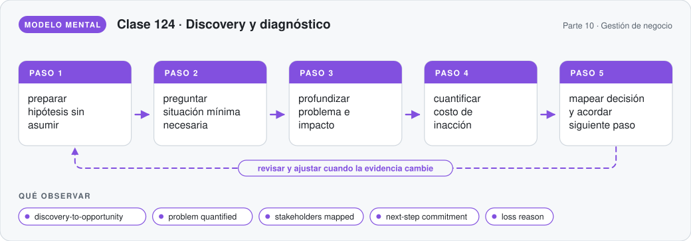

# Clase 124 — Discovery y diagnóstico

<!-- nav:inicio -->
> **Parte 10 · Ventas, desarrollo comercial y negociación** — clase 4 de 12 · [índice de la parte](../../README.md) · [temario](../../../../SYLLABUS.md)
<!-- nav:fin -->

**Parte:** 10 — Ventas, desarrollo comercial y negociación  
**Nivel:** Etapa 3 — Manager → Gerente  
**Duración sugerida:** 150–180 minutos · **Estándar:** deep-class-v2

## 🎯 Propósito

El error más caro de una venta compleja ocurre temprano: proponer una solución antes de entender el problema. El vendedor llega con una presentación, el comprador escucha cortésmente, la reunión termina con «lo vamos a evaluar» y la oportunidad se enfría. El diagnóstico (*discovery*) invierte el orden: primero se entiende el contexto, el problema, sus efectos y quién los sufre; solo después se habla de soluciones. Un buen diagnóstico no es un interrogatorio: es una conversación en la que el comprador descubre, muchas veces por primera vez, el costo real de su situación y el valor de cambiarla.

La clase se apoya en la investigación de Rackham sobre ventas y su modelo de preguntas SPIN, en la propuesta de Dixon y Adamson de enseñar al comprador algo que no sabía y en la escucha táctica de Voss y Raz. Al terminar sabrás preparar una reunión de diagnóstico, formular preguntas de situación, problema, implicación y necesidad de solución, escuchar con precisión, resumir lo entendido y decidir si la oportunidad tiene un problema que valga la pena resolver.

## 📚 Resultados de aprendizaje

Al finalizar podrás:

1. **Preparar** una reunión de diagnóstico con hipótesis e investigación previa.
2. **Formular** preguntas de situación, problema, implicación y necesidad de solución.
3. **Escuchar** y resumir con precisión lo que dice el comprador.
4. **Cuantificar** el efecto del problema con el comprador.
5. **Decidir** si existe una oportunidad real y cuál es el siguiente paso.

## 🧭 Agenda

| Tramo | Qué se hace |
|---|---|
| 0–20 min | Recuperación: recuerda una reunión comercial en que hablaste de la solución demasiado pronto y qué ocurrió. |
| 20–60 min | Preparación, tipos de pregunta, escucha y resumen. |
| 60–105 min | Ejemplo trabajado: diagnóstico en una empresa de transporte. |
| 105–150 min | Caso ejecutivo y práctica de preguntas. |
| 150–175 min | Límites y entregable. |

## 🧩 Conceptos centrales

| Concepto | Definición | Cómo se reconoce |
|---|---|---|
| **Discovery (diagnóstico)** | Fase en que se entiende el contexto, el problema y su efecto antes de proponer. | Más preguntas que afirmaciones. |
| **Pregunta de situación** | Recoge hechos del contexto. | «¿Cuántas sedes tienen?». |
| **Pregunta de problema** | Explora dificultades o insatisfacciones. | «¿Qué parte del proceso les causa más retrasos?». |
| **Pregunta de implicación** | Explora las consecuencias del problema. | «¿Cómo afecta eso a los plazos de entrega y a los reclamos?». |
| **Pregunta de necesidad de solución** | El comprador expresa el valor de resolverlo. | «¿Qué cambiaría si eso se resolviera?». |
| **Resumen de comprensión** | Síntesis de lo entendido para validar con el comprador. | «Si entendí bien…». |

## 🧠 Modelo mental

**Cómo leer el diagrama.** Cuatro peldaños que se suben en orden. Las preguntas de **situación** recogen hechos y deben ser pocas y preparadas. Las de **problema** exploran dificultades. Las de **implicación** muestran las consecuencias y le dan tamaño al problema. Las de **necesidad de solución** hacen que el comprador describa el valor de resolverlo; la solución surge de él. La nota recuerda que la evidencia de Rackham asocia el éxito en ventas grandes más con las dos últimas.

## 📖 Desarrollo

### 1. Qué encontró la investigación

Rackham y su equipo analizaron miles de visitas de ventas para entender qué conductas se asociaban con el éxito. Concluyeron que, en **ventas pequeñas**, ciertas técnicas de persuasión y de cierre funcionaban razonablemente, pero que en **ventas grandes** —con ciclos largos, riesgo alto y varios involucrados— esas mismas técnicas no ayudaban o dañaban. Lo que distinguía a los vendedores exitosos en ventas grandes era **cómo preguntaban**: hacían más preguntas sobre las dificultades del comprador y sus consecuencias, y menos presentaciones prematuras de características. De allí surgió el modelo SPIN. Es una síntesis de investigación aplicada, no una fórmula infalible.

### 2. Preparación

Un buen diagnóstico empieza antes de la reunión. Se investiga la **cuenta** (sector, noticias, resultados, cambios), el **contacto** (cargo, trayectoria, responsabilidades) y los **problemas típicos** de empresas del ICP (clase 122). Se formulan **hipótesis** (por ejemplo, «el crecimiento rápido está saturando su proceso de despacho») que se verificarán o descartarán. Se define el **objetivo de la reunión** (entender el problema y su efecto, identificar a quienes participan en la decisión, acordar un siguiente paso) y se preparan pocas preguntas de situación, para no cansar con datos que ya podrían conocerse.

### 3. Preguntas de situación y de problema

Las **preguntas de situación** (hechos, cifras, procesos actuales) son necesarias pero deben ser pocas: muchas hacen que el vendedor parezca desinformado y cansan al comprador. Las **preguntas de problema** abren el terreno: «¿Qué parte de este proceso les resulta más difícil?», «¿Dónde se pierde más tiempo?», «¿Qué les preocupa de cómo se hace hoy?». El comprador puede no haber reconocido el problema como tal; las preguntas ayudan a nombrarlo. Se escucha sin interrumpir y se toman notas. El vendedor evita saltar a la solución cuando aparece una dificultad que su producto podría resolver.

### 4. Preguntas de implicación

Las **preguntas de implicación** exploran los efectos del problema en el negocio y en las personas: costos, plazos, calidad, clientes, riesgo, estrés del equipo. «Y cuando eso ocurre, ¿qué pasa con los plazos de entrega?», «¿Cómo repercute en los reclamos y en las renovaciones?», «¿Quién más se ve afectado?». Su función es dar **tamaño** al problema: un retraso de dos días puede parecer menor hasta que se vincula con el 8 % de contratos perdidos. Son difíciles de formular y requieren pensar antes; no son preguntas manipuladoras sino ayudas para que el comprador evalúe correctamente su situación.

### 5. Preguntas de necesidad de solución y enseñanza

Las **preguntas de necesidad de solución** invitan al comprador a describir los beneficios de resolver: «¿Qué cambiaría si pudieran reducir ese retraso a la mitad?», «¿Qué valor tendría para el equipo?». Cuando es el comprador quien habla del valor, lo cree más que si lo afirma el vendedor. Dixon y Adamson añaden que los vendedores más efectivos en ventas complejas **enseñan**: aportan una perspectiva que el comprador no había considerado y que reformula su problema («la mayoría de las empresas de su tamaño pierde más por X que por Y»), y luego adaptan el mensaje a cada interlocutor.

### 6. Escucha táctica y resumen

Voss y Raz proponen escuchar con precisión: **repetir** palabras clave, **etiquetar** emociones («parece que les preocupa…»), **resumir** lo entendido y pedir confirmación. El **resumen de comprensión** al final de la reunión («Si entendí bien, el problema principal es A, afecta a B y C, y ustedes necesitarían D antes de fin de año; ¿es así?») cumple tres funciones: verifica la comprensión, muestra respeto y deja claro el punto de partida para la propuesta. Los silencios también son una herramienta: una pausa tras una respuesta suele producir más información.

### 7. Decidir qué sigue

El diagnóstico termina con una decisión honesta: ¿hay un **problema real**, con **efecto significativo**, un **patrocinador** y **capacidad** de actuar? Si es así, se acuerda un siguiente paso concreto con fecha (una reunión con otros involucrados, un piloto, una propuesta). Si no, se reconoce y se cierra o se pospone con respeto: no todas las conversaciones son oportunidades, y persistir malgasta tiempo. Se registra lo aprendido (problema, implicaciones, decisores, criterios de compra) en el CRM con las palabras del comprador, para usarlo en la propuesta (clase 125).

## 📚 Lectura comparada

| Obra | Qué aporta | Qué no resuelve | Pregunta para contrastar |
|---|---|---|---|
| Rackham (*SPIN Selling*) | Tipos de pregunta y evidencia sobre ventas grandes. | Investigación de un período y de ciertos sectores. | ¿Qué tipo de pregunta haces menos? |
| Dixon y Adamson | Enseñar, adaptar y tomar el control de la conversación. | Estudio de empresas de un período. | ¿Qué perspectiva nueva aportas? |
| Voss y Raz | Escucha táctica, etiquetas y resúmenes. | Nace de la negociación de rehenes; se adapta al comercio. | ¿Resumes antes de proponer? |
| Cialdini | Principios de influencia y su ética. | No es un manual de diagnóstico. | ¿Qué compromiso pequeño puedes pedir? |
| Christensen et al. (*Competing Against Luck*) | El trabajo que el cliente quiere lograr. | Marco conceptual. | ¿Para qué trabajo te contratarían? |

## 🧮 Ejemplo trabajado

**Situación (hipotética).** Una empresa de software de gestión de flotas se reúne con el gerente de operaciones de una empresa de transporte de carga con 120 camiones. La hipótesis previa: los retrasos en la entrega por falta de visibilidad.

| Tipo | Pregunta | Respuesta del comprador |
|---|---|---|
| Situación | ¿Cómo se asignan hoy las rutas y se sigue la entrega? | Planilla y llamadas a conductores. |
| Problema | ¿Qué parte del proceso les resulta más difícil? | No sabemos dónde están los camiones cuando un cliente llama. |
| Implicación | ¿Qué ocurre cuando un cliente llama y no pueden darle una hora? | Reclamos; el cliente más grande nos advirtió que evalúa cambiar de proveedor. |
| Implicación | ¿Cuánto representa ese cliente y cuánto tiempo de su equipo consume la atención? | 18 % de los ingresos; dos personas casi a tiempo completo. |
| Necesidad | Si pudieran informar horas confiables sin llamar, ¿qué cambiaría? | Liberaríamos a esas dos personas y reduciríamos el riesgo de perder el contrato. |

**Resumen.** «Si entendí bien: el problema principal es la falta de visibilidad de los camiones, que genera reclamos del cliente que representa el 18 % de sus ingresos, consume casi dos personas y pone en riesgo el contrato. Necesitan una solución antes del próximo renovación en cuatro meses y decide el gerente general junto con finanzas. ¿Es así?» El comprador confirma y agrega que TI exigirá integración con su sistema de facturación.

**Valor estimado con el comprador.** Dos personas a USD 2.000 mensuales cada una = USD 48.000 al año; el contrato en riesgo es USD 1,8 millones anuales con 12 % de margen operativo (USD 216.000). El comprador reconoce que evitar la pérdida pesa mucho más que el ahorro de tiempo.

**Siguiente paso.** Reunión con el gerente general y finanzas en diez días, con un caso de negocio basado en esos números; una prueba técnica de integración con TI.

**Qué muestra.** (1) Las preguntas de implicación convirtieron un inconveniente en un riesgo de negocio. (2) El resumen validó la comprensión y reveló un requisito nuevo. (3) El siguiente paso incluyó a decisores.

## 🔀 Comparación y límites

**Diagnóstico frente a venta consultiva.** El diagnóstico es una etapa; la venta consultiva es un enfoque general en que el vendedor actúa como asesor. Si el vendedor diagnostica pero no tiene el criterio para recomendar lo que no le conviene vender, el enfoque se vuelve una táctica.

**Límites.** La evidencia de Rackham proviene de estudios de décadas atrás, centrados en ventas complejas; en ventas simples un diagnóstico extenso puede ser innecesario. Las preguntas no deben usarse para presionar o manipular. Hay compradores que no tienen tiempo o que prefieren una propuesta rápida; se adapta el ritmo. Y las conversaciones sobre datos personales o información confidencial del comprador exigen cuidado y, cuando corresponde, acuerdos de confidencialidad.

## 🪜 De profesional a owner

| Nivel | Cómo participa en el diagnóstico |
|---|---|
| **Profesional** | Escucha, pregunta y registra con fidelidad. |
| **Jefe / Team Lead** | Entrena las preguntas y revisa grabaciones con el equipo. |
| **Gerente** | Define el estándar de diagnóstico y lo conecta con los criterios de etapa. |
| **CEO / Director** | Participa en diagnósticos de cuentas clave para entender al cliente. |
| **Founder / Owner** | Conversa con clientes para descubrir problemas antes de construir ofertas. |

## 🏢 Caso ejecutivo

Una empresa de consultoría en eficiencia energética para edificios comerciales tiene una tasa de cierre baja. Sus propuestas suelen enviarse tras una primera reunión de 30 minutos en que el consultor presenta la metodología y casos. En una auditoría de oportunidades perdidas, los compradores dicen que «la propuesta no reflejaba nuestras prioridades». Una administradora de edificios, que gestiona 40 inmuebles, acepta una reunión de diagnóstico de una hora; su contacto es la gerente técnica, y el decisor económico es el gerente general. El presupuesto 2026 está en revisión.

Entrega un **plan de diagnóstico y resumen** que contenga: (a) la preparación: investigación de la cuenta y tres hipótesis; (b) las preguntas organizadas por situación, problema, implicación y necesidad de solución; (c) cómo escucharás y qué etiquetas y resúmenes usarás; (d) el modo de cuantificar con la gerente técnica el costo del problema; (e) los criterios para decidir si hay oportunidad y el siguiente paso; (f) cómo registrarás lo aprendido y qué cuidados de confidencialidad tendrás.

## 🧪 Práctica

1. Escribe diez preguntas, tres de situación, tres de problema, dos de implicación y dos de necesidad de solución.
2. Prepara tres hipótesis sobre una cuenta del ICP.
3. Redacta un resumen de comprensión de ocho líneas para una reunión real.
4. Grábate o escribe un role-play y cuenta cuántas preguntas de implicación hiciste.
5. Define los criterios con que decidirías si hay oportunidad.

## ⚠️ Errores frecuentes

| Error | Por qué ocurre | Cómo corregirlo |
|---|---|---|
| Presentar antes de entender | Se quiere mostrar el producto | Diagnosticar primero. |
| Demasiadas preguntas de situación | Falta de preparación | Investigar antes y preguntar solo lo necesario. |
| No preguntar por las implicaciones | Son difíciles | Prepararlas y dar tamaño al problema. |
| Interrumpir al comprador | Se anticipa la solución | Escuchar, resumir y pausar. |
| Enviar propuesta sin resumen validado | Se supone comprensión | Confirmar con el comprador. |
| Seguir sin problema real | Se teme perder la oportunidad | Cerrar con honestidad. |

## ❓ Preguntas de comprobación

1. ¿Qué cuatro tipos de pregunta forman el modelo SPIN?
2. ¿Por qué se recomiendan pocas preguntas de situación?
3. ¿Para qué sirven las preguntas de implicación?
4. ¿Qué aporta que el comprador describa el valor de resolver el problema?
5. ¿Qué funciones cumple el resumen de comprensión?
6. ¿Cómo se decide si hay una oportunidad real?
7. ¿Qué límite tiene la evidencia de Rackham?

Claves de respuesta

1. Situación, problema, implicación y necesidad de solución.
2. Porque cansan al comprador y hacen parecer al vendedor desinformado; se prepara la investigación antes.
3. Para mostrar las consecuencias del problema y darle tamaño, de modo que el comprador evalúe su situación.
4. Lo que el comprador dice del valor lo cree más que lo que afirma el vendedor.
5. Verifica la comprensión, muestra respeto y deja claro el punto de partida de la propuesta.
6. Si hay un problema real con efecto significativo, un patrocinador y capacidad de actuar.
7. Proviene de estudios centrados en ventas complejas y de un período anterior; en ventas simples puede ser innecesario.

## 📥 Entregable

Guarda en `portfolio/124-discovery-y-diagnostico/`:

- `product-evidence-brief.md` (plantilla [Product evidence brief](../../../../templates/product-evidence-brief.md)) con el diagnóstico y el resumen del caso ejecutivo;
- `sales-pipeline.md` (plantilla [Sales pipeline](../../../../templates/sales-pipeline.md)) con los criterios de etapa y el siguiente paso;
- `decision-journal.md` con las hipótesis, las respuestas y el aprendizaje.

## 📗 Fuentes y verificación

- Neil Rackham — *SPIN Selling* (Highbridge Audio, 1998). **Uso en esta clase:** tipos de pregunta y evidencia sobre ventas grandes. Lectura selectiva sobre **discovery y diagnóstico**. **Localizador:** [ISBN-13 9781565112605](https://openlibrary.org/isbn/9781565112605).
- Matthew Dixon & Brent Adamson — *The Challenger Sale* (Portfolio/Penguin, 2011). **Uso en esta clase:** enseñar, adaptar y tomar el control de la conversación. Lectura selectiva sobre **discovery y diagnóstico**. **Localizador:** [ISBN-13 9781591844358](https://openlibrary.org/isbn/9781591844358).
- Chris Voss & Tahl Raz — *Never Split the Difference* (Penguin Random House, 2016). **Uso en esta clase:** escucha táctica, etiquetas y resúmenes. Lectura selectiva sobre **discovery y diagnóstico**. **Localizador:** [ISBN-13 9781847941480](https://openlibrary.org/isbn/9781847941480).
- Robert B. Cialdini — *Influence* (HarperCollins Publishers and Blackstone Audio, 2016). **Uso en esta clase:** principios de influencia y su ética. Lectura selectiva sobre **discovery y diagnóstico**. **Localizador:** [ISBN-13 9781624608049](https://openlibrary.org/isbn/9781624608049).
- Clayton M. Christensen et al. — *Competing Against Luck* (HarperBusiness, 2016). **Uso en esta clase:** el trabajo que el cliente quiere lograr. Lectura selectiva sobre **discovery y diagnóstico**. **Localizador:** [ISBN-13 9780062435613](https://openlibrary.org/isbn/9780062435613).

> **Regla de fuentes para Discovery y diagnóstico:** las obras anteriores estructuran las perspectivas de esta materia; cualquier norma, ley o estándar vivo mencionado debe comprobarse nuevamente en su fuente primaria vigente, incluidas las de confidencialidad y protección de datos. Los ejemplos y casos son hipotéticos, con cifras ilustrativas. El desarrollo es original y no reproduce capítulos protegidos.

<!-- pie:inicio -->
---

| Anterior | Índice | Siguiente |
|---|---|---|
| [← 123 · Prospección y generación de oportunidades](../123-prospeccion-y-generacion-de-oportunidades/README.md) | [Parte 10](../../README.md) · [Programa](../../../../SYLLABUS.md) | [125 · Propuesta de valor y business case →](../125-propuesta-de-valor-y-business-case/README.md) |
<!-- pie:fin -->
