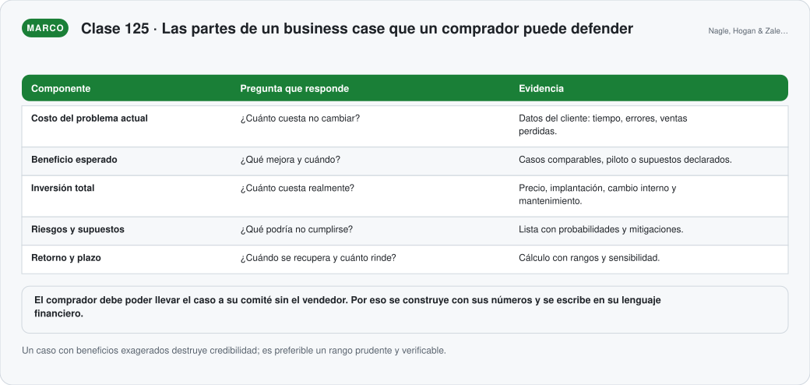

# Clase 125 — Propuesta de valor y business case

<!-- nav:inicio -->
> **Parte 10 · Ventas, desarrollo comercial y negociación** — clase 5 de 12 · [índice de la parte](../../README.md) · [temario](../../../../SYLLABUS.md)
<!-- nav:fin -->

**Parte:** 10 — Ventas, desarrollo comercial y negociación  
**Nivel:** Etapa 3 — Manager → Gerente  
**Duración sugerida:** 150–180 minutos · **Estándar:** deep-class-v2

## 🎯 Propósito

Una propuesta comercial rara vez la decide quien la recibió: la discute un comité, con personas que no estuvieron en las reuniones, que responden a su propio jefe y que miran riesgos, costos y alternativas. Si la propuesta solo enumera características y un precio, el comprador no tiene con qué defenderla internamente y la oportunidad se enfría o se decide por precio. El **business case** convierte la oferta en un argumento que el comprador puede llevar a su organización: cuál es el problema y cuánto cuesta, qué cambiaría, cuánto hay que invertir realmente, qué riesgos existen y cuándo se recupera el esfuerzo.

La clase se apoya en la teoría de estrategias de precio de Nagle, Hogan y Zale (valor para el cliente y valor económico), en la visión de decisiones de inversión de Brealey, Myers y Allen y en el modelo de Rackham de ventas centradas en el comprador. Al terminar sabrás construir una propuesta de valor específica, calcular el valor económico para el cliente con sus números, presentar costos totales, riesgos y retorno con rangos y escribir un documento que el comprador pueda defender sin ti.

## 📚 Resultados de aprendizaje

Al finalizar podrás:

1. **Formular** una propuesta de valor específica para un segmento y un problema.
2. **Calcular** el valor económico para el cliente con sus datos.
3. **Presentar** inversión total, riesgos, supuestos y retorno con rangos.
4. **Adaptar** el mensaje a cada rol del comité de compra.
5. **Redactar** una propuesta que el comprador pueda defender sin el vendedor.

## 🧭 Agenda

| Tramo | Qué se hace |
|---|---|
| 0–20 min | Recuperación: toma una propuesta tuya y marca qué frases la podría haber escrito cualquier competidor. |
| 20–60 min | Valor, business case, riesgos y presentación. |
| 60–105 min | Ejemplo trabajado: caso de negocio de un sistema de gestión de turnos. |
| 105–150 min | Caso ejecutivo y práctica. |
| 150–175 min | Límites y entregable. |

## 🧩 Conceptos centrales

| Concepto | Definición | Cómo se reconoce |
|---|---|---|
| **Propuesta de valor** | Declaración de qué problema resuelve, para quién, con qué resultado y por qué es mejor que las alternativas. | Específica; un competidor no podría firmarla. |
| **Valor económico para el cliente (EVC)** | Valor de la mejor alternativa del cliente más el valor adicional que aporta el producto. | Es el techo de lo que el cliente pagaría de forma racional. |
| **Business case** | Análisis de costos, beneficios, riesgos y retorno de una decisión. | El comprador lo puede presentar a su comité. |
| **Costo total de propiedad** | Todos los costos de adoptar y mantener la solución. | Incluye cambio interno, implantación y mantenimiento. |
| **Diferenciación** | Atributos que el cliente valora y que otros no ofrecen. | Se traduce en valor económico. |
| **Alternativa del cliente** | Lo que haría si no compra: nada, hacerlo internamente o contratar a otro. | Es la referencia contra la que se mide el valor. |

## 🧠 Modelo mental

**Cómo leer el diagrama.** Una tabla con cinco componentes que un comprador puede defender: el **costo del problema actual** (cuánto cuesta no cambiar), el **beneficio esperado**, la **inversión total** (no solo el precio), los **riesgos y supuestos** y el **retorno y plazo**. Cada fila indica la pregunta que responde y la evidencia que la respalda. El comprador debe poder llevar el caso a su comité sin el vendedor; por eso se construye con sus números y en su lenguaje financiero.

## 📖 Desarrollo

### 1. Valor es lo que el cliente gana

Nagle, Hogan y Zale distinguen entre el **costo** de producir y el **valor** para el cliente: el precio debe fijarse con referencia al valor, que es lo que el cliente obtiene respecto de su mejor alternativa. El **valor económico para el cliente** se calcula como el precio de la mejor alternativa más el valor diferencial (ahorros, ingresos adicionales, riesgos evitados) menos los costos de cambiar. Este valor es un **techo** de lo que el cliente pagaría de forma racional; el precio se fija debajo de él, de modo que quien compra se quede con parte del beneficio. Sin entender el valor, el vendedor compite por precio.

### 2. Una propuesta de valor específica

Una propuesta de valor sólida responde: **¿para quién?** (el ICP, clase 122), **¿qué problema?** (con palabras del cliente), **¿qué resultado?** (medible), **¿cómo es mejor que las alternativas?** (diferencia relevante) y **¿qué evidencia hay?** (casos, datos, referencias). Una prueba útil: ¿podría un competidor firmar esta frase? Si «mejoramos la eficiencia y reducimos costos» sirve para todos, no diferencia. Una versión específica: «reducimos en 30 % el tiempo de asignación de turnos para clínicas de 50 a 300 personas, con integración a su sistema de nómina, según 14 casos documentados».

### 3. Construir el business case con los números del cliente

El caso se construye **con el comprador**, no para él. Se parte del **costo del problema actual**, a partir de los datos del diagnóstico (clase 124): horas, errores, ventas perdidas, riesgos. Luego, el **beneficio esperado** en rangos, apoyado en casos comparables o en un piloto; se separa lo **medible** (horas ahorradas) de lo **estratégico** (reputación), que se describe sin forzar cifras. Se calcula la **inversión total**: precio, implantación, formación, cambios de procesos, integraciones, mantenimiento y costo de oportunidad del tiempo interno. Y el **retorno**: VPN o plazo de recuperación (clase 118), con el costo de capital del cliente si lo conoce.

### 4. Riesgos y supuestos

Un caso creíble nombra sus **supuestos** y sus **riesgos**: adopción del equipo, calidad de los datos, integración técnica, dependencia de terceros, cambios regulatorios. Para cada riesgo se indican **mitigaciones** y qué parte asume cada una de las partes (condiciones del contrato, garantías, fases, plan de salida). La **sensibilidad** muestra qué pasa si el beneficio es 30 % menor o si el plazo de implantación se duplica (clase 118). Ocultar riesgos destruye confianza cuando aparecen; mostrarlos con un plan los reduce y suele acelerar la decisión, porque el comprador puede anticipar las preguntas de su comité.

### 5. Hablar a cada rol del comité

El comité de compra incluye personas con preocupaciones distintas: el **usuario** (¿facilita mi trabajo?), el **patrocinador** (¿resuelve mi problema y mi reputación?), el **decisor económico** (¿vale la inversión frente a otras?), **TI** y **seguridad** (¿es compatible y seguro?), **legal** (¿qué riesgos contractuales hay?), **compras** (¿precio y condiciones comparables?). El documento tiene una **versión ejecutiva** de una a dos páginas y anexos específicos. Rackham enfatiza el análisis de roles del comprador para ajustar mensaje y evidencia; ignorar a un rol con poder de bloqueo es una causa frecuente de oportunidades perdidas.

### 6. Diferenciación y alternativas

El comprador compara con **alternativas**: hacerlo internamente, mantener la situación actual, contratar a un competidor, aplazar. La propuesta debe tratar cada una con respeto y evidencia: **no hacer nada** tiene un costo (el del problema); **hacerlo internamente** tiene costos ocultos de construcción y mantenimiento; **competidores** tienen fortalezas que se reconocen. Se evita el ataque; se muestra en qué dimensiones la propuesta es mejor y para qué situaciones otra alternativa podría ser adecuada: la franqueza aumenta la credibilidad.

### 7. El documento y su uso

La propuesta es un **documento de decisión**: claro, breve en su parte principal, con la **recomendación** y la **decisión solicitada** al inicio, **evidencia** en anexos, **plan de implantación** y **condiciones comerciales** (precio, plazos, garantías, niveles de servicio). Se redacta en el idioma y el formato del comprador (por ejemplo, la plantilla de su comité de inversión). Se **valida** con el patrocinador antes de enviarla, se presenta en una reunión (no solo por correo) y se acuerda cómo se resolverán las dudas. Los términos jurídicos se revisan con asesoría legal.

## 📚 Lectura comparada

| Obra | Qué aporta | Qué no resuelve | Pregunta para contrastar |
|---|---|---|---|
| Nagle, Hogan y Zale | Valor económico para el cliente y fijación de precios por valor. | Parte de supuestos de conocimiento del cliente. | ¿Cuál es la mejor alternativa de tu cliente? |
| Brealey, Myers y Allen | Retorno, valor presente y riesgo de decisiones de inversión. | Teoría con supuestos. | ¿Qué retorno exigirá el comité? |
| Rackham | Roles del comprador y ventas centradas en su proceso. | Enfoque de ventas complejas. | ¿Qué rol falta en tu propuesta? |
| Dixon y Adamson | Mensaje adaptado a cada interlocutor. | Estudio en un conjunto de empresas. | ¿Qué enseñas a cada rol? |
| Osterwalder et al. (*Value Proposition Design*) | Encaje entre trabajos, dolores y ganancias del cliente. | Marco de diseño, no de ventas. | ¿Qué dolor resuelves de forma verificable? |

## 🧮 Ejemplo trabajado

**Situación (hipotética).** La empresa de software de turnos propone su solución a una red de clínicas con 180 personas en turnos rotativos. Con el comprador se reúnen los datos.

**Costo del problema actual.**

| Concepto | Dato | Valor anual |
|---|---|---|
| Tiempo de la jefa de enfermería y dos asistentes asignando turnos | 22 horas semanales × USD 14 | USD 16.000 |
| Horas extra por turnos mal cubiertos | 9 % de las horas extra son evitables | USD 41.000 |
| Multas y observaciones laborales por registros incompletos | Dos en 24 meses | USD 12.000 (promedio) |
| Rotación atribuida a turnos inestables | 4 personas de 14 que se van | USD 28.000 (reemplazo) |
| **Costo anual estimado** | | **USD 97.000** |

**Beneficio esperado (rango).** Reducción de 60 % a 80 % del tiempo de asignación; reducción de 40 % a 60 % de las horas extra evitables; reducción de 25 % a 50 % de la rotación atribuida. Con la mitad a todas las multas evitadas (USD 6.000 a 12.000), el beneficio anual queda entre USD 39.000 y USD 63.000.

**Inversión total.** Licencia: USD 18.000 al año; implantación: USD 9.000; formación y cambio interno: USD 6.000 (tiempo de personas); integración con nómina: USD 5.000; total del primer año: USD 38.000; años siguientes: USD 19.000.

**Retorno.** Primer año: beneficio neto entre USD 1.000 y USD 25.000; años siguientes: entre USD 20.000 y USD 44.000. Recuperación entre 7 y 12 meses; VPN a tres años (10 %) entre unos USD 33.000 y USD 92.000.

**Riesgos y mitigaciones.** Adopción de las supervisoras (piloto en una clínica y formación); calidad de los datos de nómina (revisión previa); cumplimiento de las normas laborales de turnos (parámetros revisados con el asesor del cliente); salida (exportación de datos garantizada).

**Alternativas.** Mantener planillas (costo del problema); desarrollar internamente (USD 60.000 y mantenimiento); competidor A (menos integración, precio 15 % menor). Se reconoce que para clínicas de menos de 50 personas la solución no se justifica.

**Documento.** Dos páginas ejecutivas, anexos y un plan de 90 días; validado con la gerente de personas y con la gerente administrativa antes de enviarse.

**Qué muestra.** (1) El valor se construyó con los números del cliente. (2) Se presentaron rangos, riesgos y alternativas. (3) El documento estaba pensado para el comité, no para el vendedor.

## 🔀 Comparación y límites

**Business case frente a cotización.** La cotización informa precio y condiciones; el business case argumenta por qué conviene decidir. Ambos son necesarios en compras complejas.

**Límites.** El valor económico depende de estimaciones del cliente y del vendedor, con sesgo de optimismo; se contrasta con la visión desde afuera. En compras de bajo monto, un caso extenso es desproporcionado. Los beneficios estratégicos son difíciles de cuantificar y no deben forzarse. Y las propuestas son documentos con efectos contractuales y regulatorios (por ejemplo, afirmaciones de desempeño, garantías, uso de datos); se revisan con asesoría legal antes de enviarse.

## 🪜 De profesional a owner

| Nivel | Cómo participa en la propuesta de valor |
|---|---|
| **Profesional** | Documenta los números del cliente y propone beneficios verificables. |
| **Jefe / Team Lead** | Revisa que la propuesta responda al diagnóstico y a cada rol. |
| **Gerente** | Define el estándar de business case y revisa los de cuentas clave. |
| **CEO / Director** | Exige propuestas honestas y respaldadas por evidencia. |
| **Founder / Owner** | Aprende a cuantificar el valor antes de fijar precio. |

## 🏢 Caso ejecutivo

Una empresa de automatización de bodegas ofrece a una cadena de distribución un sistema de picking asistido por voz. El precio es de USD 650.000 con una implantación de 4 meses. El gerente de logística está convencido; el gerente general pide «un caso de negocio con números reales»; finanzas cuestiona beneficios que considera optimistas; TI exige integración con el sistema de inventario; recursos humanos teme el efecto en 120 operarios. Un competidor ofrece una solución con códigos de barras por USD 380.000. La cadena tiene un costo de capital de 11 % y exige payback menor a tres años.

Entrega una **propuesta de valor y business case** que contenga: (a) la propuesta de valor específica; (b) el costo del problema actual con las fuentes de los datos; (c) los beneficios en rangos con casos comparables y piloto; (d) la inversión total incluida la gestión del cambio; (e) los riesgos, supuestos y sensibilidades; (f) el tratamiento de la alternativa competidora y de «no hacer nada»; (g) la adaptación a cada rol del comité y las verificaciones legales y laborales.

## 🧪 Práctica

1. Reescribe tu propuesta de valor para que un competidor no pueda firmarla.
2. Calcula el costo anual del problema de un cliente real con sus datos.
3. Calcula el beneficio en un rango y el retorno de tu solución.
4. Lista los cinco principales riesgos de adopción y sus mitigaciones.
5. Redacta la versión ejecutiva de una página para un decisor económico.

## ⚠️ Errores frecuentes

| Error | Por qué ocurre | Cómo corregirlo |
|---|---|---|
| Listar características | Se confunde descripción con valor | Traducir en resultado del cliente. |
| Beneficios exagerados | Se quiere ganar | Rangos y evidencia verificable. |
| Presentar solo el precio | Se omite el costo total | Incluir implantación y cambio. |
| Ignorar riesgos | Parecen debilidades | Nombrarlos con mitigaciones. |
| Un solo documento para todos | Es más cómodo | Versión ejecutiva y anexos por rol. |
| Enviar sin validar con el patrocinador | Se quiere avanzar | Revisar antes con él. |

## ❓ Preguntas de comprobación

1. ¿Qué es el valor económico para el cliente y qué papel cumple en el precio?
2. ¿Qué hace específica a una propuesta de valor?
3. ¿Qué componentes tiene un business case?
4. ¿Por qué se muestran riesgos y supuestos?
5. ¿Cómo se adapta la propuesta a un comité de compra?
6. ¿Cómo se tratan las alternativas del comprador?
7. ¿Qué límites tiene un business case?

Claves de respuesta

1. El valor de la mejor alternativa más el valor diferencial menos los costos de cambiar; es un techo racional del precio, que se fija por debajo para que el cliente se quede con parte del beneficio.
2. Que un competidor no podría firmarla: define para quién, qué problema, qué resultado medible, por qué es mejor y qué evidencia hay.
3. Costo del problema actual, beneficio esperado, inversión total, riesgos y supuestos, y retorno y plazo.
4. Porque ocultarlos destruye confianza cuando aparecen y mostrarlos con un plan ayuda al comprador a anticipar a su comité.
5. Con una versión ejecutiva y anexos para cada rol (usuario, patrocinador, decisor económico, TI, legal, compras).
6. Con respeto y evidencia: no hacer nada tiene un costo, hacerlo internamente tiene costos ocultos y los competidores tienen fortalezas.
7. Depende de estimaciones sesgadas, no sirve para compras de bajo monto, los beneficios estratégicos no se cuantifican bien y tiene efectos contractuales.

## 📥 Entregable

Guarda en `portfolio/125-propuesta-de-valor-y-business-case/`:

- `modelo-financiero-y-memo-de-decision.md` (plantilla [Modelo financiero y memo de decisión](../../../../templates/modelo-financiero-y-memo-de-decision.md)) con el business case del caso ejecutivo;
- `commercial-decision-brief.md` (plantilla [Commercial decision brief](../../../../templates/commercial-decision-brief.md)) con la propuesta de valor y la versión ejecutiva;
- `decision-journal.md` con los supuestos, las sensibilidades y las alternativas.

## 📗 Fuentes y verificación

- Thomas T. Nagle, John E. Hogan & Joseph Zale — *The Strategy and Tactics of Pricing* (Taylor & Francis Group, 1987). **Uso en esta clase:** valor económico para el cliente y fijación de precios por valor. Lectura selectiva sobre **propuesta de valor y business case**. **Localizador:** [ISBN-13 9781315266220](https://openlibrary.org/isbn/9781315266220).
- Richard Brealey, Stewart Myers & Franklin Allen — *Principles of Corporate Finance* (McGraw-Hill International Book Co, 1984). **Uso en esta clase:** retorno, valor presente y riesgo de decisiones de inversión. Lectura selectiva sobre **propuesta de valor y business case**. **Localizador:** [ISBN-13 9780070662025](https://openlibrary.org/isbn/9780070662025).
- Neil Rackham — *Major Account Sales Strategy* (McGraw-Hill, 1989). **Uso en esta clase:** roles del comprador y ventas centradas en su proceso. Lectura selectiva sobre **propuesta de valor y business case**. **Localizador:** [ISBN-13 9780070511149](https://openlibrary.org/isbn/9780070511149).
- Matthew Dixon & Brent Adamson — *The Challenger Sale* (Portfolio/Penguin, 2011). **Uso en esta clase:** mensaje adaptado a cada interlocutor. Lectura selectiva sobre **propuesta de valor y business case**. **Localizador:** [ISBN-13 9781591844358](https://openlibrary.org/isbn/9781591844358).
- Alexander Osterwalder et al. — *Value Proposition Design* (John Wiley & Sons, Incorporated, 2014). **Uso en esta clase:** encaje entre trabajos, dolores y ganancias del cliente. Lectura selectiva sobre **propuesta de valor y business case**. **Localizador:** [ISBN-13 9781118968062](https://openlibrary.org/isbn/9781118968062).

> **Regla de fuentes para Propuesta de valor y business case:** las obras anteriores estructuran las perspectivas de esta materia; cualquier norma, ley o estándar vivo mencionado debe comprobarse nuevamente en su fuente primaria vigente, incluidas las que rigen afirmaciones de desempeño, garantías y uso de datos en propuestas comerciales. Los ejemplos y casos son hipotéticos, con cifras ilustrativas. El desarrollo es original y no reproduce capítulos protegidos.

<!-- pie:inicio -->
---

| Anterior | Índice | Siguiente |
|---|---|---|
| [← 124 · Discovery y diagnóstico](../124-discovery-y-diagnostico/README.md) | [Parte 10](../../README.md) · [Programa](../../../../SYLLABUS.md) | [126 · Pipeline y forecast comercial →](../126-pipeline-y-forecast-comercial/README.md) |
<!-- pie:fin -->
