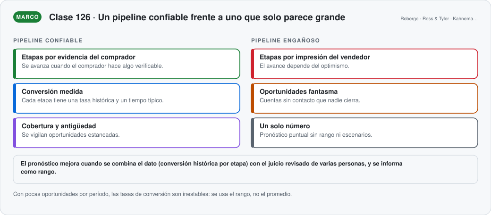

# Clase 126 — Pipeline y forecast comercial

<!-- nav:inicio -->
> **Parte 10 · Ventas, desarrollo comercial y negociación** — clase 6 de 12 · [índice de la parte](../../README.md) · [temario](../../../../SYLLABUS.md)
<!-- nav:fin -->

**Parte:** 10 — Ventas, desarrollo comercial y negociación  
**Nivel:** Etapa 3 — Manager → Gerente  
**Duración sugerida:** 150–180 minutos · **Estándar:** deep-class-v2

## 🎯 Propósito

El pronóstico de ventas es una de las promesas más importantes que un equipo comercial hace a la empresa: de él dependen la contratación, la producción, el flujo de caja y la credibilidad ante el directorio. Y es una de las más incumplidas. Los pronósticos fallan porque se construyen con optimismo, con etapas definidas por la impresión del vendedor, con oportunidades que nadie cierra pero que siguen en la lista, y con un único número presentado como certeza. Un pipeline sano es una herramienta de gestión y un instrumento de pronóstico; uno maquillado es una narración.

La clase se apoya en la gestión comercial basada en datos de Roberge, en los roles y procesos de Ross y Tyler, en la evidencia de Kahneman, Sibony y Sunstein sobre el ruido y el sesgo en los juicios y en el análisis de Rackham de la dinámica de ventas complejas. Al terminar sabrás definir etapas por evidencia, calcular conversiones y tiempos, estimar un pronóstico en rangos, combinar datos y juicio y conducir una revisión de pipeline que mejore las decisiones.

## 📚 Resultados de aprendizaje

Al finalizar podrás:

1. **Definir** etapas del pipeline por evidencia del comprador.
2. **Calcular** conversiones, tiempos de ciclo y cobertura.
3. **Construir** un pronóstico en rangos con enfoque de datos y de juicio.
4. **Identificar** oportunidades estancadas y sesgos de optimismo.
5. **Conducir** una revisión de pipeline que genere acciones.

## 🧭 Agenda

| Tramo | Qué se hace |
|---|---|
| 0–20 min | Recuperación: toma tu pipeline actual y marca cuántas oportunidades llevan más de 90 días sin avance. |
| 20–60 min | Etapas, métricas, métodos de pronóstico y revisión. |
| 60–105 min | Ejemplo trabajado: pronóstico trimestral con tres métodos. |
| 105–150 min | Caso ejecutivo y práctica de revisión. |
| 150–175 min | Límites y entregable. |

## 🧩 Conceptos centrales

| Concepto | Definición | Cómo se reconoce |
|---|---|---|
| **Pipeline** | Conjunto de oportunidades abiertas por etapa, con su valor. | Se actualiza con hechos. |
| **Forecast comercial** | Estimación de ventas cerradas en un período. | Se informa en rango y con supuestos. |
| **Tasa de conversión histórica** | Proporción de oportunidades que avanza o cierra desde cada etapa. | Se calcula de períodos anteriores. |
| **Cobertura** | Relación entre el valor del pipeline y la meta. | Por ejemplo, 3 veces la meta. |
| **Oportunidad estancada** | Oportunidad sin avance verificable en un tiempo mayor al típico. | Supera el ciclo normal de su etapa. |
| **Pronóstico ponderado** | Suma del valor de cada oportunidad por su probabilidad. | La probabilidad proviene de datos. |

## 🧠 Modelo mental

**Cómo leer el diagrama.** Dos paneles. El **pipeline confiable** avanza por evidencia del comprador, mide la conversión y el tiempo de cada etapa y vigila la cobertura y la antigüedad. El **pipeline engañoso** avanza por impresión del vendedor, acumula oportunidades fantasma y entrega un único número como pronóstico. La nota indica la salida: combinar el dato (conversión histórica por etapa) con el juicio revisado de varias personas e informar un rango.

## 📖 Desarrollo

### 1. Qué mide el pipeline

El pipeline es la cartera de oportunidades abiertas organizada por etapas. Su calidad depende de la **disciplina de registro** (cada oportunidad tiene valor, fecha estimada, próxima acción y contactos) y de los **criterios de etapa** basados en hechos del comprador (clase 121). Roberge insiste en que sin datos confiables no se puede gestionar: la mitad de los problemas de pronóstico son problemas de higiene del CRM. Una regla básica: ninguna oportunidad avanza de etapa sin que se registre el hecho que lo justifica.

### 2. Conversión y velocidad

Dos medidas guían el pronóstico: la **conversión** (qué proporción de oportunidades de cada etapa termina ganada) y la **velocidad** (cuánto tardan). Se calculan por **cohorte** (oportunidades creadas en un mismo período) y por **segmento** (clase 122). Con ellas se estima, para cada oportunidad abierta, su probabilidad de cerrarse en el período: una oportunidad en etapa de propuesta con una antigüedad típica tiene una probabilidad distinta a otra con el triple de antigüedad. Las probabilidades de etapa que usan muchos CRM por defecto (por ejemplo, 20 %, 40 %, 60 %) rara vez coinciden con la realidad de cada empresa y se reemplazan por datos propios.

### 3. Cobertura

La **cobertura** compara el valor del pipeline con la meta: con una conversión histórica a cierre de 25 %, se necesitan cuatro veces la meta en oportunidades para alcanzarla. Se calcula por período y por etapa: un pipeline amplio pero concentrado en etapas tempranas no cubre el trimestre actual. También se analiza la **calidad**: concentración en pocos negocios, dependencia de un cliente, proporción creada en el período y edad. Una cobertura baja se detecta con anticipación suficiente para actuar generando oportunidades (clase 123); una alta con baja conversión señala problemas de calificación.

### 4. Métodos de pronóstico

Hay varios, y conviene combinarlos. **Ponderado por etapa**: suma de valores por probabilidad histórica. **Basado en historial**: se proyecta con las ventas de períodos comparables y la estacionalidad. **Basado en juicio**: cada vendedor y gerente clasifica oportunidades (por ejemplo, «comprometida», «probable», «posible»). **Basado en capacidad**: se estima con el número de vendedores, su productividad y su rampa. Kahneman, Sibony y Sunstein muestran que combinar juicios independientes reduce el ruido, y que la visión desde afuera (tasas base) corrige el optimismo de la visión desde adentro. El resultado se presenta como un **rango** con escenarios.

### 5. Sesgos del pronóstico

Los sesgos más frecuentes: **optimismo** del vendedor, que ve más probabilidad de la real; **sandbagging**, cuando se sub-reporta para asegurar superar la meta; **anclaje** al pronóstico anterior; **atención a negocios grandes** que dominan la conversación y distorsionan; y la **falacia del costo hundido** («llevamos meses en esta cuenta»). Se mitigan con **criterios objetivos de etapa**, **revisión de cabezas frías** (alguien que no vende la cuenta), **seguimiento del error del pronóstico** (se compara lo predicho con lo real por persona y por período) y **separar** el pronóstico de la evaluación individual cuando sea posible.

### 6. Revisión de pipeline

La revisión semanal de pipeline es una conversación breve y estructurada por oportunidad: **¿qué cambió desde la semana pasada?**, **¿cuál es la evidencia de la etapa?**, **¿quién decide y cuándo?**, **¿qué riesgo hay?**, **¿cuál es el próximo paso y quién lo hace?** Se prioriza por valor y fecha de cierre. Se desafía con respeto a quien reporta: no se busca culpables sino claridad. Se **depuran** las oportunidades sin actividad o con fecha vencida: o se cierran o se justifica por escrito. Una revisión eficaz termina con acciones por oportunidad, no con una lista de cifras (clase 104).

### 7. Informar y decidir

El pronóstico se comunica a la dirección como **rango** (por ejemplo, «entre USD 1,8 y 2,3 millones, con un caso central de USD 2,0 millones»), con **supuestos** y **riesgos** (negocios grandes de los que depende), y con **acciones** disponibles para cubrir brechas. Se informa también la **precisión histórica** del pronóstico. Con él se toman decisiones de producción, personal y caja (clase 112). Un buen pronóstico no es el que acierta siempre, sino el que **informa bien la incertidumbre** y permite reaccionar. Se evita ajustar el pronóstico para agradar o para evitar conflictos.

## 📚 Lectura comparada

| Obra | Qué aporta | Qué no resuelve | Pregunta para contrastar |
|---|---|---|---|
| Roberge | Gestión del pipeline con datos y cadencia de revisión. | Experiencia de una empresa de software. | ¿Qué datos de tu CRM son confiables? |
| Ross y Tyler | Procesos y roles que alimentan el pipeline. | Enfoque en generación de oportunidades. | ¿Qué rol es responsable de cada etapa? |
| Kahneman, Sibony y Sunstein | Ruido, sesgo y agregación de juicios. | No trata de ventas. | ¿Qué sesgo domina tu pronóstico? |
| Rackham | Dinámica de ventas complejas y roles del comprador. | Enfoque de cuentas grandes. | ¿Quién decide en cada negocio grande? |
| Dixon y Adamson | Qué distingue a los mejores vendedores. | No trata de pronóstico. | ¿Quién dice la verdad del estado de una cuenta? |

## 🧮 Ejemplo trabajado

**Situación (hipotética).** Una empresa de software tiene una meta trimestral de USD 2,0 millones en ventas nuevas. Al inicio del trimestre, su pipeline es:

| Etapa | Oportunidades | Valor (USD miles) | Conversión histórica a cierre en el trimestre |
|---|---|---|---|
| Propuesta enviada, con fecha de decisión | 12 | 1.100 | 38 % |
| Diagnóstico completo | 20 | 1.900 | 14 % |
| Primera reunión calificada | 35 | 3.000 | 4 % |

**Método ponderado por datos propios.** 1.100 × 0,38 + 1.900 × 0,14 + 3.000 × 0,04 = 418 + 266 + 120 = **804** (USD miles). El CRM por defecto, con 60 %, 30 % y 10 %, habría dado 660 + 570 + 300 = 1.530.

**Método de juicio.** Los vendedores clasifican: «comprometidas» 700, «probables» 600, «posibles» 800; ponderadas por el gerente con 90 %, 50 %, 15 %: 630 + 300 + 120 = 1.050.

**Método histórico.** Los últimos cuatro trimestres cerraron 1.150; 1.320; 980; 1.410. Con estacionalidad y crecimiento esperado de 8 %: entre 1.100 y 1.500.

**Pronóstico.** Rango de USD 0,9 a 1,5 millones, con un caso central de unos 1,1 millones, bastante por debajo de la meta de 2,0. **Cobertura**: 6,0 millones en pipeline frente a la meta (3 veces); considerando conversión, el pipeline cubre menos de la mitad.

**Acciones.** (a) Informar a la dirección un rango de 0,9 a 1,5 millones; (b) acelerar las 12 oportunidades con fecha de decisión, con patrocinadores y planes de cierre; (c) iniciar campañas para generar oportunidades con ciclo corto en el segmento del ICP; (d) revisar los tres negocios de más de USD 200.000 que concentran el 40 % del valor; (e) planificar caja y contratación con el caso conservador.

**Seguimiento del error.** Al fin del trimestre, el pronóstico central se compara con el resultado: si el ponderado por datos propios acierta con un error menor a 15 % en cuatro trimestres seguidos, se adopta como base.

**Qué muestra.** (1) El CRM por defecto casi duplicaba el pronóstico. (2) Combinar métodos y presentar un rango informó mejor. (3) Las acciones se dirigieron a las brechas.

## 🔀 Comparación y límites

**Pronóstico frente a meta.** El pronóstico dice lo que se espera; la meta dice lo que se quiere. Cuando se confunden, el equipo ajusta el pronóstico para que coincida con la meta y la dirección pierde información.

**Límites.** Las tasas de conversión son inestables con pocas oportunidades. Los grandes negocios distorsionan los promedios. Los cambios de mercado, precio o equipo rompen la validez de los datos históricos. Los métodos de pronóstico mejoran con volumen y disciplina; con ciclos largos y pocas ventas por trimestre, el pronóstico tendrá siempre amplia incertidumbre. Los registros comerciales con datos personales deben cumplir la normativa de protección de datos aplicable.

## 🪜 De profesional a owner

| Nivel | Cómo participa en el pipeline y el pronóstico |
|---|---|
| **Profesional** | Registra con honestidad la etapa y la próxima acción. |
| **Jefe / Team Lead** | Conduce la revisión semanal y cuestiona con evidencia. |
| **Gerente** | Construye el pronóstico en rango y mide su precisión. |
| **CEO / Director** | Usa el rango para decidir y exige informes con supuestos. |
| **Founder / Owner** | Mantiene un pipeline simple y verifica su calidad personalmente. |

## 🏢 Caso ejecutivo

Una empresa de software para el sector financiero ha fallado en su pronóstico trimestral en 35 % o más durante los últimos cinco trimestres. El vicepresidente comercial presenta cada trimestre un único número optimista; en el CRM, el 28 % de las oportunidades abiertas tiene fecha de cierre vencida, y los vendedores actualizan la información justo antes de la reunión de pronóstico. Dos negocios de USD 1,5 millones cada uno representan el 45 % del pronóstico del trimestre, y en ambos el comprador no ha agendado una reunión con el decisor económico. El directorio exige previsibilidad; el director financiero planifica la contratación según el pronóstico.

Entrega un **diseño de pipeline y pronóstico** que contenga: (a) los criterios de etapa por evidencia y las reglas de higiene del CRM; (b) el cálculo de conversiones y tiempos con los datos que necesitarías; (c) el pronóstico en rango con tres métodos y escenarios; (d) el tratamiento de los dos negocios concentrados; (e) la estructura de la revisión semanal y de la revisión de cabezas frías; (f) cómo se informará la precisión del pronóstico y qué decisiones de contratación y caja dependerán del rango.

## 🧪 Práctica

1. Define criterios de etapa por evidencia para cuatro etapas.
2. Calcula conversiones por etapa con los datos de dos trimestres.
3. Construye un pronóstico ponderado con probabilidades propias y compáralo con uno por defecto.
4. Identifica cinco oportunidades estancadas y decide qué hacer con cada una.
5. Redacta cómo informarías el pronóstico a la dirección con rango y riesgos.

## ⚠️ Errores frecuentes

| Error | Por qué ocurre | Cómo corregirlo |
|---|---|---|
| Probabilidades por defecto del CRM | Es lo disponible | Calcular con datos propios. |
| Etapas por impresión | Es más fácil registrar | Criterios por evidencia. |
| Un solo número | Se busca claridad | Rango con supuestos. |
| Oportunidades fantasma | No se depura | Reglas de antigüedad y cierre. |
| Pronóstico ajustado a la meta | Se evitan conflictos | Separar pronóstico y meta. |
| No medir el error | Se pasa al siguiente trimestre | Comparar lo predicho con lo real. |

## ❓ Preguntas de comprobación

1. ¿Qué hace confiable a un pipeline?
2. ¿Qué es la cobertura y qué ocurre si es alta con baja conversión?
3. ¿Qué métodos de pronóstico se combinan?
4. ¿Qué sesgos afectan el pronóstico?
5. ¿Qué preguntas ordenan la revisión por oportunidad?
6. ¿Por qué se informa un rango?
7. ¿Qué límites tienen los datos históricos?

Claves de respuesta

1. Etapas definidas por evidencia, registro disciplinado, conversión y tiempos medidos, y vigilancia de la cobertura y la antigüedad.
2. La relación entre el valor del pipeline y la meta; si es alta con conversión baja, señala problemas de calificación.
3. Ponderado por etapa, basado en historial, basado en juicio y basado en capacidad.
4. Optimismo, sandbagging, anclaje, atención a negocios grandes y falacia del costo hundido.
5. Qué cambió, cuál es la evidencia de la etapa, quién decide y cuándo, qué riesgo hay y cuál es el próximo paso.
6. Porque informa la incertidumbre y permite decidir y reaccionar; un número único da una falsa precisión.
7. Son inestables con pocas oportunidades, se distorsionan con grandes negocios y pierden validez si cambian el mercado, el precio o el equipo.

## 📥 Entregable

Guarda en `portfolio/126-pipeline-y-forecast-comercial/`:

- `commercial-decision-brief.md` (plantilla [Commercial decision brief](../../../../templates/commercial-decision-brief.md)) con el diseño del caso ejecutivo;
- `sales-pipeline.md` (plantilla [Sales pipeline](../../../../templates/sales-pipeline.md)) con etapas, conversiones y pronóstico;
- `decision-journal.md` con los supuestos del rango y el seguimiento del error.

## 📗 Fuentes y verificación

- Mark Roberge — *The Sales Acceleration Formula* (2015). **Uso en esta clase:** gestión del pipeline con datos y cadencia de revisión. Lectura selectiva sobre **pipeline y forecast comercial**. **Localizador:** [ISBN-13 9781119047070](https://openlibrary.org/isbn/9781119047070).
- Aaron Ross & Marylou Tyler — *Predictable Revenue* (Pebblestorm, 2020). **Uso en esta clase:** procesos y roles que alimentan el pipeline. Lectura selectiva sobre **pipeline y forecast comercial**. **Localizador:** [ISBN-13 9780984380244](https://openlibrary.org/isbn/9780984380244).
- Daniel Kahneman, Olivier Sibony & Cass R. Sunstein — *Noise* (Little, Brown Spark, 2021). **Uso en esta clase:** ruido, sesgo y agregación de juicios. Lectura selectiva sobre **pipeline y forecast comercial**. **Localizador:** [ISBN-13 9780316451383](https://openlibrary.org/isbn/9780316451383).
- Neil Rackham — *Major Account Sales Strategy* (McGraw-Hill, 1989). **Uso en esta clase:** dinámica de ventas complejas y roles del comprador. Lectura selectiva sobre **pipeline y forecast comercial**. **Localizador:** [ISBN-13 9780070511149](https://openlibrary.org/isbn/9780070511149).
- Matthew Dixon & Brent Adamson — *The Challenger Sale* (Portfolio/Penguin, 2011). **Uso en esta clase:** qué distingue a los mejores vendedores. Lectura selectiva sobre **pipeline y forecast comercial**. **Localizador:** [ISBN-13 9781591844358](https://openlibrary.org/isbn/9781591844358).

> **Regla de fuentes para Pipeline y forecast comercial:** las obras anteriores estructuran las perspectivas de esta materia; cualquier norma, ley o estándar vivo mencionado debe comprobarse nuevamente en su fuente primaria vigente, incluida la protección de datos en los registros comerciales. Los ejemplos y casos son hipotéticos, con cifras ilustrativas. El desarrollo es original y no reproduce capítulos protegidos.

<!-- pie:inicio -->
---

| Anterior | Índice | Siguiente |
|---|---|---|
| [← 125 · Propuesta de valor y business case](../125-propuesta-de-valor-y-business-case/README.md) | [Parte 10](../../README.md) · [Programa](../../../../SYLLABUS.md) | [127 · Objeciones y manejo de riesgo percibido →](../127-objeciones-y-manejo-de-riesgo-percibido/README.md) |
<!-- pie:fin -->
