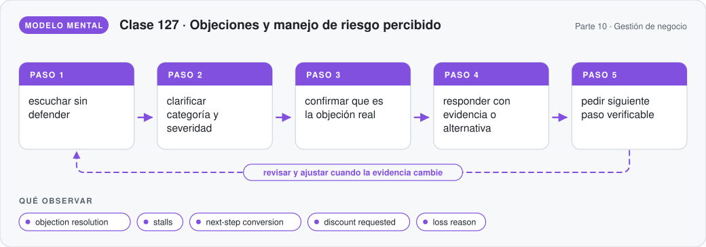

# Clase 127 — Objeciones y manejo de riesgo percibido

<!-- nav:inicio -->
> **Parte 10 · Ventas, desarrollo comercial y negociación** — clase 7 de 12 · [índice de la parte](../../README.md) · [temario](../../../../SYLLABUS.md)
<!-- nav:fin -->

**Parte:** 10 — Ventas, desarrollo comercial y negociación  
**Nivel:** Etapa 3 — Manager → Gerente  
**Duración sugerida:** 150–180 minutos · **Estándar:** deep-class-v2

## 🎯 Propósito

«Es muy caro», «tenemos que pensarlo», «ya trabajamos con otro proveedor». Las objeciones se viven como obstáculos que hay que vencer con argumentos, y de ahí vienen las peores prácticas de ventas: rebatir, presionar, descontar. Pero una objeción es, casi siempre, información: el comprador está expresando un **riesgo percibido** —de perder dinero, de equivocarse, de que el cambio sea más difícil de lo prometido, de quedar mal ante su jefe— que todavía no se resolvió. Tratar la objeción como un riesgo que se explora y se reduce convierte una conversación defensiva en una de resolución de problemas.

La clase se apoya en la teoría de las perspectivas de Kahneman y Tversky (por qué las pérdidas pesan más que las ganancias), en los principios de influencia de Cialdini, en la escucha táctica de Voss y Raz y en el modelo de Rackham. Al terminar sabrás distinguir tipos de objeciones, explorar qué hay detrás, reducir el riesgo percibido con evidencia y condiciones, reconocer cuándo una objeción es verdadera y evitar las tácticas de presión que dañan la relación.

## 📚 Resultados de aprendizaje

Al finalizar podrás:

1. **Distinguir** objeción real, cortina de humo y falta de información.
2. **Explorar** el riesgo percibido que hay detrás de una objeción.
3. **Responder** con evidencia, condiciones y opciones que reduzcan el riesgo.
4. **Aplicar** la asimetría entre pérdidas y ganancias de forma ética.
5. **Reconocer** cuándo corresponde aceptar la objeción y retirarse.

## 🧭 Agenda

| Tramo | Qué se hace |
|---|---|
| 0–20 min | Recuperación: lista las cinco objeciones que más escuchas y, para cada una, qué riesgo podría esconder. |
| 20–60 min | Tipos de objeciones, proceso de respuesta, evidencia y reducción del riesgo. |
| 60–105 min | Ejemplo trabajado: «es muy caro» en una venta de servicios. |
| 105–150 min | Caso ejecutivo y práctica de role-play. |
| 150–175 min | Límites y entregable. |

## 🧩 Conceptos centrales

| Concepto | Definición | Cómo se reconoce |
|---|---|---|
| **Objeción** | Expresión del comprador de duda, resistencia o condición. | Precio, plazo, riesgo, confianza, prioridad. |
| **Riesgo percibido** | Probabilidad e impacto que el comprador atribuye a una decisión equivocada. | Se expresa con miedos concretos. |
| **Aversión a la pérdida** | Tendencia a sentir más las pérdidas que las ganancias equivalentes. | El «qué pasa si sale mal» pesa más que el beneficio. |
| **Cortina de humo** | Objeción declarada que oculta otra razón. | «Es caro» cuando el problema es el patrocinio interno. |
| **Reducción de riesgo** | Garantías, pruebas, fases o referencias que bajan la exposición del comprador. | Piloto, cláusulas de salida, casos. |
| **Prueba social** | Referencia a decisiones de pares como evidencia. | Casos y clientes comparables. |

## 🧠 Modelo mental

**Cómo leer el diagrama.** Cinco pasos en cadena. **Escuchar** sin anticipar; **aclarar** qué riesgo hay detrás; **reconocer** la preocupación sin darle la razón por reflejo; **responder con evidencia** que reduzca el riesgo; y **confirmar** que quedó resuelta y qué falta. El orden importa: responder antes de aclarar es contestar a una pregunta que quizá nadie hizo. La nota recuerda que las pérdidas pesan más que las ganancias, por lo que reducir riesgo suele pesar más que sumar beneficios.

## 📖 Desarrollo

### 1. Qué dice la teoría de las perspectivas

Kahneman y Tversky mostraron que las personas evalúan las decisiones en términos de **ganancias y pérdidas respecto de un punto de referencia**, y que las pérdidas pesan más que las ganancias de igual tamaño (la **aversión a la pérdida**). Además, tienden a favorecer el **statu quo**. Para quien compra, cambiar de proveedor o adoptar una solución nueva implica una posible pérdida (dinero, tiempo, reputación si sale mal) frente a un beneficio incierto. De ahí que muchas decisiones se posterguen aunque el beneficio sea claro: el riesgo percibido pesa más. Esta es una regularidad empírica, no una ley, y varía entre personas y contextos.

### 2. Tipos de objeción

Se pueden distinguir cuatro tipos. **Falta de información**: el comprador no entendió o no sabe algo («¿incluye soporte?»). **Duda sobre el valor**: no ve que el beneficio justifique el costo («es muy caro»). **Riesgo percibido**: teme que no funcione, que la implantación sea difícil o que quede mal («¿y si no lo adoptan?»). **Condición de contexto**: restricciones reales (presupuesto, calendario, regulaciones, un contrato vigente). Y a veces, una **cortina de humo**: una objeción cómoda que esconde otra razón. Cada tipo exige una respuesta diferente; tratarlas todas como «precio» lleva a descontar en vano.

### 3. Escuchar y aclarar

Antes de responder, se escucha hasta el final y se **aclara**: «Cuando dices que es caro, ¿en comparación con qué?», «¿Qué te preocupa específicamente de la implantación?», «¿Qué tendría que ocurrir para que esto te parezca razonable?». Voss y Raz proponen técnicas de escucha táctica: **repetir** las últimas palabras («¿muy caro?»), **etiquetar** emociones («parece que te preocupa que el equipo no lo adopte») y **resumir**. Estas técnicas invitan al comprador a profundizar sin ponerlo a la defensiva. Se evita responder de inmediato con un argumento: se pierde la información que la objeción ofrece.

### 4. Reconocer sin ceder ni discutir

Reconocer la preocupación («es razonable que quieras estar seguro») no equivale a darle la razón en todo. Disminuye la tensión y demuestra respeto. Luego se pasa a la exploración de **alternativas para resolver el problema**, no a discutir sobre quién tiene razón. Cialdini describe cómo las personas buscan coherencia con sus compromisos previos: recordar con respeto lo que el comprador dijo antes («mencionaste que el retraso en entregas es tu mayor riesgo») ayuda a mantener la conversación centrada en los criterios que él mismo declaró.

### 5. Reducir el riesgo con evidencia y condiciones

Responder con **evidencia**: datos propios del comprador (clase 125), **casos comparables** y referencias; **pruebas** (piloto acotado, demostración con sus datos); y **condiciones** que mueven riesgo hacia el vendedor: implantación por fases, garantías de resultado verificables, cláusulas de salida, niveles de servicio (clase 092), precio ligado a resultados. Cada una reduce la exposición del comprador y, por tanto, su aversión. Un piloto de 60 días con criterios de éxito acordados suele pesar más que cualquier argumento sobre el producto. La **prueba social** funciona cuando las referencias son reales, comparables y verificables.

### 6. «Es muy caro»

Es la objeción más frecuente y la más engañosa. Puede significar: **no entiendo el valor**, **no tengo presupuesto**, **hay una alternativa más barata**, **mi jefe no lo ve como prioridad** o **estoy negociando**. La respuesta empieza por **aclarar** y volver al caso de negocio: ¿cuánto cuesta el problema?, ¿cuánto vale resolverlo?, ¿qué ocurre si no se hace? Si el precio es el problema real, se exploran opciones: **fases**, **alcance**, **condiciones de pago**, **servicios incluidos**. Bajar el precio sin cambiar nada enseña al comprador a objetar siempre, y erosiona el margen (clase 129).

### 7. Cuando la objeción es verdadera

A veces el comprador tiene razón: el producto no sirve para su caso, hay un competidor mejor para su necesidad, el momento no es adecuado. Reconocerlo es parte de una venta honesta y de una reputación duradera. Insistir con tácticas de presión (falsa urgencia, escasez inventada, culpa) puede cerrar una venta y producir un cliente insatisfecho, reclamos y daño a la marca; además, en muchos países, ciertas prácticas pueden ser contrarias a la ley de protección al consumidor o a la competencia leal. El objetivo no es vencer objeciones, sino **decidir bien junto con el comprador**.

## 📚 Lectura comparada

| Obra | Qué aporta | Qué no resuelve | Pregunta para contrastar |
|---|---|---|---|
| Kahneman y Tversky (1979) | Aversión a la pérdida y dependencia del punto de referencia. | Es teoría descriptiva de decisión. | ¿Qué pérdida percibe el comprador? |
| Cialdini | Principios de influencia: coherencia, prueba social, autoridad. | Puede usarse mal; requiere ética. | ¿Tu prueba social es verificable? |
| Voss y Raz | Escucha táctica, etiquetas y preguntas calibradas. | Origen en negociaciones de alto riesgo. | ¿Qué emoción está detrás? |
| Rackham | Preguntas que construyen necesidad y resuelven dudas. | Ventas complejas. | ¿Se habló del problema antes que de la solución? |
| Thaler y Sunstein | Efecto del punto de referencia y la inercia en decisiones. | Marco de diseño de decisiones. | ¿Qué es lo «predeterminado» para tu comprador? |

## 🧮 Ejemplo trabajado

**Situación (hipotética).** Una consultora de transformación digital propone un proyecto de USD 180.000 a una empresa de seguros. En la reunión, el gerente de operaciones dice: «Es muy caro; otra consultora nos dio USD 120.000».

**Respuesta inadecuada.** «Podemos bajarlo a 150.000». Sin aclarar, concede 17 % sin saber qué hay detrás.

**Proceso.**

| Paso | Intervención | Información que aparece |
|---|---|---|
| Escuchar | Deja terminar y toma nota. | El otro proveedor no incluye gestión del cambio. |
| Aclarar | «¿Qué te hace pensar que la diferencia es de precio y no de alcance?» | Su preocupación es que «el proyecto fracase como el anterior», que costó 40 % más y no se adoptó. |
| Reconocer | «Tiene sentido: ya viviste un proyecto que no se adoptó.» | Baja la tensión. |
| Responder | Presenta la comparación de alcance; propone una **fase 1 de diagnóstico y piloto** de USD 45.000 con criterios de éxito acordados (adopción de 70 % de un grupo piloto) y **pago de la fase 2 condicionado** a esos criterios; ofrece hablar con un cliente que atravesó una situación parecida. | Reduce el riesgo del comprador. |
| Confirmar | «¿Resuelve esto tu preocupación? ¿Qué más necesitarías para decidir?» | Pide la validación de finanzas y compras. |

**Resultado.** El comprador acepta la fase 1 y agenda una reunión con finanzas. El precio total del proyecto se mantiene en USD 180.000, con un pago de 25 % ligado a la adopción; el margen no se erosiona y la relación mejora.

**Análisis.** El «es caro» era un temor a repetir un fracaso. El descuento inmediato lo habría ignorado y habría dejado el riesgo igual.

**Qué muestra.** (1) Aclarar reveló el riesgo real. (2) Las condiciones movieron el riesgo hacia el vendedor. (3) No se perdió margen.

## 🔀 Comparación y límites

**Manejar objeciones frente a manipular.** Manejar es entender y reducir un riesgo real; manipular es crear una presión o un temor que no corresponde. La frontera se examina preguntando si el comprador, conociendo todo lo que sabe el vendedor, aprobaría la táctica.

**Límites.** La aversión a la pérdida describe tendencias estadísticas, y no todas las personas responden igual. Las técnicas de escucha tienen un efecto moderado y exigen autenticidad. En contextos de compra pública o regulada, las objeciones y condiciones se procesan con reglas formales. Las garantías, condiciones de pago y cláusulas de salida son contractuales y se redactan con asesoría legal; las prácticas de presión pueden infringir normas de protección del consumidor.

## 🪜 De profesional a owner

| Nivel | Cómo trata las objeciones |
|---|---|
| **Profesional** | Escucha y aclara antes de responder. |
| **Jefe / Team Lead** | Entrena role-plays y revisa grabaciones con foco en el riesgo. |
| **Gerente** | Diseña garantías, pilotos y condiciones que reduzcan el riesgo del comprador. |
| **CEO / Director** | Protege la honestidad comercial y la reputación. |
| **Founder / Owner** | Aprende de cada objeción para mejorar la oferta. |

## 🏢 Caso ejecutivo

Una empresa de software de gestión de proyectos para constructoras negocia con una constructora mediana. En las últimas tres reuniones, el comprador ha dicho: «es caro», «tenemos que ver prioridades internas» y «nuestro equipo ya usa planillas». El vendedor ha respondido ofreciendo descuentos de 10 % y 15 %, sin éxito. El patrocinador interno, jefe de planificación, dice en privado que el gerente general no ve el proyecto como prioritario y que un intento anterior de adoptar un sistema fracasó por falta de adopción en obra. El contrato de la herramienta actual (planillas) no tiene costo directo, aunque hay errores y retrasos que el jefe de planificación estima en USD 90.000 al año.

Entrega un **plan de manejo de objeciones** que contenga: (a) la clasificación de cada objeción y los riesgos percibidos; (b) las preguntas de aclaración que harías y a quién; (c) la evidencia y las condiciones que reducirían el riesgo (piloto, fases, referencias); (d) cómo evitarías el descuento sin cambio de alcance; (e) cómo ayudarías al patrocinador a defender el caso ante el gerente general; (f) los criterios para retirarte si la objeción es verdadera y las verificaciones legales de las condiciones ofrecidas.

## 🧪 Práctica

1. Clasifica diez objeciones reales de tu mercado por tipo y riesgo.
2. Escribe preguntas de aclaración para «es muy caro».
3. Diseña un piloto con criterios de éxito para reducir el riesgo de adopción.
4. Practica un role-play con etiquetas y resumen.
5. Define los criterios con que aceptarías que la objeción es verdadera.

## ⚠️ Errores frecuentes

| Error | Por qué ocurre | Cómo corregirlo |
|---|---|---|
| Responder antes de aclarar | Se quiere resolver rápido | Escuchar y preguntar primero. |
| Descontar de inmediato | Se confunde objeción con precio | Explorar valor, alcance y riesgo. |
| Discutir con el comprador | Se vive como ataque | Reconocer y explorar alternativas. |
| Usar presión y falsa urgencia | Se busca cierre rápido | Reducir riesgo con evidencia. |
| Ignorar el statu quo | Se compara con competidores | Tratar el «no hacer nada» como alternativa. |
| No aceptar una objeción verdadera | Se teme perder | Retirarse con honestidad. |

## ❓ Preguntas de comprobación

1. ¿Qué es el riesgo percibido y cómo se relaciona con la aversión a la pérdida?
2. ¿Qué tipos de objeción pueden distinguirse?
3. ¿Qué cinco pasos componen el manejo de una objeción?
4. ¿Qué formas hay de reducir el riesgo del comprador?
5. ¿Qué puede significar «es muy caro»?
6. ¿Por qué un descuento inmediato es mala respuesta?
7. ¿Cuándo corresponde retirarse?

Claves de respuesta

1. La probabilidad e impacto que el comprador atribuye a una decisión equivocada; la aversión a la pérdida hace que ese riesgo pese más que el beneficio equivalente.
2. Falta de información, duda sobre el valor, riesgo percibido, condición de contexto y cortina de humo.
3. Escuchar, aclarar, reconocer, responder con evidencia y confirmar.
4. Piloto, implantación por fases, garantías verificables, cláusulas de salida, niveles de servicio, referencias comparables.
5. Que no ve el valor, no tiene presupuesto, hay una alternativa más barata, no es prioridad o está negociando.
6. Porque ignora la causa real, erosiona el margen y enseña al comprador a objetar siempre.
7. Cuando la objeción es verdadera: el producto no sirve para su caso o el momento no es adecuado; insistir daña la confianza.

## 📥 Entregable

Guarda en `portfolio/127-objeciones-y-manejo-de-riesgo-percibido/`:

- `risk-governance-brief.md` (plantilla [Risk & Governance Brief](../../../../templates/risk-governance-brief.md)) con el análisis de riesgos percibidos del caso ejecutivo;
- `commercial-decision-brief.md` (plantilla [Commercial decision brief](../../../../templates/commercial-decision-brief.md)) con el plan de manejo de objeciones;
- `decision-journal.md` con las preguntas de aclaración, el piloto y los criterios de retiro.

## 📗 Fuentes y verificación

- Daniel Kahneman & Amos Tversky — *Prospect Theory: An Analysis of Decision under Risk* (Econometrica, 1979). **Uso en esta clase:** aversión a la pérdida y dependencia del punto de referencia. Lectura selectiva sobre **objeciones y manejo de riesgo percibido**. **Localizador:** [DOI 10.2307/1914185](https://doi.org/10.2307/1914185).
- Robert B. Cialdini — *Influence* (HarperCollins Publishers and Blackstone Audio, 2016). **Uso en esta clase:** principios de influencia y su uso ético. Lectura selectiva sobre **objeciones y manejo de riesgo percibido**. **Localizador:** [ISBN-13 9781624608049](https://openlibrary.org/isbn/9781624608049).
- Chris Voss & Tahl Raz — *Never Split the Difference* (Penguin Random House, 2016). **Uso en esta clase:** escucha táctica, etiquetas y preguntas calibradas. Lectura selectiva sobre **objeciones y manejo de riesgo percibido**. **Localizador:** [ISBN-13 9781847941480](https://openlibrary.org/isbn/9781847941480).
- Neil Rackham — *SPIN Selling* (Highbridge Audio, 1998). **Uso en esta clase:** preguntas que construyen necesidad y resuelven dudas. Lectura selectiva sobre **objeciones y manejo de riesgo percibido**. **Localizador:** [ISBN-13 9781565112605](https://openlibrary.org/isbn/9781565112605).
- Richard Thaler & Cass Sunstein — *Nudge* (Penguin Books, 2009). **Uso en esta clase:** efecto del punto de referencia y la inercia en decisiones. Lectura selectiva sobre **objeciones y manejo de riesgo percibido**. **Localizador:** [ISBN-13 9780143115267](https://openlibrary.org/isbn/9780143115267).

> **Regla de fuentes para Objeciones y manejo de riesgo percibido:** las obras anteriores estructuran las perspectivas de esta materia; cualquier norma, ley o estándar vivo mencionado debe comprobarse nuevamente en su fuente primaria vigente, incluidas las normas de protección al consumidor y de competencia leal. Los ejemplos y casos son hipotéticos, con cifras ilustrativas. El desarrollo es original y no reproduce capítulos protegidos.

<!-- pie:inicio -->
---

| Anterior | Índice | Siguiente |
|---|---|---|
| [← 126 · Pipeline y forecast comercial](../126-pipeline-y-forecast-comercial/README.md) | [Parte 10](../../README.md) · [Programa](../../../../SYLLABUS.md) | [128 · Negociación basada en intereses →](../128-negociacion-basada-en-intereses/README.md) |
<!-- pie:fin -->
