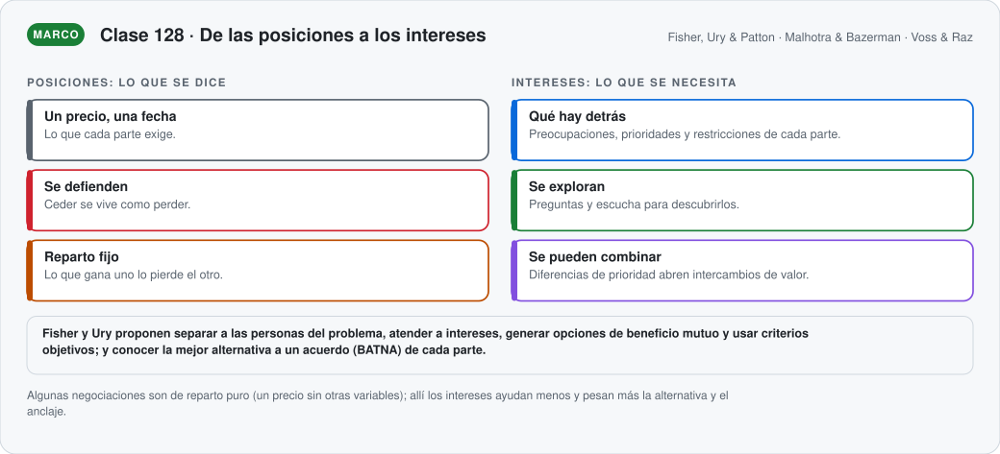

# Clase 128 — Negociación basada en intereses

<!-- nav:inicio -->
> **Parte 10 · Ventas, desarrollo comercial y negociación** — clase 8 de 12 · [índice de la parte](../../README.md) · [temario](../../../../SYLLABUS.md)
<!-- nav:fin -->

**Parte:** 10 — Ventas, desarrollo comercial y negociación  
**Nivel:** Etapa 3 — Manager → Gerente  
**Duración sugerida:** 150–180 minutos · **Estándar:** deep-class-v2

## 🎯 Propósito

Negociar no es regatear. Cuando dos partes discuten un precio, una fecha o una cláusula, cada una defiende una **posición**, y el resultado depende de quién cede más; el acuerdo, si llega, suele ser mediocre y deja resentimiento. La negociación basada en intereses cambia la pregunta: en lugar de «¿cuánto cedo?», se pregunta «¿qué necesita cada parte de verdad y cómo se puede lograr que ambas queden mejor que sin acuerdo?». No es ingenuidad ni blandura: exige preparación, información, disciplina y, a veces, firmeza. Con ella, muchas negociaciones que parecían de suma cero revelan valor que se puede crear antes de repartirlo.

La clase se apoya en el método de Fisher, Ury y Patton (*Getting to Yes*), en el análisis de Malhotra y Bazerman sobre la preparación y las decisiones en la negociación, en la escucha táctica de Voss y Raz y en la investigación de Galinsky y Mussweiler sobre el efecto de las primeras ofertas. Al terminar sabrás preparar una negociación (intereses, alternativas, rangos), explorar intereses del otro, generar opciones, usar criterios objetivos y decidir cuándo abandonar.

## 📚 Resultados de aprendizaje

Al finalizar podrás:

1. **Distinguir** posiciones de intereses y explorarlos.
2. **Determinar** la mejor alternativa a un acuerdo negociado (BATNA) y el punto de reserva.
3. **Generar** opciones que creen valor para ambas partes.
4. **Usar** criterios objetivos y el efecto de anclaje con ética.
5. **Decidir** cuándo cerrar, ajustar o retirarse.

## 🧭 Agenda

| Tramo | Qué se hace |
|---|---|
| 0–20 min | Recuperación: recuerda una negociación en que cediste algo que no valoraba mucho y cuya contrapartida habría sido muy importante para ti. |
| 20–60 min | Preparación, intereses, opciones, anclaje y criterios. |
| 60–105 min | Ejemplo trabajado: negociación de un contrato anual de servicios. |
| 105–150 min | Caso ejecutivo y práctica. |
| 150–175 min | Límites y entregable. |

## 🧩 Conceptos centrales

| Concepto | Definición | Cómo se reconoce |
|---|---|---|
| **Posición** | Lo que una parte dice que quiere. | Un precio, una fecha, una cláusula. |
| **Interés** | La necesidad, preocupación o prioridad que motiva una posición. | Se descubre preguntando por qué. |
| **BATNA** | Mejor alternativa a un acuerdo negociado. | Qué haría la parte si no hubiera acuerdo. |
| **Punto de reserva** | Peor resultado que una parte aceptaría antes de retirarse. | Se deriva de la BATNA. |
| **ZOPA** | Zona de posible acuerdo entre los puntos de reserva. | Existe si los rangos se superponen. |
| **Criterio objetivo** | Estándar independiente de la voluntad de las partes. | Precio de mercado, normas, precedentes. |

## 🧠 Modelo mental

**Cómo leer el diagrama.** Dos paneles. A la izquierda, las **posiciones**: lo que cada parte dice que quiere, que se defienden y que suelen leerse como reparto fijo (lo que gana uno lo pierde el otro). A la derecha, los **intereses**: lo que de verdad se necesita, que se pueden explorar con preguntas y combinar porque las partes valoran cosas distintas. La nota recoge el método de Fisher y Ury: separar a las personas del problema, atender a intereses, generar opciones y usar criterios objetivos, con una BATNA clara.

## 📖 Desarrollo

### 1. Posiciones e intereses

Fisher, Ury y Patton ilustran con un ejemplo clásico: dos personas discuten por una naranja; ambas la quieren; la dividen por la mitad; una usa la cáscara para un pastel y la otra el jugo para beber. La posición (la naranja) ocultaba intereses compatibles. En negocios, un cliente que exige un descuento de 15 % puede necesitar un precio que cabe en su presupuesto, una forma de justificar la compra ante su comité, previsibilidad de costos o una señal de que el proveedor valora la relación. Cada interés abre soluciones distintas: pagos escalonados, contratos plurianuales, servicios adicionales, referencia pública.

### 2. Preparación

Malhotra y Bazerman enfatizan que gran parte del resultado se decide **antes** de sentarse: conocer los propios **intereses y prioridades** (qué importa más y menos), la **BATNA** (si el cliente no compra, ¿qué alternativa tengo? ¿cuánto vale?), el **punto de reserva**, los **intereses probables del otro** y su BATNA, la **zona de posible acuerdo**, y **opciones** para crear valor. Una BATNA fuerte da poder y serenidad; una débil se mejora antes de negociar (por ejemplo, desarrollando otras oportunidades). Un error común es confundir la **meta** con la reserva: se acepta un resultado peor que la meta pero mejor que la BATNA.

### 3. Explorar intereses

Se exploran con preguntas abiertas y escucha: «¿Qué es lo más importante para ustedes en este acuerdo?», «¿Qué los preocuparía si firmáramos con estas condiciones?», «¿Qué ocurre si no llegamos a un acuerdo?». Voss y Raz proponen **preguntas calibradas** («¿cómo podemos hacer que esto funcione para ambos?») que invitan al otro a resolver el problema, y **etiquetas** que reconocen emociones («parece que el plazo es muy importante para ustedes»). Se comparte información de forma selectiva y recíproca: dar un interés a cambio de recibir otro suele abrir intercambios; revelar el punto de reserva, no.

### 4. Crear valor antes de repartirlo

Las partes valoran de forma diferente distintos aspectos (precio, plazo, volumen, servicio, riesgo, relación, flexibilidad). Esas **diferencias** permiten intercambios en que cada una cede lo que le cuesta poco y obtiene lo que le importa mucho: el comprador necesita pagar a 90 días y no le importa el plazo de entrega; el vendedor necesita caja pronto pero tiene capacidad para entregar con holgura. **Paquetes** de varias condiciones a la vez (en lugar de negociar una a una) facilitan estos intercambios. Antes de repartir lo que hay, se busca ampliar la torta, siempre con atención a que la creación de valor no sea una excusa para no defender el propio interés.

### 5. Anclaje y primeras ofertas

Galinsky y Mussweiler mostraron que las **primeras ofertas** actúan como anclas: influyen en el resultado final, y quien las hace con información sólida suele obtener mejores resultados; pero quienes se enfocan en la BATNA y los intereses del otro resisten mejor los efectos de un ancla ajena. Reglas prácticas: **preparar** el rango antes; **abrir** con una oferta ambiciosa pero defendible con criterios (no insultante); **contrarrestar** un ancla ajena con la BATNA, con criterios y con una contraoferta fundada, sin discutir sobre el número. Un ancla sin fundamento erosiona la credibilidad.

### 6. Criterios objetivos y relación

Para evitar disputas de voluntades, se buscan **criterios independientes**: precios de mercado, comparables, costos, normas del sector, precedentes, opiniones de expertos. «No es mi voluntad contra la tuya: veamos qué dicen las referencias». Fisher y Ury también recomiendan **separar a las personas del problema**: ser blando con las personas y duro con el problema; reconocer emociones, evitar atribuir mala intención, mantener la relación. En negociaciones repetidas, la reputación es un activo: un acuerdo ganado con engaño o presión puede costar futuras oportunidades.

### 7. Cerrar o retirarse

Se cierra cuando el acuerdo es **mejor que la BATNA**, respeta los intereses esenciales y es **implementable** (claro, con responsables y plazos). Se verifica que lo acordado sea **entendido igual** por ambos y se documenta. Si no hay ZOPA o el precio de acordar es peor que la alternativa, **retirarse** es una decisión racional; hacerlo con respeto deja la puerta abierta. Se evitan las trampas: **escalada del compromiso** (seguir porque ya se invirtió tiempo), **maldición del ganador** (ganar demasiado fácil indica que se pudo pedir más), **presión del tiempo** impuesta por el otro como táctica. Los contratos resultantes se revisan con asesoría legal.

## 📚 Lectura comparada

| Obra | Qué aporta | Qué no resuelve | Pregunta para contrastar |
|---|---|---|---|
| Fisher, Ury y Patton | Intereses, opciones, criterios objetivos y BATNA. | Menos ayuda ante contrapartes de mala fe o con poder abrumador. | ¿Cuál es tu BATNA y la de ellos? |
| Malhotra y Bazerman | Preparación y errores de decisión en negociación. | Exige trabajo previo. | ¿Qué sesgo puede afectarte? |
| Voss y Raz | Escucha táctica y preguntas calibradas. | Origen en contextos de alta tensión. | ¿Qué emoción hay detrás de la posición? |
| Galinsky y Mussweiler (2001) | Efecto de las primeras ofertas y cómo mitigarlo. | Estudios con situaciones experimentales. | ¿Quién hace la primera oferta y con qué base? |
| Cialdini | Influencia y reciprocidad. | No es un método de negociación. | ¿Qué concesión puede obtener reciprocidad? |

## 🧮 Ejemplo trabajado

**Situación (hipotética).** Una empresa de limpieza industrial renueva su contrato anual con una cadena de clínicas. El contrato vigente es de USD 480.000 al año. El comprador pide una rebaja de 12 % (USD 422.400). Los costos del vendedor: USD 396.000; su margen es de 17,5 %.

**Preparación del vendedor.**

| Elemento | Análisis |
|---|---|
| Intereses del vendedor | Mantener el cliente (representa 8 % de sus ingresos), margen sobre 12 %, previsibilidad de caja, referencia pública. |
| BATNA del vendedor | Reemplazar parte del volumen con dos clientes en conversación; probable menor ingreso durante seis meses. |
| Punto de reserva | USD 440.000 al año (margen de 10 %). |
| Intereses probables del comprador | Reducir costos, simplificar la gestión, evitar fallas en las clínicas, demostrar ahorro a su gerencia. |
| BATNA del comprador | Licitar con otros dos proveedores; costo de cambiar: seis semanas y riesgo de transición. |

**Conversación.** El vendedor pregunta qué hay detrás de la rebaja: la gerencia exige reducir los gastos de servicios en 10 %, el contrato se paga mensual a 60 días y la clínica más grande sufrió un incidente por un retraso en limpieza de quirófanos.

**Opciones creadas.** (a) Contrato de tres años con precio base de USD 456.000 (-5 %) y reajuste atado a un índice; (b) pago a 30 días en lugar de 60, que cuesta al vendedor unos USD 3.000 de financiamiento al año (8 %); (c) reducción de frecuencia en áreas administrativas (ahorro de USD 22.000) con refuerzo en áreas críticas (costo USD 10.000); (d) un acuerdo de nivel de servicio con auditorías conjuntas y un indicador de cumplimiento para áreas críticas; (e) autorización para citar al cliente como referencia.

**Paquete acordado.** Tres años; USD 450.000 anuales (reducción de 6,25 %); pago a 30 días; frecuencia ajustada; SLA con indicadores; referencia pública. El comprador logra un ahorro de USD 30.000 y mejor control de calidad; el vendedor asegura tres años, mantiene un margen cercano a 14 % (con la frecuencia ajustada su costo baja a unos USD 384.000) y gana una referencia valiosa.

**Criterios objetivos.** Un benchmark de costos por metro cuadrado de limpieza hospitalaria validó el nuevo precio.

**Qué muestra.** (1) La posición del 12 % escondía un objetivo de ahorro global. (2) Las diferencias de prioridades permitieron un paquete. (3) La BATNA y el criterio objetivo protegieron el precio.

## 🔀 Comparación y límites

**Negociación por intereses frente a negociación distributiva.** La distributiva reparte un valor fijo y los intereses ayudan menos; la integrativa busca crear valor. La mayoría de las negociaciones tiene elementos de ambas: se crea valor y luego se reparte.

**Límites.** El método supone contrapartes con voluntad mínima de colaborar; frente a tácticas coercitivas o de mala fe, se necesitan otras defensas (BATNA, terceros, retirada). Las diferencias culturales afectan el estilo, la franqueza y la importancia de la relación. La evidencia de Galinsky y Mussweiler proviene de experimentos y puede variar en contextos reales. Los acuerdos finales son contratos con efectos legales, tributarios y de competencia que se revisan con asesoría.

## 🪜 De profesional a owner

| Nivel | Cómo negocia por intereses |
|---|---|
| **Profesional** | Se prepara, pregunta y registra los intereses del otro. |
| **Jefe / Team Lead** | Negocia con colegas y proveedores creando valor. |
| **Gerente** | Define la BATNA y los límites de su equipo y negocia paquetes. |
| **CEO / Director** | Negocia acuerdos clave y protege la reputación de la empresa. |
| **Founder / Owner** | Mejora su BATNA antes de negociar y no cede por urgencia de caja. |

## 🏢 Caso ejecutivo

Una empresa de energía solar para industrias negocia un contrato de 12 años con una planta de procesamiento de alimentos: instalación de paneles con financiamiento propio y venta de energía a un precio por kilovatio hora. El comprador exige un precio 18 % inferior al de la oferta, plazo de salida sin costo a los tres años y que el vendedor asuma el riesgo de variación de la tarifa de red. El vendedor tiene capacidad de financiamiento limitada, otro proyecto grande en conversación con probabilidad de 40 %, y un competidor que acaba de ganar un contrato similar. El comprador, por su parte, enfrenta alzas de tarifa y una meta de sostenibilidad ante sus clientes internacionales.

Entrega un **plan de negociación** que contenga: (a) los intereses y prioridades de ambas partes; (b) la BATNA y el punto de reserva de cada una, con la ZOPA estimada; (c) las opciones para crear valor y los paquetes que propondrías; (d) la estrategia de primera oferta y de respuesta a anclas; (e) los criterios objetivos que usarías; (f) las condiciones para retirarte y las verificaciones legales, regulatorias y tributarias necesarias.

## 🧪 Práctica

1. Lista las posiciones y los intereses probables de la contraparte en una negociación actual.
2. Define tu BATNA, tu punto de reserva y tu meta, y estima los de la otra parte.
3. Diseña tres paquetes de condiciones que creen valor.
4. Prepara una primera oferta con criterios que la respalden.
5. Define las condiciones en que te retirarías.

## ⚠️ Errores frecuentes

| Error | Por qué ocurre | Cómo corregirlo |
|---|---|---|
| Negociar posiciones | Es lo que se dice | Preguntar por intereses. |
| No tener BATNA | No se prepara | Definir y mejorar la alternativa antes. |
| Ceder primero | Se evita el conflicto | Intercambiar concesiones. |
| Aceptar anclas sin respuesta | Se discute el número | Responder con criterios y alternativa. |
| Revelar el punto de reserva | Se busca confianza | Compartir intereses, no reservas. |
| Cerrar por presión de tiempo | Se teme perder | Verificar contra la BATNA. |

## ❓ Preguntas de comprobación

1. ¿Qué diferencia hay entre posición e interés?
2. ¿Qué es la BATNA y qué papel cumple?
3. ¿Qué es la ZOPA?
4. ¿Cómo se crea valor en una negociación?
5. ¿Qué efecto tienen las primeras ofertas y cómo se mitigan?
6. ¿Para qué sirven los criterios objetivos?
7. ¿Cuándo corresponde retirarse?

Claves de respuesta

1. La posición es lo que se dice que se quiere; el interés es la necesidad o preocupación detrás.
2. La mejor alternativa a un acuerdo negociado; define el punto de reserva y da poder y serenidad.
3. La zona de posible acuerdo entre los puntos de reserva de las partes; existe si los rangos se superponen.
4. Aprovechando diferencias de prioridad y valoración con intercambios y paquetes de condiciones.
5. Actúan como anclas que influyen en el resultado; se mitigan preparando el rango, enfocándose en la BATNA y respondiendo con criterios y una contraoferta fundada.
6. Para evitar choques de voluntades usando estándares independientes como precios de mercado, comparables y normas.
7. Cuando el acuerdo posible es peor que la BATNA o no existe ZOPA.

## 📥 Entregable

Guarda en `portfolio/128-negociacion-basada-en-intereses/`:

- `commercial-decision-brief.md` (plantilla [Commercial decision brief](../../../../templates/commercial-decision-brief.md)) con el plan de negociación del caso ejecutivo;
- `contract-type-selection-checklist.md` (plantilla [Contract type selection checklist](../../../../templates/contract-type-selection-checklist.md)) con las condiciones y el tipo de contrato propuesto;
- `decision-journal.md` con la BATNA, los rangos y los criterios.

## 📗 Fuentes y verificación

- Roger Fisher, William Ury & Bruce Patton — *Getting to Yes* (Hutchinson, 1983). **Uso en esta clase:** intereses, opciones, criterios objetivos y BATNA. Lectura selectiva sobre **negociación basada en intereses**. **Localizador:** [ISBN-13 9780091493714](https://openlibrary.org/isbn/9780091493714).
- Deepak Malhotra & Max H. Bazerman — *Negotiation Genius* (Tantor Media, 2007). **Uso en esta clase:** preparación y errores de decisión en negociación. Lectura selectiva sobre **negociación basada en intereses**. **Localizador:** [ISBN-13 9781400135400](https://openlibrary.org/isbn/9781400135400).
- Chris Voss & Tahl Raz — *Never Split the Difference* (Penguin Random House, 2016). **Uso en esta clase:** escucha táctica y preguntas calibradas. Lectura selectiva sobre **negociación basada en intereses**. **Localizador:** [ISBN-13 9781847941480](https://openlibrary.org/isbn/9781847941480).
- Adam D. Galinsky & Thomas Mussweiler — *First offers as anchors: The role of perspective-taking and negotiator focus* (Journal of Personality and Social Psychology, 2001). **Uso en esta clase:** efecto de las primeras ofertas como anclas. Lectura selectiva sobre **negociación basada en intereses**. **Localizador:** [DOI 10.1037/0022-3514.81.4.657](https://doi.org/10.1037/0022-3514.81.4.657).
- Robert B. Cialdini — *Influence* (HarperCollins Publishers and Blackstone Audio, 2016). **Uso en esta clase:** influencia y reciprocidad. Lectura selectiva sobre **negociación basada en intereses**. **Localizador:** [ISBN-13 9781624608049](https://openlibrary.org/isbn/9781624608049).

> **Regla de fuentes para Negociación basada en intereses:** las obras anteriores estructuran las perspectivas de esta materia; cualquier norma, ley o estándar vivo mencionado debe comprobarse nuevamente en su fuente primaria vigente, incluidas las normas regulatorias, tributarias y de competencia aplicables a los acuerdos. Los ejemplos y casos son hipotéticos, con cifras ilustrativas. El desarrollo es original y no reproduce capítulos protegidos.

<!-- pie:inicio -->
---

| Anterior | Índice | Siguiente |
|---|---|---|
| [← 127 · Objeciones y manejo de riesgo percibido](../127-objeciones-y-manejo-de-riesgo-percibido/README.md) | [Parte 10](../../README.md) · [Programa](../../../../SYLLABUS.md) | [129 · Pricing y concesiones →](../129-pricing-y-concesiones/README.md) |
<!-- pie:fin -->
