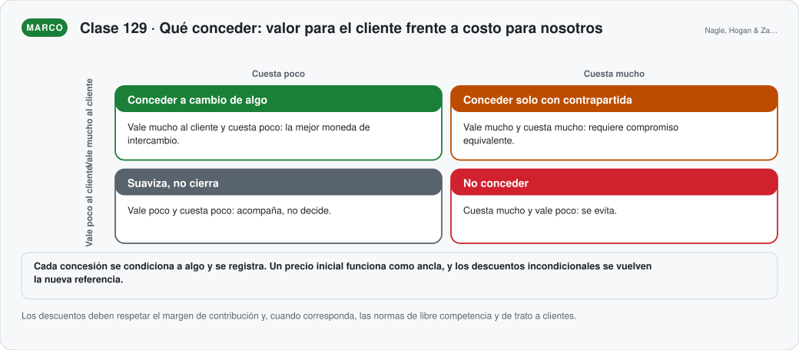

# Clase 129 — Pricing y concesiones

<!-- nav:inicio -->
> **Parte 10 · Ventas, desarrollo comercial y negociación** — clase 9 de 12 · [índice de la parte](../../README.md) · [temario](../../../../SYLLABUS.md)
<!-- nav:fin -->

**Parte:** 10 — Ventas, desarrollo comercial y negociación  
**Nivel:** Etapa 3 — Manager → Gerente  
**Duración sugerida:** 150–180 minutos · **Estándar:** deep-class-v2

## 🎯 Propósito

El precio es la palanca de utilidad más poderosa y la más mal manejada. Un uno por ciento de mejora en el precio efectivo suele aumentar la utilidad más que un uno por ciento de reducción de costos o de aumento de volumen, y sin embargo muchas empresas fijan precios agregando un margen al costo, copiando a la competencia o cediendo ante la primera presión de un cliente. Las concesiones, por su parte, se regalan: se dan descuentos sin contrapartida, que luego se convierten en el nuevo punto de partida. Gestionar precio y concesiones es una disciplina conjunta de valor, estructura de oferta, psicología de la decisión y control comercial.

La clase se apoya en el análisis de estrategias de precio de Nagle, Hogan y Zale, en los hallazgos de Ariely, Loewenstein y Prelec sobre el anclaje en la valoración, en la contabilidad mental de Thaler y en los principios de concesión de Malhotra y Bazerman. Al terminar sabrás fijar precio con base en el valor, estructurar ofertas por niveles, anclar con ética, diseñar una política de descuentos con controles y negociar concesiones con contrapartidas.

## 📚 Resultados de aprendizaje

Al finalizar podrás:

1. **Fijar** precios con base en el valor para el cliente y los costos y la competencia.
2. **Estructurar** la oferta en niveles y paquetes con lógica.
3. **Anclar** y presentar precios de forma honesta y efectiva.
4. **Diseñar** una política de descuentos con límites y aprobaciones.
5. **Negociar** concesiones con contrapartidas y registrarlas.

## 🧭 Agenda

| Tramo | Qué se hace |
|---|---|
| 0–20 min | Recuperación: revisa los últimos diez descuentos que diste y qué obtuviste a cambio de cada uno. |
| 20–60 min | Valor, estructura de oferta, anclaje, descuentos y concesiones. |
| 60–105 min | Ejemplo trabajado: política de precios y descuentos de una empresa de software. |
| 105–150 min | Caso ejecutivo y práctica. |
| 150–175 min | Límites y entregable. |

## 🧩 Conceptos centrales

| Concepto | Definición | Cómo se reconoce |
|---|---|---|
| **Precio basado en valor** | Precio fijado según el valor que el cliente obtiene respecto de su mejor alternativa. | Se justifica con beneficios, no con costos. |
| **Precio por niveles (good-better-best)** | Oferta en varios paquetes con distintas prestaciones y precios. | El cliente elige según su necesidad. |
| **Ancla** | Referencia inicial que influye en la valoración posterior. | El primer precio mencionado. |
| **Piso de precio** | Precio por debajo del cual no se vende sin aprobación. | Se basa en el margen de contribución. |
| **Concesión** | Cesión de algo (precio, plazo, servicio) en una negociación. | Debe tener contrapartida. |
| **Fuga de precio (price leakage)** | Diferencia entre el precio de lista y el realmente cobrado. | Descuentos y condiciones sin control. |

## 🧠 Modelo mental

**Cómo leer el diagrama.** Dos ejes: cuánto **vale** la concesión para el cliente y cuánto **cuesta** al vendedor. Lo que **vale mucho al cliente y cuesta poco** es la mejor moneda de intercambio: se concede a cambio de algo. Lo que vale mucho y cuesta mucho se concede solo con una contrapartida equivalente. Lo que vale poco y cuesta poco suaviza pero no cierra. Lo que cuesta mucho y vale poco no se concede. La nota recuerda que las concesiones se condicionan y se registran, y que los descuentos incondicionales se vuelven la nueva referencia.

## 📖 Desarrollo

### 1. Precio y utilidad

Nagle, Hogan y Zale muestran que el precio es la palanca con mayor efecto en la utilidad: con márgenes habituales, una mejora de uno por ciento en el precio efectivo, sin perder volumen, aumenta la utilidad operacional mucho más que mejoras equivalentes en volumen o costo. Pero también advierten que la sensibilidad al precio varía: no todos los clientes valoran lo mismo ni todos los productos son comparables. Por eso la estrategia de precio parte de **entender el valor** que cada segmento recibe (clase 125), no de un cálculo de costo más margen. El costo fija un piso; el valor, el techo; la competencia y la estrategia determinan dónde ubicarse.

### 2. Tres anclas: costo, competencia y valor

Los enfoques habituales son tres. El **basado en costo** (costo más margen) es simple pero ignora lo que el cliente valora y deja dinero en la mesa o pierde ventas. El **basado en competencia** posiciona respecto de rivales; sirve como referencia, pero copiar precios importa los errores de otros. El **basado en valor** fija el precio según el beneficio diferencial para el cliente; exige conocerlo y comunicarlo. En la práctica se combinan: el costo (variable, clase 113) como piso, el valor como techo y la competencia como referencia de posición.

### 3. Estructura de oferta

La forma de presentar la oferta influye en la decisión. Una **estructura por niveles** (por ejemplo, básico, estándar y premium) ayuda al cliente a elegir según su necesidad, y permite **capturar valor** de quienes valoran más. Los **paquetes** agrupan prestaciones que se valoran en conjunto. Los **componentes opcionales** permiten ajustar el precio sin destruir el valor de la oferta principal. La lógica de niveles se basa en diferencias de valor reales, no en recortes artificiales. Se cuida la **comparabilidad**: si un competidor presenta un precio por usuario y otro por volumen, se ayuda al cliente a comparar con una base común.

### 4. Anclaje, referencia y contabilidad mental

Ariely, Loewenstein y Prelec mostraron que las valoraciones de las personas son sensibles a **anclas arbitrarias** —números que no tienen relación con el valor del producto— y que, una vez establecidas, las preferencias posteriores son coherentes con ellas. Thaler describió la **contabilidad mental**: las personas clasifican el dinero en cuentas mentales (gasto operativo, inversión, regalo) y valoran distinto el mismo monto según la cuenta. Implicaciones éticas y prácticas: presentar **primero** el precio completo del paquete o de la opción mayor, **comparar** con el costo del problema, **expresar** en la unidad que usa el comprador (mensual, por usuario) y **evitar** engaños (anclas falsas, precios «tachados» ficticios, que pueden infringir normas de publicidad).

### 5. Política de descuentos

Una política clara incluye: **motivos válidos** (volumen, plazo, referencias, cliente estratégico, entrada a un segmento), **límites por rol** (el ejecutivo puede hasta X %, el gerente hasta Y %, el comité sobre Y %), **contrapartidas exigidas** (compromiso de volumen, pago anticipado, caso público, plazo más largo), **piso de precio** (nunca bajo el margen de contribución, salvo excepciones aprobadas), **vigencia** y **registro**. El objetivo es reducir la **fuga de precio** y evitar que los descuentos dependan de la habilidad del cliente para presionar. Se miden el descuento promedio, su dispersión por vendedor y cliente, y su relación con el cierre.

### 6. Concesiones con contrapartida

Malhotra y Bazerman recomiendan **no conceder sin recibir**: cada cesión se condiciona («si ampliamos el plazo de pago, necesitamos un compromiso por tres años»). Se concede en **pasos decrecientes** (la primera mayor, las siguientes menores) para señalar que se acerca el límite; se **nombra** el valor de cada concesión («esto vale USD 12.000 para nosotros»); y se **registra** lo concedido para no repetir. Se evalúan según el cuadrante de valor y costo: se prefieren las concesiones que **cuestan poco y valen mucho** (extender una garantía de calidad que rara vez se activa, un soporte prioritario, un caso público) antes que bajar el precio.

### 7. Precio, relación y límites

El precio comunica **posicionamiento** y **respeto por el valor propio**. Los descuentos frecuentes pueden enseñar a los clientes a esperar rebajas; los aumentos mal comunicados dañan la relación. Para **aumentar precios**: se explica el valor, se avisa con anticipación, se segmenta (a quienes obtienen más valor), se ofrecen opciones y se protege a clientes estratégicos con criterio. Hay **límites legales**: normas de libre competencia (acuerdos de precios entre competidores, prácticas predatorias o discriminatorias), de protección al consumidor (publicidad engañosa, cláusulas abusivas), y regulaciones sectoriales. Las políticas de precio se revisan con asesoría legal.

## 📚 Lectura comparada

| Obra | Qué aporta | Qué no resuelve | Pregunta para contrastar |
|---|---|---|---|
| Nagle, Hogan y Zale | Estrategia y tácticas de precio basadas en valor. | Requiere datos sobre el cliente. | ¿Cuánto valor recibe cada segmento? |
| Ariely, Loewenstein y Prelec (2003) | Anclaje y coherencia arbitraria de preferencias. | Estudios experimentales. | ¿Qué ancla recibe tu cliente primero? |
| Thaler (1985) | Contabilidad mental en las decisiones del consumidor. | Marco descriptivo. | ¿En qué cuenta mental cae tu precio? |
| Malhotra y Bazerman | Concesiones y negociación. | No trata de política de precios. | ¿Qué recibes por cada cesión? |
| Voss y Raz | Preguntas calibradas ante presiones de precio. | Contexto de negociación. | ¿Cómo respondes a «dame un mejor precio»? |

## 🧮 Ejemplo trabajado

**Situación (hipotética).** Una empresa de software de gestión de proyectos para constructoras vende licencias por usuario. Precio de lista: USD 40 por usuario al mes; costo variable por usuario (soporte, infraestructura): USD 9; margen de contribución: USD 31 (77,5 %). El descuento promedio otorgado es de 22 %, con una dispersión alta: del 0 % al 45 %.

**Análisis de fuga de precio.** En 120 negocios del último año: 38 con descuento mayor a 30 %; de ellos, 25 no tienen contrapartida registrada; el cierre no se relaciona con el descuento (clientes con 5 % y con 35 % cierran a tasas similares), lo que sugiere que los descuentos grandes se concedieron sin necesidad.

**Nueva estructura.**

| Nivel | Precio por usuario/mes | Qué incluye |
|---|---|---|
| Esencial | 28 | Gestión de proyectos y tableros |
| Profesional | 40 | Esencial + presupuestos y control de costos + integraciones |
| Empresa | 58 | Profesional + permisos avanzados, auditoría, SLA de soporte |

**Política de descuentos.**

| Descuento | Quién aprueba | Contrapartida mínima |
|---|---|---|
| Hasta 10 % | Ejecutivo de cuentas | Compromiso anual |
| 10 %–20 % | Gerente comercial | Compromiso de 2 años, pago anual anticipado, o caso de éxito |
| Más de 20 % | Comité (gerente comercial y financiero) | Volumen sobre 300 usuarios y contrato de 3 años |

**Concesiones alternativas** (cuestan poco, valen mucho): capacitación inicial gratuita para 20 personas (costo USD 1.800); soporte prioritario durante seis meses (costo USD 1.200); extensión de piloto a 90 días.

**Estimación del efecto.** Si el descuento promedio baja de 22 % a 14 % con el mismo volumen de ventas de 100.000 usuarios-mes, el ingreso por usuario sube de 31,2 a 34,4 (+10,3 %), que equivale a un aumento de unos USD 3,2 por usuario al mes y, sobre 100.000 usuarios-mes, unos USD 320.000 en un año de ingresos adicionales con el mismo costo variable. Se vigila la tasa de cierre durante 6 meses para confirmar que no cae.

**Qué muestra.** (1) La fuga de precio era grande y evitable. (2) Las contrapartidas y los niveles de aprobación ordenaron las concesiones. (3) Se ofrecieron concesiones de bajo costo y alto valor.

## 🔀 Comparación y límites

**Precio frente a valor percibido.** El precio es lo que se cobra; el valor percibido es lo que el cliente cree que obtiene. Subir el precio sin elevar el valor percibido reduce ventas; elevar el valor percibido (casos, pruebas, servicio) permite precios mayores.

**Límites.** Estimar la disposición a pagar es difícil y los experimentos de precio pueden afectar a clientes y reputación. Los hallazgos de anclaje provienen de experimentos y su magnitud varía; el uso engañoso de anclas es contrario a la ética y a la ley. En precios dinámicos o personalizados con datos de consumidores hay cuestiones de transparencia y no discriminación. Las políticas de precio y las condiciones comerciales tienen implicancias de competencia y consumo que se verifican en la normativa vigente.

## 🪜 De profesional a owner

| Nivel | Cómo gestiona precio y concesiones |
|---|---|
| **Profesional** | Defiende el valor y pide contrapartida a cada concesión. |
| **Jefe / Team Lead** | Revisa descuentos y entrena a su equipo en negociar concesiones. |
| **Gerente** | Define la estructura de oferta, el piso y la política de descuentos. |
| **CEO / Director** | Usa el precio como palanca estratégica y protege el posicionamiento. |
| **Founder / Owner** | Cobra por valor desde el inicio y evita competir por precio. |

## 🏢 Caso ejecutivo

Una empresa de servicios de ciberseguridad con ventas de USD 25 millones ofrece paquetes de monitoreo y respuesta a incidentes por contratos anuales. Los precios se fijan por horas más 30 %. Los ejecutivos otorgan descuentos «para cerrar» sin registro; el margen de contribución promedio cayó de 48 % a 39 % en dos años mientras el volumen creció 15 %. Un competidor ofrece un servicio similar a un precio 20 % menor. Un cliente grande, que representa el 7 % de los ingresos, exige un 25 % de descuento por renovar tres años, y amenaza con licitar. El gerente general quiere «igualar al competidor»; el director financiero, aumentar los precios 8 % en general; el comercial, mantener los descuentos para no perder negocios.

Entrega una **estrategia de precio y concesiones** que contenga: (a) el análisis de fuga de precio y de margen por cliente; (b) la propuesta de estructura de oferta por niveles con base en valor; (c) la política de descuentos con límites, aprobaciones y contrapartidas; (d) el plan para el cliente que pide 25 %: BATNA, concesiones alternativas y paquete; (e) la estrategia de aumento de precios y comunicación; (f) los riesgos legales de competencia y consumo que se verificarán.

## 🧪 Práctica

1. Calcula el descuento promedio y su dispersión en tus últimos 20 negocios.
2. Diseña una estructura de tres niveles con diferencias de valor reales.
3. Escribe una política de descuentos con límites y contrapartidas.
4. Lista cinco concesiones de bajo costo y alto valor para tus clientes.
5. Diseña la respuesta a «necesito un mejor precio» con una contrapartida.

## ⚠️ Errores frecuentes

| Error | Por qué ocurre | Cómo corregirlo |
|---|---|---|
| Costo más margen | Es lo simple | Partir del valor y usar el costo como piso. |
| Descuentos sin contrapartida | Se quiere cerrar rápido | Condicionar cada concesión. |
| Dispersión sin control | Cada ejecutivo decide | Límites por rol y aprobaciones. |
| Un solo precio para todos | Se simplifica | Niveles que capturen valor. |
| Anclas falsas | Se busca persuadir | Presentar referencias reales. |
| Aumentos sin explicar | Se teme la reacción | Explicar el valor y avisar con tiempo. |

## ❓ Preguntas de comprobación

1. ¿Por qué el precio es la palanca de mayor efecto en la utilidad?
2. ¿Qué papel tienen costo, valor y competencia en el precio?
3. ¿Qué es la fuga de precio y cómo se reduce?
4. ¿Qué es un ancla y cómo se usa con ética?
5. ¿Qué debe incluir una política de descuentos?
6. ¿Qué concesiones conviene ofrecer primero?
7. ¿Qué límites legales rodean al precio?

Claves de respuesta

1. Porque, con márgenes habituales, una mejora del precio efectivo sin perder volumen aumenta la utilidad más que una mejora equivalente en volumen o costo.
2. El costo fija el piso, el valor el techo y la competencia sirve de referencia para ubicarse.
3. La diferencia entre el precio de lista y el realmente cobrado; se reduce con política, límites, aprobaciones y contrapartidas.
4. Una referencia inicial que influye en las valoraciones posteriores; se usa con referencias reales y comparaciones verdaderas, sin engaños.
5. Motivos válidos, límites por rol, contrapartidas, piso de precio, vigencia y registro.
6. Las que cuestan poco al vendedor y valen mucho al cliente.
7. Normas de libre competencia, de publicidad y consumo y regulaciones sectoriales.

## 📥 Entregable

Guarda en `portfolio/129-pricing-y-concesiones/`:

- `commercial-decision-brief.md` (plantilla [Commercial decision brief](../../../../templates/commercial-decision-brief.md)) con la estrategia del caso ejecutivo;
- `modelo-financiero-y-memo-de-decision.md` (plantilla [Modelo financiero y memo de decisión](../../../../templates/modelo-financiero-y-memo-de-decision.md)) con el efecto de la política de descuentos en margen;
- `decision-journal.md` con los límites, las contrapartidas y el seguimiento del cierre.

## 📗 Fuentes y verificación

- Thomas T. Nagle, John E. Hogan & Joseph Zale — *The Strategy and Tactics of Pricing* (Taylor & Francis Group, 1987). **Uso en esta clase:** estrategia y tácticas de precio basadas en valor. Lectura selectiva sobre **pricing y concesiones**. **Localizador:** [ISBN-13 9781315266220](https://openlibrary.org/isbn/9781315266220).
- Dan Ariely, George Loewenstein & Drazen Prelec — *Coherent Arbitrariness: Stable Demand Curves Without Stable Preferences* (The Quarterly Journal of Economics, 2003). **Uso en esta clase:** anclaje y coherencia arbitraria de preferencias. Lectura selectiva sobre **pricing y concesiones**. **Localizador:** [DOI 10.1162/00335530360535153](https://doi.org/10.1162/00335530360535153).
- Richard Thaler — *Mental Accounting and Consumer Choice* (Marketing Science, 1985). **Uso en esta clase:** contabilidad mental en las decisiones del consumidor. Lectura selectiva sobre **pricing y concesiones**. **Localizador:** [DOI 10.1287/mksc.4.3.199](https://doi.org/10.1287/mksc.4.3.199).
- Deepak Malhotra & Max H. Bazerman — *Negotiation Genius* (Tantor Media, 2007). **Uso en esta clase:** concesiones y negociación. Lectura selectiva sobre **pricing y concesiones**. **Localizador:** [ISBN-13 9781400135400](https://openlibrary.org/isbn/9781400135400).
- Chris Voss & Tahl Raz — *Never Split the Difference* (Penguin Random House, 2016). **Uso en esta clase:** preguntas calibradas ante presiones de precio. Lectura selectiva sobre **pricing y concesiones**. **Localizador:** [ISBN-13 9781847941480](https://openlibrary.org/isbn/9781847941480).

> **Regla de fuentes para Pricing y concesiones:** las obras anteriores estructuran las perspectivas de esta materia; cualquier norma, ley o estándar vivo mencionado debe comprobarse nuevamente en su fuente primaria vigente, incluidas las normas de libre competencia, publicidad y protección del consumidor. Los ejemplos y casos son hipotéticos, con cifras ilustrativas. El desarrollo es original y no reproduce capítulos protegidos.

<!-- pie:inicio -->
---

| Anterior | Índice | Siguiente |
|---|---|---|
| [← 128 · Negociación basada en intereses](../128-negociacion-basada-en-intereses/README.md) | [Parte 10](../../README.md) · [Programa](../../../../SYLLABUS.md) | [130 · Cierre y próximos pasos →](../130-cierre-y-proximos-pasos/README.md) |
<!-- pie:fin -->
