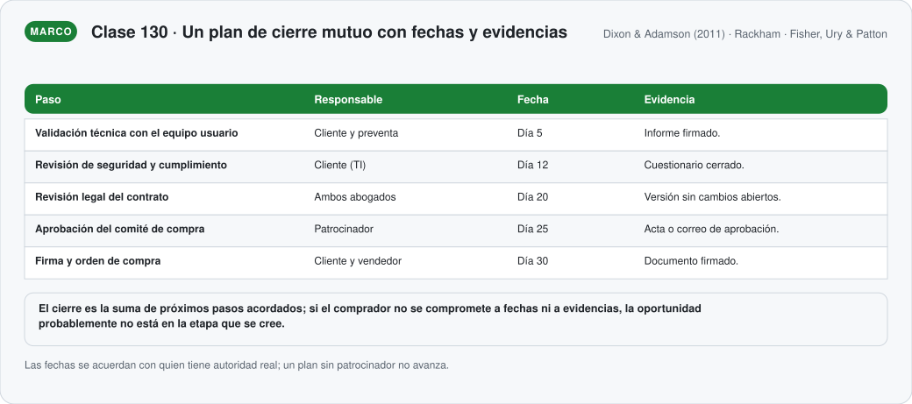

# Clase 130 — Cierre y próximos pasos

<!-- nav:inicio -->
> **Parte 10 · Ventas, desarrollo comercial y negociación** — clase 10 de 12 · [índice de la parte](../../README.md) · [temario](../../../../SYLLABUS.md)
<!-- nav:fin -->

**Parte:** 10 — Ventas, desarrollo comercial y negociación  
**Nivel:** Etapa 3 — Manager → Gerente  
**Duración sugerida:** 150–180 minutos · **Estándar:** deep-class-v2

## 🎯 Propósito

El «cierre» suele imaginarse como un momento dramático en que el vendedor consigue la firma con una frase hábil. En ventas complejas ocurre lo contrario: cuando se llega a la reunión final, la decisión casi siempre ya se tomó, o no se va a tomar. El cierre es la **consecuencia de un proceso** en que, paso a paso, comprador y vendedor acordaron qué debía ocurrir para llegar a la firma y lo fueron cumpliendo. Lo que se gestiona, entonces, no es una técnica de cierre sino un **plan de próximos pasos mutuos**: acciones con responsable y fecha que dependen de ambos y que dejan evidencia.

La clase se apoya en el enfoque de Rackham sobre el avance del comprador y los compromisos que lo demuestran, en la propuesta de Dixon y Adamson de tomar el control de la conversación con respeto, en los principios de compromiso y coherencia de Cialdini y en el método de intereses de Fisher y Ury. Al terminar sabrás construir un plan de cierre mutuo, distinguir compromisos reales de cortesías, manejar la última etapa de revisión legal y de compras, y transitar del cierre a la puesta en marcha.

## 📚 Resultados de aprendizaje

Al finalizar podrás:

1. **Construir** un plan de cierre mutuo con pasos, responsables, fechas y evidencias.
2. **Distinguir** compromisos reales de señales de cortesía.
3. **Gestionar** las revisiones técnica, legal, de seguridad y de compras.
4. **Pedir** la decisión de forma directa y respetuosa.
5. **Preparar** la transición del cierre a la puesta en marcha.

## 🧭 Agenda

| Tramo | Qué se hace |
|---|---|
| 0–20 min | Recuperación: recuerda una venta que «se enfrió» al final y qué paso del comprador faltó. |
| 20–60 min | Plan de cierre mutuo, compromisos, revisiones y decisión. |
| 60–105 min | Ejemplo trabajado: plan de cierre de 30 días para una venta enterprise. |
| 105–150 min | Caso ejecutivo y práctica. |
| 150–175 min | Límites y entregable. |

## 🧩 Conceptos centrales

| Concepto | Definición | Cómo se reconoce |
|---|---|---|
| **Plan de cierre mutuo** | Documento compartido con los pasos que ambas partes harán hasta la firma. | Tiene responsables, fechas y evidencias. |
| **Compromiso verificable** | Acción que el comprador acepta realizar y que se puede comprobar. | «Agendó la reunión con finanzas para el día 12». |
| **Señal de cortesía** | Respuesta amable que no implica avance. | «Me parece interesante, lo revisamos». |
| **Patrocinador (champion)** | Persona del comprador que impulsa internamente la decisión. | Defiende el caso sin el vendedor. |
| **Proceso de compras** | Pasos formales de aprobación del comprador. | Seguridad, legal, compras, finanzas. |
| **Puesta en marcha** | Inicio de la implantación tras la firma. | Responsables, plan y valor temprano. |

## 🧠 Modelo mental

**Cómo leer el diagrama.** Una tabla de cinco pasos con el **responsable**, la **fecha** y la **evidencia** que confirma que ocurrió. Es el esqueleto de un plan de cierre mutuo: el comprador y el vendedor lo construyen juntos y lo revisan cada semana. Si el comprador no se compromete a fechas ni a evidencias, la oportunidad probablemente no está en la etapa que se cree. La nota recuerda que las fechas se acuerdan con quien tiene autoridad real.

## 📖 Desarrollo

### 1. El cierre como resultado de un proceso

Rackham observó que, en ventas grandes, las técnicas de cierre tradicionales (la presión, la urgencia artificial, el «si firma hoy…») tenían poco efecto o resultaban contraproducentes: el comprador toma la decisión por su análisis de valor y riesgo, no por habilidad del vendedor. Lo que sí predecía el éxito eran los **avances**: compromisos concretos del comprador que muestran que la oportunidad progresa (aceptar una reunión con el decisor, dar acceso a datos, presentar al equipo técnico). Por eso, en lugar de «cerrar», se gestiona la secuencia de avances.

### 2. El plan de cierre mutuo

El plan de cierre mutuo (*mutual close plan*) es un documento sencillo y compartido: la lista de pasos que llevan a la firma, **quién** hace cada uno, **cuándo** y **qué evidencia** lo confirma. Incluye los pasos del comprador (validación técnica, seguridad, legal, compras, aprobación, firma) y los del vendedor (propuesta final, referencias, borrador de contrato, plan de implantación). Se construye **hacia atrás** desde la fecha en que el comprador necesita tener la solución en marcha: «si necesitan operar en marzo, ¿qué debe ocurrir y cuándo?». Se revisa cada semana y se actualiza con realismo.

### 3. Compromisos reales y cortesías

No toda respuesta amable es un avance. Dixon y Adamson destacan que los vendedores más eficaces **piden compromisos** y distinguen entre ellos. **Compromisos reales**: el comprador gasta algo (tiempo, acceso, reputación, información) o hace algo que depende de él. **Cortesías**: «lo vemos», «te escribo la próxima semana», «suena bien». Una pregunta útil: «¿Qué tendría que ocurrir para que esto avance, y quién lo hace?». Si el comprador evita fechas o personas, hay un riesgo. El vendedor puede, con respeto, preguntar si todavía tiene sentido continuar.

### 4. Gestionar a quienes pueden bloquear

En el proceso final intervienen áreas con poder de bloqueo: **seguridad de la información**, **legal**, **compras**, **finanzas**, **TI**. Se identifican al inicio, se **adelantan** los documentos que suelen pedirse (cuestionarios, certificaciones, políticas, contratos modelo, referencias) y se pide al patrocinador que explique **cómo es el proceso real**: quién aprueba, cuántas etapas, cuánto tarda, qué ha frenado casos anteriores. Cuando surgen problemas (cláusulas, requisitos de seguridad), se tratan como **riesgos con dueño y plazo**, no como sorpresas de último minuto. Los contratos y requisitos legales se revisan con asesoría especializada.

### 5. Pedir la decisión

Llegado el momento, se pide la decisión de forma **directa y respetuosa**: «Con lo que hemos visto, ¿qué falta para que podamos avanzar con la firma?», o «Nuestro plan indica la firma el día 30; ¿sigue siendo viable?». Cialdini explica el efecto de la **coherencia**: las personas tienden a actuar de acuerdo con compromisos previos, especialmente los explícitos y voluntarios; el plan mutuo se apoya en eso. La presión artificial (descuentos que vencen «hoy», escasez inventada) puede lograr una firma y deteriorar la relación; si hay una fecha límite real (fin de un período, disponibilidad de capacidad), se explica con honestidad.

### 6. Cuando no avanza

Si los pasos se retrasan, se **revisa**: ¿cambió la prioridad?, ¿cambió el patrocinador?, ¿apareció un bloqueador?, ¿se subestimó el proceso? Se conversa con el patrocinador con franqueza: «el plan se retrasó dos semanas; ¿qué está pasando y qué necesitas de nosotros?». Se evalúan alternativas: reducir el alcance, dividir en fases, ofrecer un piloto. Si después de varios intentos no hay compromisos, se cambia la etapa del pipeline o se cierra la oportunidad (clase 126). Cerrar con honestidad una oportunidad que no avanza libera tiempo y mejora el pronóstico.

### 7. Del cierre a la puesta en marcha

La firma es el inicio de otra etapa que determina si el cliente obtiene valor, renueva y recomienda. Antes de la firma se acuerdan: **objetivos de éxito** del cliente (con las métricas del business case), **responsables** de ambos lados, **plan de implantación** con hitos, **valor temprano** (un primer resultado en 30 a 60 días), **canales de comunicación** y **gobernanza** (reuniones de seguimiento). Se hace un **traspaso** claro del equipo de ventas al de implantación o éxito del cliente, con todo lo aprendido en el diagnóstico (clase 131). Las promesas hechas en la venta se documentan y se cumplen.

## 📚 Lectura comparada

| Obra | Qué aporta | Qué no resuelve | Pregunta para contrastar |
|---|---|---|---|
| Rackham | Avances y compromisos como predictores del éxito. | Enfoque de ventas grandes. | ¿Qué compromiso real ofreció el comprador? |
| Dixon y Adamson | Tomar el control con respeto y pedir compromisos. | Estudio en un conjunto de empresas. | ¿Qué paso concreto pides? |
| Cialdini | Compromiso y coherencia. | Puede usarse para manipular. | ¿El compromiso es voluntario y verificable? |
| Fisher, Ury y Patton | Intereses y opciones para cerrar acuerdos. | Marco general de negociación. | ¿Qué interés queda por resolver? |
| Roberge | Seguimiento del avance con datos. | Experiencia de una empresa. | ¿Qué dice el historial de oportunidades similares? |

## 🧮 Ejemplo trabajado

**Situación (hipotética).** Una empresa de plataformas de datos vende una solución de USD 420.000 al año a una aseguradora. La fecha límite de la aseguradora para tener la plataforma operativa es el 1 de marzo. Se está a 45 días de esa fecha; el proceso de compras habitual demora entre 30 y 40 días.

**Plan de cierre construido hacia atrás.**

| Paso | Responsable | Fecha | Evidencia |
|---|---|---|---|
| Prueba técnica con datos del cliente | Cliente (TI) y preventa | Día 5 | Informe firmado por TI |
| Reunión con el decisor económico | Patrocinador | Día 7 | Acta o correo del decisor |
| Cuestionario de seguridad completo | Vendedor | Día 8 (envío), día 15 (revisión) | Aprobación de seguridad |
| Contrato: primera revisión legal | Abogados de ambos | Día 10–20 | Versión sin cambios abiertos |
| Aprobación de compras y presupuesto | Gerente de compras | Día 25 | Orden de compra o aprobación |
| Firma | Representantes legales | Día 30 | Contrato firmado |
| Inicio de implantación | Ambos | Día 31 | Kickoff realizado |

**Riesgos detectados con el patrocinador.** (1) Seguridad suele pedir pruebas de penetración no incluidas; se pide el requisito hoy. (2) Legal exige una cláusula de responsabilidad que el vendedor no acepta en su forma habitual; se agenda una reunión de abogados esta semana. (3) El decisor económico viaja la semana 2; se agenda con anticipación.

**Seguimiento.** Reunión semanal de 20 minutos con el patrocinador para actualizar. En la semana 2 se descubre que seguridad necesita un informe de una auditoría externa; el vendedor lo gestiona en cinco días y el plan se ajusta un día.

**Pedido de decisión.** En el día 24, el vendedor pregunta al patrocinador: «Con todos los pasos cumplidos, ¿qué podría impedir la aprobación el día 25?» El patrocinador menciona que compras exige un tercer proveedor comparable; se envía información para completar la comparación.

**Resultado.** Firma el día 33; implantación comienza el día 34. Un plan de 90 días con un primer resultado verificable a los 45 días se acuerda desde el inicio.

**Qué muestra.** (1) El plan se construyó hacia atrás desde la fecha del comprador. (2) Los riesgos se trataron antes de que bloquearan. (3) El traspaso a la implantación estaba acordado.

## 🔀 Comparación y límites

**Cierre mutuo frente a cierre por presión.** El cierre mutuo se apoya en acuerdos verificables y confianza; el cierre por presión busca la firma con urgencia artificial. El primero produce clientes que renuevan; el segundo, reclamos y cancelaciones.

**Límites.** Un plan de cierre mutuo exige que el comprador acepte colaborar; con compradores que se niegan, la oportunidad probablemente es débil. Los procesos de compra regulados (licitaciones públicas, por ejemplo) tienen reglas que no admiten este enfoque. Las fechas de aprobación dependen de factores externos al vendedor. La evidencia sobre la eficacia de las técnicas de cierre proviene de investigaciones y casos específicos. Y todo contrato, garantía y cláusula debe revisarse con asesoría legal y respetar la normativa de contratación aplicable.

## 🪜 De profesional a owner

| Nivel | Cómo participa en el cierre |
|---|---|
| **Profesional** | Registra compromisos reales y mantiene al día el plan. |
| **Jefe / Team Lead** | Revisa los planes de cierre y ayuda a destrabar bloqueos. |
| **Gerente** | Exige planes por evidencia y acompaña en negocios clave. |
| **CEO / Director** | Apoya cuando el cliente necesita un contacto al más alto nivel. |
| **Founder / Owner** | Cumple lo prometido para que las primeras ventas se conviertan en referencias. |

## 🏢 Caso ejecutivo

Una empresa de software para gestión hospitalaria tiene una oportunidad de USD 1,1 millones con una red de clínicas. El patrocinador, el director médico, está entusiasmado; ha dicho «estamos casi listos» durante dos meses. El plan de implantación debe comenzar en cuatro meses por una nueva norma que exige ciertos registros. El comprador no ha presentado al vendedor al gerente general ni a compras; seguridad no ha recibido el cuestionario; no hay fecha de decisión; un competidor ofrece una solución más barata con menor funcionalidad. El gerente comercial de la empresa quiere ofrecer un descuento de 20 % si firman este mes.

Entrega un **plan de cierre** que contenga: (a) el plan de cierre mutuo construido hacia atrás desde la fecha de la norma; (b) la identificación de compromisos reales y cortesías en lo ocurrido; (c) el mapa de bloqueadores y los documentos que adelantarás; (d) cómo conducirás la conversación con el patrocinador y cómo pedirás la decisión; (e) la evaluación del descuento y alternativas (fases, piloto); (f) el plan de transición a la implantación y las verificaciones legales, de datos de salud y de normativa aplicable.

## 🧪 Práctica

1. Construye un plan de cierre mutuo hacia atrás para una oportunidad real.
2. Clasifica las últimas cinco respuestas de un comprador en compromisos reales o cortesías.
3. Lista los documentos que adelantarías a seguridad, legal y compras.
4. Redacta cómo pedirías la decisión de forma directa y respetuosa.
5. Define el primer resultado de valor de los primeros 45 días tras la firma.

## ⚠️ Errores frecuentes

| Error | Por qué ocurre | Cómo corregirlo |
|---|---|---|
| Confiar en cortesías | Se interpreta el entusiasmo como compromiso | Pedir acciones con fecha y responsable. |
| Descubrir bloqueadores al final | No se mapean | Identificarlos y adelantarse. |
| Presión artificial | Se quiere cerrar rápido | Plan mutuo y fechas reales. |
| Plan sin evidencias | Se registra intención | Evidencia por paso. |
| No preparar la transición | Se piensa que la venta terminó | Acordar objetivos y plan de implantación. |
| Mantener oportunidades que no avanzan | Optimismo | Revisar y cerrar con honestidad. |

## ❓ Preguntas de comprobación

1. ¿Qué es un plan de cierre mutuo y cómo se construye?
2. ¿Qué diferencia hay entre un compromiso real y una cortesía?
3. ¿Qué papel cumple el patrocinador?
4. ¿Cómo se gestionan seguridad, legal y compras?
5. ¿Cómo se pide la decisión?
6. ¿Qué se hace si el plan se retrasa?
7. ¿Qué se acuerda antes de la firma para la puesta en marcha?

Claves de respuesta

1. Un documento compartido con pasos, responsables, fechas y evidencias hasta la firma; se construye hacia atrás desde la fecha en que el comprador necesita la solución.
2. El compromiso real implica que el comprador gasta tiempo, acceso o reputación o hace algo verificable; la cortesía es una respuesta amable sin avance.
3. Impulsa internamente la decisión y explica el proceso real del comprador.
4. Identificándolos al inicio, adelantando documentos y tratando los problemas como riesgos con dueño y plazo.
5. De forma directa y respetuosa, preguntando qué falta o si el plan sigue siendo viable, sin presión artificial.
6. Se revisa la causa con el patrocinador, se evalúan alternativas como fases o piloto y, si no hay compromisos, se cambia de etapa o se cierra la oportunidad.
7. Objetivos de éxito, responsables, plan de implantación con hitos, valor temprano, comunicación y gobernanza, y el traspaso de lo aprendido.

## 📥 Entregable

Guarda en `portfolio/130-cierre-y-proximos-pasos/`:

- `leadership-decision-brief.md` (plantilla [Leadership Decision Brief](../../../../templates/leadership-decision-brief.md)) con el plan de cierre del caso ejecutivo;
- `sales-pipeline.md` (plantilla [Sales pipeline](../../../../templates/sales-pipeline.md)) con el estado de la oportunidad y los compromisos;
- `decision-journal.md` con los bloqueadores, los riesgos y el traspaso a la implantación.

## 📗 Fuentes y verificación

- Neil Rackham — *Major Account Sales Strategy* (McGraw-Hill, 1989). **Uso en esta clase:** avances y compromisos como predictores del éxito. Lectura selectiva sobre **cierre y próximos pasos**. **Localizador:** [ISBN-13 9780070511149](https://openlibrary.org/isbn/9780070511149).
- Matthew Dixon & Brent Adamson — *The Challenger Sale* (Portfolio/Penguin, 2011). **Uso en esta clase:** tomar el control con respeto y pedir compromisos. Lectura selectiva sobre **cierre y próximos pasos**. **Localizador:** [ISBN-13 9781591844358](https://openlibrary.org/isbn/9781591844358).
- Robert B. Cialdini — *Influence* (HarperCollins Publishers and Blackstone Audio, 2016). **Uso en esta clase:** compromiso y coherencia. Lectura selectiva sobre **cierre y próximos pasos**. **Localizador:** [ISBN-13 9781624608049](https://openlibrary.org/isbn/9781624608049).
- Roger Fisher, William Ury & Bruce Patton — *Getting to Yes* (Hutchinson, 1983). **Uso en esta clase:** intereses y opciones para cerrar acuerdos. Lectura selectiva sobre **cierre y próximos pasos**. **Localizador:** [ISBN-13 9780091493714](https://openlibrary.org/isbn/9780091493714).
- Mark Roberge — *The Sales Acceleration Formula* (2015). **Uso en esta clase:** seguimiento del avance con datos. Lectura selectiva sobre **cierre y próximos pasos**. **Localizador:** [ISBN-13 9781119047070](https://openlibrary.org/isbn/9781119047070).

> **Regla de fuentes para Cierre y próximos pasos:** las obras anteriores estructuran las perspectivas de esta materia; cualquier norma, ley o estándar vivo mencionado debe comprobarse nuevamente en su fuente primaria vigente, incluidas las de contratación, protección de datos de salud y regulación sectorial. Los ejemplos y casos son hipotéticos, con cifras ilustrativas. El desarrollo es original y no reproduce capítulos protegidos.

<!-- pie:inicio -->
---

| Anterior | Índice | Siguiente |
|---|---|---|
| [← 129 · Pricing y concesiones](../129-pricing-y-concesiones/README.md) | [Parte 10](../../README.md) · [Programa](../../../../SYLLABUS.md) | [131 · Account management, expansión y retención →](../131-account-management-expansion-y-retencion/README.md) |
<!-- pie:fin -->
