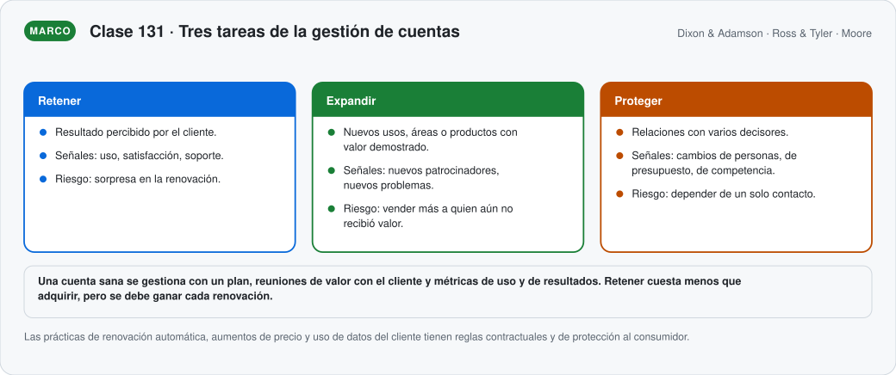

# Clase 131 — Account management, expansión y retención

<!-- nav:inicio -->
> **Parte 10 · Ventas, desarrollo comercial y negociación** — clase 11 de 12 · [índice de la parte](../../README.md) · [temario](../../../../SYLLABUS.md)
<!-- nav:fin -->

**Parte:** 10 — Ventas, desarrollo comercial y negociación  
**Nivel:** Etapa 3 — Manager → Gerente  
**Duración sugerida:** 150–180 minutos · **Estándar:** deep-class-v2

## 🎯 Propósito

La venta que importa no es la primera sino la que ocurre cuando el cliente renueva, amplía y recomienda. Un cliente que se va después de un año destruye el costo de adquirirlo; uno que crece lo amortiza varias veces. Sin embargo, muchas empresas dedican a la gestión de cuentas la mitad de la atención que a la captación: el equipo de ventas «entrega» al cliente y desaparece, el de soporte atiende solicitudes, y nadie gestiona la relación completa. Gestionar cuentas es asegurar que el cliente obtenga el valor prometido, que la relación tenga varios puntos de contacto y que haya un plan para crecer con él.

La clase se apoya en el análisis de Dixon y Adamson sobre cómo compran y se relacionan los clientes, en las prácticas de Ross y Tyler sobre procesos y roles, en la visión de Moore sobre el ciclo de adopción y expansión y en la economía unitaria de la clase 117. Al terminar sabrás estructurar un plan de cuenta, medir la salud de un cliente, identificar señales de riesgo y de expansión, conducir revisiones de valor y diseñar un modelo de retención y crecimiento.

## 📚 Resultados de aprendizaje

Al finalizar podrás:

1. **Diseñar** un plan de cuenta con objetivos, relaciones y acciones.
2. **Medir** la salud de un cliente con indicadores de uso, valor y relación.
3. **Detectar** señales tempranas de riesgo y de expansión.
4. **Conducir** revisiones de valor con el cliente.
5. **Estructurar** el modelo de gestión de cuentas y su relación con ventas y soporte.

## 🧭 Agenda

| Tramo | Qué se hace |
|---|---|
| 0–20 min | Recuperación: ¿qué clientes tuyos se fueron en el último año y qué señales se vieron meses antes? |
| 20–60 min | Plan de cuenta, salud, revisiones, expansión y retención. |
| 60–105 min | Ejemplo trabajado: plan de una cuenta estratégica con riesgo de no renovación. |
| 105–150 min | Caso ejecutivo y práctica. |
| 150–175 min | Límites y entregable. |

## 🧩 Conceptos centrales

| Concepto | Definición | Cómo se reconoce |
|---|---|---|
| **Gestión de cuentas** | Gestión continua de la relación con un cliente para lograr valor, renovación y crecimiento. | Hay dueño, plan y reuniones de valor. |
| **Salud de la cuenta** | Evaluación de la probabilidad de que el cliente renueve y crezca. | Combina uso, resultados, relación y riesgo. |
| **Retención** | Proporción de clientes o de ingresos que se mantiene en un período. | Por cohorte y por segmento. |
| **Retención neta de ingresos** | Ingresos de un grupo de clientes hoy respecto de hace un año, incluidos aumentos y bajas. | Mayor a 100 % indica expansión neta. |
| **Expansión** | Venta adicional a un cliente actual. | Nuevos usuarios, áreas o productos. |
| **Revisión de valor** | Reunión periódica para revisar resultados logrados y próximos objetivos. | Basada en métricas acordadas. |

## 🧠 Modelo mental

**Cómo leer el diagrama.** Tres columnas. **Retener** asegura que el cliente perciba resultados (señales: uso, satisfacción, soporte; riesgo: sorpresa en la renovación). **Expandir** busca nuevos usos o áreas con valor demostrado (señales: nuevos patrocinadores o problemas; riesgo: vender más a quien aún no recibió valor). **Proteger** cuida la relación con varios decisores y vigila cambios de personas, presupuesto y competencia (riesgo: depender de un solo contacto). Las tres se hacen a la vez.

## 📖 Desarrollo

### 1. Por qué importa

Los clientes actuales son la fuente más barata de ingresos: ya conocen la empresa, ya tienen un problema que ella resuelve y ya confían. Retener cuesta menos que adquirir, y la expansión suele tener menor costo de venta (clase 117). Una mejora pequeña en retención tiene un efecto compuesto sobre el valor del cliente. Pero la retención no se logra por voluntarismo: depende del **valor que el cliente reciba** y de que **lo perciba**. Muchos clientes se van no porque el producto fracase, sino porque nadie les mostró lo que logró o porque cambió su patrocinador.

### 2. Plan de cuenta

Para cuentas relevantes se escribe un **plan de cuenta**: perfil y estrategia del cliente, **objetivos del cliente** y cómo se mide el éxito, **mapa de relaciones** (patrocinador, usuarios, decisor económico, influyentes, riesgos), **valor entregado** hasta hoy, **riesgos** y **oportunidades de expansión**, y **acciones** con responsable y fecha. Rackham y Dixon y Adamson destacan que las mejores relaciones involucran **múltiples contactos** y que un patrocinador puede irse. Se revisa trimestralmente y se comparte con soporte, producto y dirección cuando corresponde.

### 3. Salud de la cuenta

Un indicador de salud combina señales: **uso** (profundidad y frecuencia, usuarios activos frente a contratados), **resultados** (el cliente alcanza los objetivos acordados), **relación** (reuniones, patrocinador activo, acceso a decisores), **soporte** (incidentes, escalamientos), **comercial** (pagos puntuales, disputas) y **riesgos externos** (cambio de dirección, recortes, fusión, competidor). Se resume en una escala simple (verde, ámbar, rojo) con criterios documentados. Debe **validarse con datos**: ¿las cuentas que fueron rojas efectivamente tuvieron mayor baja? (clase 101). Un indicador no validado es una opinión.

### 4. Revisiones de valor

Una **revisión de valor** (QBR o similar) es una conversación periódica con el patrocinador y otros interesados para revisar **qué se logró** (con métricas del business case, clase 125), **qué falta**, **qué cambió en el contexto del cliente**, **qué podría hacerse a continuación** y **qué necesitamos el uno del otro**. No es un informe de actividades ni una presentación de ventas. Se prepara con datos de uso y resultados; se anticipan las preguntas difíciles; se registran acuerdos. Es también la ocasión de detectar riesgos antes de que aparezcan y de plantear expansión con base en resultados.

### 5. Expansión con valor

La expansión surge de **valor demostrado** y de **nuevos problemas** del cliente: otra área con una necesidad similar, más usuarios, un producto complementario, un cambio de plan. Moore describe cómo, tras establecerse en un segmento, la expansión por adyacencia aprovecha referencias y confianza. Se evita **vender más a quien no obtiene valor**: genera descontento y facilita la baja. Se identifican **disparadores** (nuevas sedes, nuevos directivos, nuevas regulaciones) y se involucra a nuevos patrocinadores. Un modelo de precios que acompañe el uso (por usuario, por volumen) facilita que la expansión sea natural.

### 6. Señales de riesgo y plan de rescate

Señales frecuentes: **caída del uso**, **cambio o salida del patrocinador**, **retrasos en pagos**, **aumento de reclamos**, **reuniones que se cancelan**, **consultas sobre cómo exportar datos**, **mención de competidores**, **recortes de presupuesto**, **fusiones**. Ante un riesgo se activa un **plan de rescate**: diagnóstico con el cliente (¿qué cambió?), involucrar a un directivo propio, **reforzar** el valor (capacitación, nuevas funciones, resultados visibles), ajustar condiciones si corresponde y reconocer errores. Si el cliente decide irse, se hace una **salida profesional**: entender las razones, facilitar la transición y dejar la puerta abierta.

### 7. Modelo organizacional

Los roles se definen según la complejidad: **ejecutivo de cuentas** (relación y comercial), **éxito del cliente** (adopción y resultados), **soporte** (incidentes), **producto** (insumos del cliente) y **operaciones comerciales** (datos y procesos). Se acuerdan **metas coherentes**: si ventas solo se premia por nuevas ventas, no cuidará la relación; si éxito del cliente solo mide satisfacción, no verá oportunidades. Se usan métricas de **retención neta de ingresos**, **expansión**, **salud de cuentas**, **tiempo hasta primer valor** y **satisfacción**. Roberge y Ross y Tyler destacan la importancia de roles y datos claros.

## 📚 Lectura comparada

| Obra | Qué aporta | Qué no resuelve | Pregunta para contrastar |
|---|---|---|---|
| Dixon y Adamson | Cómo se compra y se enseña en relaciones complejas. | Estudio centrado en ventas. | ¿Quién enseña algo nuevo al cliente cada trimestre? |
| Ross y Tyler | Roles y procesos para sostener ingresos predecibles. | Orientado a la captación. | ¿Quién es dueño de la renovación? |
| Moore | Expansión por adyacencia desde un segmento. | Contexto de tecnología. | ¿Qué cuenta puede ser referencia? |
| Roberge | Métricas y gestión de equipos comerciales. | Experiencia de una empresa de software. | ¿Qué métrica de salud valida tus alertas? |
| Gupta, Lehmann y Stuart (2004) | Valor de los clientes como activos. | Modelos con supuestos. | ¿Cuánto vale retener a este cliente? |

## 🧮 Ejemplo trabajado

**Situación (hipotética).** Una empresa de software de facturación y cobranza tiene una cuenta estratégica, una cadena de retail con 400 usuarios, que representa USD 560.000 al año (6 % de sus ingresos). Faltan cinco meses para la renovación.

**Salud de la cuenta.**

| Dimensión | Dato | Estado |
|---|---|---|
| Uso | 61 % de usuarios activos (hace un año, 83 %) | Rojo |
| Resultados | Redujeron los días de cobro de 58 a 49; la meta era 40 | Ámbar |
| Relación | Patrocinador (gerente de finanzas) se fue hace dos meses; sin contacto con el nuevo | Rojo |
| Soporte | 14 incidentes críticos en el trimestre; promedio de resolución de 3 días | Ámbar |
| Comercial | Pagos al día | Verde |
| Entorno | Nuevo director financiero; recortes del 10 % en gastos de tecnología | Rojo |

**Diagnóstico.** La cuenta está en riesgo alto. La razón inmediata es el cambio de patrocinador y de director financiero; la causa de fondo es que la adopción cayó y nadie del cliente defiende los resultados.

**Plan de rescate (cinco meses).**

1. **Semana 1–2**: gerente general del vendedor y el director de cuentas piden reunión con el nuevo director financiero; preparan un resumen de resultados (reducir 9 días el cobro libera unos USD 2,1 millones de capital de trabajo si el cliente vende a crédito unos USD 85 millones al año).
2. **Mes 1**: diagnóstico de uso con los usuarios; identificar causas del 22 % de caída (rotación de personal y falta de capacitación).
3. **Mes 1–2**: capacitación para 150 usuarios y simplificación de dos procesos; resolver los incidentes recurrentes con un plan de producto.
4. **Mes 2–3**: nuevos patrocinadores: el gerente de crédito y el de tesorería; revisión de valor con metas hasta 42 días de cobro.
5. **Mes 3–4**: propuesta de renovación con opciones: plan actual con compromiso de adopción, o un plan reducido de 320 usuarios con menor precio y cláusulas de crecimiento.
6. **Mes 5**: renovación.

**Resultado esperado.** Con el valor en capital de trabajo (USD 2,1 millones, que al 9 % de costo de financiamiento son unos USD 190.000 al año) frente al costo de USD 560.000, el caso es defendible para el nuevo director, pero requiere traducirlo a sus prioridades de reducción de gastos: el plan reducido ofrece un ahorro y mantiene el valor central.

**Qué muestra.** (1) La salud combinó varias señales. (2) El plan fue anterior a la fecha de renovación. (3) Se buscó un nuevo patrocinador y se tradujo el valor a la prioridad del nuevo decisor.

## 🔀 Comparación y límites

**Gestión de cuentas frente a soporte.** Soporte resuelve problemas cuando surgen; gestión de cuentas es proactiva: busca resultados y relación. Ambos se coordinan.

**Límites.** Los indicadores de salud son hipótesis que se deben validar. Con pocas cuentas grandes, la variabilidad es alta y el análisis estadístico limitado. La retención depende también de factores fuera de control (fusiones, cierre del cliente, cambios de estrategia). Los intentos de «retener a toda costa» con descuentos reducen margen y enseñan al cliente a amenazar con irse. Las prácticas de renovación automática, aumentos de precio y uso de datos del cliente tienen normas contractuales y de consumo que se verifican con asesoría.

## 🪜 De profesional a owner

| Nivel | Cómo participa en la gestión de cuentas |
|---|---|
| **Profesional** | Cumple lo prometido y registra señales de la relación. |
| **Jefe / Team Lead** | Revisa la salud de las cuentas de su equipo y el plan de cada una. |
| **Gerente** | Define el modelo, las métricas y los roles de gestión de cuentas. |
| **CEO / Director** | Dedica tiempo a cuentas estratégicas y cuida la reputación con clientes clave. |
| **Founder / Owner** | Conoce personalmente a sus primeros clientes y aprende de ellos. |

## 🏢 Caso ejecutivo

Una empresa de software de recursos humanos tiene 600 clientes y una retención de ingresos neta de 96 %. Su equipo comercial recibe comisiones solo por nuevas ventas; el equipo de soporte atiende tickets sin dueño de relación; no hay revisiones de valor. En el último año se perdieron 11 cuentas grandes, tres de ellas con aviso de menos de 30 días. Un análisis posterior muestra que ocho tenían caída de uso de más del 25 % seis meses antes y que en seis habían cambiado de gerente de personas. Las cuentas que tuvieron revisiones de valor con dos o más contactos renovaron al 94 %, frente a 78 % de las demás. La dirección discute contratar 10 gestores de cuentas.

Entrega un **diseño de gestión de cuentas** que contenga: (a) la segmentación de cuentas y el nivel de atención; (b) el plan de cuenta tipo y las revisiones de valor; (c) el indicador de salud, su validación con datos y las alertas; (d) el protocolo de riesgo y de rescate; (e) los roles, las metas coherentes y el análisis de costo-beneficio de los 10 gestores; (f) las condiciones contractuales y de datos que se verificarán con asesoría.

## 🧪 Práctica

1. Elige una cuenta importante y escribe su plan: objetivos, relaciones, riesgos y acciones.
2. Define cinco señales de salud y valida una con datos de tus clientes.
3. Prepara la agenda de una revisión de valor con tres métricas.
4. Escribe el protocolo de acción ante una caída de uso del 25 %.
5. Calcula cuánto vale mejorar en dos puntos la retención de ingresos.

## ⚠️ Errores frecuentes

| Error | Por qué ocurre | Cómo corregirlo |
|---|---|---|
| Entregar y desaparecer | La venta se considera terminada | Dueño de la cuenta y plan. |
| Depender de un solo contacto | Es más cómodo | Varios contactos y niveles. |
| Indicador de salud sin validar | Se crea por intuición | Contrastar con bajas reales. |
| Expandir a quien no recibe valor | Se prioriza la venta | Primero resultados, luego expansión. |
| Retener con descuentos | Se teme perder | Reforzar valor y condiciones. |
| Metas desalineadas | Cada área tiene la suya | Metas compartidas de retención y expansión. |

## ❓ Preguntas de comprobación

1. ¿Qué incluye un plan de cuenta?
2. ¿Qué señales componen la salud de una cuenta?
3. ¿Qué es una revisión de valor y qué la distingue de un informe?
4. ¿Cuándo es sano expandir una cuenta?
5. ¿Qué señales anticipan un riesgo de baja?
6. ¿Qué mide la retención neta de ingresos?
7. ¿Qué límite tienen los indicadores de salud?

Claves de respuesta

1. Objetivos del cliente y de éxito, mapa de relaciones, valor entregado, riesgos, oportunidades y acciones con responsable y fecha.
2. Uso, resultados, relación, soporte, aspectos comerciales y riesgos externos.
3. Una reunión periódica para revisar resultados logrados, lo que falta, cambios de contexto y próximos pasos con métricas acordadas; no es informe de actividades ni presentación de ventas.
4. Cuando el cliente ya obtiene valor demostrado y aparecen nuevos problemas, áreas o disparadores.
5. Caída de uso, salida del patrocinador, retrasos de pago, reclamos, reuniones canceladas, consultas sobre exportar datos, mención de competidores o recortes.
6. Los ingresos actuales de un grupo de clientes respecto de hace un año, incluidos aumentos y bajas; sobre 100 % indica expansión neta.
7. Son hipótesis que deben validarse con bajas reales, y con pocas cuentas la variabilidad limita el análisis.

## 📥 Entregable

Guarda en `portfolio/131-account-management-expansion-y-retencion/`:

- `commercial-decision-brief.md` (plantilla [Commercial decision brief](../../../../templates/commercial-decision-brief.md)) con el diseño del caso ejecutivo;
- `kpi-tree.md` (plantilla [KPI tree](../../../../templates/kpi-tree.md)) con el indicador de salud y las métricas de retención;
- `decision-journal.md` con los planes de cuenta, las alertas y el análisis de costo-beneficio.

## 📗 Fuentes y verificación

- Matthew Dixon & Brent Adamson — *The Challenger Sale* (Portfolio/Penguin, 2011). **Uso en esta clase:** cómo se compra y se enseña en relaciones complejas. Lectura selectiva sobre **account management, expansión y retención**. **Localizador:** [ISBN-13 9781591844358](https://openlibrary.org/isbn/9781591844358).
- Aaron Ross & Marylou Tyler — *Predictable Revenue* (Pebblestorm, 2020). **Uso en esta clase:** roles y procesos para sostener ingresos predecibles. Lectura selectiva sobre **account management, expansión y retención**. **Localizador:** [ISBN-13 9780984380244](https://openlibrary.org/isbn/9780984380244).
- Geoffrey A. Moore — *Crossing the Chasm* (HarperBusiness, 1995). **Uso en esta clase:** expansión por adyacencia desde un segmento. Lectura selectiva sobre **account management, expansión y retención**. **Localizador:** [ISBN-13 9780887307171](https://openlibrary.org/isbn/9780887307171).
- Mark Roberge — *The Sales Acceleration Formula* (2015). **Uso en esta clase:** métricas y gestión de equipos comerciales. Lectura selectiva sobre **account management, expansión y retención**. **Localizador:** [ISBN-13 9781119047070](https://openlibrary.org/isbn/9781119047070).
- Sunil Gupta, Donald R. Lehmann & Jennifer Ames Stuart — *Valuing Customers* (Journal of Marketing Research, 2004). **Uso en esta clase:** valor de los clientes como activos. Lectura selectiva sobre **account management, expansión y retención**. **Localizador:** [DOI 10.1509/jmkr.41.1.7.25084](https://doi.org/10.1509/jmkr.41.1.7.25084).

> **Regla de fuentes para Account management, expansión y retención:** las obras anteriores estructuran las perspectivas de esta materia; cualquier norma, ley o estándar vivo mencionado debe comprobarse nuevamente en su fuente primaria vigente, incluidas las normas de renovación contractual, precios y protección de datos. Los ejemplos y casos son hipotéticos, con cifras ilustrativas. El desarrollo es original y no reproduce capítulos protegidos.

<!-- pie:inicio -->
---

| Anterior | Índice | Siguiente |
|---|---|---|
| [← 130 · Cierre y próximos pasos](../130-cierre-y-proximos-pasos/README.md) | [Parte 10](../../README.md) · [Programa](../../../../SYLLABUS.md) | [132 · Capstone: negociación enterprise →](../132-capstone-negociacion-enterprise/README.md) |
<!-- pie:fin -->
