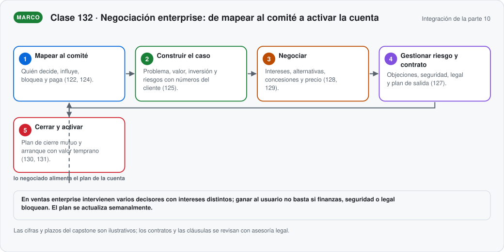

# Clase 132 — Capstone: negociación enterprise

<!-- nav:inicio -->
> **Parte 10 · Ventas, desarrollo comercial y negociación** — clase 12 de 12 · [índice de la parte](../../README.md) · [temario](../../../../SYLLABUS.md)
<!-- nav:fin -->

**Parte:** 10 — Ventas, desarrollo comercial y negociación  
**Nivel:** Etapa 3 — Manager → Gerente  
**Duración sugerida:** 150–180 minutos · **Estándar:** deep-class-v2

## 🎯 Propósito

Una venta enterprise reúne todos los desafíos comerciales a la vez: un comité de compra con intereses distintos, un ciclo largo, un valor alto, un proceso formal de seguridad, legal y compras, competidores que presentan alternativas y un acuerdo que atará a ambas partes por años. Ganar al usuario no basta si finanzas, seguridad o legal bloquean; ganar el precio no sirve si el contrato impone riesgos que la empresa no puede asumir. La negociación enterprise exige ordenar las herramientas de la parte en una secuencia coherente: elegir a quién vender, entender al comité, construir un caso que el comprador pueda defender, negociar con intereses y alternativas, resolver riesgos y cerrar con un plan mutuo.

Este capstone integra la parte 10 y se apoya en Rackham, Dixon y Adamson, Fisher, Ury y Patton, Malhotra y Bazerman, Nagle, Hogan y Zale, Voss y Raz y Roberge. Al terminar sabrás conducir una negociación enterprise de punta a punta: diagnosticar la cuenta, planificar la estrategia, presentar el caso, manejar objeciones y concesiones, gestionar el contrato y asegurar la puesta en marcha.

## 📚 Resultados de aprendizaje

Al finalizar podrás:

1. **Mapear** el comité de compra, sus intereses y su proceso de decisión.
2. **Construir** un plan de cuenta con propuesta de valor, business case y estrategia de negociación.
3. **Negociar** precio, alcance y condiciones con BATNA, concesiones y paquetes.
4. **Gestionar** objeciones y riesgos de seguridad, legales y de compras.
5. **Cerrar** con un plan mutuo y preparar la puesta en marcha.

## 🧭 Agenda

| Tramo | Qué se hace |
|---|---|
| 0–20 min | Recuperación: ordena las diez primeras preguntas que harías antes de enviar un precio a una cuenta enterprise. |
| 20–60 min | Secuencia, comité, estrategia de negociación y gestión de riesgos. |
| 60–105 min | Ejemplo trabajado: negociación de un contrato de USD 2,4 millones. |
| 105–150 min | Caso ejecutivo integrado. |
| 150–175 min | Rúbrica, límites y entregable. |

## 🧩 Conceptos centrales

| Concepto | Definición | Cómo se reconoce |
|---|---|---|
| **Comité de compra** | Conjunto de personas que influyen o deciden una compra grande. | Cada una con interés y poder distintos. |
| **Plan de cuenta enterprise** | Estrategia por cuenta: valor, relaciones, riesgos, competidores y acciones. | Se actualiza cada semana. |
| **Paquete de negociación** | Conjunto de condiciones acordadas a la vez. | Permite intercambios entre intereses. |
| **BATNA y punto de reserva** | Alternativa y límite de cada parte. | Se definen antes de negociar. |
| **Matriz de riesgos del acuerdo** | Lista de riesgos con dueño, mitigación y condiciones. | Alimenta el contrato. |
| **Plan de cierre mutuo** | Pasos de ambas partes hasta la firma con fechas y evidencias. | Se revisa semanalmente. |

## 🧠 Modelo mental

**Cómo leer el diagrama.** Cinco pasos que remiten a las clases de la parte. **Mapear al comité** (122, 124) define quién decide, influye, bloquea y paga. **Construir el caso** (125) pone números del cliente. **Negociar** (128, 129) maneja intereses, alternativas, concesiones y precio. **Gestionar riesgo y contrato** (127) resuelve objeciones, seguridad y aspectos legales. **Cerrar y activar** (130, 131) acuerda el plan de cierre y arranca con valor temprano. La flecha de retorno indica que lo negociado alimenta el plan de la cuenta.

## 📖 Desarrollo

### 1. Mapear el comité y el proceso

El primer trabajo es entender **quién decide qué** (clase 124). Se identifican: **patrocinador** (quien tiene el problema y el presupuesto), **decisor económico**, **usuarios**, **influyentes técnicos**, **seguridad**, **legal**, **compras**, **finanzas** y posibles **bloqueadores**, con sus preocupaciones y su relación con el vendedor. También el **proceso**: pasos, tiempos, documentos, calendario de comités. Rackham insiste en entender las dinámicas del comprador en cuentas grandes: la estrategia depende de a quién se debe convencer, de qué y en qué orden. Un mapa de poder y de interés evita invertir esfuerzo solo en los contactos más cómodos.

### 2. Construir y validar el caso con el comprador

Con el diagnóstico (124), se elabora la propuesta de valor y el business case con los números del cliente (125): costo del problema, beneficio en rangos, inversión total, riesgos, alternativas y retorno. Se **valida con el patrocinador** antes de presentarlo al comité y se adapta a cada rol: versión ejecutiva para finanzas, requisitos técnicos para TI, controles para seguridad, cláusulas para legal, condiciones para compras. Dixon y Adamson destacan la importancia de enseñar al comprador algo nuevo y de adaptar el mensaje a cada interlocutor; en comités, el mensaje debe ser coherente entre roles.

### 3. Preparar la negociación

Antes de negociar con compras o con el decisor, se prepara (clase 128): **intereses** de ambos, **BATNA** y **punto de reserva**, **zona de posible acuerdo**, **paquetes** de condiciones, **concesiones** valoradas por costo para el vendedor y valor para el comprador (clase 129), **piso de precio** y **criterios objetivos**. Se definen **roles** del equipo (quién lidera, quién escucha, quién aprueba concesiones), **autoridad** para decidir en la mesa y **qué se negocia primero** (a menudo, el alcance y el valor antes que el precio). Se planifica la **primera oferta** y la respuesta a anclas del comprador.

### 4. Negociar con paquetes, concesiones y criterios

En la mesa se aplican las herramientas: **explorar intereses** con preguntas calibradas y etiquetas (Voss y Raz), **crear valor** con paquetes (por ejemplo, plazo de contrato más largo por precio unitario menor y pago anticipado por una cláusula de ajuste), **conceder con contrapartida**, **referirse a criterios objetivos** y **cuidar la relación**. Malhotra y Bazerman advierten sobre la **escalada**, la **maldición del ganador** y las **trampas de la urgencia**; la disciplina de la BATNA protege de ellas. Si el comprador presiona con un descuento inmediato, se responde reformulando intereses y alternativas, no cediendo.

### 5. Riesgos de seguridad, legales y de compras

En el cierre enterprise, los temas más difíciles suelen ser **no comerciales**: seguridad de la información (cuestionarios, certificaciones, pruebas), **cláusulas** de responsabilidad, indemnización, propiedad de datos, niveles de servicio y penalidades, terminación y salida, protección de datos personales, subcontratistas y ubicación de datos. Se elabora una **matriz de riesgos** con dueño y mitigación, se adelantan los documentos y se negocian los puntos con abogados de ambas partes. Las **concesiones legales** (por ejemplo, limitar la responsabilidad) se evalúan por su efecto económico. Todo esto se revisa con asesoría legal y de seguridad de la empresa; esta clase no sustituye ese juicio.

### 6. Cerrar y activar

Se acuerda el **plan de cierre mutuo** (clase 130), con fechas y evidencias, y se pide la decisión con respeto. Antes de la firma se acuerdan también los **objetivos de éxito** del cliente, el **plan de implantación**, los **responsables** y el **valor temprano** (clase 131). El traspaso a implantación incluye todo lo aprendido: problema, intereses, riesgos, compromisos del contrato. Se documentan las promesas hechas en la venta: lo que se prometió se cumple. Un cierre que obliga al cliente a firmar algo que no entiende produce disputas más adelante.

### 7. Aprender y mantener la relación

Tras el cierre, haya sido ganado o perdido, se hace una **revisión**: ¿qué hipótesis se confirmaron?, ¿qué sorprendió?, ¿qué concesiones valieron la pena?, ¿qué haríamos distinto?, ¿qué dijo el comprador sobre nuestra propuesta y sobre el competidor? Los negocios perdidos, con preguntas al comprador, enseñan más que los ganados. Los resultados alimentan el ICP (122), el pipeline (126), la política de precios (129) y el modelo de cuentas (131). La relación con un cliente enterprise comienza con la firma, no termina: se planifican revisiones de valor y el camino de expansión.

## 📚 Lectura comparada

| Obra | Qué aporta | Qué no resuelve | Pregunta para contrastar |
|---|---|---|---|
| Rackham | Estrategia por cuenta y roles del comprador. | Enfoque de ventas grandes. | ¿Quién bloquea y por qué? |
| Dixon y Adamson | Enseñar, adaptar y tomar el control del proceso. | Estudio en un conjunto de empresas. | ¿Qué enseñas a cada rol? |
| Fisher, Ury y Patton | Intereses, opciones, criterios y BATNA. | Menos ayuda frente a mala fe. | ¿Cuál es tu alternativa? |
| Malhotra y Bazerman | Preparación y trampas de la negociación. | Requiere disciplina. | ¿Qué trampa te acecha? |
| Nagle, Hogan y Zale | Precio por valor y política de descuentos. | Necesita datos del cliente. | ¿Cuánto vale esto para ellos? |

## 🧮 Ejemplo trabajado

**Situación (hipotética).** Una empresa de plataformas de análisis de datos negocia con un banco regional un contrato de tres años por USD 2,4 millones (USD 800.000 anuales). El banco tiene un comité de compra formado por: la directora de riesgo (patrocinadora), el gerente de TI (técnico), la jefa de seguridad (bloqueo potencial), compras (precio), legal y el gerente financiero (decisor económico). Un competidor global ofrece un precio 15 % menor.

**Mapa y plan.**

| Rol | Interés | Riesgo para la venta | Acción |
|---|---|---|---|
| Directora de riesgo | Reducir pérdidas por fraude; presentar resultados al directorio | Cambio de prioridades | Business case con sus datos; resultados a 6 meses |
| Gerente de TI | No integrar con riesgo operativo | Complejidad de integración | Prueba técnica con datos reales |
| Seguridad | Control de datos del banco | Rechazo por ubicación de datos | Opción de despliegue en la nube del banco; certificaciones |
| Compras | Comparar precios, plazo de pago | Exige descuento | Paquete: plazo y volumen |
| Legal | Limitar responsabilidad | Cláusulas de indemnización | Reunión de abogados temprana |
| Gerente financiero | Retorno y presupuesto | Competidor más barato | Caso con VPN y riesgos |

**Business case.** Pérdidas actuales por fraude: USD 6 millones al año; reducción esperada de 8 % a 14 % (USD 480.000 a 840.000); ahorro de horas analistas USD 150.000; costo total del primer año: USD 1,1 millones (licencia, integración, cambio); años siguientes: USD 0,85 millones. El retorno es positivo desde el segundo año solo en el caso favorable (beneficio de unos USD 990.000 frente a un costo recurrente de USD 850.000); en el caso conservador el beneficio (USD 630.000) no cubre el costo recurrente, por lo que el piloto con criterios de éxito antes del despliegue completo es parte del acuerdo.

**Preparación de negociación.** BATNA del vendedor: otros dos bancos en etapa temprana (probabilidad 30 %); punto de reserva: USD 2,1 millones en tres años, con margen del 38 %. BATNA del banco: contratar al competidor (15 % menos) con integración más costosa estimada en USD 300.000. Intereses del banco: precio, flexibilidad de salida, control de datos, responsabilidad por incidentes.

**Paquete acordado.** Tres años con precio de USD 2,3 millones (−4 %), con pagos anuales anticipados; cláusula de salida al mes 18 con penalidad decreciente; despliegue en la nube del banco con certificaciones; responsabilidad limitada a 2 veces las tarifas anuales con excepciones para incumplimientos de confidencialidad; SLA de disponibilidad 99,5 %; piloto de 90 días con criterios de éxito (reducción de falsos positivos) antes del despliegue completo; autorización de referencia pública tras el piloto.

**Plan de cierre y activación.** Cierre a 38 días con pasos y evidencias; kickoff en 7 días tras la firma; resultados esperados a 90 y 180 días; revisión de valor trimestral.

**Resultado.** El banco acepta; el precio se reduce 4 % en lugar de 15 %; el vendedor mantiene margen cercano a 40 %. Los dos puntos legales críticos se resolvieron en una reunión de abogados al día 12.

**Qué muestra.** (1) El mapa de comité guió el plan. (2) El paquete creó valor para ambos y protegió el precio. (3) Los riesgos legales y de seguridad se trataron temprano.

## 🔀 Comparación y límites

**Negociación enterprise frente a venta transaccional.** La enterprise exige más preparación, múltiples decisores y una relación de largo plazo; la transaccional se centra en volumen y eficiencia. Aplicar el estilo equivocado destruye valor.

**Límites.** Los comités y procesos varían entre organizaciones, y a veces están sujetos a reglas formales (licitaciones públicas, bancos regulados). Las estimaciones de valor y de riesgo tienen incertidumbre. El comportamiento de las contrapartes no es previsible. Las cifras del ejemplo son ilustrativas. Los contratos de esta magnitud involucran riesgos legales, regulatorios, tributarios y de datos que requieren asesoría especializada y normativa vigente.

## 🪜 De profesional a owner

| Nivel | Cómo participa en una negociación enterprise |
|---|---|
| **Profesional** | Aporta datos, pruebas técnicas y seguimiento de compromisos. |
| **Jefe / Team Lead** | Coordina al equipo de cuenta y mantiene el plan. |
| **Gerente** | Lidera la estrategia, las concesiones y la relación con el comité. |
| **CEO / Director** | Se involucra con el nivel ejecutivo del cliente y respalda condiciones críticas. |
| **Founder / Owner** | Sostiene la visión y el valor y evita aceptar contratos que ponen en riesgo a la empresa. |

## 🏢 Caso ejecutivo

Una empresa de tecnología para logística, con 300 empleados, negocia el contrato más grande de su historia: USD 9 millones en cinco años con una cadena de supermercados con 400 locales. El comité incluye al gerente de operaciones (patrocinador), el gerente de TI, el director financiero (decisor económico), el jefe de compras y el abogado general. El comprador exige: 20 % de descuento sobre la oferta, una garantía de resultados (reducción de 12 % del costo logístico) con multas por incumplimiento, responsabilidad ilimitada por interrupciones del servicio, derechos de auditoría y exclusividad de la solución en su sector durante tres años. El vendedor tiene capacidad para un solo proyecto de esta escala a la vez; su caja soportaría seis meses de retraso en pagos; un competidor global está en la lista corta. El gerente general quiere ganar a toda costa por el efecto de referencia.

Entrega un **plan de negociación enterprise** que contenga: (a) el mapa del comité con intereses, poder y riesgos; (b) el business case con rangos y las alternativas del comprador; (c) la BATNA, el punto de reserva y los paquetes de negociación, con concesiones valoradas por costo y valor; (d) la respuesta a cada exigencia (descuento, garantía, responsabilidad, exclusividad), con intercambios y límites; (e) la matriz de riesgos del acuerdo y los puntos a derivar a asesoría legal; (f) el plan de cierre mutuo, la puesta en marcha y los criterios para retirarse.

## 🧪 Práctica

1. Mapea el comité de una cuenta real con intereses, poder y estrategia.
2. Define tu BATNA, tu punto de reserva y tres paquetes de condiciones.
3. Clasifica diez posibles concesiones por valor para el cliente y costo para ti.
4. Construye una matriz de cinco riesgos del acuerdo con dueño y mitigación.
5. Redacta el plan de cierre mutuo con fechas y evidencias.

## ⚠️ Errores frecuentes

| Error | Por qué ocurre | Cómo corregirlo |
|---|---|---|
| Vender solo al usuario | Es quien más cerca está | Mapear y convencer a todo el comité. |
| Negociar solo precio | Es lo visible | Negociar paquetes con valor y riesgo. |
| Dejar legal y seguridad para el final | Se subestiman | Adelantarlos y tratarlos como riesgos. |
| Conceder sin contrapartida | Se teme perder | Condicionar y registrar. |
| Ganar a toda costa | Presión por la referencia | Respetar el punto de reserva. |
| No traspasar a la implantación | Se piensa que terminó | Plan de activación y valor temprano. |

## ❓ Preguntas de comprobación

1. ¿Qué roles componen un comité de compra enterprise?
2. ¿Qué se prepara antes de negociar?
3. ¿Cómo se crea valor en un paquete de negociación?
4. ¿Por qué se tratan temprano los temas de seguridad y legales?
5. ¿Qué incluye una matriz de riesgos del acuerdo?
6. ¿Qué debe acordarse antes de la firma para la puesta en marcha?
7. ¿Qué límites tiene este enfoque?

Claves de respuesta

1. Patrocinador, decisor económico, usuarios, influyentes técnicos, seguridad, legal, compras, finanzas y posibles bloqueadores.
2. Intereses de ambos, BATNA y punto de reserva, zona de acuerdo, paquetes, concesiones valoradas, piso de precio y criterios objetivos.
3. Aprovechando diferencias de prioridad con intercambios entre precio, plazo, volumen, servicio y riesgo.
4. Porque suelen ser los puntos que bloquean el cierre y requieren tiempo y varias partes.
5. Riesgos con dueño, mitigación y condiciones que se reflejan en el contrato.
6. Objetivos de éxito, plan de implantación, responsables, valor temprano, comunicación y gobernanza.
7. Los comités y procesos varían, a veces hay reglas formales, las estimaciones son inciertas y los contratos requieren asesoría especializada.

## 📥 Entregable

Guarda en `portfolio/132-capstone-negociacion-enterprise/`:

- `commercial-decision-brief.md` (plantilla [Commercial decision brief](../../../../templates/commercial-decision-brief.md)) con el plan de negociación del caso ejecutivo;
- `risk-governance-brief.md` (plantilla [Risk & Governance Brief](../../../../templates/risk-governance-brief.md)) con la matriz de riesgos del acuerdo;
- `modelo-financiero-y-memo-de-decision.md` (plantilla [Modelo financiero y memo de decisión](../../../../templates/modelo-financiero-y-memo-de-decision.md)) con el business case y el efecto de las concesiones en el margen;
- `decision-journal.md` con la BATNA, los paquetes, las concesiones y el plan de cierre.

## 📗 Fuentes y verificación

- Neil Rackham — *Major Account Sales Strategy* (McGraw-Hill, 1989). **Uso en esta clase:** estrategia por cuenta y roles del comprador. Lectura selectiva sobre **capstone: negociación enterprise**. **Localizador:** [ISBN-13 9780070511149](https://openlibrary.org/isbn/9780070511149).
- Matthew Dixon & Brent Adamson — *The Challenger Sale* (Portfolio/Penguin, 2011). **Uso en esta clase:** enseñar, adaptar y tomar el control del proceso. Lectura selectiva sobre **capstone: negociación enterprise**. **Localizador:** [ISBN-13 9781591844358](https://openlibrary.org/isbn/9781591844358).
- Roger Fisher, William Ury & Bruce Patton — *Getting to Yes* (Hutchinson, 1983). **Uso en esta clase:** intereses, opciones, criterios y BATNA. Lectura selectiva sobre **capstone: negociación enterprise**. **Localizador:** [ISBN-13 9780091493714](https://openlibrary.org/isbn/9780091493714).
- Deepak Malhotra & Max H. Bazerman — *Negotiation Genius* (Tantor Media, 2007). **Uso en esta clase:** preparación y trampas de la negociación. Lectura selectiva sobre **capstone: negociación enterprise**. **Localizador:** [ISBN-13 9781400135400](https://openlibrary.org/isbn/9781400135400).
- Thomas T. Nagle, John E. Hogan & Joseph Zale — *The Strategy and Tactics of Pricing* (Taylor & Francis Group, 1987). **Uso en esta clase:** precio por valor y política de descuentos. Lectura selectiva sobre **capstone: negociación enterprise**. **Localizador:** [ISBN-13 9781315266220](https://openlibrary.org/isbn/9781315266220).

> **Regla de fuentes para Capstone: negociación enterprise:** las obras anteriores estructuran las perspectivas de esta materia; cualquier norma, ley o estándar vivo mencionado debe comprobarse nuevamente en su fuente primaria vigente, incluidas las cláusulas contractuales, la regulación sectorial y la protección de datos aplicables. Los ejemplos y casos son hipotéticos y no describen a ninguna empresa real. El desarrollo es original y no reproduce capítulos protegidos.

<!-- pie:inicio -->
---

| Anterior | Índice | Siguiente |
|---|---|---|
| [← 131 · Account management, expansión y retención](../131-account-management-expansion-y-retencion/README.md) | [Parte 10](../../README.md) · [Programa](../../../../SYLLABUS.md) | [133 · Mercado, categoría y demanda →](../../../11-marketing-customers-growth/classes/133-mercado-categoria-y-demanda/README.md) |
<!-- pie:fin -->
