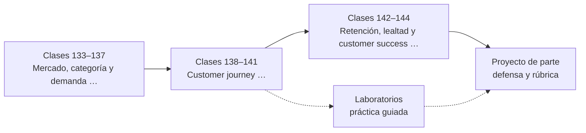

# Parte 11 — Marketing, cliente y crecimiento

<!-- parte:inicio -->

> ← [Parte 10 — Ventas, desarrollo comercial y negociación](../10-sales-commercial-negotiation/README.md) · [Temario](../../SYLLABUS.md) · [Parte 12 — Producto e innovación](../12-product-innovation/README.md) →

*Elegir a quién servir y hacer que la oferta se reconozca y se confíe*

**Etapa:** 3 — Gestión de negocio  
**Duración:** 12 clases · 30 horas  
**Resultado de salida:** Elegir segmentos, posicionar una oferta y diseñar canales de adquisición y retención medibles.

🟣 [Ver las 6 etapas](../../SYLLABUS.md) · 12 clases (133–144) · 4 laboratorios · [proyecto de parte](project.md)

## 🎯 De qué trata esta parte

El marketing responde cuatro preguntas: quién es el cliente, qué problema resuelve la oferta, por qué canal llega y por qué debería creer. Esta parte trabaja las cuatro con evidencia y no con eslóganes.

El eje es **evidencia de demanda antes de gasto**. Marca y confianza se tratan como señales verificables, no como imagen. Es una introducción para quien dirige; el detalle disciplinar vive en el programa de marketing, al que se remite.

## 🧱 Con qué hay que llegar

| Parte | Qué aporta |
|---|---|
| [10 — Ventas, desarrollo comercial y negociación](../10-sales-commercial-negotiation/README.md) | Cliente ideal, valor y economía comercial. |
| [09 — Finanzas y contabilidad para gerentes](../09-managerial-finance-accounting/README.md) | Unit economics. |

Cada clase supone la anterior: el orden importa, y saltarse una deja sin base a las que vienen después.

## 📚 Resultados de la parte

Al terminar esta parte podrás:

1. **Dimensionar** mercado y demanda con evidencia.
2. **Segmentar** y posicionar una oferta.
3. **Sostener** la marca con señales de confianza verificables.
4. **Mapear** el recorrido del cliente, los canales y el funnel.
5. **Diseñar** retención y experimentos de crecimiento.

## 🗺️ Mapa de la parte

## 🧭 Cómo se encadenan las 12 clases

Las clases **133 a 137** definen a quién y con qué promesa: mercado, investigación, segmentación, posicionamiento y confianza.

Las clases **138 a 141** definen cómo llega: recorrido del cliente, canales, adquisición y conversión.

Las clases **142 a 144** definen cómo se mantiene y crece: retención, loops de crecimiento y el capstone de go-to-market.

## 📘 Las 12 clases

| # | Clase | Qué se trabaja | Entregable | Min |
|---:|---|---|---|---:|
| 133 | [Mercado, categoría y demanda](classes/133-mercado-categoria-y-demanda/README.md) | market, category, demand | [leadership-decision-brief](../../templates/leadership-decision-brief.md) | 150 |
| 134 | [Investigación de mercado](classes/134-investigacion-de-mercado/README.md) | secondary research, qualitative research, quantitative research | [leadership-decision-brief](../../templates/leadership-decision-brief.md) | 150 |
| 135 | [Segmentación y cliente ideal](classes/135-segmentacion-y-cliente-ideal/README.md) | segmentation, needs-based segment, behavioral segment | [commercial-decision-brief](../../templates/commercial-decision-brief.md) | 150 |
| 136 | [Posicionamiento](classes/136-posicionamiento/README.md) | competitive alternative, unique attribute, value | [leadership-decision-brief](../../templates/leadership-decision-brief.md) | 150 |
| 137 | [Marca y señales de confianza](classes/137-marca-y-senales-de-confianza/README.md) | brand, distinctive asset, trust signal | [commercial-decision-brief](../../templates/commercial-decision-brief.md) | 150 |
| 138 | [Customer journey](classes/138-customer-journey/README.md) | journey, touchpoint, moment of truth | [leadership-decision-brief](../../templates/leadership-decision-brief.md) | 150 |
| 139 | [Canales y distribución](classes/139-canales-y-distribucion/README.md) | channel, direct channel, partner channel | [commercial-decision-brief](../../templates/commercial-decision-brief.md) | 150 |
| 140 | [Adquisición digital y contenido](classes/140-adquisicion-digital-y-contenido/README.md) | intent, organic acquisition, paid acquisition | [leadership-decision-brief](../../templates/leadership-decision-brief.md) | 150 |
| 141 | [Funnel y conversión](classes/141-funnel-y-conversion/README.md) | funnel, conversion rate, drop-off | [commercial-decision-brief](../../templates/commercial-decision-brief.md) | 150 |
| 142 | [Retención, lealtad y customer success](classes/142-retencion-lealtad-y-customer-success/README.md) | retention, churn, NRR | [commercial-decision-brief](../../templates/commercial-decision-brief.md) | 150 |
| 143 | [Growth loops y experimentación](classes/143-growth-loops-y-experimentacion/README.md) | growth loop, viral loop, content loop | [leadership-decision-brief](../../templates/leadership-decision-brief.md) | 150 |
| 144 | [Capstone: go-to-market](classes/144-capstone-go-to-market/README.md) | GTM, beachhead, message-market fit | [leadership-decision-brief](../../templates/leadership-decision-brief.md) | 150 |

## ⚠️ Riesgos característicos

- Segmentar por conveniencia interna y no por comportamiento.
- Confundir marca con logotipo.
- Comprar tráfico antes de entender la conversión.
- Medir adquisición e ignorar la retención.

## 🔤 Glosario de la parte

60 conceptos definidos en las clases, con la definición operacional que usa cada una.

| Concepto | Definición operacional |
|---|---|
| **attribution** | regla para asignar crédito de una conversión a interacciones. |
| **beachhead** | segmento inicial elegido para concentrar aprendizaje y distribución. |
| **behavioral segment** | grupo definido por comportamiento observable. |
| **bias** | distorsión sistemática introducida por pregunta, muestra o análisis. |
| **bottleneck** | etapa cuya mejora tiene mayor efecto sobre outcome. |
| **brand** | conjunto de asociaciones y expectativas ligadas a una oferta u organización. |
| **brand promise** | expectativa explícita o implícita que la experiencia debe sostener. |
| **category** | marco mental usado para agrupar soluciones comparables. |
| **category creation** | esfuerzo por instalar un nuevo marco competitivo. |
| **channel** | medio por el que se alcanza, vende o entrega a un cliente. |
| **channel conflict** | tensión entre rutas que compiten por cliente o margen. |
| **churn** | pérdida de clientes o revenue. |
| **cohort** | grupo comparable por fecha o característica. |
| **competitive alternative** | qué usaría el cliente si tu solución no existiera. |
| **content asset** | pieza diseñada para informar, atraer o convertir. |
| **content loop** | contenido generado o financiado por uso que atrae nueva demanda. |
| **conversion rate** | porcentaje que avanza entre etapas. |
| **customer success** | función/práctica que ayuda al cliente a alcanzar outcomes. |
| **demand** | cantidad de compra posible a distintos precios y condiciones. |
| **direct channel** | relación comercial controlada directamente. |
| **distinctive asset** | señal reconocible que facilita memoria sin depender del nombre. |
| **distribution advantage** | capacidad difícil de replicar para llegar al mercado. |
| **drop-off** | pérdida entre dos etapas. |
| **experiment** | prueba con hipótesis, métrica y comparación. |
| **friction** | esfuerzo, demora o incertidumbre que dificulta progreso. |
| **funnel** | secuencia de etapas medibles hacia una acción. |
| **growth loop** | ciclo donde una acción de usuarios produce recursos que alimentan nuevo crecimiento. |
| **GTM** | plan integrado para alcanzar, vender y entregar valor a un mercado objetivo. |
| **GTM economics** | economía conjunta de adquisición, margen, ciclo y retención. |
| **handoff** | transferencia interna que puede hacerse visible como ruptura externa. |
| **ideal customer** | cliente cuyo fit y economía son especialmente atractivos. |
| **incrementality** | crecimiento causado por intervención más allá de lo que habría ocurrido. |
| **intent** | señal de que una persona está explorando o acercándose a compra. |
| **journey** | secuencia de interacciones y tareas desde perspectiva del cliente. |
| **market** | conjunto de compradores, problemas y alternativas con intercambio potencial. |
| **market frame** | categoría o contexto que hace comprensible la comparación. |
| **message-market fit** | grado en que la narrativa conecta con problema y lenguaje del segmento. |
| **moment of truth** | interacción con efecto desproporcionado en confianza o decisión. |
| **needs-based segment** | grupo definido por problema o criterio de elección. |
| **NRR** | retención de revenue incluyendo expansión y contracción. |
| **organic acquisition** | demanda obtenida sin pago directo por cada click o impresión. |
| **paid acquisition** | demanda comprada mediante medios pagados. |
| **partner channel** | intermediario que aporta alcance o capacidad. |
| **qualitative research** | entrevistas u observación para explorar significados y mecanismos. |
| **quantitative research** | medición estructurada para estimar prevalencia o relaciones. |
| **retention** | proporción de clientes o revenue que permanece. |
| **sales motion** | forma de vender, desde self-service a enterprise. |
| **salience** | probabilidad de que una marca venga a mente en una situación de compra. |
| **sample** | muestra seleccionada de una población. |
| **secondary research** | datos ya existentes de fuentes públicas o privadas. |
| **segmentation** | división de mercado en grupos accionables con respuesta distinta. |
| **serviceability** | capacidad real de alcanzar y servir un segmento. |
| **substitute** | alternativa que resuelve el mismo job de modo diferente. |
| **target segment** | grupo para el que ese valor es especialmente importante. |
| **time-to-value** | tiempo hasta obtener primer valor significativo. |
| **touchpoint** | punto de interacción con organización o ecosistema. |
| **trust signal** | evidencia que reduce riesgo percibido. |
| **unique attribute** | capacidad difícil de encontrar en alternativas. |
| **value** | beneficio que el atributo habilita para el cliente. |
| **viral loop** | crecimiento impulsado por exposición o invitación entre usuarios. |

## 📦 Qué queda como evidencia

- Un análisis de mercado con fuentes.
- Una declaración de posicionamiento sustentada.
- Un funnel con tasas y supuestos.
- El capstone: plan de go-to-market.

## 🔗 Cómo se conecta

Enlaza con producto (parte 12) y con la validación del fundador (parte 20). La reparación de confianza se trabaja con la clase 286.

## 🧪 Cómo se trabaja

Son **12 clases de 150 minutos** —30 horas— con **4 laboratorios** y un proyecto integrador. Cada clase trae su propósito, sus conceptos, un caso, práctica, errores frecuentes, preguntas de comprobación, entregable y fuentes, y se evalúa con su `assessment.md`. Los laboratorios se resuelven con datos propios o sintéticos, nunca con datos reales de terceros, y la parte se cierra con el proyecto y su defensa. Las reglas de recorrido están en [la guía de navegación](../../docs/NAVIGATION.md).

<!-- parte:fin -->

## Laboratorios

- [Lab 01 — Market map](labs/lab-01.md)
- [Lab 02 — Positioning canvas](labs/lab-02.md)
- [Lab 03 — Funnel audit](labs/lab-03.md)
- [Lab 04 — GTM sprint](labs/lab-04.md)

## Proyecto de parte

Diseñar el go-to-market de una oferta nueva y defender CAC, canal, mensaje y métricas.

## Bibliografía rectora

- Philip Kotler & Kevin Lane Keller — *Marketing Management* (Marketing)
- Byron Sharp — *How Brands Grow* (Marketing)
- April Dunford — *Obviously Awesome* (Posicionamiento)
- Geoffrey A. Moore — *Crossing the Chasm* (Go-to-market)
- Sean Ellis & Morgan Brown — *Hacking Growth* (Growth)

## Criterio de aprobación

80/100 y entrega del proyecto integrador.
