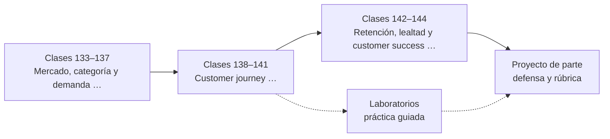

# Parte 11 — Marketing, cliente y crecimiento

<!-- parte:inicio -->

> ← [Parte 10 — Ventas, desarrollo comercial y negociación](../10-sales-commercial-negotiation/README.md) · [Temario](../../SYLLABUS.md) · [Parte 12 — Producto e innovación](../12-product-innovation/README.md) →

*Elegir a quién servir y hacer que la oferta se reconozca y se confíe*

**Etapa:** 3 — Gestión de negocio  
**Duración:** 12 clases · 30 horas  
**Resultado de salida:** Elegir segmentos, posicionar una oferta y diseñar canales de adquisición y retención medibles.

🟣 [Ver las 6 etapas](../../SYLLABUS.md) · 12 clases (133–144) · 4 laboratorios · [proyecto de parte](project.md)

## 🎯 De qué trata esta parte

El marketing responde cuatro preguntas: quién es el cliente, qué problema resuelve la oferta, por qué canal llega y por qué debería creer. Esta parte trabaja las cuatro con evidencia y no con eslóganes.

El eje es **evidencia de demanda antes de gasto**. Marca y confianza se tratan como señales verificables, no como imagen. Es una introducción para quien dirige; el detalle disciplinar vive en el programa de marketing, al que se remite.

## 🧱 Con qué hay que llegar

| Parte | Qué aporta |
|---|---|
| [10 — Ventas, desarrollo comercial y negociación](../10-sales-commercial-negotiation/README.md) | Cliente ideal, valor y economía comercial. |
| [09 — Finanzas y contabilidad para gerentes](../09-managerial-finance-accounting/README.md) | Unit economics. |

Cada clase supone la anterior: el orden importa, y saltarse una deja sin base a las que vienen después.

## 📚 Resultados de la parte

Al terminar esta parte podrás:

1. **Dimensionar** mercado y demanda con evidencia.
2. **Segmentar** y posicionar una oferta.
3. **Sostener** la marca con señales de confianza verificables.
4. **Mapear** el recorrido del cliente, los canales y el funnel.
5. **Diseñar** retención y experimentos de crecimiento.

## 🗺️ Mapa de la parte

## 🧭 Cómo se encadenan las 12 clases

Las clases **133 a 137** definen a quién y con qué promesa: mercado, investigación, segmentación, posicionamiento y confianza.

Las clases **138 a 141** definen cómo llega: recorrido del cliente, canales, adquisición y conversión.

Las clases **142 a 144** definen cómo se mantiene y crece: retención, loops de crecimiento y el capstone de go-to-market.

## 📘 Las 12 clases

| # | Clase | Qué se trabaja | Entregable | Min |
|---:|---|---|---|---:|
| 133 | [Mercado, categoría y demanda](classes/133-mercado-categoria-y-demanda/README.md) | Mercado, Categoría, Mercado total | [leadership-decision-brief](../../templates/leadership-decision-brief.md) | 150 |
| 134 | [Investigación de mercado](classes/134-investigacion-de-mercado/README.md) | Decisión pendiente, Hipótesis, Datos secundarios | [leadership-decision-brief](../../templates/leadership-decision-brief.md) | 150 |
| 135 | [Segmentación y cliente ideal](classes/135-segmentacion-y-cliente-ideal/README.md) | Segmentación, Mercado objetivo, Criterio de segmentación | [commercial-decision-brief](../../templates/commercial-decision-brief.md) | 150 |
| 136 | [Posicionamiento](classes/136-posicionamiento/README.md) | Posicionamiento, Alternativas competitivas, Atributos únicos | [leadership-decision-brief](../../templates/leadership-decision-brief.md) | 150 |
| 137 | [Marca y señales de confianza](classes/137-marca-y-senales-de-confianza/README.md) | Confianza, Capacidad, Benevolencia | [trust-repair-plan](../../templates/trust-repair-plan.md) | 150 |
| 138 | [Customer journey](classes/138-customer-journey/README.md) | Recorrido del cliente (customer journey), Punto de contacto, Experiencia del cliente | [leadership-decision-brief](../../templates/leadership-decision-brief.md) | 150 |
| 139 | [Canales y distribución](classes/139-canales-y-distribucion/README.md) | Canal de distribución, Canal directo, Canal indirecto | [commercial-decision-brief](../../templates/commercial-decision-brief.md) | 150 |
| 140 | [Adquisición digital y contenido](classes/140-adquisicion-digital-y-contenido/README.md) | Medios pagados, Medios propios, Medios ganados | [leadership-decision-brief](../../templates/leadership-decision-brief.md) | 150 |
| 141 | [Funnel y conversión](classes/141-funnel-y-conversion/README.md) | Embudo (funnel), Tasa de conversión, Activación | [commercial-decision-brief](../../templates/commercial-decision-brief.md) | 150 |
| 142 | [Retención, lealtad y customer success](classes/142-retencion-lealtad-y-customer-success/README.md) | Retención de clientes, Retención neta de ingresos, Lealtad | [commercial-decision-brief](../../templates/commercial-decision-brief.md) | 150 |
| 143 | [Growth loops y experimentación](classes/143-growth-loops-y-experimentacion/README.md) | Ciclo de crecimiento (growth loop), Ciclo viral, Ciclo de contenido | [leadership-decision-brief](../../templates/leadership-decision-brief.md) | 150 |
| 144 | [Capstone: go-to-market](classes/144-capstone-go-to-market/README.md) | Plan de salida al mercado (GTM), Hipótesis de lanzamiento, Economía unitaria | [gtm-plan](../../templates/gtm-plan.md) | 150 |

## ⚠️ Riesgos característicos

- Segmentar por conveniencia interna y no por comportamiento.
- Confundir marca con logotipo.
- Comprar tráfico antes de entender la conversión.
- Medir adquisición e ignorar la retención.

## 🔤 Glosario de la parte

71 conceptos definidos en las clases, con la definición operacional que usa cada una.

| Concepto | Definición operacional |
|---|---|
| **Activación** | Momento en que el usuario obtiene el primer valor real. |
| **Alternativas competitivas** | Lo que el cliente haría si el producto no existiera. |
| **Atribución** | Asignación del mérito de una venta a los canales que influyeron. |
| **Atributos únicos** | Capacidades que la oferta tiene y las alternativas no. |
| **Benevolencia** | Medida en que se cree que la otra parte quiere hacer el bien al que confía, aparte de un motivo de beneficio propio (Mayer et al., 1995). |
| **Canal de distribución** | Conjunto de organizaciones que hacen disponible el producto al cliente. |
| **Canal directo** | La empresa vende y entrega al cliente final. |
| **Canal indirecto** | Se usan intermediarios: distribuidores, minoristas, plataformas, revendedores. |
| **Capacidad** | Habilidades, competencias y características que permiten a una parte tener influencia en un dominio específico (Mayer et al., 1995). |
| **Categoría** | Marco con que los compradores agrupan y comparan las ofertas. |
| **Cautividad** | Permanencia por costos de salida o falta de alternativas. |
| **Ciclo de contenido** | El uso o la contribución de usuarios genera contenido que atrae a otros. |
| **Ciclo de crecimiento (growth loop)** | Secuencia en que la salida de un paso alimenta la entrada del siguiente, generando más usuarios. |
| **Ciclo de pago** | Los ingresos de los clientes se reinvierten en adquirir más clientes. |
| **Ciclo viral** | Los usuarios invitan o exponen el producto a otros. |
| **Cliente ideal** | Descripción del cliente para quien la propuesta es más valiosa y rentable. |
| **Cliente que más valora** | Segmento al que esos atributos le importan más. |
| **Coeficiente de ciclo** | Número promedio de usuarios nuevos que genera cada usuario en una vuelta. |
| **Confianza** | Estado psicológico que incluye la intención de aceptar vulnerabilidad basada en expectativas positivas sobre la conducta de otro (Rousseau et al., 1998); en Mayer et al. (1995), disposición a ser vulnerable ante las acciones de otro sin poder vigilarlo ni controlarlo. |
| **Conflicto de canal** | Competencia o tensión entre canales de una misma empresa. |
| **Contenido útil** | Material que responde preguntas reales del cliente. |
| **Costo de adquisición (CAC)** | Gasto total de captar un cliente nuevo. |
| **Costo de cambio** | Esfuerzo, dinero o riesgo de pasar a otra alternativa. |
| **Criterio de detención** | Resultado que lleva a pausar o cerrar el lanzamiento. |
| **Criterio de segmentación** | Variable usada para formar los grupos. |
| **Customer success** | Función que ayuda a los clientes a lograr sus resultados con el producto. |
| **Datos primarios** | Información recogida para el estudio. |
| **Datos secundarios** | Información que ya existe (estudios, estadísticas, datos internos). |
| **Decisión pendiente** | Elección concreta que la investigación debe informar. |
| **Dependencia de plataforma** | Concentración de ventas o tráfico en un tercero que fija las reglas. |
| **Economía unitaria** | Valor y costo de ganar y servir a un cliente. |
| **Embudo (funnel)** | Secuencia de etapas entre el primer contacto y un resultado de valor. |
| **Experiencia del cliente** | Respuesta cognitiva, emocional y conductual a lo largo del recorrido. |
| **Experimento de crecimiento** | Prueba controlada de una hipótesis sobre una etapa del ciclo. |
| **Fricción** | Obstáculo que hace más difícil o costosa una acción del cliente. |
| **Fuerzas competitivas** | Rivalidad, entrantes, sustitutos, poder de compradores y de proveedores. |
| **Hipótesis** | Afirmación comprobable sobre clientes o mercado. |
| **Hipótesis de lanzamiento** | Supuesto sobre clientes, valor, precio o canales que se debe probar. |
| **Hito de decisión** | Punto en que se decide escalar, ajustar o detener. |
| **Integridad** | Percepción de que la otra parte se rige por principios que el que confía considera aceptables (Mayer et al., 1995). |
| **Lealtad** | Disposición a seguir y a recomendar por el valor recibido. |
| **Mapa de recorrido** | Representación de etapas, acciones, emociones, puntos de contacto y oportunidades. |
| **Margen de canal** | Parte del precio que se queda el intermediario. |
| **Medios ganados** | Menciones y recomendaciones de terceros. |
| **Medios pagados** | Espacios comprados para llegar al público. |
| **Medios propios** | Canales que la empresa controla. |
| **Mercado** | Conjunto de clientes actuales y potenciales con una necesidad que pueden y quieren satisfacer. |
| **Mercado alcanzable** | Parte atendible con el modelo, los canales y la geografía elegidos. |
| **Mercado objetivo** | Segmento o segmentos elegidos para atender. |
| **Mercado obtenible** | Parte que se puede capturar en un plazo razonable. |
| **Mercado total** | Demanda posible de la categoría completa. |
| **Momento crítico (momento de la verdad)** | Instante en que la experiencia puede ganar o perder al cliente. |
| **Muestra representativa** | Grupo que refleja a la población que interesa. |
| **Mínimo producto vendible** | Oferta más simple que un segmento pagaría. |
| **Plan de salida al mercado (GTM)** | Conjunto de decisiones y acciones para llevar una oferta a un segmento y crecer con ella. |
| **Posicionamiento** | Contexto que ayuda al comprador a entender qué es la oferta y por qué importa. |
| **Propensión a confiar** | Rasgo de quien confía: su tendencia general a hacerlo. |
| **Prueba A/B** | Experimento que compara dos versiones con asignación aleatoria. |
| **Punto de contacto** | Cualquier interacción entre cliente y empresa. |
| **Recorrido del cliente (customer journey)** | Secuencia de interacciones del cliente con la empresa desde que identifica una necesidad hasta la relación posterior. |
| **Retención de clientes** | Proporción de clientes que permanece en un período. |
| **Retención neta de ingresos** | Ingresos del grupo actual frente a los de hace un año, con aumentos y bajas. |
| **Segmentación** | División del mercado en grupos con necesidades o comportamientos similares. |
| **Segmento inicial** | Nicho donde se concentra el esfuerzo antes de ampliar. |
| **Sesgo** | Error sistemático que distorsiona los resultados. |
| **Señal de confianza** | Evidencia observable de que la promesa se cumple. Criterio de la clase: es creíble si es verificable por un tercero, costosa de fingir y sostenida en el tiempo. |
| **Tasa de conversión** | Proporción de personas que pasan de una etapa a la siguiente. |
| **Trabajo a realizar** | Progreso que el cliente busca lograr en una circunstancia. |
| **Valor** | Resultado que los atributos entregan al cliente. |
| **Valor por etapa** | Valor económico esperado de una persona que llega a cada etapa. |
| **Violación de confianza** | Hecho que contradice la expectativa. Puede ser de **competencia** (se equivocó) o de **integridad** (se duda de su honestidad) (Kim et al., 2004). |

## 📦 Qué queda como evidencia

- Un análisis de mercado con fuentes.
- Una declaración de posicionamiento sustentada.
- Un funnel con tasas y supuestos.
- El capstone: plan de go-to-market.

## 🔗 Cómo se conecta

Enlaza con producto (parte 12) y con la validación del fundador (parte 20). La reparación de confianza se trabaja con la clase 286.

## 🧪 Cómo se trabaja

Son **12 clases de 150 minutos** —30 horas— con **4 laboratorios** y un proyecto integrador. Cada clase trae su propósito, sus conceptos, un caso, práctica, errores frecuentes, preguntas de comprobación, entregable y fuentes, y se evalúa con su `assessment.md`. Los laboratorios se resuelven con datos propios o sintéticos, nunca con datos reales de terceros, y la parte se cierra con el proyecto y su defensa. Las reglas de recorrido están en [la guía de navegación](../../docs/NAVIGATION.md).

<!-- parte:fin -->

## Laboratorios

- [Lab 01 — Market map](labs/lab-01.md)
- [Lab 02 — Positioning canvas](labs/lab-02.md)
- [Lab 03 — Funnel audit](labs/lab-03.md)
- [Lab 04 — GTM sprint](labs/lab-04.md)

## Proyecto de parte

Diseñar el go-to-market de una oferta nueva y defender CAC, canal, mensaje y métricas.

## Bibliografía rectora

- Philip Kotler & Kevin Lane Keller — *Marketing Management* (Marketing)
- Byron Sharp — *How Brands Grow* (Marketing)
- April Dunford — *Obviously Awesome* (Posicionamiento)
- Geoffrey A. Moore — *Crossing the Chasm* (Go-to-market)
- Sean Ellis & Morgan Brown — *Hacking Growth* (Growth)

## Criterio de aprobación

80/100 y entrega del proyecto integrador.
