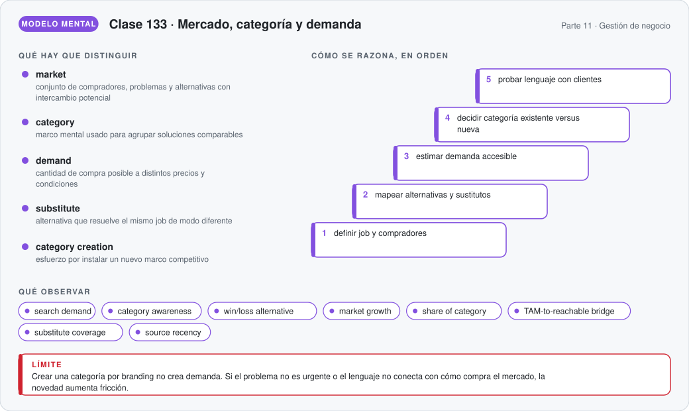

# Clase 133 — Mercado, categoría y demanda

<!-- nav:inicio -->
> **Parte 11 · Marketing, cliente y crecimiento** — clase 1 de 12 · [índice de la parte](../../README.md) · [temario](../../../../SYLLABUS.md)
<!-- nav:fin -->

**Parte:** 11 — Marketing, cliente y crecimiento  
**Nivel:** Etapa 3 — Manager → Gerente  
**Duración sugerida:** 150–180 minutos · **Estándar:** deep-class-v2

## 🎯 Propósito

Antes de elegir a quién vender, con qué mensaje o por qué canal, una empresa debe responder una pregunta más básica: ¿en qué mercado compite y cuánta demanda hay realmente? Muchas definen su mercado por lo que producen («vendemos software de gestión») en lugar de por el problema que el cliente resuelve; otras estiman su potencial con una frase optimista («si capturamos el 1 % de un mercado de USD 10.000 millones…») que no demuestra nada; y otras entran a una categoría saturada sin preguntarse qué fuerzas determinan su rentabilidad. Definir el mercado, su categoría y su demanda es la base de todas las decisiones de marketing.

La clase se apoya en el enfoque de dirección de marketing de Kotler y Keller, en el análisis de fuerzas competitivas de Porter y en la propuesta de Kim y Mauborgne sobre crear espacios de mercado sin competencia directa. Al terminar sabrás definir un mercado desde el cliente, estimar su tamaño desde abajo, distinguir tipos de demanda, evaluar la atractividad de una categoría y decidir cuándo competir en una categoría existente y cuándo intentar redefinirla.

## 📚 Resultados de aprendizaje

Al finalizar podrás:

1. **Definir** un mercado desde el problema del cliente y no desde el producto.
2. **Estimar** mercado total, alcanzable y obtenible con método ascendente.
3. **Diagnosticar** el estado de la demanda y sus determinantes.
4. **Evaluar** la atractividad de una categoría con las fuerzas competitivas.
5. **Decidir** entre competir en una categoría existente o redefinirla.

## 🧭 Agenda

| Tramo | Qué se hace |
|---|---|
| 0–20 min | Recuperación: define en una frase el mercado de tu empresa desde el problema del cliente y compara con cómo lo define tu sitio web. |
| 20–60 min | Definición, tamaño, demanda y fuerzas competitivas. |
| 60–105 min | Ejemplo trabajado: estimar el mercado de un software para clínicas. |
| 105–150 min | Caso ejecutivo y práctica. |
| 150–175 min | Límites y entregable. |

## 🧩 Conceptos centrales

| Concepto | Definición | Cómo se reconoce |
|---|---|---|
| **Mercado** | Conjunto de clientes actuales y potenciales con una necesidad que pueden y quieren satisfacer. | Se define por el problema, no por el producto. |
| **Categoría** | Marco con que los compradores agrupan y comparan las ofertas. | «CRM», «seguros de salud», «bicicletas eléctricas». |
| **Mercado total** | Demanda posible de la categoría completa. | Techo teórico. |
| **Mercado alcanzable** | Parte atendible con el modelo, los canales y la geografía elegidos. | Segmentos concretos. |
| **Mercado obtenible** | Parte que se puede capturar en un plazo razonable. | Depende de capacidad y competencia. |
| **Fuerzas competitivas** | Rivalidad, entrantes, sustitutos, poder de compradores y de proveedores. | Determinan la rentabilidad de la categoría. |

## 🧠 Modelo mental

**Cómo leer el diagrama.** Tres columnas encadenadas. El **mercado total** es el techo teórico de la categoría; sirve para ver el tamaño de la oportunidad, no para planificar. El **mercado alcanzable** es la parte que el modelo, los canales y los segmentos elegidos permiten atender; sirve para decidir dónde jugar. El **mercado obtenible** es lo que realista y razonablemente se puede capturar en un plazo; sirve para metas y presupuestos. La nota advierte que una estimación creíble parte de abajo, con clientes concretos.

## 📖 Desarrollo

### 1. Definir el mercado desde el cliente

Kotler y Keller proponen definir el negocio por la **necesidad que satisface**, no por el producto que se vende: un fabricante de taladros vende agujeros, y su mercado incluye a quienes necesitan hacer agujeros, con herramientas, servicios o alternativas. Una definición demasiado estrecha («taladros eléctricos») oculta sustitutos y oportunidades; una demasiado amplia («bricolaje») impide enfocar. Se prueba con una pregunta: ¿qué haría el cliente si nuestro producto no existiera? Esa respuesta identifica a los verdaderos competidores, que no siempre son otras empresas del rubro: pueden ser planillas, servicios internos o no hacer nada.

### 2. Categoría: el marco de comparación

La categoría es el marco con que el comprador entiende lo que se le ofrece y con qué lo compara. Está asociada a expectativas de precio, de atributos y de proveedores. Entrar a una categoría establecida da **claridad inmediata** (el comprador sabe qué es), pero implica competir contra marcas fuertes con sus criterios. Crear o redefinir una categoría puede evitar esa competencia, pero exige **educar al mercado**, con un costo y un riesgo altos: muchos intentos de categoría nueva fracasan por falta de demanda o de comprensión (clase 136). La decisión depende de la fuerza de las alternativas y de la diferencia real que se ofrece.

### 3. Estimar el tamaño del mercado

Se estima de dos maneras. **Descendente**: se parte de datos de industria (ventas totales de la categoría) y se aplican porcentajes; es rápida pero depende de definiciones ajenas y suele inflarse. **Ascendente**: se cuentan **clientes concretos** (número de empresas o personas que cumplen un perfil), se multiplica por **precio** o ingreso anual y por **frecuencia** o uso. La ascendente es más trabajosa y más defendible, porque cada supuesto se puede contrastar con datos propios. Se contrastan ambas; si difieren mucho, hay un error de definición o de supuestos. Lo que se presenta a un comité o inversionista es la ascendente, con rangos.

### 4. Total, alcanzable y obtenible

El **mercado total** muestra el potencial de la categoría. El **alcanzable** aplica los filtros de la estrategia: segmentos elegidos (clase 135), geografía, canales, idioma, regulación, ciclo de venta. El **obtenible** aplica la capacidad y la competencia: cuántos clientes se pueden adquirir con el equipo, el presupuesto y la velocidad de adopción esperada, y qué participación es razonable. Un error frecuente es presentar el total como si fuera la meta, o suponer una participación sin explicar cómo se logra. Una forma sana de verificarlo: ¿cuántos clientes por semana habría que ganar para alcanzar la cifra y es compatible con la capacidad comercial (clase 121)?

### 5. La demanda y sus estados

Kotler y Keller describen distintos **estados de demanda** con implicancias de marketing: **demanda inexistente** (los clientes no la necesitan o no la conocen), **latente** (hay una necesidad que ningún producto satisface), **en declive**, **irregular** (estacional o cíclica), **plena** (se mantiene el nivel) y **excesiva** (supera la capacidad). Cada estado pide una tarea distinta: estimular, desarrollar, revitalizar, sincronizar, mantener o reducir. La demanda depende de factores como el ingreso, el precio, la disponibilidad de sustitutos, las regulaciones, la tecnología y las expectativas. Entender qué la impulsa permite anticipar cambios.

### 6. Atractividad de la categoría

Porter muestra que la rentabilidad de una categoría depende de cinco fuerzas: la **rivalidad** entre competidores, la amenaza de **nuevos entrantes**, la amenaza de **sustitutos**, el **poder de los compradores** y el **poder de los proveedores**. Una categoría puede ser grande pero poco rentable (muchos competidores, compradores poderosos, bajos costos de cambio) o pequeña y muy rentable (barreras de entrada, diferenciación). Se evalúa cada fuerza con datos y se pregunta dónde puede la empresa **posicionarse** o **cambiar la estructura**. La atractividad no es fija: la tecnología y la regulación pueden alterarla.

### 7. Espacios de mercado nuevos

Kim y Mauborgne proponen buscar **espacios sin competencia directa** («océanos azules») mediante la **innovación en valor**: ofrecer un salto de valor al comprador con un costo bajo, usando un marco de cuatro acciones —**eliminar** factores que la industria da por sentados, **reducir** otros, **elevar** algunos y **crear** factores nuevos—. Es una herramienta para pensar diferente la oferta, no una garantía. Los casos que presentan son seleccionados y su carácter de éxito puede cambiar con el tiempo. Antes de apostar por un espacio nuevo se valida con compradores reales que el valor propuesto les importa y pagarían por él.

## 📚 Lectura comparada

| Obra | Qué aporta | Qué no resuelve | Pregunta para contrastar |
|---|---|---|---|
| Kotler y Keller | Definición de mercado, estados de demanda y proceso de marketing. | Es amplio y general. | ¿Qué necesidad satisfaces? |
| Porter (*Competitive Strategy*) | Fuerzas competitivas y atractividad de la industria. | Supone industrias definidas. | ¿Qué fuerza limita tu margen? |
| Kim y Mauborgne | Espacios sin competencia y marco de cuatro acciones. | Casos seleccionados; poca evidencia sistemática. | ¿Qué factor podrías eliminar o crear? |
| Moore | Segmento inicial y ciclo de adopción. | Contexto de tecnología. | ¿Qué segmento adopta primero? |
| Christensen et al. | El trabajo que el cliente contrata y sus alternativas. | Marco conceptual. | ¿Contra qué compites realmente? |

## 🧮 Ejemplo trabajado

**Situación (hipotética).** Una empresa propone un software de gestión de turnos y pacientes para clínicas dentales independientes en un país. Su fundador afirma: «El mercado de software de salud es de USD 8.000 millones; con el 1 % tendríamos USD 80 millones».

**Estimación ascendente.**

| Paso | Dato | Resultado |
|---|---|---|
| Clínicas dentales independientes en el país | Registro del colegio profesional y cámara del sector | 4.800 |
| Con 3 o más sillones (el perfil que valora el software) | 40 % | 1.920 |
| Con acceso a internet y apertura a digitalizar | 70 % | 1.344 |
| Precio anual promedio | USD 1.800 | **Mercado alcanzable ≈ USD 2,4 millones** |
| Participación obtenible en 3 años | 8 % de las clínicas (≈ 108) con un equipo comercial de 3 personas | **Mercado obtenible ≈ USD 194.000 al año** |

**Lectura.** El mercado alcanzable en el país es cercano a USD 2,4 millones al año, lejos de USD 80 millones. El obtenible, cerca de USD 194.000 anuales, no sostiene a una empresa con 25 personas. La oportunidad requiere ampliar el segmento (clínicas medianas y multiprofesionales), el territorio (otros países) o la oferta (servicios adicionales como pagos y seguros).

**Fuerzas competitivas.** Rivalidad moderada (cuatro proveedores locales); sustitutos fuertes (planillas, agendas de papel); poder de compradores alto (cambian fácilmente); barreras de entrada bajas; proveedores (plataformas de nube) con poco poder.

**Alternativa de espacio nuevo.** Con el marco de cuatro acciones: eliminar funciones contables complejas; reducir la configuración inicial; elevar la automatización de recordatorios a pacientes; crear un servicio de cobranza a aseguradoras. Se valida con 20 entrevistas antes de decidir.

**Decisión.** Replantear el plan: segmento inicial de clínicas de 3 a 8 sillones, ampliación a un segundo país en el año 2 y el servicio de cobranza como fuente de ingresos adicional. El mercado obtenible se vuelve a calcular con tres escenarios.

**Qué muestra.** (1) La estimación ascendente desmontó una cifra inflada. (2) Las fuerzas competitivas explicaron la presión de precio. (3) El resultado cambió el plan.

## 🔀 Comparación y límites

**Mercado frente a oportunidad.** Un mercado grande no es una oportunidad si la empresa no puede alcanzarlo o no tiene ventaja. Una oportunidad pequeña pero accesible y rentable puede ser mejor punto de partida.

**Límites.** Las estimaciones de mercado son inciertas y sensibles a la definición; los datos de industria usan categorías distintas. Los estados de demanda de Kotler y Keller son un marco descriptivo. El análisis de fuerzas competitivas es estático y no recoge bien las industrias de plataformas o las que cambian rápido. Los casos de espacios nuevos son difíciles de replicar. Las proyecciones se contrastan con datos propios y se revisan, y los datos personales de clientes en estudios de mercado se tratan según la normativa de protección de datos.

## 🪜 De profesional a owner

| Nivel | Cómo trabaja el mercado y la demanda |
|---|---|
| **Profesional** | Aporta datos de clientes y de competidores con fuente. |
| **Jefe / Team Lead** | Estima el mercado de su línea con método ascendente. |
| **Gerente** | Define el mercado, la categoría y las metas de participación. |
| **CEO / Director** | Decide en qué mercados competir y cuáles abandonar. |
| **Founder / Owner** | Valida que el mercado alcanzable sostenga la empresa antes de invertir. |

## 🏢 Caso ejecutivo

Una empresa chilena de bicicletas eléctricas urbanas vende 4.000 unidades al año y quiere triplicar su facturación en tres años. Su informe de planificación afirma que «el mercado de movilidad urbana en América Latina es de USD 50.000 millones» y que con el 0,5 % bastaría. El gerente comercial sostiene que el crecimiento vendrá de ciudades intermedias; el de producto, de modelos de carga para reparto; el de finanzas, de ampliar a Perú y Colombia. Hay nuevos entrantes asiáticos con precios 25 % menores, un incentivo estatal que podría terminar, restricciones de importación incipientes y demanda estacional con picos en primavera.

Entrega un **diagnóstico de mercado y demanda** que contenga: (a) la definición del mercado desde el problema del cliente y los competidores reales; (b) la estimación ascendente de mercado alcanzable y obtenible para al menos dos segmentos, con rangos; (c) el estado de la demanda y sus determinantes, incluida la dependencia del incentivo; (d) el análisis de las cinco fuerzas; (e) una alternativa de espacio nuevo con las cuatro acciones y su validación; (f) la recomendación sobre dónde jugar, y las verificaciones regulatorias, arancelarias y de incentivos que se harán con fuentes oficiales.

## 🧪 Práctica

1. Define tu mercado en una frase desde el problema del cliente y lista a tus tres competidores reales.
2. Estima el mercado alcanzable de un segmento con un cálculo ascendente y sus fuentes.
3. Evalúa las cinco fuerzas de tu categoría con un dato por fuerza.
4. Aplica las cuatro acciones a tu oferta y descarta una idea con evidencia.
5. Calcula cuántos clientes por semana exige tu meta de participación.

## ⚠️ Errores frecuentes

| Error | Por qué ocurre | Cómo corregirlo |
|---|---|---|
| Definir el mercado por el producto | Es lo que se conoce | Definirlo por el problema del cliente. |
| «Con el 1 % bastaría» | Es fácil de decir | Estimar desde abajo con clientes concretos. |
| Confundir total con alcanzable | Se quiere impresionar | Aplicar filtros de segmento y canal. |
| Ignorar sustitutos | Se mira solo a rivales del rubro | Preguntar qué haría el cliente sin el producto. |
| Suponer una categoría nueva sin demanda | Se confía en la novedad | Validar con compradores. |
| No actualizar | Se considera estático | Revisar con datos cada año. |

## ❓ Preguntas de comprobación

1. ¿Por qué se define el mercado por el problema del cliente?
2. ¿Qué diferencia hay entre mercado total, alcanzable y obtenible?
3. ¿Cómo se estima un mercado de forma ascendente?
4. ¿Qué cinco fuerzas determinan la rentabilidad de una categoría?
5. ¿Qué estados de demanda describen Kotler y Keller?
6. ¿Qué plantean las cuatro acciones de Kim y Mauborgne?
7. ¿Qué límites tienen las estimaciones de mercado?

Claves de respuesta

1. Porque identifica los verdaderos sustitutos y oportunidades; definirlo por producto oculta alternativas.
2. El total es el techo teórico; el alcanzable es la parte atendible según los segmentos y canales; el obtenible es lo capturable en un plazo con la capacidad y la competencia existentes.
3. Contando clientes concretos que cumplen el perfil, multiplicando por precio y frecuencia y aplicando filtros, con supuestos contrastables.
4. Rivalidad, nuevos entrantes, sustitutos, poder de los compradores y poder de los proveedores.
5. Inexistente, latente, en declive, irregular, plena y excesiva, entre otros.
6. Eliminar, reducir, elevar y crear factores de valor respecto de lo que la industria da por sentado.
7. Son sensibles a la definición y a los datos de terceros, y deben contrastarse con datos propios y revisarse.

## 📥 Entregable

Guarda en `portfolio/133-mercado-categoria-y-demanda/`:

- `leadership-decision-brief.md` (plantilla [Leadership Decision Brief](../../../../templates/leadership-decision-brief.md)) con el diagnóstico del caso ejecutivo;
- `venture-validation.md` (plantilla [Venture validation](../../../../templates/venture-validation.md)) con la estimación ascendente y la validación del espacio nuevo;
- `decision-journal.md` con las definiciones, los supuestos y las fuentes de los datos.

## 📗 Fuentes y verificación

- Philip Kotler & Kevin Lane Keller — *Marketing Management* (Pearson Education, 2016). **Uso en esta clase:** definición de mercado, estados de demanda y proceso de marketing. Lectura selectiva sobre **mercado, categoría y demanda**. **Localizador:** [ISBN-13 9781292092621](https://openlibrary.org/isbn/9781292092621).
- Michael E. Porter — *Competitive Strategy* (Free Press, 1980). **Uso en esta clase:** fuerzas competitivas y atractividad de la industria. Lectura selectiva sobre **mercado, categoría y demanda**. **Localizador:** [ISBN-13 9780684841489](https://openlibrary.org/isbn/9780684841489).
- W. Chan Kim & Renée Mauborgne — *Blue Ocean Strategy* (Coach Series, 2006). **Uso en esta clase:** espacios sin competencia y marco de cuatro acciones. Lectura selectiva sobre **mercado, categoría y demanda**. **Localizador:** [ISBN-13 9781596590687](https://openlibrary.org/isbn/9781596590687).
- Geoffrey A. Moore — *Crossing the Chasm* (HarperBusiness, 1995). **Uso en esta clase:** segmento inicial y ciclo de adopción. Lectura selectiva sobre **mercado, categoría y demanda**. **Localizador:** [ISBN-13 9780887307171](https://openlibrary.org/isbn/9780887307171).
- Clayton M. Christensen et al. — *Competing Against Luck* (HarperBusiness, 2016). **Uso en esta clase:** el trabajo que el cliente contrata y sus alternativas. Lectura selectiva sobre **mercado, categoría y demanda**. **Localizador:** [ISBN-13 9780062435613](https://openlibrary.org/isbn/9780062435613).

> **Regla de fuentes para Mercado, categoría y demanda:** las obras anteriores estructuran las perspectivas de esta materia; cualquier norma, ley o estándar vivo mencionado debe comprobarse nuevamente en su fuente primaria vigente, incluidas las normas arancelarias, de incentivos y de protección de datos aplicables. Los ejemplos y casos son hipotéticos, con cifras ilustrativas. El desarrollo es original y no reproduce capítulos protegidos.

<!-- pie:inicio -->
---

| Anterior | Índice | Siguiente |
|---|---|---|
| [← 132 · Capstone: negociación enterprise](../../../10-sales-commercial-negotiation/classes/132-capstone-negociacion-enterprise/README.md) | [Parte 11](../../README.md) · [Programa](../../../../SYLLABUS.md) | [134 · Investigación de mercado →](../134-investigacion-de-mercado/README.md) |
<!-- pie:fin -->
