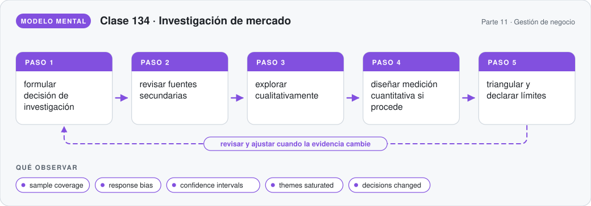

# Clase 134 — Investigación de mercado

<!-- nav:inicio -->
> **Parte 11 · Marketing, cliente y crecimiento** — clase 2 de 12 · [índice de la parte](../../README.md) · [temario](../../../../SYLLABUS.md)
<!-- nav:fin -->

**Parte:** 11 — Marketing, cliente y crecimiento  
**Nivel:** Etapa 3 — Manager → Gerente  
**Duración sugerida:** 150–180 minutos · **Estándar:** deep-class-v2

## 🎯 Propósito

Las decisiones de marketing se toman con información imperfecta, y la investigación de mercado busca mejorarla a un costo razonable. Pero la mayoría de las investigaciones fracasan por razones previas al análisis: nadie sabía qué decisión iban a informar, la pregunta estaba mal formulada, se encuestó a quienes eran fáciles de alcanzar y no a quienes importaban, o se confió en lo que la gente dice que hará en lugar de lo que hace. El resultado son informes bien presentados que no cambian ninguna decisión. Investigar bien es una disciplina de diseño: partir de la decisión, formular hipótesis, elegir el método adecuado y reconocer los límites de lo que se puede concluir.

La clase se apoya en el proceso de investigación de Kotler y Keller, en la teoría del trabajo por hacer de Christensen y colaboradores y en el rigor de los experimentos controlados de Kohavi, Tang y Xu. Al terminar sabrás diseñar una investigación desde una decisión, combinar fuentes secundarias y primarias, conducir entrevistas y encuestas con cuidado, evitar sesgos habituales y convertir hallazgos en acciones.

## 📚 Resultados de aprendizaje

Al finalizar podrás:

1. **Formular** una investigación a partir de una decisión pendiente y sus hipótesis.
2. **Elegir** entre fuentes secundarias, entrevistas, encuestas, observación y experimentos.
3. **Diseñar** una muestra y un cuestionario que reduzcan sesgos.
4. **Interpretar** resultados con sus límites y niveles de confianza.
5. **Traducir** hallazgos en decisiones y definir cuándo volver a medir.

## 🧭 Agenda

| Tramo | Qué se hace |
|---|---|
| 0–20 min | Recuperación: recuerda una investigación que encargaste y qué decisión cambió su resultado. |
| 20–60 min | Decisión, hipótesis, métodos, muestra y sesgos. |
| 60–105 min | Ejemplo trabajado: investigar el abandono de un servicio de suscripción. |
| 105–150 min | Caso ejecutivo y práctica. |
| 150–175 min | Límites y entregable. |

## 🧩 Conceptos centrales

| Concepto | Definición | Cómo se reconoce |
|---|---|---|
| **Decisión pendiente** | Elección concreta que la investigación debe informar. | Se puede decir qué cambiaría según el resultado. |
| **Hipótesis** | Afirmación comprobable sobre clientes o mercado. | Se puede refutar con datos. |
| **Datos secundarios** | Información que ya existe (estudios, estadísticas, datos internos). | Rápidos y baratos. |
| **Datos primarios** | Información recogida para el estudio. | Entrevistas, encuestas, observación, experimentos. |
| **Muestra representativa** | Grupo que refleja a la población que interesa. | Se elige con criterio explícito. |
| **Sesgo** | Error sistemático que distorsiona los resultados. | De selección, de formulación, de respuesta. |

## 🧠 Modelo mental

**Cómo leer el diagrama.** Cinco pasos que comienzan en la **decisión**, no en el método. Se formulan **hipótesis** y preguntas; se elige el **método y la fuente** adecuados; se define la **muestra** y se analiza controlando sesgos; y se termina con una **acción** y una fecha para volver a medir. La nota advierte que una investigación sin decisión asociada produce informes que nadie usa, y que lo que la gente dice y lo que hace suelen diferir.

## 📖 Desarrollo

### 1. Empezar por la decisión

Kotler y Keller describen el proceso de investigación en etapas: definir el problema y los objetivos, desarrollar el plan, recoger la información, analizarla, presentar los resultados y tomar la decisión. La primera etapa es la más importante y la menos cuidada. Una buena definición responde: **¿qué decisión se tomará con esto?**, **¿qué opciones hay?**, **¿qué resultado inclinaría la decisión hacia cada opción?** y **¿cuánto vale la información?** (si la decisión es pequeña o reversible, no justifica un estudio caro). Una investigación para «conocer mejor a nuestros clientes» es un deseo; una para «decidir si lanzamos un plan de precios por uso o por suscripción» es un encargo.

### 2. Hipótesis y preguntas

Con la decisión definida, se formulan **hipótesis** que se puedan contrastar: «los clientes que abandonan lo hacen por precio» o «lo hacen porque no logran su primer resultado en dos semanas». Cada una se traduce en **preguntas** y en el dato que la confirmaría o refutaría. Este paso evita recoger información por si acaso y protege del sesgo de confirmación: se busca activamente evidencia contraria. También se define qué se necesita saber con certeza y qué basta con una estimación gruesa.

### 3. Fuentes secundarias y primarias

Se comienza con lo que ya existe: **datos internos** (ventas, uso, tickets de soporte, abandonos), **estudios sectoriales**, **estadísticas públicas**, **reseñas y comentarios** de clientes, investigación académica. Estos datos son rápidos y baratos, aunque pueden no responder la pregunta exacta. Después, **datos primarios**: **entrevistas** en profundidad para comprender razones y contextos; **encuestas** para medir la frecuencia de algo en una población; **observación** del comportamiento real; **pruebas y experimentos** para comparar alternativas. Cada método responde preguntas distintas: las entrevistas descubren; las encuestas cuantifican; los experimentos prueban causalidad.

### 4. Entrevistas: descubrir con rigor

Christensen y colaboradores proponen entrevistar a clientes sobre **el momento en que contrataron** (o dejaron) un producto: qué ocurría, qué alternativas consideraron, qué los hizo decidir, qué temían. Se pregunta por **comportamientos pasados y concretos**, no por opiniones generales ni intenciones futuras («¿lo comprarías?»), que son poco confiables. Se escucha más de lo que se habla, se evita sugerir respuestas, se registran citas textuales y se entrevista a 10 o 20 personas de segmentos distintos hasta que dejan de aparecer patrones nuevos. Las entrevistas generan hipótesis, no estadísticas.

### 5. Encuestas y muestras

Una encuesta es útil para medir cuán extendido está algo. Su calidad depende de la **muestra** y del **cuestionario**. En la muestra: ¿se encuestó a la población que interesa (clientes actuales, perdidos, potenciales)?, ¿cómo se seleccionó (aleatoria, por cuotas, por conveniencia)?, ¿cuántos respondieron y quiénes no? En el cuestionario: preguntas **claras, neutras, de una sola idea**, con opciones completas, sin términos técnicos ni sugerencias. Los sesgos más frecuentes son: de **selección** (responden los más motivados), de **formulación** (la pregunta induce), de **deseabilidad social** (se responde lo que parece correcto) y de **orden** de las preguntas.

### 6. Experimentos y comportamiento

Cuando se puede, es mejor observar **lo que la gente hace** que lo que dice. Kohavi, Tang y Xu describen los experimentos controlados en línea (pruebas A/B): se asigna aleatoriamente a los usuarios a una versión u otra y se compara una **métrica definida de antemano**. Su valor está en establecer **causalidad**. Requieren: muestras suficientes, tiempo de ejecución adecuado, una métrica principal clara, controles de calidad y cuidado con los **falsos positivos** (conclusiones que parecen significativas y no lo son). En ámbitos sin experimentos digitales, se pueden hacer pruebas piloto o mercados de prueba con grupos de comparación.

### 7. Del hallazgo a la decisión

El informe debe comenzar con la **recomendación** y la **evidencia** que la sostiene, indicar **cuánta confianza** merece (tamaño de muestra, limitaciones, hallazgos contradictorios) y proponer **acciones** con responsable y fecha. Se distinguen **hechos** (observados), **interpretaciones** (explicaciones probables) y **hipótesis** (por probar). Se evita el error de generalizar una entrevista a una población, o una encuesta de conveniencia a un mercado. Y se planifica **cuándo volver a medir**: los mercados cambian. Con datos de personas, se cumple la normativa de protección de datos y se obtiene consentimiento informado.

## 📚 Lectura comparada

| Obra | Qué aporta | Qué no resuelve | Pregunta para contrastar |
|---|---|---|---|
| Kotler y Keller | Proceso completo de investigación de marketing. | Marco general; poca profundidad metodológica. | ¿Qué decisión informa tu estudio? |
| Christensen et al. | Entrevistas centradas en el momento de decisión y el trabajo por hacer. | Método cualitativo; no cuantifica. | ¿Qué hizo el cliente, no qué opina? |
| Kohavi, Tang y Xu | Experimentos controlados y sus trampas. | Centrado en productos digitales. | ¿Puedes probarlo con un grupo de control? |
| Osterwalder et al. (*Testing Business Ideas*) | Experimentos para validar hipótesis de negocio. | Etapa de validación inicial. | ¿Cuál es la prueba más barata de tu hipótesis? |
| Sharp | Evidencia empírica sobre cómo crecen las marcas. | No es un manual de investigación. | ¿Qué datos reales contradicen tu creencia? |

## 🧮 Ejemplo trabajado

**Situación (hipotética).** Un servicio de entrega semanal de alimentos por suscripción tiene un abandono mensual de 9 %. La gerencia debe decidir entre tres acciones: bajar precios, flexibilizar la frecuencia de entregas o mejorar el empaque. Cada una cuesta USD 150.000 en el año.

**Decisión y hipótesis.** Decisión: en qué invertir primero. Hipótesis: (H1) abandonan por precio; (H2) por falta de flexibilidad en fechas y frecuencia; (H3) por problemas de calidad o empaque.

**Datos secundarios.** Los datos internos muestran que el 62 % de las bajas ocurre en los primeros tres meses; el 28 % de los tickets de soporte son sobre cambio de fecha; los productos dañados representan el 3 % de las entregas.

**Entrevistas.** 14 entrevistas a clientes que se dieron de baja en los últimos 60 días, centradas en la última semana antes de cancelar. Hallazgos: 9 de 14 mencionan que «no estaba cuando llegó la caja» o que «se me acumuló comida»; 3 mencionan precio; 2, calidad. Las citas muestran que el problema es la rigidez de las entregas.

**Encuesta.** Se envía a 1.600 exclientes (tasa de respuesta 22 %, 352 respuestas) y 800 clientes activos. Resultado: entre quienes cancelaron, el 48 % señala «no me calzaba la frecuencia o la fecha», 21 % precio, 12 % calidad, 19 % otras razones. Limitación: la tasa de respuesta es baja y los más enojados tienden a responder más.

**Experimento.** A un grupo aleatorio de 4.000 clientes nuevos se les ofrece «saltar una semana sin costo» en el segundo mes; el grupo de control (4.000) no la tiene. Tras tres meses, el abandono es 5,6 % mensual en el grupo con la opción y 8,9 % en el control. Con las muestras, la diferencia es estadísticamente distinguible del azar.

**Decisión.** Invertir primero en flexibilidad (H2); hacer un piloto de precio para un segmento sensible en el siguiente trimestre; monitorear la calidad del empaque. Se volverá a medir en 90 días. La campaña informa a los clientes sobre el tratamiento de sus datos y el uso de la encuesta.

**Qué muestra.** (1) La decisión ordenó el diseño. (2) Entrevistas, encuesta y experimento se complementaron. (3) Se declararon las limitaciones.

## 🔀 Comparación y límites

**Investigación frente a intuición.** La intuición del equipo es una fuente de hipótesis, no de evidencia. La investigación busca contrastarla; no la reemplaza cuando la decisión es pequeña o reversible.

**Límites.** Las encuestas con muestras de conveniencia no se generalizan. Las entrevistas con pocos casos no permiten estimar frecuencias. Los experimentos requieren volumen y pueden medir efectos de corto plazo que no se sostienen. Lo que la gente dice de sus intenciones predice mal sus conductas. La investigación con datos personales o con menores exige cumplir normas de protección de datos, consentimiento y, en algunos casos, evaluación ética. Las cifras del ejemplo son ilustrativas.

## 🪜 De profesional a owner

| Nivel | Cómo participa en la investigación |
|---|---|
| **Profesional** | Recoge datos con rigor y registra citas y limitaciones. |
| **Jefe / Team Lead** | Diseña estudios acotados desde una decisión y los analiza. |
| **Gerente** | Prioriza qué se investiga y asegura que los hallazgos cambien decisiones. |
| **CEO / Director** | Exige evidencia proporcional a la decisión y protege la mirada contraria. |
| **Founder / Owner** | Conversa con clientes semanalmente y prueba antes de construir. |

## 🏢 Caso ejecutivo

Una cadena de farmacias quiere lanzar un programa de suscripción de medicamentos crónicos con entrega a domicilio. La gerencia de marketing encargó una encuesta en línea a 2.000 personas de su base de clientes: el 71 % dijo que «probablemente» o «seguramente» usaría el servicio. Con ese dato, el gerente comercial propone invertir USD 3 millones. El área de operaciones nota que la encuesta no distinguió entre pacientes crónicos y otros, que las respuestas se recogieron por correo con incentivo de cupón, que la entrega de medicamentos tiene regulación específica y que los pacientes mayores usan poco el canal digital. El área legal advierte que se trata de datos de salud.

Entrega un **diseño de investigación** que contenga: (a) la decisión y sus opciones, con el resultado que inclinaría a cada una; (b) las hipótesis y los datos secundarios disponibles; (c) el plan de entrevistas, encuesta y prueba piloto, con muestra y sesgos a controlar; (d) la crítica de la encuesta original y qué conclusiones sí admite; (e) los criterios de decisión y el plan de acción; (f) los cuidados de datos de salud, consentimiento y normativa farmacéutica que se verificarán con fuentes oficiales y asesoría.

## 🧪 Práctica

1. Redacta una decisión pendiente y tres hipótesis para una investigación de tu área.
2. Elige el método más barato que refute tu hipótesis principal y justifícalo.
3. Escribe diez preguntas de entrevista sobre comportamientos pasados.
4. Revisa un cuestionario real y marca tres preguntas que inducen respuestas.
5. Define cómo comunicarás la confianza que merece un hallazgo.

## ⚠️ Errores frecuentes

| Error | Por qué ocurre | Cómo corregirlo |
|---|---|---|
| Investigar sin decisión | Se quiere «conocer» | Partir de la decisión y la acción. |
| Preguntar intenciones | Es fácil de preguntar | Observar comportamiento y preguntar por hechos. |
| Muestra de conveniencia | Es la más fácil | Definir la población y cómo se selecciona. |
| Preguntas que inducen | No se revisa el cuestionario | Preguntas neutras y probadas. |
| Generalizar pocos casos | Se busca una conclusión | Declarar límites y volver a medir. |
| Ignorar la normativa de datos | Se piensa en resultados | Consentimiento y protección de datos. |

## ❓ Preguntas de comprobación

1. ¿Por qué se parte de la decisión y no del método?
2. ¿Qué diferencia hay entre datos secundarios y primarios?
3. ¿Qué aportan las entrevistas, las encuestas y los experimentos?
4. ¿Qué sesgos afectan a las encuestas?
5. ¿Por qué se pregunta por comportamientos pasados y no por intenciones?
6. ¿Qué requisitos tiene un experimento controlado?
7. ¿Cómo debe presentarse un hallazgo?

Claves de respuesta

1. Porque la investigación solo vale si cambia una decisión; sin decisión produce informes que nadie usa.
2. Los secundarios ya existen (internos, sectoriales, públicos); los primarios se recogen para el estudio.
3. Las entrevistas descubren razones y contextos; las encuestas cuantifican la frecuencia; los experimentos establecen causalidad.
4. Selección, formulación, deseabilidad social y orden de las preguntas, entre otros.
5. Porque las intenciones declaradas predicen mal el comportamiento real.
6. Asignación aleatoria, muestra suficiente, métrica principal definida de antemano, duración adecuada y control de falsos positivos.
7. Con la recomendación y la evidencia, la confianza que merece, las limitaciones y las acciones con responsable y fecha.

## 📥 Entregable

Guarda en `portfolio/134-investigacion-de-mercado/`:

- `leadership-decision-brief.md` (plantilla [Leadership Decision Brief](../../../../templates/leadership-decision-brief.md)) con el diseño de investigación del caso ejecutivo;
- `venture-validation.md` (plantilla [Venture validation](../../../../templates/venture-validation.md)) con las hipótesis, los métodos y los criterios de decisión;
- `decision-journal.md` con la crítica de la encuesta, las limitaciones y la fecha de nueva medición.

## 📗 Fuentes y verificación

- Philip Kotler & Kevin Lane Keller — *Marketing Management* (Pearson Education, 2016). **Uso en esta clase:** proceso completo de investigación de marketing. Lectura selectiva sobre **investigación de mercado**. **Localizador:** [ISBN-13 9781292092621](https://openlibrary.org/isbn/9781292092621).
- Clayton M. Christensen et al. — *Competing Against Luck* (HarperBusiness, 2016). **Uso en esta clase:** entrevistas centradas en el momento de decisión. Lectura selectiva sobre **investigación de mercado**. **Localizador:** [ISBN-13 9780062435613](https://openlibrary.org/isbn/9780062435613).
- Ron Kohavi, Diane Tang & Ya Xu — *Trustworthy Online Controlled Experiments* (Cambridge University Press, 2020). **Uso en esta clase:** experimentos controlados y sus trampas. Lectura selectiva sobre **investigación de mercado**. **Localizador:** [ISBN-13 9781108724265](https://openlibrary.org/isbn/9781108724265).
- David J. Bland & Alexander Osterwalder — *Testing Business Ideas* (Wiley, 2019). **Uso en esta clase:** experimentos para validar hipótesis de negocio. Lectura selectiva sobre **investigación de mercado**. **Localizador:** [ISBN-13 9781119551447](https://openlibrary.org/isbn/9781119551447).
- Byron Sharp — *How Brands Grow* (BookBaby, 2010). **Uso en esta clase:** evidencia empírica sobre cómo crecen las marcas. Lectura selectiva sobre **investigación de mercado**. **Localizador:** [ISBN-13 9781483534701](https://openlibrary.org/isbn/9781483534701).

> **Regla de fuentes para Investigación de mercado:** las obras anteriores estructuran las perspectivas de esta materia; cualquier norma, ley o estándar vivo mencionado debe comprobarse nuevamente en su fuente primaria vigente, incluidas las de protección de datos de salud, consentimiento y regulación sectorial. Los ejemplos y casos son hipotéticos, con cifras ilustrativas. El desarrollo es original y no reproduce capítulos protegidos.

<!-- pie:inicio -->
---

| Anterior | Índice | Siguiente |
|---|---|---|
| [← 133 · Mercado, categoría y demanda](../133-mercado-categoria-y-demanda/README.md) | [Parte 11](../../README.md) · [Programa](../../../../SYLLABUS.md) | [135 · Segmentación y cliente ideal →](../135-segmentacion-y-cliente-ideal/README.md) |
<!-- pie:fin -->
