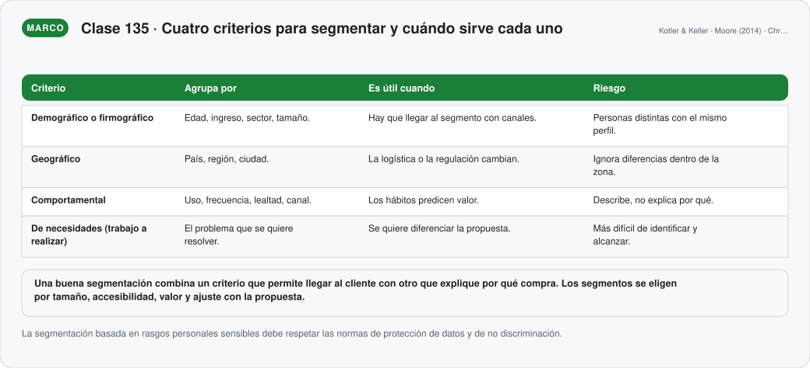

# Clase 135 — Segmentación y cliente ideal

<!-- nav:inicio -->
> **Parte 11 · Marketing, cliente y crecimiento** — clase 3 de 12 · [índice de la parte](../../README.md) · [temario](../../../../SYLLABUS.md)
<!-- nav:fin -->

**Parte:** 11 — Marketing, cliente y crecimiento  
**Nivel:** Etapa 3 — Manager → Gerente  
**Duración sugerida:** 150–180 minutos · **Estándar:** deep-class-v2

## 🎯 Propósito

Un mercado no es un bloque homogéneo: dentro de él conviven personas y empresas con necesidades, hábitos, capacidad de pago y formas de decidir muy distintos. Segmentar es **dividir el mercado en grupos que respondan de manera diferente** a una oferta, con el fin de elegir cuáles atender y cómo. Hecha con criterio, la segmentación permite concentrar recursos, diseñar mensajes y productos específicos y subir la rentabilidad. Hecha sin criterio, se vuelve un ejercicio demográfico que describe a los clientes pero no explica por qué compran ni orienta ninguna decisión.

La clase se apoya en el proceso de segmentación, elección de objetivo y posicionamiento de Kotler y Keller, en la noción de segmento inicial de Moore y en la visión de Christensen y colaboradores sobre el trabajo que los clientes contratan. Complementa la clase 122, que se centró en el perfil de cliente ideal para ventas B2B, ampliándola a mercados de consumo y a decisiones de marca, canal y oferta. Al terminar sabrás elegir criterios de segmentación útiles, evaluar segmentos, definir un cliente ideal con datos y evitar los errores típicos.

## 📚 Resultados de aprendizaje

Al finalizar podrás:

1. **Distinguir** los criterios de segmentación y cuándo sirve cada uno.
2. **Evaluar** segmentos por tamaño, acceso, valor, ajuste y competencia.
3. **Elegir** uno o pocos segmentos objetivo con justificación.
4. **Describir** un cliente ideal con datos y necesidades.
5. **Traducir** la segmentación en decisiones de oferta, mensaje, canal y precio.

## 🧭 Agenda

| Tramo | Qué se hace |
|---|---|
| 0–20 min | Recuperación: ¿qué grupo de clientes te compra más y lo que más valora es diferente a lo que valora el resto? |
| 20–60 min | Criterios, evaluación y selección de segmentos; cliente ideal. |
| 60–105 min | Ejemplo trabajado: segmentar el mercado de una aplicación de finanzas personales. |
| 105–150 min | Caso ejecutivo y práctica. |
| 150–175 min | Límites y entregable. |

## 🧩 Conceptos centrales

| Concepto | Definición | Cómo se reconoce |
|---|---|---|
| **Segmentación** | División del mercado en grupos con necesidades o comportamientos similares. | Cada grupo responde distinto a la oferta. |
| **Mercado objetivo** | Segmento o segmentos elegidos para atender. | Se destinan recursos específicos. |
| **Criterio de segmentación** | Variable usada para formar los grupos. | Demográfico, geográfico, comportamental, de necesidades. |
| **Cliente ideal** | Descripción del cliente para quien la propuesta es más valiosa y rentable. | Combina rasgos, necesidades y comportamiento. |
| **Segmento inicial** | Nicho donde se concentra el esfuerzo antes de ampliar. | Moore lo llama cabeza de playa. |
| **Trabajo a realizar** | Progreso que el cliente busca lograr en una circunstancia. | Explica la compra más allá del perfil. |

## 🧠 Modelo mental

**Cómo leer el diagrama.** Una tabla con cuatro criterios. Los **demográficos o firmográficos** y los **geográficos** son fáciles de identificar y de alcanzar con canales, pero no explican por qué compran. Los **comportamentales** (uso, frecuencia, lealtad) describen lo que hacen pero no por qué. Los de **necesidades** o trabajo a realizar explican el porqué y permiten diferenciar la oferta, pero son más difíciles de identificar y de alcanzar. La nota recomienda combinar un criterio que permita llegar al cliente con otro que explique su compra.

## 📖 Desarrollo

### 1. Para qué segmentar

Kotler y Keller sitúan la segmentación, la elección del mercado objetivo y el posicionamiento como el núcleo de la estrategia de marketing: primero se decide **a quién** se dirige la empresa, y luego qué ofrece, a qué precio, por qué canal y con qué mensaje. Segmentar tiene sentido cuando existen **diferencias relevantes** entre los clientes (en necesidades, sensibilidad al precio, canales, valor) y cuando la empresa puede **actuar diferente** para cada grupo. Si todos los clientes valoran lo mismo y se atienden igual, la segmentación no agrega valor.

### 2. Criterios y sus limitaciones

Los **criterios demográficos o firmográficos** (edad, ingreso, ocupación, sector, tamaño) son fáciles de medir y de usar para llegar a las personas, pero una misma categoría puede esconder necesidades muy distintas. Los **geográficos** importan cuando la logística, la regulación, el idioma o los gustos cambian por zona. Los **comportamentales** (frecuencia de uso, lealtad, canal de compra, ocasión) reflejan valor real y orientan programas de fidelización. Los **psicográficos** (valores, estilos de vida) enriquecen el mensaje pero son más difíciles de medir. Y los de **necesidades** o de **trabajo a realizar** (Christensen y otros) explican la compra. El criterio correcto depende de la decisión que se quiere tomar.

### 3. El trabajo a realizar

Christensen y sus colegas sostienen que los clientes no «compran productos»: **contratan soluciones** para progresar en una situación concreta. Un mismo producto puede ser contratado para trabajos distintos, y dos personas con perfiles muy diferentes pueden contratar el mismo trabajo. Segmentar por **trabajo** revela con quién se compite y qué atributos importan. Un ejemplo clásico: la gente «contrata» un batido por la mañana para que el viaje en auto sea menos aburrido y para sentirse saciada hasta el almuerzo; la competencia no son otros batidos, sino bananas, donas o café. La segmentación por trabajo se obtiene con entrevistas (clase 134), no con datos demográficos.

### 4. Evaluar segmentos

Para cada segmento candidato se estiman: **tamaño y crecimiento**; **necesidad no resuelta** y su intensidad; **ajuste** con la propuesta actual o posible; **valor** (disposición a pagar, margen, duración); **accesibilidad** (canales y costo para llegar); **competencia** y barreras; y **compatibilidad** con la estrategia y las capacidades. Se puntúan con criterios y pesos acordados de antemano (clase 105). El resultado es una lista priorizada con una **recomendación explícita** sobre cuáles atender primero, cuáles después y cuáles no. Un segmento atractivo en el papel que no se puede alcanzar con los canales actuales no es un buen segmento inicial.

### 5. Segmento inicial y expansión

Moore enfatiza que, en mercados nuevos, conviene **concentrarse en un nicho** donde se pueda ser la opción dominante, con una oferta completa para ese grupo, y luego expandirse a segmentos adyacentes. Concentrarse permite aprender rápido, construir referencias creíbles y cobrar un precio justo por el valor entregado. La dispersión inicial produce mensajes vagos y clientes poco satisfechos. La expansión se planifica: qué segmento sigue, qué adaptaciones requiere, qué aprendizajes se transfieren. Se revisa con datos de retención y rentabilidad.

### 6. El cliente ideal

La descripción del cliente ideal reúne: **quién es** (perfil), **qué trabajo quiere realizar** y en qué circunstancia, **qué alternativas usa hoy**, **qué le frustra**, **qué criterios de compra** tiene, **dónde se informa** y **qué lo hace pasar a la acción** (disparador). Se construye con datos: entrevistas, análisis de los mejores clientes, datos de uso y de ventas. Se evita el estereotipo («Carolina, 34 años, le gusta el yoga») sin base empírica: las **personas** ficticias son útiles si se apoyan en patrones observados y si guían decisiones concretas (mensaje, canal, oferta). Se declaran también los clientes que no se quiere atender.

### 7. De la segmentación a la acción

La segmentación debe producir **decisiones distintas por segmento**: **oferta** (funciones, planes, servicios), **mensaje** y **posicionamiento** (clase 136), **precio** (clase 129), **canales** (clase 139), **métricas** y **metas**. Se asignan responsables y presupuestos por segmento y se miden resultados por segmento. Se vigila que la segmentación no se use para prácticas discriminatorias o para explotar vulnerabilidades: las decisiones de oferta y de precio por segmentos deben respetar las normas de protección de datos, de no discriminación y de consumidores aplicables.

## 📚 Lectura comparada

| Obra | Qué aporta | Qué no resuelve | Pregunta para contrastar |
|---|---|---|---|
| Kotler y Keller | Proceso de segmentación, selección y posicionamiento. | Marco general; poca guía operativa sobre datos. | ¿Qué decisión distinta tomas por segmento? |
| Moore | Segmento inicial y expansión por adyacencia. | Contexto de tecnología. | ¿Qué nicho puedes dominar primero? |
| Christensen et al. | Segmentación por trabajo a realizar. | Requiere investigación cualitativa. | ¿Qué trabajo contratan tus clientes? |
| Sharp | Evidencia de que las marcas crecen sobre todo captando muchos compradores ligeros. | Cuestiona el valor de segmentos muy estrechos. | ¿Tu segmento limita el alcance de la marca? |
| Dunford | Posicionamiento para el cliente que más valora. | Se centra en el mensaje. | ¿Quién valora más tu atributo único? |

## 🧮 Ejemplo trabajado

**Situación (hipotética).** Una aplicación de finanzas personales tiene 120.000 usuarios y 8 % de ellos pagan. Quiere segmentar para decidir su foco del año.

**Segmentación por necesidades (entrevistas a 22 usuarios y encuesta a 1.100).**

| Segmento (trabajo a realizar) | % de usuarios | Conversión a pago | Retención a 12 meses | Observaciones |
|---|---|---|---|---|
| «Poner orden a mis gastos» (control básico) | 46 % | 4 % | 38 % | Usan 2 meses y abandonan |
| «Salir de deudas» | 21 % | 9 % | 61 % | Valoran metas y alertas |
| «Ahorrar para una meta concreta» | 18 % | 12 % | 70 % | Compartirían con su pareja |
| «Gestionar los gastos de mi familia o de mi negocio pequeño» | 15 % | 17 % | 76 % | Piden varias cuentas y reportes |

**Evaluación.** El segmento de familia o negocio pequeño es el menor (15 %) pero convierte más y retiene más; hay pocos competidores directos para su necesidad; es accesible por comunidades y contadores. El de control básico es el mayor, pero el menos rentable y el más fácil de sustituir por planillas.

**Elección.** Segmento inicial: gestión de gastos de familia y pequeños negocios; segundo: ahorro para metas. El de control básico se atiende con el plan gratuito y bajo costo de soporte.

**Cliente ideal.** Persona o pareja que administra los gastos de una familia o de un negocio con 1 a 5 personas; usa planillas y cuadernos; se frustra por mezclar gastos personales y del negocio; busca reportes para el contador; se informa con contadores y comunidades; el disparador es el cierre de impuestos o el inicio de un negocio.

**Decisiones.** Nuevo plan con múltiples cuentas y roles; mensajes centrados en «un solo lugar para ordenar los números de tu familia o negocio»; canales: contadores y comunidades de emprendedores; métrica: activación en 14 días con cuentas conectadas. Se revisa a los 6 meses con retención y margen por segmento.

**Qué muestra.** (1) La segmentación por necesidad explicó diferencias de conversión que la demográfica no mostraba. (2) El segmento más grande no era el más valioso. (3) Se tradujo en oferta, mensaje y canal.

## 🔀 Comparación y límites

**Segmentación frente a personalización.** La segmentación agrupa; la personalización ajusta a cada individuo con datos. Con datos suficientes, la personalización puede complementarla, con las cautelas de privacidad.

**Límites.** Los segmentos son constructos útiles, no categorías naturales; las personas cambian de segmento según la circunstancia. Sharp aporta evidencia de que muchas marcas crecen sobre todo por **penetración** (conseguir muchos compradores, incluidos los poco frecuentes), lo que advierte contra segmentos tan estrechos que limiten el alcance; la tensión entre foco y alcance se decide caso a caso. Los datos de clientes que identifican a personas se tratan conforme a la normativa de protección de datos, y las decisiones de precio y oferta por segmento no deben ser discriminatorias.

## 🪜 De profesional a owner

| Nivel | Cómo participa en la segmentación |
|---|---|
| **Profesional** | Aporta observaciones y datos de clientes concretos. |
| **Jefe / Team Lead** | Adapta mensajes y acciones a los segmentos de su responsabilidad. |
| **Gerente** | Define criterios, evalúa segmentos y asigna recursos. |
| **CEO / Director** | Decide a quién atender y a quién no. |
| **Founder / Owner** | Comienza con un nicho que conoce a fondo. |

## 🏢 Caso ejecutivo

Una cadena de cafeterías con 60 locales segmenta a sus clientes por edad y ocupación («jóvenes», «oficinistas», «familias») y comunica lo mismo a todos con descuentos. Sus datos de programa de fidelidad muestran que el 14 % de los clientes genera el 52 % de las ventas y que visitan entre 3 y 5 veces por semana, en horarios de mañana, con compras de ticket bajo pero alta frecuencia; otro grupo visita los fines de semana con familia y gasta el triple por visita, pero con baja frecuencia. Los locales cercanos a universidades registran alta rotación y poca lealtad. El gerente de marketing propone una gran campaña de descuentos para todos; el de operaciones, un servicio de pedido anticipado para el grupo de la mañana; el de finanzas, reducir locales de baja rentabilidad.

Entrega una **segmentación y cliente ideal** que contenga: (a) los criterios elegidos y por qué; (b) los segmentos por comportamiento y por trabajo a realizar, con los datos que usarías; (c) la evaluación de cada segmento con criterios y puntajes; (d) la elección de segmentos objetivo y los que no se priorizan; (e) la descripción del cliente ideal con su disparador y sus alternativas; (f) las decisiones por segmento (oferta, mensaje, canal, precio, métricas) y las cautelas de datos personales y de no discriminación.

## 🧪 Práctica

1. Divide tus clientes en cuatro segmentos con un criterio de necesidad o de comportamiento y mide su conversión y retención.
2. Puntúa tus segmentos con cinco criterios.
3. Escribe el cliente ideal en una página con disparador y alternativas.
4. Define tres decisiones distintas para cada uno de tus dos segmentos principales.
5. Identifica un segmento que no atenderás y justifícalo.

## ⚠️ Errores frecuentes

| Error | Por qué ocurre | Cómo corregirlo |
|---|---|---|
| Segmentar solo por demografía | Es lo disponible | Incluir comportamiento y necesidad. |
| Segmentos que no cambian ninguna decisión | Se describe, no se actúa | Definir qué se hace distinto por segmento. |
| Perseguir el mayor segmento | Se confunde tamaño con valor | Evaluar valor, ajuste y acceso. |
| Personas ficticias sin datos | Se inventan estereotipos | Basarlas en patrones observados. |
| Demasiados segmentos | Se quiere atender a todos | Elegir pocos y concentrar. |
| Prácticas discriminatorias | Se usan datos sensibles | Respetar normas de datos y no discriminación. |

## ❓ Preguntas de comprobación

1. ¿Para qué se segmenta un mercado?
2. ¿Qué limitación tienen los criterios demográficos?
3. ¿Qué es el trabajo a realizar y cómo se descubre?
4. ¿Qué criterios se usan para evaluar segmentos?
5. ¿Por qué conviene elegir un segmento inicial?
6. ¿Qué incluye la descripción de un cliente ideal?
7. ¿Qué advierte Sharp sobre los segmentos muy estrechos?

Claves de respuesta

1. Para elegir a quién atender y actuar distinto con cada grupo en oferta, mensaje, precio y canal.
2. Son fáciles de medir y alcanzar, pero no explican por qué compran y esconden necesidades distintas.
3. El progreso que el cliente busca lograr en una circunstancia; se descubre con entrevistas sobre el momento de decisión.
4. Tamaño y crecimiento, necesidad, ajuste, valor, accesibilidad, competencia y compatibilidad con la estrategia.
5. Permite dominar un nicho, aprender rápido, construir referencias y expandirse por adyacencia.
6. Perfil, trabajo a realizar, alternativas actuales, frustraciones, criterios de compra, dónde se informa y el disparador.
7. Que muchas marcas crecen sobre todo captando muchos compradores, incluso los poco frecuentes, por lo que un foco excesivo puede limitar el alcance.

## 📥 Entregable

Guarda en `portfolio/135-segmentacion-y-cliente-ideal/`:

- `commercial-decision-brief.md` (plantilla [Commercial decision brief](../../../../templates/commercial-decision-brief.md)) con la segmentación y las decisiones del caso ejecutivo;
- `kpi-tree.md` (plantilla [KPI tree](../../../../templates/kpi-tree.md)) con las métricas por segmento;
- `decision-journal.md` con los criterios, la evaluación y las revisiones.

## 📗 Fuentes y verificación

- Philip Kotler & Kevin Lane Keller — *Marketing Management* (Pearson Education, 2016). **Uso en esta clase:** proceso de segmentación, selección y posicionamiento. Lectura selectiva sobre **segmentación y cliente ideal**. **Localizador:** [ISBN-13 9781292092621](https://openlibrary.org/isbn/9781292092621).
- Geoffrey A. Moore — *Crossing the Chasm* (HarperBusiness, 1995). **Uso en esta clase:** segmento inicial y expansión por adyacencia. Lectura selectiva sobre **segmentación y cliente ideal**. **Localizador:** [ISBN-13 9780887307171](https://openlibrary.org/isbn/9780887307171).
- Clayton M. Christensen et al. — *Competing Against Luck* (HarperBusiness, 2016). **Uso en esta clase:** segmentación por trabajo a realizar. Lectura selectiva sobre **segmentación y cliente ideal**. **Localizador:** [ISBN-13 9780062435613](https://openlibrary.org/isbn/9780062435613).
- Byron Sharp — *How Brands Grow* (BookBaby, 2010). **Uso en esta clase:** crecimiento de marcas por penetración. Lectura selectiva sobre **segmentación y cliente ideal**. **Localizador:** [ISBN-13 9781483534701](https://openlibrary.org/isbn/9781483534701).
- April Dunford — *Obviously Awesome* (Ambient Press, 2019). **Uso en esta clase:** posicionamiento para el cliente que más valora. Lectura selectiva sobre **segmentación y cliente ideal**. **Localizador:** [ISBN-13 9781999023003](https://openlibrary.org/isbn/9781999023003).

> **Regla de fuentes para Segmentación y cliente ideal:** las obras anteriores estructuran las perspectivas de esta materia; cualquier norma, ley o estándar vivo mencionado debe comprobarse nuevamente en su fuente primaria vigente, incluidas las normas de protección de datos y de no discriminación. Los ejemplos y casos son hipotéticos, con cifras ilustrativas. El desarrollo es original y no reproduce capítulos protegidos.

<!-- pie:inicio -->
---

| Anterior | Índice | Siguiente |
|---|---|---|
| [← 134 · Investigación de mercado](../134-investigacion-de-mercado/README.md) | [Parte 11](../../README.md) · [Programa](../../../../SYLLABUS.md) | [136 · Posicionamiento →](../136-posicionamiento/README.md) |
<!-- pie:fin -->
