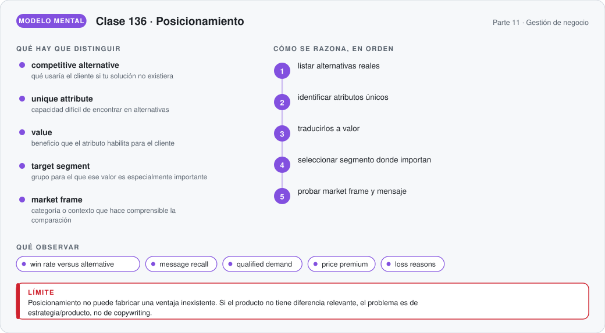

# Clase 136 — Posicionamiento

<!-- nav:inicio -->
> **Parte 11 · Marketing, cliente y crecimiento** — clase 4 de 12 · [índice de la parte](../../README.md) · [temario](../../../../SYLLABUS.md)
<!-- nav:fin -->

**Parte:** 11 — Marketing, cliente y crecimiento  
**Nivel:** Etapa 3 — Manager → Gerente  
**Duración sugerida:** 150–180 minutos · **Estándar:** deep-class-v2

## 🎯 Propósito

Cuando alguien escucha el nombre de tu producto, ¿qué piensa? Si la respuesta es «no sé qué es» o «es como todos los demás», el posicionamiento falló, y ningún presupuesto de comunicación lo compensará. El posicionamiento es la forma en que la oferta se ubica en la mente del comprador respecto de las alternativas: qué es, para quién es, en qué es mejor y por qué debería importarle. No es un eslogan: es una **decisión estratégica** sobre el contexto en que se quiere que el cliente evalúe la oferta, de la que se derivan el mensaje, la oferta, el precio, los canales y las ventas.

La clase se apoya en la obra clásica de Ries y Trout, en el enfoque práctico de Dunford para posicionar productos de forma que su valor sea evidente, en la propuesta de Kim y Mauborgne sobre diferenciación y en la evidencia de Sharp sobre cómo se construyen las marcas en la mente de los compradores. Al terminar sabrás aplicar los cinco elementos del posicionamiento en orden, probarlo con compradores, detectar posicionamientos débiles y alinear mensaje, producto y ventas.

## 📚 Resultados de aprendizaje

Al finalizar podrás:

1. **Definir** los cinco elementos del posicionamiento y su orden.
2. **Identificar** las alternativas competitivas reales del cliente.
3. **Traducir** atributos únicos en valor para el cliente.
4. **Elegir** la categoría de mercado que haga evidente el valor.
5. **Probar** y ajustar el posicionamiento con compradores y datos.

## 🧭 Agenda

| Tramo | Qué se hace |
|---|---|
| 0–20 min | Recuperación: pide a tres clientes que expliquen en una frase qué hace tu producto y para quién; compara con tu mensaje. |
| 20–60 min | Cinco elementos, categoría, prueba y alineación. |
| 60–105 min | Ejemplo trabajado: reposicionar una plataforma de analítica. |
| 105–150 min | Caso ejecutivo y práctica. |
| 150–175 min | Límites y entregable. |

## 🧩 Conceptos centrales

| Concepto | Definición | Cómo se reconoce |
|---|---|---|
| **Posicionamiento** | Contexto que ayuda al comprador a entender qué es la oferta y por qué importa. | Un cliente lo explica con tus palabras. |
| **Alternativas competitivas** | Lo que el cliente haría si el producto no existiera. | Incluye hacer nada y soluciones internas. |
| **Atributos únicos** | Capacidades que la oferta tiene y las alternativas no. | Verificables, no adjetivos. |
| **Valor** | Resultado que los atributos entregan al cliente. | Medible o evidente. |
| **Cliente que más valora** | Segmento al que esos atributos le importan más. | Compra rápido y retiene. |
| **Categoría** | Marco que hace evidente el valor. | Define expectativas y comparaciones. |

## 🧠 Modelo mental

**Cómo leer el diagrama.** Cinco pasos que se definen en este orden. Primero, las **alternativas** del cliente (qué haría sin tu producto); segundo, los **atributos únicos** (lo que tienes y ellas no); tercero, el **valor** que esos atributos significan para el cliente; cuarto, los **clientes que más lo valoran**; y quinto, la **categoría** que haga evidente ese valor. La nota insiste en que se parte de las alternativas del cliente, no de las características del producto, y que el posicionamiento se prueba con compradores y se refleja en mensajes, ventas y producto.

## 📖 Desarrollo

### 1. Qué es posicionar

Ries y Trout popularizaron la idea de que el posicionamiento no ocurre sobre el producto sino **en la mente del cliente**: en un entorno saturado de mensajes, la gente simplifica y ordena las ofertas por categorías y atributos que recuerda. Quien ocupa un lugar claro en esa ordenación tiene ventaja. Dunford lo plantea de forma práctica: posicionar es **definir el contexto** que permite a los compradores entender el valor de la oferta. Sin contexto, el cliente aplica uno por defecto, y suele ser equivocado: te compara con alternativas inadecuadas, valora atributos que no son tu fuerte y te juzga por el precio.

### 2. Alternativas competitivas

Se comienza por preguntar: **si tu producto no existiera, ¿qué haría tu cliente?** Las respuestas pueden incluir competidores directos, productos de otra categoría, soluciones hechas en casa (planillas, procesos manuales, equipos internos) o **no hacer nada**. Estas son las verdaderas alternativas, y definen contra qué se evalúa tu valor. Muchos equipos se comparan con competidores que no son los que el cliente considera. Se identifican con entrevistas, datos de ventas perdidas y análisis de lo que los clientes usaban antes. En muchos mercados, la alternativa más fuerte es el statu quo, y se vence mostrando el costo de no cambiar (clase 125).

### 3. Atributos únicos y valor

Con las alternativas claras, se listan los **atributos únicos**: capacidades, características, servicios o ventajas que tu oferta tiene y las alternativas no. Deben ser **verificables** («integra en un día con sistemas de nómina de 12 proveedores») y no adjetivos («innovador», «completo»). A cada atributo se le asocia el **valor**: el resultado que significa para el cliente («lanzas una sucursal nueva en una semana en lugar de tres»). Muchos productos tienen atributos únicos que el cliente no entiende porque nadie los tradujo a valor. Y a veces el atributo más característico no es el más valioso para el cliente: se prueba.

### 4. Los clientes que más lo valoran

No todos los clientes valoran igual los atributos. Los que más lo hacen son quienes **tienen el problema que tu atributo resuelve mejor**, compran más rápido, pagan más y se quedan más tiempo. Dunford sugiere buscarlos en los datos de ventas (¿qué clientes cierran rápido y renuevan?) y en entrevistas. Posicionar para ellos permite mensajes específicos, ventas más eficientes y un precio coherente (clase 135). Intentar posicionar para «todos» obliga a mensajes genéricos que no convencen a nadie. Eso no impide vender a otros; indica a quién se dirige la comunicación y el desarrollo.

### 5. La categoría de mercado

La **categoría** es el marco que activa expectativas: quién es el competidor de referencia, qué atributos importan, qué precio es razonable. Se elige la que haga **evidente el valor** a los clientes que más lo valoran. Opciones: **competir en una categoría existente** (rápida comprensión; hay que ganar a los líderes en sus criterios), **subdividirla** (un segmento especializado donde se pueda dominar) o **crear una nueva** (evita competir en los criterios de otros, pero exige educar al mercado y asumir costo y riesgo, clase 133). Kim y Mauborgne añaden que se puede diferenciar redefiniendo los factores de competencia. La elección debe validarse con compradores.

### 6. Probar el posicionamiento

Un posicionamiento es una **hipótesis**. Se prueba con: **entrevistas a compradores** (¿cómo describen lo que hacemos?, ¿con qué nos comparan?), **pruebas de mensaje** (variantes con muestras de clientes objetivo), **datos de conversión** (¿entienden y avanzan?), **análisis de oportunidades perdidas** y **señales de las ventas** (¿hay que explicar demasiado?). Un buen indicador es la **claridad**: un cliente nuevo explica en una frase qué hace la empresa, para quién y en qué es distinta. Si necesita varias, el posicionamiento es difuso. Sharp advierte que lo que crece una marca es la **disponibilidad mental y física** y señales distintivas; el posicionamiento debe apoyar esa distintividad.

### 7. Alinear la organización

El posicionamiento debe verse en **todo**: sitio web, materiales de ventas, demostraciones, precios, producto, soporte, contratación. Si el mensaje dice «simplicidad» y el producto exige una configuración de semanas, la contradicción destruye credibilidad. Se alinean los equipos con un documento breve (alternativas, atributos, valor, cliente, categoría, ejemplos de mensajes) y se capacita a ventas y soporte. Se revisa con los datos del mercado cada año o ante cambios: nuevos competidores, nueva tecnología o evolución del cliente. Las afirmaciones comparativas y de desempeño deben ser verdaderas y respaldables, conforme a las normas de publicidad.

## 📚 Lectura comparada

| Obra | Qué aporta | Qué no resuelve | Pregunta para contrastar |
|---|---|---|---|
| Ries y Trout | Posicionamiento como ocupar un lugar en la mente del cliente. | Escrito en otra era de medios; ejemplos de consumo masivo. | ¿Qué lugar ocupas en la mente del cliente? |
| Dunford | Cinco elementos y su orden; método práctico para B2B. | Menos evidencia sistemática. | ¿Qué alternativas usa realmente tu cliente? |
| Kim y Mauborgne | Redefinir los factores de competencia. | Casos seleccionados. | ¿Qué factor eliminarías o crearías? |
| Sharp | Distintividad y disponibilidad como motores del crecimiento. | Visión centrada en marcas de consumo. | ¿Qué señales te hacen reconocible? |
| Aaker | Identidad de marca y asociaciones. | Marco conceptual de marca. | ¿Qué asociaciones quieres construir? |

## 🧮 Ejemplo trabajado

**Situación (hipotética).** Una empresa ofrece una plataforma de analítica de datos con tableros e inteligencia artificial. Su sitio dice: «La plataforma de datos más completa para equipos modernos». Sus ventas son lentas: los prospectos la comparan con herramientas de tableros genéricas y la consideran cara; el 40 % de las oportunidades se pierde «por no priorizar».

**Reconstrucción con los cinco elementos.**

| Elemento | Hallazgo |
|---|---|
| **Alternativas** | Entrevistas a 18 clientes: usaban planillas y reportes manuales mensuales (11), tableros genéricos (5) y consultoras (2). Casi nadie la compara con una «plataforma de datos»; la alternativa principal es la planilla. |
| **Atributos únicos** | Conecta con sistemas de inventario y facturación sin programar (en 2 días); incluye plantillas de indicadores para distribución y retail; alerta cuando un indicador se desvía. |
| **Valor** | Los gerentes dejan de esperar el reporte del día 10 y ven el margen por local y los quiebres de stock cada mañana; reducen quiebres entre 15 % y 30 % en seis meses (casos documentados). |
| **Clientes que más valoran** | Distribuidoras y cadenas de retail con 10 a 60 locales o bodegas, con un gerente de operaciones o de finanzas como patrocinador; renuevan al 92 % y cierran en 35 días. |
| **Categoría** | «Control de gestión diario para retail y distribución» en lugar de «plataforma de datos». |

**Nuevo mensaje.** «Sabrás cada mañana qué locales venden menos de lo esperado y qué productos se te están acabando, sin esperar el reporte del día 10». Prueba con 300 contactos: la tasa de respuesta sube de 1,4 % a 4,1 %, y los prospectos describen el producto como «el tablero diario de mis tiendas».

**Alineación.** Se cambia el sitio, la presentación de ventas (demostración con datos de un retail), el onboarding (primer tablero en dos días) y el precio (por local). Se retira el material para otros sectores del sitio principal. Se mide a los 90 días la duración del ciclo y la conversión.

**Qué muestra.** (1) El mercado real de comparación era la planilla. (2) El valor se tradujo a un resultado cotidiano. (3) La categoría hizo evidente el valor y el mensaje se alineó con producto y ventas.

## 🔀 Comparación y límites

**Posicionamiento frente a marca.** El posicionamiento define el contexto y el valor de una oferta para un segmento; la marca es el conjunto más amplio de asociaciones y de señales de confianza (clase 137). Se refuerzan mutuamente.

**Límites.** El posicionamiento cambia cuando cambian el mercado y las alternativas. Sharp cuestiona que las marcas deban diferenciarse de forma muy estrecha para crecer; el equilibrio entre diferenciación y distintividad se decide con datos. Los métodos de Dunford están basados en la práctica de la autora y de empresas B2B de tecnología. Las comparaciones y afirmaciones de desempeño en publicidad están reguladas y deben ser demostrables.

## 🪜 De profesional a owner

| Nivel | Cómo participa en el posicionamiento |
|---|---|
| **Profesional** | Usa el mensaje de forma consistente y trae lo que oye de clientes. |
| **Jefe / Team Lead** | Revisa que materiales y presentaciones reflejen el posicionamiento. |
| **Gerente** | Lidera su definición y prueba con datos, y alinea áreas. |
| **CEO / Director** | Sostiene el posicionamiento frente a la tentación de ser todo para todos. |
| **Founder / Owner** | Define con claridad a quién sirve y en qué es distinto desde el inicio. |

## 🏢 Caso ejecutivo

Una empresa de software de gestión de inventarios para pequeños comercios se presenta como «solución integral de gestión» y sus vendedores explican hasta 12 funciones distintas en cada demostración. Compite contra grandes sistemas contables y contra planillas. Los clientes que cierran lo hacen por una función: la sincronización automática con tiendas en línea. Esos clientes —comercios con ventas por internet y por local— renuevan al 90 %; el resto, al 60 %. El nuevo gerente general propone reposicionar como «la forma más fácil de no quedarte sin stock cuando vendes en tienda e internet». El gerente de producto teme perder clientes de otros perfiles; el de ventas, que el mensaje sea demasiado estrecho.

Entrega un **posicionamiento** que contenga: (a) las alternativas competitivas reales con evidencia; (b) los atributos únicos y su valor, con cómo se verificarán; (c) los clientes que más valoran la oferta y los datos que lo muestran; (d) la categoría elegida, las alternativas consideradas y su validación; (e) el mensaje y los ajustes en producto, ventas, precio y soporte; (f) las métricas para probarlo y las verificaciones de publicidad y afirmaciones comparativas.

## 🧪 Práctica

1. Escribe tus cinco elementos de posicionamiento y marca cuáles te faltan de evidencia.
2. Entrevista a tres clientes: ¿qué usaban antes y con qué te comparan?
3. Transforma tres atributos en valor medible.
4. Elige tu categoría y escribe qué pierdes y qué ganas con ella.
5. Diseña una prueba de mensaje de dos variantes y la métrica que usarás.

## ⚠️ Errores frecuentes

| Error | Por qué ocurre | Cómo corregirlo |
|---|---|---|
| Partir de las características | Es lo que se conoce | Partir de las alternativas del cliente. |
| Adjetivos en vez de atributos | Suena bien | Atributos verificables. |
| Posicionar para todos | Se teme perder clientes | Elegir al cliente que más valora. |
| Categoría inadecuada | Se hereda la del sector | Elegir la que haga evidente el valor. |
| Mensaje desalineado del producto | Cada área comunica lo suyo | Alinear y capacitar. |
| No probarlo | Se considera una decisión de gusto | Entrevistas, pruebas de mensaje y datos. |

## ❓ Preguntas de comprobación

1. ¿Qué son las alternativas competitivas y por qué incluyen «no hacer nada»?
2. ¿Qué diferencia hay entre un atributo único y un adjetivo?
3. ¿Qué papel cumple el cliente que más valora la oferta?
4. ¿Qué hace la categoría de mercado?
5. ¿Cómo se prueba un posicionamiento?
6. ¿Por qué debe alinearse toda la organización?
7. ¿Qué límite tienen estos métodos?

Claves de respuesta

1. Lo que el cliente haría si el producto no existiera, que incluye competidores, soluciones internas y mantener la situación actual, porque define contra qué se evalúa el valor.
2. El atributo es verificable (una capacidad concreta); el adjetivo es una valoración subjetiva sin evidencia.
3. Orienta el mensaje y el desarrollo hacia quienes compran más rápido, pagan más y se quedan más tiempo.
4. Activa expectativas de comparación y atributos que importan y hace evidente el valor a los clientes objetivo.
5. Con entrevistas, pruebas de mensaje, datos de conversión, análisis de oportunidades perdidas y la claridad con que un cliente nuevo lo explica.
6. Porque las contradicciones entre mensaje, producto, ventas y soporte destruyen credibilidad.
7. Se basan en prácticas y casos específicos, cambian con el mercado y deben equilibrarse con la evidencia sobre distintividad y alcance.

## 📥 Entregable

Guarda en `portfolio/136-posicionamiento/`:

- `leadership-decision-brief.md` (plantilla [Leadership Decision Brief](../../../../templates/leadership-decision-brief.md)) con el posicionamiento del caso ejecutivo;
- `gtm-plan.md` (plantilla [GTM plan](../../../../templates/gtm-plan.md)) con el mensaje, los canales y la alineación;
- `decision-journal.md` con las pruebas de mensaje y los resultados.

## 📗 Fuentes y verificación

- Al Ries & Jack Trout — *Positioning* (American Media International, 2004). **Uso en esta clase:** posicionamiento como ocupar un lugar en la mente del cliente. **Localizador:** [ISBN-13 9781932378252](https://openlibrary.org/isbn/9781932378252).
- April Dunford — *Obviously Awesome* (Ambient Press, 2019). **Uso en esta clase:** cinco elementos del posicionamiento y su orden. **Localizador:** [ISBN-13 9781999023003](https://openlibrary.org/isbn/9781999023003).
- W. Chan Kim & Renée Mauborgne — *Blue Ocean Strategy* (Coach Series, 2006). **Uso en esta clase:** redefinir los factores de competencia. Lectura selectiva sobre **posicionamiento**. **Localizador:** [ISBN-13 9781596590687](https://openlibrary.org/isbn/9781596590687).
- Byron Sharp — *How Brands Grow* (BookBaby, 2010). **Uso en esta clase:** distintividad y disponibilidad como motores del crecimiento. Lectura selectiva sobre **posicionamiento**. **Localizador:** [ISBN-13 9781483534701](https://openlibrary.org/isbn/9781483534701).
- David Aaker — *Building Strong Brands* (Simon & Schuster Ltd, 2002). **Uso en esta clase:** identidad de marca y asociaciones. Lectura selectiva sobre **posicionamiento**. **Localizador:** [ISBN-13 9780743232135](https://openlibrary.org/isbn/9780743232135).

> **Regla de fuentes para Posicionamiento:** las obras anteriores estructuran las perspectivas de esta materia; cualquier norma, ley o estándar vivo mencionado debe comprobarse nuevamente en su fuente primaria vigente, incluidas las de publicidad y afirmaciones comparativas. Los ejemplos y casos son hipotéticos, con cifras ilustrativas. El desarrollo es original y no reproduce capítulos protegidos.

<!-- pie:inicio -->
---

| Anterior | Índice | Siguiente |
|---|---|---|
| [← 135 · Segmentación y cliente ideal](../135-segmentacion-y-cliente-ideal/README.md) | [Parte 11](../../README.md) · [Programa](../../../../SYLLABUS.md) | [137 · Marca y señales de confianza →](../137-marca-y-senales-de-confianza/README.md) |
<!-- pie:fin -->
