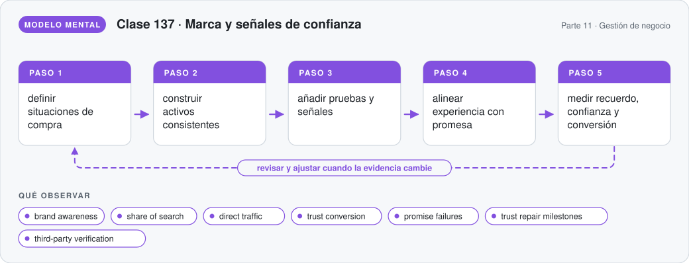

# Clase 137 — Marca y señales de confianza

<!-- nav:inicio -->
> **Parte 11 · Marketing, cliente y crecimiento** — clase 5 de 12 · [índice de la parte](../../README.md) · [temario](../../../../SYLLABUS.md)
<!-- nav:fin -->

**Parte:** 11 — Marketing, cliente y crecimiento  
**Nivel:** Etapa 3 — Manager → Gerente  
**Duración sugerida:** 150–180 minutos · **Estándar:** deep-class-v2

## 🎯 Propósito

Una marca promete algo; la confianza es lo que el cliente hace con esa promesa cuando no puede comprobarla por sí mismo. Casi todo lo que se compra se compra sin poder verificarlo antes: se confía en que el producto hará lo prometido, en que la empresa responderá si falla y en que no mentirá si se equivoca. Esta clase trata de qué sostiene esa confianza, qué señales la hacen creíble y, sobre todo, **qué se hace cuando se rompe**.

El enfoque es el de quien dirige, no el del publicista. El posicionamiento y la marca como activo comercial se desarrollan en la clase 136 y en el programa de marketing; aquí se trabaja la confianza como una obligación que se gana con conducta verificable y se repara con hechos. Al terminar sabrás diagnosticar qué dimensión de la confianza falló y diseñar un plan de reparación que un tercero pueda comprobar.

## 📚 Resultados de aprendizaje

Al finalizar podrás:

1. **Definir** confianza como disposición a ser vulnerable, y distinguirla de satisfacción, simpatía y lealtad.
2. **Explicar** cómo capacidad, benevolencia e integridad forman la confiabilidad percibida de una empresa.
3. **Evaluar** si una señal de confianza es creíble con tres pruebas: verificable, costosa de fingir y sostenida.
4. **Diagnosticar** si una falla fue de competencia o de integridad, y por qué cambia la respuesta.
5. **Diseñar** un plan de reparación de cinco pasos con evidencia comprobable por un tercero.

## 🧭 Agenda

| Tramo | Qué se hace |
|---|---|
| 0–20 min | Recuperación: recuerda una empresa en la que dejaste de confiar; ¿qué falló exactamente? |
| 20–60 min | El modelo de confianza y las tres pruebas de una señal. |
| 60–100 min | Ejemplo trabajado: dos fallas de una misma tienda y dos reparaciones distintas. |
| 100–135 min | Caso ejecutivo: diagnóstico y plan de reparación. |
| 135–150 min | Límites de la evidencia experimental y entregable. |

## 🧩 Conceptos centrales

| Concepto | Definición | Cómo se reconoce |
|---|---|---|
| **Confianza** | Estado psicológico que incluye la intención de aceptar vulnerabilidad basada en expectativas positivas sobre la conducta de otro (Rousseau et al., 1998); en Mayer et al. (1995), disposición a ser vulnerable ante las acciones de otro sin poder vigilarlo ni controlarlo. | El cliente actúa asumiendo un riesgo: paga por adelantado, entrega datos, recomienda. |
| **Capacidad** | Habilidades, competencias y características que permiten a una parte tener influencia en un dominio específico (Mayer et al., 1995). | Entrega lo prometido con la calidad prometida. |
| **Benevolencia** | Medida en que se cree que la otra parte quiere hacer el bien al que confía, aparte de un motivo de beneficio propio (Mayer et al., 1995). | Cuida al cliente cuando no le conviene a corto plazo. |
| **Integridad** | Percepción de que la otra parte se rige por principios que el que confía considera aceptables (Mayer et al., 1995). | Dice la verdad y cumple lo que dice, también cuando cuesta. |
| **Propensión a confiar** | Rasgo de quien confía: su tendencia general a hacerlo. | Explica por qué dos clientes reaccionan distinto ante la misma empresa. |
| **Señal de confianza** | Evidencia observable de que la promesa se cumple. Criterio de la clase: es creíble si es verificable por un tercero, costosa de fingir y sostenida en el tiempo. | Una auditoría, una garantía cumplida, un registro público de incidentes. |
| **Violación de confianza** | Hecho que contradice la expectativa. Puede ser de **competencia** (se equivocó) o de **integridad** (se duda de su honestidad) (Kim et al., 2004). | Se pregunta si el cliente duda de la habilidad o del carácter. |

## 🧠 Modelo mental

**Cómo leer el diagrama.** A la izquierda, tres factores alimentan lo que el cliente **percibe** de la empresa; ese juicio, junto con su propensión a confiar y el riesgo que asume, produce la confianza. A la derecha, lo más útil para dirigir: antes de reparar hay que saber **qué factor falló**, porque se repara distinto una equivocación que una sospecha de deshonestidad.

## 📖 Desarrollo

### 1. La confianza no es un sentimiento cálido

Mayer, Davis y Schoorman la definen como la disposición a ser vulnerable ante las acciones de otro, basada en la expectativa de que hará algo importante para quien confía, **sin poder monitorearlo ni controlarlo**. La definición tiene una consecuencia gerencial: la confianza solo importa donde hay riesgo y donde el cliente no puede verificar. Cuanto más difícil es comprobar un producto —un seguro, un servicio profesional, un software— más pesa la confianza en la decisión de compra.

Rousseau y sus colegas, en una revisión entre disciplinas, coinciden en lo esencial: la confianza es una intención de aceptar vulnerabilidad apoyada en expectativas positivas sobre la conducta de otro. No es lo mismo que satisfacción (que mira el pasado), ni que lealtad (que mira la repetición).

### 2. Tres factores que el cliente observa

El modelo de Mayer y colegas propone que la **confiabilidad percibida** de una parte depende de tres factores: **capacidad** (¿sabe hacerlo?), **benevolencia** (¿quiere mi bien?) e **integridad** (¿se rige por principios que acepto?). Los tres se observan de manera distinta: la capacidad, en resultados; la benevolencia, en cómo trata al cliente cuando no hay obligación; la integridad, en la coherencia entre lo que dice, lo que decide y lo que cumple.

La confianza resultante además depende de la **propensión a confiar** del cliente y del **riesgo percibido** de la situación. Por eso la empresa no controla todo: puede mejorar la confiabilidad que muestra, pero no la disposición de cada persona.

### 3. Tres pruebas para una señal creíble

Una señal de confianza —certificación, garantía, transparencia sobre incidentes, política de devoluciones, auditoría— solo ayuda si es **cierta**. Como criterio de trabajo, la clase propone tres pruebas:

- **Verificable por un tercero.** Si solo la empresa puede confirmarla, es una afirmación, no una señal.
- **Costosa de fingir.** Una garantía que se cumple cuesta; una frase en un sitio web no.
- **Sostenida en el tiempo.** Cumplir una vez es un hecho; cumplir de manera repetida es una reputación.

Una señal que falla alguna de las tres no solo no ayuda: cuando se descubre falsa, convierte un error en un problema de integridad.

### 4. Cuando la señal falla: diagnosticar antes de reparar

Kim, Ferrin, Cooper y Dirks distinguieron dos tipos de violación. En una **violación de competencia** la empresa se equivocó: no entregó a tiempo, cometió un error técnico. En una **violación de integridad** se duda de su honestidad: ocultó información, mintió, manipuló. Son distintas porque ponen en duda factores distintos del modelo, y por eso se reparan de forma distinta.

La pregunta de diagnóstico es: *¿el cliente duda de que sepamos hacerlo o duda de que seamos honestos?* A veces ocurren juntas: un error que se oculta pasa de competencia a integridad.

### 5. Reparar: reconocer, corregir, reparar, verificar, sostener

El plan de la clase tiene cinco pasos, cada uno con una evidencia: **1) Reconocer** lo ocurrido con hechos, sin eufemismos. **2) Corregir la causa**, no solo el síntoma. **3) Reparar a los afectados** de forma proporcional y comprobable. **4) Exponer a verificación independiente** el cambio. **5) Sostener** el cumplimiento en el tiempo y medirlo.

En sus experimentos, Kim y colegas hallaron que, para una violación de competencia, la **disculpa** fue más eficaz que la negación. Para una de integridad, **negar** resultó más eficaz que disculparse cuando la evidencia era ambigua. Esto no autoriza a negar: la clase fija un límite ético y práctico —**nunca se niega lo que se sabe cierto**— porque una negación desmentida después destruye lo que quedaba de confianza. Además, los resultados provienen de escenarios de laboratorio y orientan el diagnóstico; no reemplazan el juicio ante un hecho real.

### 6. Legitimidad y responsabilidad

Confianza, legitimidad y responsabilidad se apoyan entre sí. La **legitimidad** es el reconocimiento de que la empresa tiene derecho a decidir y de que lo hace por un proceso aceptable; la **responsabilidad** es responder por lo ocurrido sin trasladar la culpa. Cuando una empresa explica solo cuando la presionan, su capacidad puede ser buena y su legitimidad quedar dañada. La clase 034 muestra cómo cambia la atención que exigen los interesados cuando perciben falta de legitimidad.

### 7. Medir la recuperación

La reparación no se mide por lo que la empresa anuncia sino por conducta observable: compromisos cumplidos en fecha, tiempo de respuesta a los afectados, hallazgos corregidos y verificados por un tercero, y la evolución de las quejas repetidas. Fija una línea base antes de empezar y una fecha para revisar. Una recuperación de confianza lleva meses, no días.

## 📚 Lectura comparada

| Obra | Qué aporta | Qué no resuelve | Pregunta para contrastar |
|---|---|---|---|
| Mayer, Davis y Schoorman (1995) | El modelo de capacidad, benevolencia, integridad, propensión y riesgo. | No dice cómo reparar. | ¿Qué factor de tu empresa observa hoy el cliente con menos evidencia? |
| Rousseau et al. (1998) | Una definición común de confianza entre disciplinas. | No es operativa para el directivo. | ¿Qué riesgo asume el cliente que confía en ti? |
| Kim et al. (2004) | Reparación distinta según la violación sea de competencia o de integridad. | Experimentos de laboratorio. | ¿Qué dice este diagnóstico sobre tu última falla? |
| Coombs (2007) | Cómo la responsabilidad atribuida condiciona la respuesta pública. | No trata de confianza interpersonal. | ¿Qué responsabilidad te atribuye el público? |
| Edmondson (2018) | Cómo la cultura permite informar el error a tiempo. | No habla del cliente. | ¿Qué cuesta hoy a tu equipo avisar de una falla? |

## 🧮 Ejemplo trabajado

**Situación (hipotética, con cifras ilustrativas).** *Tienda Verde*, un comercio electrónico, prometió entrega en 48 horas. Dos episodios distintos dañaron su confianza.

| | Episodio A | Episodio B |
|---|---|---|
| **Qué ocurrió** | En una campaña de alta demanda, el 22 % de los pedidos llegó después de 5 días. | Se descubre que parte de las reseñas de cinco estrellas fueron escritas por la empresa. |
| **Qué factor falló** | Capacidad: logística insuficiente. | Integridad: se dio una imagen falsa de la opinión de clientes. |
| **Primer paso** | Reconocer el atraso y la cifra real, avisar a los afectados con una fecha cierta. | Reconocer que las reseñas eran propias; no minimizar ni negar. |
| **Corregir la causa** | Aumentar la capacidad antes de la próxima campaña y limitar pedidos si se supera. | Retirar las reseñas, prohibir la práctica y establecer un control. |
| **Reparar** | Compensar con el reembolso del envío a los atrasados. | Avisar a los compradores que decidieron con esa información. |
| **Verificación independiente** | Informe de cumplimiento de plazos revisado por un auditor externo. | Reseñas verificadas por un proveedor externo, con distintivo. |
| **Cómo se sostiene** | Publicar mensualmente el porcentaje de entregas a tiempo. | Informe trimestral de moderación de reseñas. |

**Qué muestra.** Con una misma tienda, el **diagnóstico** cambió la respuesta: A se repara con reconocimiento y corrección operativa; B exige además que la empresa demuestre honestidad, porque lo que se puso en duda fue su carácter. Si en B la empresa negara lo que sabe cierto, el episodio pasaría de falla a encubrimiento.

## 🔀 Comparación y límites

**Confianza frente a reputación.** La reputación es el juicio acumulado de muchos sobre la conducta pasada; la confianza es la decisión de cada cliente de asumir un riesgo. La reputación facilita la confianza, pero no la reemplaza.

**Reparar frente a gestionar la imagen.** Reparar actúa sobre el hecho y se verifica; gestionar la imagen actúa sobre la percepción y suele agravarse si se descubre una discrepancia.

**Límites.** La evidencia de Kim y colegas proviene de experimentos con escenarios, y sus resultados dependen de la ambigüedad de la evidencia y del contexto cultural. El modelo de Mayer y colegas es una teoría de la confianza entre personas y organizaciones; no mide la confianza de una marca. Y la elección entre disculparse y negar nunca se puede tomar sin saber qué ocurrió realmente.

## 🪜 De profesional a owner

| Nivel | Cómo trabaja la confianza |
|---|---|
| **Profesional** | Cumple lo prometido y avisa pronto cuando no podrá hacerlo. |
| **Jefe / Team Lead** | Reconoce errores del equipo ante el cliente y los corrige con una fecha. |
| **Gerente** | Diseña señales verificables y cuida que lo que se promete en marketing coincida con la operación. |
| **CEO / Director** | Decide cómo se asume una falla pública y qué se somete a verificación independiente. |
| **Founder / Owner** | Su palabra es el activo: protege la integridad aunque cueste un cliente. |

## 🏢 Caso ejecutivo

Una empresa de software para clínicas descubre que un error en su sistema mostró durante tres semanas horarios de citas equivocados a pacientes. Aunque la causa fue técnica, el equipo comercial había asegurado a las clínicas que «nunca habían tenido una falla de este tipo». Dos clínicas amenazan con terminar el contrato.

Entrega un **plan de reparación de confianza** que contenga: (a) el diagnóstico —¿competencia, integridad o ambas, y por qué?—; (b) los cinco pasos con la evidencia de cada uno; (c) qué señal de confianza anterior queda en duda y qué prueba de credibilidad la reemplaza; (d) qué se dirá a las dos clínicas y qué no se negará; (e) las métricas de recuperación, su línea base y la fecha de revisión.

## 🧪 Práctica

1. Toma una señal de confianza de tu organización y aplícale las tres pruebas. ¿Cuál falla?
2. Describe una falla reciente y clasifícala como de competencia, de integridad o mixta. ¿Qué evidencia la ubica ahí?
3. Escribe los cinco pasos de reparación para esa falla con la evidencia verificable de cada uno.
4. Redacta el mensaje inicial a los afectados sin eufemismos y sin atribuir causas que no conoces.
5. Define tres métricas de recuperación, su línea base y la fecha de revisión.

## ⚠️ Errores frecuentes

| Error | Por qué ocurre | Cómo corregirlo |
|---|---|---|
| Disculparse sin corregir | Se confunde la disculpa con la reparación | Exigir un cambio de causa y una evidencia verificable. |
| Corregir sin reconocer | Se teme admitir el error | Reconocer el hecho con datos; el silencio parece ocultamiento. |
| Prometer lo que no se puede verificar | Se quiere tranquilizar | Solo declarar lo que un tercero pueda comprobar. |
| Negar lo que se sabe | Se quiere proteger la imagen | Nunca negar un hecho cierto; la negación desmentida agrava. |
| Tratar toda falla como de imagen | No se diagnostica qué factor falló | Preguntar si se duda de la habilidad o de la honestidad. |
| Medir lo anunciado | Es lo más fácil de mostrar | Medir conducta: plazos cumplidos, hallazgos corregidos, quejas repetidas. |

## ❓ Preguntas de comprobación

1. ¿Cómo define Mayer, Davis y Schoorman la confianza y por qué solo importa donde hay riesgo?
2. ¿Qué tres factores componen la confiabilidad percibida y cómo se observa cada uno?
3. ¿Qué tres pruebas debe pasar una señal de confianza para ser creíble?
4. ¿En qué se diferencia una violación de competencia de una de integridad y por qué se reparan distinto?
5. ¿Qué hallaron Kim et al. sobre disculpa y negación, y qué límite fija la clase?
6. Una empresa oculta un error técnico durante dos semanas. ¿Por qué pasó de competencia a integridad?
7. ¿Con qué se mide una recuperación de confianza?

Claves de respuesta

1. Disposición a ser vulnerable ante las acciones de otro sin poder vigilarlo ni controlarlo; si el cliente puede verificar todo, no necesita confiar.
2. Capacidad (resultados), benevolencia (trato cuando no hay obligación) e integridad (coherencia entre lo dicho, lo decidido y lo cumplido).
3. Verificable por un tercero, costosa de fingir y sostenida en el tiempo.
4. En la primera se duda de la habilidad; en la segunda, del carácter. Ponen en juego factores distintos del modelo.
5. Disculpa funcionó mejor en competencia; negar rindió más en integridad con evidencia ambigua. La clase: nunca se niega lo que se sabe cierto; los experimentos orientan, no sustituyen el juicio.
6. Porque el ocultamiento pone en duda la honestidad, no solo la habilidad.
7. Con conducta observable: compromisos cumplidos, tiempos de respuesta, hallazgos corregidos y verificados, quejas repetidas; con línea base y fecha de revisión.

## 📥 Entregable

Guarda en `portfolio/137-marca-y-senales-de-confianza/`:

- `trust-repair-plan.md` (plantilla [plan de reparación de confianza](../../../../templates/trust-repair-plan.md)) con el caso ejecutivo resuelto;
- `reading-note.md` contrastando dos fuentes y su efecto en el diagnóstico;
- `decision-journal.md` con el diagnóstico, el límite ético que aplicaste y la fecha de revisión.

## 📗 Fuentes y verificación

- Roger C. Mayer, James H. Davis & F. David Schoorman — *An Integrative Model of Organizational Trust* (Academy of Management Review, 1995). **Uso en esta clase:** la definición de confianza y el modelo de capacidad, benevolencia e integridad. Lectura selectiva sobre **marca y señales de confianza**. **Localizador:** [DOI 10.2307/258792](https://doi.org/10.2307/258792).
- Denise M. Rousseau, Sim B. Sitkin, Ronald S. Burt & Colin Camerer — *Not So Different After All: A Cross-Discipline View of Trust* (Academy of Management Review, 1998). **Uso en esta clase:** una definición de confianza compartida entre disciplinas. Lectura selectiva sobre **marca y señales de confianza**. **Localizador:** [DOI 10.5465/amr.1998.926617](https://doi.org/10.5465/amr.1998.926617).
- Peter H. Kim, Donald L. Ferrin, Cecily D. Cooper & Kurt T. Dirks — *Removing the Shadow of Suspicion: The Effects of Apology Versus Denial for Repairing Competence- Versus Integrity-Based Trust Violations* (Journal of Applied Psychology, 2004). **Uso en esta clase:** la distinción entre violaciones de competencia y de integridad y sus reparaciones. Lectura selectiva sobre **marca y señales de confianza**. **Localizador:** [DOI 10.1037/0021-9010.89.1.104](https://doi.org/10.1037/0021-9010.89.1.104).
- W. Timothy Coombs — *Protecting Organization Reputations During a Crisis: The Development and Application of Situational Crisis Communication Theory* (Corporate Reputation Review, 2007). **Uso en esta clase:** responsabilidad atribuida y respuesta pública. Lectura selectiva sobre **marca y señales de confianza**. **Localizador:** [DOI 10.1057/palgrave.crr.1550049](https://doi.org/10.1057/palgrave.crr.1550049).
- Amy C. Edmondson — *The Fearless Organization* (Wiley, 2018). **Uso en esta clase:** cultura que permite avisar del error a tiempo. Lectura selectiva sobre **marca y señales de confianza**. **Localizador:** [ISBN-13 9781119477242](https://openlibrary.org/isbn/9781119477242).

> **Regla de fuentes para Marca y señales de confianza:** las obras anteriores estructuran las perspectivas de esta materia; cualquier norma, ley o estándar vivo mencionado debe comprobarse nuevamente en su fuente primaria vigente. Los ejemplos de *Tienda Verde* y de la empresa de software son hipotéticos y no describen a ninguna empresa real. El desarrollo es original y no reproduce capítulos protegidos.

<!-- pie:inicio -->
---

| Anterior | Índice | Siguiente |
|---|---|---|
| [← 136 · Posicionamiento](../136-posicionamiento/README.md) | [Parte 11](../../README.md) · [Programa](../../../../SYLLABUS.md) | [138 · Customer journey →](../138-customer-journey/README.md) |
<!-- pie:fin -->
