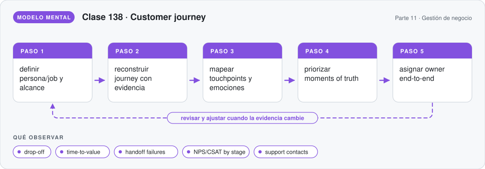

# Clase 138 — Customer journey

<!-- nav:inicio -->
> **Parte 11 · Marketing, cliente y crecimiento** — clase 6 de 12 · [índice de la parte](../../README.md) · [temario](../../../../SYLLABUS.md)
<!-- nav:fin -->

**Parte:** 11 — Marketing, cliente y crecimiento  
**Nivel:** Etapa 3 — Manager → Gerente  
**Duración sugerida:** 150–180 minutos · **Estándar:** deep-class-v2

## 🎯 Propósito

Las empresas organizan su trabajo por áreas —marketing, ventas, producto, soporte, cobranza—, pero el cliente no vive esas divisiones: vive **un recorrido** que empieza antes de comprar, continúa durante el uso y no termina con la entrega. Cada punto de contacto con la empresa suma o resta confianza, y la experiencia total es la suma, mucho más que lo que cada área ve desde su parte. Muchos problemas de conversión, de retención y de reputación nacen en los **traspasos** entre áreas: la promesa de marketing que ventas no puede cumplir, la implantación que no continúa lo que se explicó en la venta, el soporte que desconoce lo acordado.

La clase se apoya en el marco de experiencia del cliente a lo largo del recorrido de Lemon y Verhoef, en el modelo de trabajo a realizar de Christensen y colaboradores y en la gestión de marketing de Kotler y Keller. Al terminar sabrás mapear un recorrido con datos y voz del cliente, identificar momentos críticos y fricciones, diseñar mejoras con dueño y medir su efecto en conversión, uso y retención.

## 📚 Resultados de aprendizaje

Al finalizar podrás:

1. **Mapear** el recorrido del cliente por etapas, puntos de contacto y emociones.
2. **Identificar** momentos críticos y fricciones con datos y entrevistas.
3. **Distinguir** puntos de contacto propios, de socios, del cliente y externos.
4. **Priorizar** mejoras por efecto en valor para el cliente y para el negocio.
5. **Asignar** dueños y métricas que atraviesen áreas.

## 🧭 Agenda

| Tramo | Qué se hace |
|---|---|
| 0–20 min | Recuperación: describe el recorrido de tu último cliente desde que supo de ti hasta que usó el producto. |
| 20–60 min | Etapas, puntos de contacto, momentos críticos y medición. |
| 60–105 min | Ejemplo trabajado: recorrido de compra de equipamiento de oficina en línea. |
| 105–150 min | Caso ejecutivo y práctica. |
| 150–175 min | Límites y entregable. |

## 🧩 Conceptos centrales

| Concepto | Definición | Cómo se reconoce |
|---|---|---|
| **Recorrido del cliente (customer journey)** | Secuencia de interacciones del cliente con la empresa desde que identifica una necesidad hasta la relación posterior. | Se organiza en etapas. |
| **Punto de contacto** | Cualquier interacción entre cliente y empresa. | Sitio, vendedor, entrega, factura, soporte. |
| **Experiencia del cliente** | Respuesta cognitiva, emocional y conductual a lo largo del recorrido. | Se refleja en satisfacción y comportamiento. |
| **Momento crítico (momento de la verdad)** | Instante en que la experiencia puede ganar o perder al cliente. | Primer uso, falla, renovación. |
| **Fricción** | Obstáculo que hace más difícil o costosa una acción del cliente. | Formulario largo, espera, información contradictoria. |
| **Mapa de recorrido** | Representación de etapas, acciones, emociones, puntos de contacto y oportunidades. | Se basa en datos y en clientes reales. |

## 🧠 Modelo mental

**Cómo leer el diagrama.** Una tabla de cinco etapas. En cada una se ve **qué se pregunta el cliente**, el **momento crítico** donde se juega la confianza y la **señal** que indica que funciona. Descubrir se mide en visitas calificadas; considerar, en consultas; comprar, en conversión y abandonos; usar, en activación; y renovar y recomendar, en retención. La nota recuerda que el recorrido real no es lineal ni ocurre en un solo canal, y que se mejoran primero los momentos donde más se pierde valor o confianza.

## 📖 Desarrollo

### 1. Una mirada de punta a punta

Lemon y Verhoef revisan cómo la investigación de marketing pasó de estudiar etapas separadas a estudiar la **experiencia total del cliente** a lo largo del recorrido: antes de la compra (reconocer la necesidad, buscar, considerar), durante (elegir, pagar, recibir) y después (usar, pedir ayuda, renovar, recomendar). Destacan que la experiencia se forma en **muchos puntos de contacto**, algunos controlados por la empresa, otros por socios, otros por el propio cliente y otros externos (reseñas, conversaciones con amigos). La implicancia gerencial: gestionar la experiencia exige coordinar áreas y tener una visión común.

### 2. Etapas y preguntas del cliente

Un esquema práctico: **descubrir** («¿existe algo para mi problema?»), **considerar** («¿esta opción sirve y es confiable?»), **comprar** («¿puedo decidir sin riesgo?»), **usar** («¿obtengo el resultado prometido?») y **renovar y recomendar** («¿me conviene seguir y contarlo?»). Las etapas se adaptan al negocio: un servicio B2B de ciclo largo tendrá etapas de evaluación técnica y de aprobación interna; un comercio en línea, de comparación y entrega. Cada etapa se define por la **pregunta que se hace el cliente** y la **acción** que se espera, no por el departamento que la gestiona.

### 3. Construir el mapa con datos y voz del cliente

Un mapa útil no se hace en una sala con post-its sino con **evidencia**: **entrevistas** con clientes recientes sobre su recorrido real (clase 134); **datos de comportamiento** (analítica de sitio, uso del producto, tiempos entre etapas); **datos de soporte** (motivos de contacto, quejas); **reseñas** y comentarios; **grabaciones** y observación. Se representan etapas, acciones, puntos de contacto, **emociones** (frustración, confianza), **tiempos de espera** y **traspasos entre áreas**. Se incluyen los recorridos de distintos segmentos (clase 135) y el recorrido real, no el diseñado.

### 4. Momentos críticos y fricciones

En todo recorrido hay momentos donde se decide la relación: la **primera impresión**, la **primera experiencia de uso**, la **primera falla** y cómo se resuelve, la **renovación**, el **cambio de persona de contacto**. Se identifican con datos (dónde se abandona, dónde aumentan los contactos de soporte, dónde cae la satisfacción) y con entrevistas. La fricción incluye pasos innecesarios, información contradictoria, esperas, falta de seguimiento y promesas incumplidas. Se prioriza por **efecto** (cuántos clientes y cuánto valor se pierde), **facilidad** de mejora y **causa raíz**: muchas fricciones tienen origen en decisiones de otra área.

### 5. Traspasos y dueños

El recorrido atraviesa áreas, y la mayoría de los problemas nacen en los **traspasos**: ventas que prometen algo que implantación no puede cumplir; marketing que atrae a clientes que el producto no sirve; soporte que no ve lo acordado en el contrato. Se asigna un **dueño del recorrido** o de cada etapa con metas compartidas (por ejemplo, tiempo hasta el primer valor, retención al día 90), y se definen **acuerdos entre áreas** (qué información pasa, cuándo). La gestión del recorrido es parte de la gestión por procesos (clase 086), con el cliente como destinatario.

### 6. Medición

Se mide en **dos niveles**: **métricas de etapa** (conversión, tiempo, abandono, activación, contactos de soporte por cliente, satisfacción tras interacciones) y **métricas de resultado** (retención, valor del cliente, recomendación). Gupta y Zeithaml muestran, en su revisión de métricas de clientes y su efecto en el desempeño financiero, que conviene vincular las métricas de marketing con resultados económicos y no solo con actitudes. Las encuestas de satisfacción o recomendación se combinan con **datos de comportamiento**, que revelan lo que el cliente hace. Cada indicador tiene una definición y un dueño (clase 100).

### 7. Mejorar con experimentos y escuchar

Las mejoras se plantean como **hipótesis** y se prueban: simplificar un formulario, enviar una guía de inicio, cambiar la frecuencia de un mensaje. Se miden con grupo de control cuando es posible (clase 143). Se **cierra el ciclo con el cliente**: si reportó un problema, se le informa qué se hizo. Se tienen en cuenta aspectos de **privacidad**: el recorrido se reconstruye con datos personales, por lo que se cuida el consentimiento, el uso de cookies y el seguimiento, y se cumplen las normas de protección de datos y de comunicaciones comerciales aplicables.

## 📚 Lectura comparada

| Obra | Qué aporta | Qué no resuelve | Pregunta para contrastar |
|---|---|---|---|
| Lemon y Verhoef (2016) | Experiencia a lo largo del recorrido y tipos de puntos de contacto. | Revisión conceptual; no es una guía operativa. | ¿Quién controla cada punto de contacto? |
| Christensen et al. | Trabajo a realizar y contexto de elección. | Marco cualitativo. | ¿Qué progreso busca el cliente en cada etapa? |
| Kotler y Keller | Proceso de decisión de compra y marketing de relaciones. | Marco general. | ¿Qué etapa de decisión pierde clientes? |
| Gupta y Zeithaml (2006) | Relación entre métricas de clientes y resultados financieros. | Estudio de métricas, no de mapas. | ¿Tus métricas se vinculan a resultados? |
| Ellis y Brown | Activación y experiencia inicial. | Enfoque en productos digitales. | ¿Qué momento de «aha» logras? |

## 🧮 Ejemplo trabajado

**Situación (hipotética).** Una tienda en línea de equipamiento de oficina para pequeñas empresas tiene un tráfico de 80.000 visitas mensuales, una conversión de 1,8 % y un 24 % de pedidos que generan un contacto de soporte por retrasos. La satisfacción tras la entrega es baja y las recompras, escasas.

**Mapa con datos.**

| Etapa | Datos | Fricción identificada |
|---|---|---|
| Descubrir | 62 % del tráfico llega por buscadores; alta tasa de rebote en fichas de productos con poca información | Las fichas no muestran dimensiones ni compatibilidad |
| Considerar | 34 % de las sesiones consulta políticas de despacho y devolución | Información contradictoria entre sitio y correo |
| Comprar | 71 % de los carritos se abandona; el 38 % de ellos en el paso de despacho | Costo de envío aparece solo al final |
| Usar (recibir e instalar) | 24 % de los pedidos tiene retraso; los pedidos de más de un producto llegan por separado | Falta de seguimiento proactivo |
| Renovar y recomendar | 9 % recompra en 90 días | No hay contacto posterior |

**Entrevistas.** 12 clientes recientes: «no sabía si el escritorio cabía en mi oficina»; «me enteré del costo de envío al final»; «recibí la silla sin la base y nadie me avisó».

**Priorización.** Mejoras ordenadas por efecto y facilidad: (1) mostrar el costo de envío estimado desde la ficha (efecto alto, esfuerzo bajo); (2) fichas con dimensiones y guía de medidas; (3) avisos proactivos de retrasos y de envíos separados; (4) mensajes de seguimiento tras 30 días con ayuda para el armado; (5) programa de recompra para pymes.

**Dueño y métricas.** Una gerente de experiencia de cliente con metas compartidas con logística y marketing: conversión del carrito, porcentaje de pedidos con aviso proactivo, contactos por pedido, recompra a 90 días. Se prueba cada mejora con grupo de control en un 20 % del tráfico.

**Resultado a 3 meses.** Con el costo de envío visible, el abandono en el paso de despacho baja de 38 % a 21 %; la conversión sube de 1,8 % a 2,3 %; los contactos de soporte por retraso bajan 32 %. Los efectos en recompra se miden a seis meses.

**Qué muestra.** (1) El mapa se hizo con datos y entrevistas. (2) La mayor fricción era de información, no de tecnología. (3) Se asignó un dueño y se midió con experimentos.

## 🔀 Comparación y límites

**Mapa del recorrido frente a proceso interno.** El proceso interno muestra lo que la empresa hace; el recorrido muestra lo que el cliente vive. Se complementan: cada paso interno que el cliente percibe debe tener un buen diseño.

**Límites.** Los mapas simplifican recorridos que son no lineales y multicanal. Pueden basarse en pocas entrevistas y en datos incompletos. Medir el recorrido exige unir información de varios sistemas, lo que plantea cuestiones de calidad y privacidad. Los resultados de mejoras dependen del contexto. Las cifras del ejemplo son ilustrativas. El uso de datos personales, de seguimiento y de comunicaciones debe cumplir la normativa de protección de datos y de comercio electrónico vigente.

## 🪜 De profesional a owner

| Nivel | Cómo participa en el recorrido del cliente |
|---|---|
| **Profesional** | Cuida los puntos de contacto que le corresponden y reporta fricciones. |
| **Jefe / Team Lead** | Mide su etapa y coordina los traspasos con otras áreas. |
| **Gerente** | Mapea el recorrido, prioriza mejoras y asigna dueños. |
| **CEO / Director** | Exige una visión común del cliente y metas compartidas entre áreas. |
| **Founder / Owner** | Recorre personalmente la experiencia como un cliente nuevo. |

## 🏢 Caso ejecutivo

Una aseguradora de salud vende planes a personas y familias. Su recorrido incluye una cotización en línea (marketing), una llamada de un ejecutivo (ventas), la firma (operaciones), la activación de la cobertura (back-office), el uso (red de clínicas y reembolsos) y la renovación anual (ventas de nuevo). La conversión de cotización a contrato es de 6 %. El 31 % de quienes contratan llama a los 15 días para consultar cómo usar el plan; el 22 % de los reclamos corresponde a reembolsos demorados; la renovación es de 71 %, pero entre quienes tuvieron un reembolso demorado cae a 49 %. Cada área mide lo suyo: marketing, cotizaciones; ventas, contratos; reembolsos, tiempo promedio de proceso; nadie mide la experiencia completa.

Entrega un **mapa y plan de mejora del recorrido** que contenga: (a) las etapas con preguntas del cliente, puntos de contacto y emociones, con las fuentes de datos; (b) los momentos críticos y las fricciones con su efecto estimado; (c) las mejoras priorizadas con hipótesis y experimentos; (d) los traspasos entre áreas y los acuerdos necesarios; (e) el dueño del recorrido, las metas y las métricas; (f) los cuidados de datos personales y de salud y la normativa del sector asegurador que se verificarán.

## 🧪 Práctica

1. Dibuja el recorrido de tu cliente en cinco etapas y marca los puntos de contacto de cada una.
2. Entrevista a tres clientes sobre su recorrido real y anota las fricciones.
3. Calcula la conversión y el abandono por etapa con datos propios.
4. Prioriza cinco mejoras por efecto y esfuerzo.
5. Define quién es el dueño del recorrido y qué métricas compartirá con otras áreas.

## ⚠️ Errores frecuentes

| Error | Por qué ocurre | Cómo corregirlo |
|---|---|---|
| Mapear sin clientes | Se hace en una sala | Entrevistas y datos de comportamiento. |
| Mirar solo la compra | Es lo que se mide | Incluir el uso y la renovación. |
| Cada área mide lo suyo | Estructura funcional | Dueño y métricas compartidas. |
| Mejorar lo visible | Se atiende lo fácil | Priorizar por efecto en valor. |
| Ignorar los traspasos | No son de nadie | Acuerdos entre áreas. |
| Datos sin privacidad | Se busca más información | Consentimiento y cumplimiento normativo. |

## ❓ Preguntas de comprobación

1. ¿Qué es el recorrido del cliente y por qué es más que la compra?
2. ¿Qué tipos de punto de contacto reconocen Lemon y Verhoef?
3. ¿Qué evidencia se usa para construir un mapa?
4. ¿Qué es un momento crítico?
5. ¿Dónde suelen nacer los problemas del recorrido?
6. ¿Qué dos niveles de métricas se usan?
7. ¿Qué límites tiene un mapa de recorrido?

Claves de respuesta

1. La secuencia de interacciones desde que se identifica la necesidad hasta la relación posterior; la experiencia se forma antes, durante y después de comprar.
2. Propios de la marca, de socios, del cliente y externos (como reseñas o conversaciones).
3. Entrevistas, datos de comportamiento, datos de soporte, reseñas y observación.
4. Un instante donde la experiencia puede ganar o perder al cliente, como el primer uso, una falla o la renovación.
5. En los traspasos entre áreas y en la falta de un dueño del recorrido.
6. Métricas de etapa (conversión, tiempo, abandono, activación) y de resultado (retención, valor, recomendación).
7. Simplifica recorridos no lineales, puede basarse en pocos datos y exige integrar información con cuidado de la privacidad.

## 📥 Entregable

Guarda en `portfolio/138-customer-journey/`:

- `leadership-decision-brief.md` (plantilla [Leadership Decision Brief](../../../../templates/leadership-decision-brief.md)) con el plan del caso ejecutivo;
- `process-map.md` (plantilla [Process map](../../../../templates/process-map.md)) con el mapa del recorrido y los traspasos;
- `decision-journal.md` con las fuentes de datos, las hipótesis y las mejoras probadas.

## 📗 Fuentes y verificación

- Katherine N. Lemon & Peter C. Verhoef — *Understanding Customer Experience Throughout the Customer Journey* (Journal of Marketing, 2016). **Uso en esta clase:** experiencia a lo largo del recorrido y tipos de punto de contacto. Lectura selectiva sobre **customer journey**. **Localizador:** [DOI 10.1509/jm.15.0420](https://doi.org/10.1509/jm.15.0420).
- Clayton M. Christensen et al. — *Competing Against Luck* (HarperBusiness, 2016). **Uso en esta clase:** trabajo a realizar y contexto de elección. Lectura selectiva sobre **customer journey**. **Localizador:** [ISBN-13 9780062435613](https://openlibrary.org/isbn/9780062435613).
- Philip Kotler & Kevin Lane Keller — *Marketing Management* (Pearson Education, 2016). **Uso en esta clase:** proceso de decisión de compra y marketing de relaciones. Lectura selectiva sobre **customer journey**. **Localizador:** [ISBN-13 9781292092621](https://openlibrary.org/isbn/9781292092621).
- Sunil Gupta & Valarie Zeithaml — *Customer Metrics and Their Impact on Financial Performance* (Marketing Science, 2006). **Uso en esta clase:** relación entre métricas de clientes y resultados financieros. Lectura selectiva sobre **customer journey**. **Localizador:** [DOI 10.1287/mksc.1060.0221](https://doi.org/10.1287/mksc.1060.0221).
- Sean Ellis & Morgan Brown — *Hacking Growth* (Ebury Publishing, 2017). **Uso en esta clase:** activación y experiencia inicial. Lectura selectiva sobre **customer journey**. **Localizador:** [ISBN-13 9780753545386](https://openlibrary.org/isbn/9780753545386).

> **Regla de fuentes para Customer journey:** las obras anteriores estructuran las perspectivas de esta materia; cualquier norma, ley o estándar vivo mencionado debe comprobarse nuevamente en su fuente primaria vigente, incluidas las de protección de datos, comercio electrónico y regulación sectorial. Los ejemplos y casos son hipotéticos, con cifras ilustrativas. El desarrollo es original y no reproduce capítulos protegidos.

<!-- pie:inicio -->
---

| Anterior | Índice | Siguiente |
|---|---|---|
| [← 137 · Marca y señales de confianza](../137-marca-y-senales-de-confianza/README.md) | [Parte 11](../../README.md) · [Programa](../../../../SYLLABUS.md) | [139 · Canales y distribución →](../139-canales-y-distribucion/README.md) |
<!-- pie:fin -->
