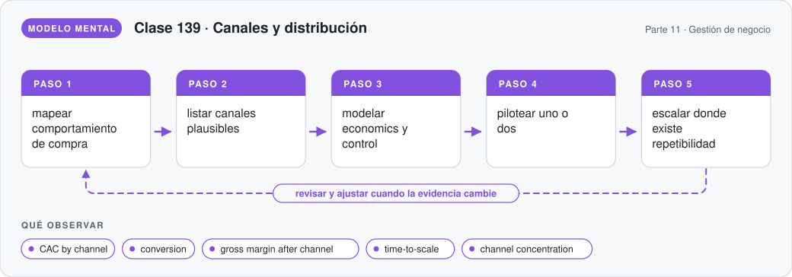

# Clase 139 — Canales y distribución

<!-- nav:inicio -->
> **Parte 11 · Marketing, cliente y crecimiento** — clase 7 de 12 · [índice de la parte](../../README.md) · [temario](../../../../SYLLABUS.md)
<!-- nav:fin -->

**Parte:** 11 — Marketing, cliente y crecimiento  
**Nivel:** Etapa 3 — Manager → Gerente  
**Duración sugerida:** 150–180 minutos · **Estándar:** deep-class-v2

## 🎯 Propósito

Un buen producto con la propuesta correcta puede fracasar si no llega al cliente por el camino adecuado. El **canal** es la ruta por la que la oferta llega a quien la compra: tienda propia, distribuidores, plataformas, venta directa, socios, revendedores, aplicaciones. Cada canal cambia el costo de llegar, el margen que se retiene, el control sobre la experiencia y la propiedad de los datos del cliente. Y cada uno tiene una lógica propia: un distribuidor es un cliente además de un canal, con sus propios incentivos; una plataforma da alcance a cambio de reglas, comisiones y dependencia.

La clase se apoya en el tratamiento de canales de Kotler y Keller, en el análisis de la estructura competitiva de Porter y en la visión de canales de adquisición de Weinberg y Mares (*Traction*). Al terminar sabrás clasificar canales, evaluar su economía, elegir una combinación según alcance y control, gestionar el conflicto entre canales y evitar la dependencia excesiva de uno solo.

## 📚 Resultados de aprendizaje

Al finalizar podrás:

1. **Clasificar** canales directos e indirectos y sus funciones.
2. **Evaluar** la economía de cada canal con margen y costo por cliente.
3. **Elegir** una combinación equilibrando alcance, control y riesgo.
4. **Gestionar** socios de canal y conflictos entre canales.
5. **Reducir** la dependencia de un solo canal o plataforma.

## 🧭 Agenda

| Tramo | Qué se hace |
|---|---|
| 0–20 min | Recuperación: ¿qué porcentaje de tus ventas depende de tu canal principal y qué pasaría si cambiara sus reglas? |
| 20–60 min | Tipos de canal, economía, selección, socios y conflicto. |
| 60–105 min | Ejemplo trabajado: elegir canales para un producto de consumo. |
| 105–150 min | Caso ejecutivo y práctica. |
| 150–175 min | Límites y entregable. |

## 🧩 Conceptos centrales

| Concepto | Definición | Cómo se reconoce |
|---|---|---|
| **Canal de distribución** | Conjunto de organizaciones que hacen disponible el producto al cliente. | Directo (sin intermediarios) o indirecto. |
| **Canal directo** | La empresa vende y entrega al cliente final. | Tienda propia, venta directa, comercio electrónico propio. |
| **Canal indirecto** | Se usan intermediarios: distribuidores, minoristas, plataformas, revendedores. | Margen compartido. |
| **Margen de canal** | Parte del precio que se queda el intermediario. | Descuento sobre el precio al público. |
| **Conflicto de canal** | Competencia o tensión entre canales de una misma empresa. | Precios distintos, territorios superpuestos. |
| **Dependencia de plataforma** | Concentración de ventas o tráfico en un tercero que fija las reglas. | Cambios de política afectan los resultados. |

## 🧠 Modelo mental

**Cómo leer el diagrama.** Dos ejes: el **alcance** que da el canal y el **control** que la empresa mantiene. Los **distribuidores y plataformas** dan mucho alcance con poco control: llegan lejos, pero fijan reglas, se quedan con parte del margen y de los datos. El **canal propio digital y la red propia** dan alcance con control, con más inversión. La **venta directa especializada** da control alto en un público acotado. Lo de **poco alcance y poco control** se evita. La nota indica que la elección cambia margen, propiedad de datos y experiencia.

## 📖 Desarrollo

### 1. Funciones de un canal

Kotler y Keller explican que los intermediarios existen porque realizan **funciones** que reducen los costos de transacción: **reunir y distribuir** (tener productos disponibles cerca del cliente), **financiar** (inventario, crédito), **informar y promover**, **negociar**, **asumir riesgos** y **dar servicio** (instalación, garantías). Una empresa que vende directo asume esas funciones y obtiene control; una que usa intermediarios las comparte y paga con margen. La pregunta no es «¿directo o indirecto?», sino **qué funciones conviene hacer uno mismo y cuáles delegar**, y a qué costo.

### 2. Tipos de canal

Entre los más frecuentes: **tienda o punto de venta propio**; **comercio electrónico propio**; **fuerza de ventas directa**; **distribuidores y mayoristas**; **minoristas**; **revendedores y socios** (en software y servicios); **plataformas y mercados en línea**; **franquicias**; y **canales emergentes** (venta social, aplicaciones, suscripciones). La elección se adapta al **producto** (valor, complejidad, frecuencia, necesidad de servicio), al **cliente** (dónde busca y compra) y a la **estrategia** (posicionamiento, alcance, precio). Un producto complejo y de alto valor pide asesoramiento; uno estándar de bajo valor, disponibilidad masiva.

### 3. Economía del canal

Cada canal tiene una economía propia que se calcula completa: **precio de venta**, **comisiones o márgenes del intermediario**, **costo de adquisición del cliente** por el canal, **costos de servicio y logística**, **devoluciones**, **capital de trabajo** (inventario, cuentas por cobrar) y **retención** de los clientes que vienen por ese canal (clase 117). Un canal con alto volumen y margen bajo puede ser menos rentable que uno pequeño con mejor retención. Se calcula la **rentabilidad por canal** (margen de contribución después de todos los costos) y se compara el **valor del cliente** por canal. Los datos de clientes que se pierden cuando el canal los posee son parte del costo.

### 4. Alcance, control y datos

Los canales indirectos dan **alcance** rápido (acceso a clientes que ya compran allí) y reducen inversión, pero ceden **control** de precio, presentación, experiencia y relación con el cliente, y a menudo de los **datos**. Los directos dan control y relación, y requieren inversión y capacidad. Porter muestra que el poder de negociación de los compradores y de los canales afecta la rentabilidad: cuando unos pocos distribuidores concentran el acceso al cliente, capturan una porción mayor del valor. Una estrategia sana busca un **equilibrio**: usar canales indirectos para alcance y construir canales propios para relación y datos.

### 5. Adquisición y canales de crecimiento

Weinberg y Mares proponen explorar **diversos canales de tracción** (publicidad, contenido, alianzas, ventas, comunidades, referidos, marketing de motores de búsqueda, relaciones públicas, entre otros) con pruebas pequeñas y centrarse en el que muestre mejor **costo por cliente** y **capacidad de escalar**. La mayoría de los canales se agota o se encarece con el tiempo (saturación, mayor competencia, cambios de reglas), de modo que se necesita un **portafolio** y una exploración continua. Se miden los resultados por canal con la misma lógica de economía unitaria.

### 6. Socios de canal y conflicto

Con distribuidores, revendedores o plataformas, se gestiona una relación de **socio**: **incentivos** alineados (márgenes, bonos, apoyo comercial), **capacitación**, **reglas claras** (territorios, precios, marcas), **información compartida** y **medición del desempeño**. El **conflicto de canal** surge cuando canales compiten entre sí (el mismo producto más barato en el canal directo que en el distribuidor) o cuando un socio ve a la empresa como amenaza. Se reduce con **reglas de precio**, **diferenciación** de ofertas por canal, **protección de territorios** y **acuerdos claros**. Las reglas de precios, exclusividades y territorios están sujetas a normas de libre competencia que deben verificarse con asesoría.

### 7. Riesgo de dependencia

Depender de un solo canal —una plataforma, un distribuidor, un motor de búsqueda— es un riesgo estratégico: un cambio de comisión, de algoritmo o de política puede reducir ventas de un día para otro. Se mitiga con **diversificación** (ningún canal debería superar un porcentaje acordado de ventas o de adquisición), **canales propios** para clientes recurrentes, **contratos** con términos claros y plazos de aviso, y **planes de contingencia** (qué se hace si el canal cambia o se interrumpe). La dependencia se mide y se revisa en los comités como un riesgo (clase 093).

## 📚 Lectura comparada

| Obra | Qué aporta | Qué no resuelve | Pregunta para contrastar |
|---|---|---|---|
| Kotler y Keller | Funciones, estructura y gestión de canales. | Marco amplio y general. | ¿Qué funciones delegas y cuáles retienes? |
| Porter | Poder de compradores y estructura competitiva de la industria. | Visión estática. | ¿Quién captura el valor en tu cadena? |
| Weinberg y Mares | Exploración de canales de tracción y foco. | Ejemplos de startups. | ¿Qué canal escala con costo sostenible? |
| Ellis y Brown | Crecimiento basado en experimentos y análisis. | Enfoque digital. | ¿Qué experimento harás con el canal? |
| Kim y Mauborgne | Redefinir cómo se llega al cliente. | Casos seleccionados. | ¿Qué canal tradicional podrías eliminar? |

## 🧮 Ejemplo trabajado

**Situación (hipotética).** Una empresa de alimentos saludables envasados vende a USD 6 por unidad al público. Evalúa tres canales para el próximo año.

| Canal | Precio al público | Margen del canal | Precio neto para la empresa | Costo variable (producto y envase) | Costo de logística y servicio | Contribución por unidad |
|---|---|---|---|---|---|---|
| Supermercados (por distribuidor) | 6,00 | 40 % | 3,60 | 2,20 | 0,60 | 0,80 |
| Plataforma de comercio en línea | 6,00 | 25 % comisión | 4,50 | 2,20 | 1,10 (envío y devoluciones) | 1,20 |
| Tienda propia en línea (suscripción) | 6,00 | 0 % | 6,00 | 2,20 | 1,40 (envío) + marketing 1,10 | 1,30 |

**Lectura.** La contribución por unidad es mayor en el canal propio, pero requiere inversión en marketing y logística y alcanza menos volumen. La plataforma da un buen margen con alcance, aunque con dependencia de reglas y sin datos del cliente. El supermercado entrega volumen y presencia de marca con una contribución baja y capital de trabajo (pago a 60 días).

**Volumen esperado y capital.** Supermercados: 600.000 unidades al año, contribución USD 480.000, capital de trabajo del 16 % de ventas (3,60 × 600.000 × 60/365 = USD 355.000). Plataforma: 220.000 unidades, contribución USD 264.000. Propio: 90.000 unidades, contribución USD 117.000, con retención de clientes de 70 % a 12 meses frente a 35 % de plataforma.

**Decisión.** Combinar: supermercados para presencia y volumen en dos cadenas con condiciones de precio y planogramas acordados; plataforma para captar clientes nuevos con un límite del 40 % de la facturación; canal propio por suscripción como destino de los clientes recurrentes, con meta del 20 % de los ingresos en tres años. Se acuerdan reglas de precios para evitar conflicto (el canal propio no vende por debajo del precio de plataforma) y se mide la retención y la contribución por canal. Se revisan las cláusulas con el distribuidor con asesoría legal.

**Qué muestra.** (1) La contribución por canal cambió la lectura del volumen. (2) El capital de trabajo pesó en el supermercado. (3) Se combinó alcance y control con límites a la dependencia.

## 🔀 Comparación y límites

**Canal frente a mercado.** El mercado es el conjunto de clientes; el canal, el camino para llegar a ellos. Un mercado atractivo con canales inaccesibles o caros no es una oportunidad alcanzable.

**Límites.** Los márgenes y comisiones cambian con el tiempo y la negociación. El análisis de rentabilidad por canal exige separar costos con criterios discutibles. Las plataformas pueden alterar condiciones unilateralmente. Los datos de clientes en canales de terceros tienen restricciones de uso. Las reglas de precios, exclusividades, territorios y de uso de datos están sujetas a normas de libre competencia, consumo y protección de datos que se verifican con asesoría legal.

## 🪜 De profesional a owner

| Nivel | Cómo gestiona los canales |
|---|---|
| **Profesional** | Cuida la experiencia y los datos del canal que le corresponde. |
| **Jefe / Team Lead** | Mide el desempeño y los costos del canal de su equipo. |
| **Gerente** | Define la mezcla de canales, las reglas y la relación con socios. |
| **CEO / Director** | Decide el equilibrio entre alcance y control y limita la dependencia. |
| **Founder / Owner** | Prueba canales pequeños y se concentra donde el costo por cliente es sostenible. |

## 🏢 Caso ejecutivo

Una marca chilena de ropa deportiva vende el 68 % de su facturación en una plataforma internacional de comercio en línea que, tras un cambio de algoritmo, redujo la visibilidad de su tienda en 40 % y subió la comisión de 15 % a 19 %. La marca tiene dos tiendas físicas y un sitio propio que representa el 9 % de las ventas; el 55 % de sus clientes en la plataforma no vuelve a comprar. Una cadena de tiendas por departamento ofrece vender sus productos en 25 locales con un margen de 45 % y exclusividad por dos años en el país; un distribuidor extranjero quiere representarla en Perú y Colombia. El gerente comercial prefiere seguir con la plataforma; el de finanzas, aceptar a la cadena por el volumen; el de marketing, invertir en el sitio propio.

Entrega una **estrategia de canales** que contenga: (a) la economía por canal con margen, costos, capital y retención; (b) el riesgo de dependencia y los límites por canal; (c) la evaluación de la oferta de la cadena, incluida la exclusividad, y de la propuesta de distribución internacional; (d) las reglas para evitar conflicto de canal; (e) el plan para construir el canal propio con metas y métricas; (f) los puntos contractuales, de competencia y de datos que se llevarán a asesoría legal.

## 🧪 Práctica

1. Calcula la contribución por unidad de cada uno de tus canales con todos los costos.
2. Mide qué porcentaje de ventas y de adquisición depende de tu mayor canal.
3. Define reglas de precio para evitar conflicto entre dos de tus canales.
4. Diseña una prueba pequeña de un canal nuevo con un criterio de éxito.
5. Escribe un plan de contingencia si tu canal principal cambiara sus reglas.

## ⚠️ Errores frecuentes

| Error | Por qué ocurre | Cómo corregirlo |
|---|---|---|
| Elegir por volumen | Se mira el ingreso | Evaluar contribución, capital y retención. |
| Depender de una plataforma | Es la que funciona hoy | Diversificar y construir canal propio. |
| Ceder los datos del cliente | Se prioriza el alcance | Acordar uso de datos y captar clientes recurrentes. |
| Conflicto de precios entre canales | No hay reglas | Reglas de precio y diferenciación. |
| Aceptar exclusividades sin análisis | Se atrae el volumen | Evaluar costo de oportunidad y legalidad. |
| No medir por canal | Se agrega todo | Contribución y retención por canal. |

## ❓ Preguntas de comprobación

1. ¿Qué funciones cumplen los intermediarios?
2. ¿Qué incluye la economía completa de un canal?
3. ¿Qué se gana y qué se pierde con canales indirectos?
4. ¿Qué proponen Weinberg y Mares sobre los canales de crecimiento?
5. ¿Qué es un conflicto de canal y cómo se reduce?
6. ¿Por qué es un riesgo depender de una plataforma?
7. ¿Qué cuidados legales rodean a los acuerdos de canal?

Claves de respuesta

1. Reunir y distribuir, financiar, informar y promover, negociar, asumir riesgos y dar servicio.
2. Precio, margen o comisión del canal, costo de adquisición, costos de logística y servicio, devoluciones, capital de trabajo y retención.
3. Se gana alcance rápido y menor inversión; se pierde control del precio, la experiencia, la relación y, a menudo, los datos.
4. Probar varios canales con experimentos pequeños y concentrarse en el de mejor costo por cliente y capacidad de escalar, sabiendo que los canales se saturan.
5. Tensión entre canales de una misma empresa; se reduce con reglas de precios, diferenciación de ofertas, protección de territorios y acuerdos claros.
6. Porque cambios de comisión, algoritmo o política pueden reducir ventas de golpe y la empresa no controla las reglas.
7. Precios, exclusividades, territorios y uso de datos están sujetos a normas de libre competencia, consumo y protección de datos.

## 📥 Entregable

Guarda en `portfolio/139-canales-y-distribucion/`:

- `commercial-decision-brief.md` (plantilla [Commercial decision brief](../../../../templates/commercial-decision-brief.md)) con la estrategia de canales del caso ejecutivo;
- `gtm-plan.md` (plantilla [GTM plan](../../../../templates/gtm-plan.md)) con los canales, las reglas y las metas;
- `decision-journal.md` con la economía por canal, los límites de dependencia y la contingencia.

## 📗 Fuentes y verificación

- Philip Kotler & Kevin Lane Keller — *Marketing Management* (Pearson Education, 2016). **Uso en esta clase:** funciones, estructura y gestión de canales. Lectura selectiva sobre **canales y distribución**. **Localizador:** [ISBN-13 9781292092621](https://openlibrary.org/isbn/9781292092621).
- Michael E. Porter — *Competitive Strategy* (Free Press, 1980). **Uso en esta clase:** poder de compradores y estructura competitiva. Lectura selectiva sobre **canales y distribución**. **Localizador:** [ISBN-13 9780684841489](https://openlibrary.org/isbn/9780684841489).
- Gabriel Weinberg & Justin Mares — *Traction* (Gildan Media, 2015). **Uso en esta clase:** exploración de canales de tracción y foco. Lectura selectiva sobre **canales y distribución**. **Localizador:** [ISBN-13 9781469096230](https://openlibrary.org/isbn/9781469096230).
- Sean Ellis & Morgan Brown — *Hacking Growth* (Ebury Publishing, 2017). **Uso en esta clase:** crecimiento basado en experimentos y análisis. Lectura selectiva sobre **canales y distribución**. **Localizador:** [ISBN-13 9780753545386](https://openlibrary.org/isbn/9780753545386).
- W. Chan Kim & Renée Mauborgne — *Blue Ocean Strategy* (Coach Series, 2006). **Uso en esta clase:** redefinir cómo se llega al cliente. Lectura selectiva sobre **canales y distribución**. **Localizador:** [ISBN-13 9781596590687](https://openlibrary.org/isbn/9781596590687).

> **Regla de fuentes para Canales y distribución:** las obras anteriores estructuran las perspectivas de esta materia; cualquier norma, ley o estándar vivo mencionado debe comprobarse nuevamente en su fuente primaria vigente, incluidas las de libre competencia, consumo y protección de datos. Los ejemplos y casos son hipotéticos, con cifras ilustrativas. El desarrollo es original y no reproduce capítulos protegidos.

<!-- pie:inicio -->
---

| Anterior | Índice | Siguiente |
|---|---|---|
| [← 138 · Customer journey](../138-customer-journey/README.md) | [Parte 11](../../README.md) · [Programa](../../../../SYLLABUS.md) | [140 · Adquisición digital y contenido →](../140-adquisicion-digital-y-contenido/README.md) |
<!-- pie:fin -->
