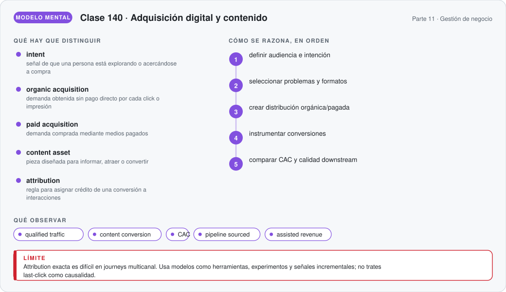

# Clase 140 — Adquisición digital y contenido

<!-- nav:inicio -->
> **Parte 11 · Marketing, cliente y crecimiento** — clase 8 de 12 · [índice de la parte](../../README.md) · [temario](../../../../SYLLABUS.md)
<!-- nav:fin -->

**Parte:** 11 — Marketing, cliente y crecimiento  
**Nivel:** Etapa 3 — Manager → Gerente  
**Duración sugerida:** 150–180 minutos · **Estándar:** deep-class-v2

## 🎯 Propósito

La adquisición digital promete algo muy atractivo: llegar a clientes concretos, medir cada contacto y ajustar al instante. En la práctica, muchas empresas gastan en publicidad en línea sin saber cuánto cuesta realmente un cliente, publican contenido que nadie lee porque no responde a ninguna pregunta de su comprador y dependen de un canal cuyo costo sube cada año. La adquisición digital funciona cuando se aborda como una disciplina de economía unitaria y de servicio al cliente: se conoce a quién se quiere llegar, qué necesita saber, cuánto vale ese cliente y cuánto se puede gastar en conseguirlo.

La clase se apoya en el marco de comunicación y promoción de Kotler y Keller, en la exploración de canales de Weinberg y Mares, en el método de crecimiento por experimentos de Ellis y Brown y en la evidencia de Sharp sobre cómo crecen las marcas. Al terminar sabrás distinguir medios pagados, propios y ganados, construir una estrategia de contenido basada en las preguntas del cliente, medir el costo de adquisición por canal y decidir dónde invertir.

## 📚 Resultados de aprendizaje

Al finalizar podrás:

1. **Distinguir** medios pagados, propios y ganados y sus roles.
2. **Diseñar** una estrategia de contenido a partir de las preguntas del cliente.
3. **Calcular** el costo de adquisición por canal y su retorno.
4. **Elegir** dónde invertir y cuándo detener una inversión.
5. **Reconocer** los riesgos de dependencia de plataformas y los límites éticos y legales.

## 🧭 Agenda

| Tramo | Qué se hace |
|---|---|
| 0–20 min | Recuperación: ¿cuántos de tus clientes actuales llegaron por cada canal y cuánto costó cada uno? |
| 20–60 min | Tipos de medio, contenido, medición y decisiones de inversión. |
| 60–105 min | Ejemplo trabajado: asignar un presupuesto de adquisición entre tres canales. |
| 105–150 min | Caso ejecutivo y práctica. |
| 150–175 min | Límites y entregable. |

## 🧩 Conceptos centrales

| Concepto | Definición | Cómo se reconoce |
|---|---|---|
| **Medios pagados** | Espacios comprados para llegar al público. | Publicidad en buscadores y redes. |
| **Medios propios** | Canales que la empresa controla. | Sitio, correo, aplicación, blog. |
| **Medios ganados** | Menciones y recomendaciones de terceros. | Prensa, reseñas, comunidades. |
| **Costo de adquisición (CAC)** | Gasto total de captar un cliente nuevo. | Gasto del canal sobre clientes ganados. |
| **Contenido útil** | Material que responde preguntas reales del cliente. | Se busca, se comparte y convierte. |
| **Atribución** | Asignación del mérito de una venta a los canales que influyeron. | Imperfecta y debatible. |

## 🧠 Modelo mental

**Cómo leer el diagrama.** Tres columnas. Los **medios pagados** dan rapidez y escala controlable, y su riesgo es que el resultado desaparece al dejar de pagar. Los **medios propios** (sitio, correo, aplicación, contenido) construyen un activo acumulable y datos propios, aunque son lentos y requieren constancia. Los **medios ganados** (prensa, recomendaciones, comunidades) aportan credibilidad con bajo costo directo, pero con poco control. La nota señala que el contenido útil responde las preguntas del cliente cuando las tiene y que se invierte donde el retorno sea sostenible.

## 📖 Desarrollo

### 1. Tres tipos de medio, tres funciones

Kotler y Keller describen el mix de comunicación como un conjunto de herramientas (publicidad, promoción de ventas, relaciones públicas, ventas personales, marketing directo y digital) que se integran. En el entorno digital, una forma útil de ordenarlas es por **propiedad del medio**. Los **pagados** compran atención: son los más rápidos y medibles y los más sensibles al costo. Los **propios** construyen presencia: un sitio con contenido útil, una lista de correo o una comunidad son activos que se acumulan. Los **ganados** son la credibilidad de terceros: reseñas, menciones, recomendaciones. Una estrategia sana combina los tres con roles definidos.

### 2. Contenido que responde preguntas reales

El contenido es útil cuando **resuelve una pregunta que el cliente se hace** en un momento de su recorrido (clase 138): ¿cómo se hace esto?, ¿cuánto cuesta?, ¿qué opciones hay?, ¿es seguro?, ¿qué debo evitar? Se obtiene la lista de preguntas de **ventas y soporte** (qué preguntan los clientes), de **búsquedas** (qué escriben) y de **entrevistas** (qué temen). Se crean piezas que respondan con profundidad y claridad (guías, comparaciones, calculadoras, casos), se organizan por etapa y se miden. El contenido genérico («5 tendencias del sector») rara vez atrae a compradores; el específico y práctico sí.

### 3. Medición y costo de adquisición

Para cada canal se calcula: **gasto total** (medios, personas, herramientas, agencias), **clientes nuevos atribuibles**, **costo por cliente** y **retorno** respecto del valor del cliente (clase 117). Se separa el **costo por clic** o por visita del costo por **cliente**, que es el que importa: un canal barato por clic puede ser caro por cliente si convierte poco. Weinberg y Mares insisten en probar varios canales con inversiones pequeñas y medir el costo por cliente antes de escalar. Se vigila también la **calidad**: los clientes de ciertos canales retienen menos y valen menos.

### 4. Atribución con humildad

La atribución intenta repartir el mérito de una venta entre los canales que influyeron en la decisión. Los modelos (último clic, primer clic, lineal, por posición) dan resultados distintos, y ninguno refleja bien una influencia que ocurre fuera de lo medible (una conversación, una recomendación, un evento). Se usan como **aproximaciones** y se complementan con: **experimentos** (apagar o encender un canal en una región y comparar), **encuestas de origen** («¿cómo se enteró de nosotros?»), y **análisis de cohortes**. Un canal de «último clic» suele recibir crédito excesivo por capturar demanda que otros crearon.

### 5. Crear demanda y capturar demanda

La publicidad en buscadores **captura** demanda que ya existe (alguien busca una solución); otros medios **crean** demanda (descubrimiento, marca). Si solo se invierte en capturar, el crecimiento está limitado por la demanda existente y el costo sube por la competencia en las mismas búsquedas. Sharp aporta evidencia de que las marcas crecen sobre todo ampliando su **alcance** a muchos compradores potenciales, incluidos los que aún no están en el mercado, y construyendo **disponibilidad mental** y **señales distintivas**. En términos prácticos: se equilibra la inversión entre **respuesta** (captura) y **construcción** (creación y marca).

### 6. Crecimiento con experimentos

Ellis y Brown proponen un proceso de **crecimiento basado en experimentos**: generar ideas, priorizarlas, probarlas con rapidez, analizar y aprender. En adquisición se prueban mensajes, imágenes, ofertas, páginas de destino y segmentos con **pruebas controladas** (clase 143), con un criterio de éxito definido de antemano. Se documentan los resultados, también los negativos. Un equipo de crecimiento sano no busca el «truco» sino una **cadencia de aprendizaje**. Se cuida la **calidad de la evidencia**: muestras suficientes y tiempo adecuado para no concluir con ruido.

### 7. Riesgos, ética y límites

Los riesgos: **dependencia de plataformas** (cambios de algoritmo, de política o de costo), **fatiga publicitaria**, **fraude de clics** y de tráfico, **marca en contextos inadecuados**, **seguimiento invasivo**. Los límites éticos y legales: **transparencia** de la publicidad y de las relaciones comerciales con quienes recomiendan, **veracidad** de las afirmaciones, **privacidad** (consentimiento para cookies, seguimiento y correo comercial), **no engaño** (fechas límite falsas, reseñas fabricadas) y **protección de menores**. Las reglas varían por país y por sector y deben verificarse en su fuente vigente, con asesoría legal.

## 📚 Lectura comparada

| Obra | Qué aporta | Qué no resuelve | Pregunta para contrastar |
|---|---|---|---|
| Kotler y Keller | Mix de comunicación y su integración. | Marco general. | ¿Qué rol cumple cada medio? |
| Weinberg y Mares | Prueba de múltiples canales y foco en el que escala. | Casos de startups. | ¿Cuál es tu costo por cliente por canal? |
| Ellis y Brown | Proceso de experimentación en crecimiento. | Enfoque en productos digitales. | ¿Qué experimento de adquisición harás esta semana? |
| Sharp | Alcance, disponibilidad y distintividad como base del crecimiento. | Visión de marcas de consumo. | ¿Estás construyendo demanda o solo capturándola? |
| Kohavi, Tang y Xu | Rigor en pruebas controladas. | Orientado a plataformas con tráfico alto. | ¿Tu muestra es suficiente para concluir? |

## 🧮 Ejemplo trabajado

**Situación (hipotética).** Una empresa de software de contabilidad para pequeñas empresas gasta USD 30.000 al mes en adquisición y gana 150 clientes mensuales. Cada cliente deja USD 40 de margen mensual y permanece 24 meses en promedio.

**Valor del cliente.** USD 40 × 24 = USD 960 (sin descuento por simplicidad). El CAC promedio es 30.000 / 150 = USD 200; el retorno aparente es 4,8 veces.

**Análisis por canal.**

| Canal | Gasto mensual | Clientes ganados | CAC | Retención a 12 meses | Valor del cliente (aprox.) | Valor/CAC |
|---|---|---|---|---|---|---|
| Búsqueda pagada | 14.000 | 56 | 250 | 62 % | 640 | 2,6 |
| Redes sociales pagadas | 8.000 | 24 | 333 | 48 % | 480 | 1,4 |
| Contenido y correo (equipo y herramientas) | 6.000 | 40 | 150 | 78 % | 1.250 | 8,3 |
| Alianzas con contadores | 2.000 | 30 | 67 | 85 % | 1.500 | 22,4 |

**Lectura.** El promedio de 4,8 oculta diferencias grandes: las redes pagadas apenas superan el costo; el contenido y las alianzas rinden varias veces más, aunque con volumen limitado. La búsqueda pagada captura demanda existente con retorno aceptable.

**Decisiones.** Reducir las redes pagadas a pruebas acotadas de mensajes; ampliar el programa de alianzas con contadores (incentivos y materiales); invertir en 12 guías prácticas que respondan las preguntas más frecuentes de soporte (por ejemplo, «cómo preparar el cierre de impuestos»); mantener la búsqueda pagada con presupuesto máximo por clic; medir con una encuesta de origen y un experimento geográfico de apagado de redes en una región durante 6 semanas. Incorporar una política de consentimiento y de baja en el correo.

**Resultado esperado.** Con USD 30.000 reasignados (búsqueda 14.000; contenido y correo 9.000; alianzas 5.000; pruebas 2.000), se proyectan 175 a 190 clientes mensuales con mejor retención. Se verificará al tercer mes.

**Qué muestra.** (1) El promedio ocultaba canales que destruían valor. (2) La retención cambió el valor del cliente por canal. (3) Se previó una medición que no depende solo del último clic.

## 🔀 Comparación y límites

**Adquisición frente a retención.** Adquirir consigue clientes nuevos; retener y expandir hace que valgan más (clase 142). Una adquisición sin retención llena un balde con agujeros.

**Límites.** Los costos por canal cambian rápido con la competencia y los algoritmos. La atribución es imperfecta y los experimentos de apagado pueden costar ventas. Los datos de terceros cambian con las normas de privacidad. El contenido tarda meses en rendir y no siempre se puede atribuir con precisión. Las cifras del ejemplo son ilustrativas. La publicidad, el seguimiento y el correo comercial están sujetos a normas de consumo, de protección de datos y de comunicaciones que se verifican con asesoría.

## 🪜 De profesional a owner

| Nivel | Cómo participa en la adquisición digital |
|---|---|
| **Profesional** | Ejecuta con calidad, mide y documenta lo que aprende. |
| **Jefe / Team Lead** | Coordina contenido y campañas con metas de costo por cliente. |
| **Gerente** | Asigna presupuesto entre canales con economía unitaria. |
| **CEO / Director** | Vigila la dependencia de canales y el equilibrio entre captura y construcción. |
| **Founder / Owner** | Prueba pocos canales con rigor y construye activos propios. |

## 🏢 Caso ejecutivo

Una empresa de educación en línea para adultos invierte USD 120.000 mensuales en publicidad en dos plataformas y gana 800 estudiantes al mes. Hace tres meses, el costo por clic aumentó 35 % y las conversiones cayeron. El equipo de marketing publica tres artículos semanales sobre «tendencias de la educación» que atraen visitas con baja conversión; el equipo de soporte recibe 40 consultas semanales sobre becas, convalidaciones y empleabilidad que no tienen contenido en el sitio. Los alumnos que llegan por recomendación completan los cursos al doble que los de publicidad. La plataforma principal acaba de cambiar sus reglas sobre afirmaciones de empleabilidad. El gerente general quiere duplicar el presupuesto para recuperar volumen.

Entrega una **estrategia de adquisición y contenido** que contenga: (a) la economía por canal con CAC, retención y valor del cliente; (b) el mapa de preguntas del cliente y el plan de contenido asociado; (c) la mezcla entre capturar y crear demanda; (d) el diseño de experimentos y de medición de atribución; (e) el plan para reducir la dependencia de las dos plataformas y aprovechar las recomendaciones; (f) las verificaciones de publicidad, afirmaciones de empleabilidad, consentimiento y datos personales que se harán con las reglas vigentes.

## 🧪 Práctica

1. Calcula el CAC y el valor del cliente por canal con datos de los últimos seis meses.
2. Lista las veinte preguntas más frecuentes de tus clientes y asígnalas a piezas de contenido.
3. Diseña un experimento para medir el efecto real de un canal que recibe mucho crédito de «último clic».
4. Define un máximo de dependencia por canal y el plan de contingencia.
5. Escribe tus reglas de consentimiento y de baja del correo comercial.

## ⚠️ Errores frecuentes

| Error | Por qué ocurre | Cómo corregirlo |
|---|---|---|
| Medir clics y no clientes | Es lo que muestran las plataformas | Calcular CAC y retorno por cliente. |
| Contenido genérico | No se conocen las preguntas | Partir de ventas, soporte y búsquedas. |
| Un solo canal | Funciona hoy | Diversificar y construir activos propios. |
| Confiar en el último clic | Es lo que se mide | Encuestas de origen y experimentos. |
| Solo capturar demanda | Es medible | Equilibrar con construcción de alcance y marca. |
| Ignorar la normativa | Se piensa en resultados | Verificar publicidad, datos y comunicaciones. |

## ❓ Preguntas de comprobación

1. ¿Qué diferencia hay entre medios pagados, propios y ganados?
2. ¿Cómo se identifican las preguntas para el contenido?
3. ¿Por qué se calcula el costo por cliente y no por clic?
4. ¿Qué limitaciones tiene la atribución?
5. ¿Qué diferencia hay entre capturar y crear demanda?
6. ¿Qué riesgos tiene depender de una plataforma?
7. ¿Qué límites legales y éticos rodean a la adquisición digital?

Claves de respuesta

1. Los pagados compran atención; los propios son canales que la empresa controla; los ganados son menciones y recomendaciones de terceros.
2. Con consultas de ventas y soporte, búsquedas y entrevistas a clientes.
3. Porque un canal barato por clic puede ser caro por cliente si convierte poco; el cliente es lo que genera valor.
4. Los modelos dan resultados distintos y no capturan influencias fuera de lo medible; se complementan con experimentos y encuestas de origen.
5. Capturar atiende una demanda que ya busca una solución; crear amplía el alcance y la disponibilidad mental entre quienes aún no buscan.
6. Cambios de algoritmo, política o costo pueden reducir ventas de golpe, y la empresa no controla las reglas.
7. Transparencia y veracidad de la publicidad, consentimiento para datos y comunicaciones, no engaño y protección de menores, según las reglas vigentes.

## 📥 Entregable

Guarda en `portfolio/140-adquisicion-digital-y-contenido/`:

- `leadership-decision-brief.md` (plantilla [Leadership Decision Brief](../../../../templates/leadership-decision-brief.md)) con la estrategia del caso ejecutivo;
- `gtm-plan.md` (plantilla [GTM plan](../../../../templates/gtm-plan.md)) con los canales, el plan de contenido y las metas;
- `decision-journal.md` con la economía por canal, los experimentos y los límites de dependencia.

## 📗 Fuentes y verificación

- Philip Kotler & Kevin Lane Keller — *Marketing Management* (Pearson Education, 2016). **Uso en esta clase:** mix de comunicación y su integración. Lectura selectiva sobre **adquisición digital y contenido**. **Localizador:** [ISBN-13 9781292092621](https://openlibrary.org/isbn/9781292092621).
- Gabriel Weinberg & Justin Mares — *Traction* (Gildan Media, 2015). **Uso en esta clase:** prueba de múltiples canales y foco en el que escala. Lectura selectiva sobre **adquisición digital y contenido**. **Localizador:** [ISBN-13 9781469096230](https://openlibrary.org/isbn/9781469096230).
- Sean Ellis & Morgan Brown — *Hacking Growth* (Ebury Publishing, 2017). **Uso en esta clase:** proceso de experimentación en crecimiento. Lectura selectiva sobre **adquisición digital y contenido**. **Localizador:** [ISBN-13 9780753545386](https://openlibrary.org/isbn/9780753545386).
- Byron Sharp — *How Brands Grow* (BookBaby, 2010). **Uso en esta clase:** alcance, disponibilidad y distintividad como base del crecimiento. Lectura selectiva sobre **adquisición digital y contenido**. **Localizador:** [ISBN-13 9781483534701](https://openlibrary.org/isbn/9781483534701).
- Ron Kohavi, Diane Tang & Ya Xu — *Trustworthy Online Controlled Experiments* (Cambridge University Press, 2020). **Uso en esta clase:** rigor en pruebas controladas. Lectura selectiva sobre **adquisición digital y contenido**. **Localizador:** [ISBN-13 9781108724265](https://openlibrary.org/isbn/9781108724265).

> **Regla de fuentes para Adquisición digital y contenido:** las obras anteriores estructuran las perspectivas de esta materia; cualquier norma, ley o estándar vivo mencionado debe comprobarse nuevamente en su fuente primaria vigente, incluidas las de publicidad, consentimiento, protección de datos y comunicaciones comerciales. Los ejemplos y casos son hipotéticos, con cifras ilustrativas. El desarrollo es original y no reproduce capítulos protegidos.

<!-- pie:inicio -->
---

| Anterior | Índice | Siguiente |
|---|---|---|
| [← 139 · Canales y distribución](../139-canales-y-distribucion/README.md) | [Parte 11](../../README.md) · [Programa](../../../../SYLLABUS.md) | [141 · Funnel y conversión →](../141-funnel-y-conversion/README.md) |
<!-- pie:fin -->
