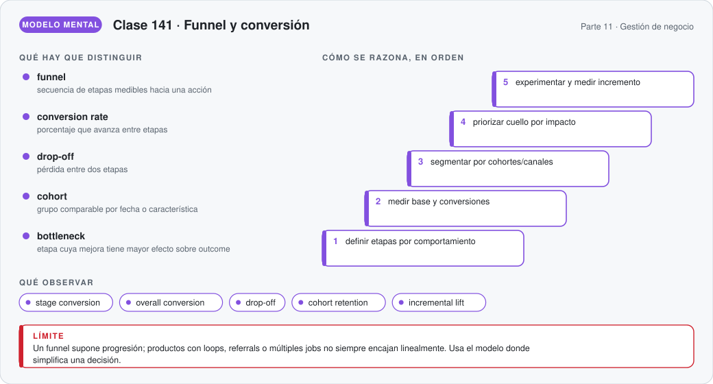

# Clase 141 — Funnel y conversión

<!-- nav:inicio -->
> **Parte 11 · Marketing, cliente y crecimiento** — clase 9 de 12 · [índice de la parte](../../README.md) · [temario](../../../../SYLLABUS.md)
<!-- nav:fin -->

**Parte:** 11 — Marketing, cliente y crecimiento  
**Nivel:** Etapa 3 — Manager → Gerente  
**Duración sugerida:** 150–180 minutos · **Estándar:** deep-class-v2

## 🎯 Propósito

El embudo (*funnel*) es una de las ideas más usadas y más malinterpretadas de marketing: una imagen de etapas por las que pasan los clientes, con pérdidas en cada una. Bien usado, ordena la discusión (¿dónde perdemos más personas? ¿qué cambiaría eso?) y permite priorizar mejoras con datos. Mal usado, se convierte en un diagrama decorativo, en una excusa para optimizar el último paso mientras se descuida el primero, o en una obsesión por la conversión que sacrifica valor a largo plazo. Optimizar la conversión no es manipular: es **quitar obstáculos para que quien quiere resolver su problema pueda hacerlo**.

La clase se apoya en el método de crecimiento con experimentos de Ellis y Brown, en el rigor de las pruebas controladas de Kohavi, Tang y Xu y en la relación entre métricas de clientes y desempeño financiero de Gupta y Zeithaml. Al terminar sabrás definir un embudo con etapas medibles, calcular conversiones y su valor, priorizar qué mejorar, diseñar experimentos válidos y evitar optimizaciones que dañen la confianza o la retención.

## 📚 Resultados de aprendizaje

Al finalizar podrás:

1. **Definir** las etapas de un embudo con eventos medibles.
2. **Calcular** conversiones, abandono y valor por etapa.
3. **Priorizar** mejoras según volumen afectado, esfuerzo y efecto.
4. **Diseñar** experimentos con muestra y criterio de decisión.
5. **Evitar** optimizaciones que aumenten la conversión pero reduzcan valor.

## 🧭 Agenda

| Tramo | Qué se hace |
|---|---|
| 0–20 min | Recuperación: toma el último mes de tu embudo y estima cuántas personas se pierden entre dos etapas consecutivas. |
| 20–60 min | Etapas, métricas, priorización, experimentos y calidad. |
| 60–105 min | Ejemplo trabajado: analizar un embudo de una plataforma de servicios. |
| 105–150 min | Caso ejecutivo y práctica. |
| 150–175 min | Límites y entregable. |

## 🧩 Conceptos centrales

| Concepto | Definición | Cómo se reconoce |
|---|---|---|
| **Embudo (funnel)** | Secuencia de etapas entre el primer contacto y un resultado de valor. | Cada etapa tiene un evento medible. |
| **Tasa de conversión** | Proporción de personas que pasan de una etapa a la siguiente. | Se calcula por período y segmento. |
| **Activación** | Momento en que el usuario obtiene el primer valor real. | Un evento que predice retención. |
| **Fricción** | Obstáculo que reduce la conversión. | Pasos innecesarios, dudas, esperas. |
| **Prueba A/B** | Experimento que compara dos versiones con asignación aleatoria. | Se define métrica y muestra antes. |
| **Valor por etapa** | Valor económico esperado de una persona que llega a cada etapa. | Se calcula con la conversión posterior y el valor del cliente. |

## 🧠 Modelo mental

**Cómo leer el diagrama.** Una tabla con un embudo de ejemplo breve (distinto del ejemplo trabajado más abajo): de **20.000 visitantes** se llega a **1.200 registros** (6 %), **420 activados** (35 %), **63 compradores** (15 %) y **44 renovados** (70 %). Cada fila ofrece la acción de mejora asociada a la etapa. La nota advierte que la etapa con mayor pérdida relativa no siempre es la de mayor oportunidad: se prioriza por volumen afectado, facilidad de cambio y efecto en el resultado final.

## 📖 Desarrollo

### 1. Qué es un embudo útil

Un embudo es útil cuando cada etapa se define por un **evento observable** que indica un avance real del cliente (visitó una página clave, creó una cuenta, completó una acción de valor, pagó, renovó) y no por una impresión del equipo. Ellis y Brown insisten en identificar el **momento de activación** («aha»): la acción que mejor predice que un usuario se quedará. Un embudo bien definido también distingue **segmentos** (canales, perfiles, dispositivos), porque el promedio esconde diferencias grandes: la conversión de visitantes de búsqueda no es la de visitantes de recomendaciones.

### 2. Medir conversión y valor

La **conversión por etapa** es el número que pasa dividido por el que entró. La **conversión total** es el producto de las conversiones. Para decidir dónde actuar, se calcula el **valor de una persona en cada etapa**: la probabilidad de convertirse en cliente y el valor del cliente (clase 117). Si un registro vale USD 12 y un visitante vale USD 0,7, se sabe cuánto se puede gastar por cada uno. Gupta y Zeithaml subrayan la importancia de **vincular las métricas de marketing con resultados financieros**: una conversión que sube pero cuyos clientes retienen menos puede reducir el valor.

### 3. Priorizar qué mejorar

La etapa donde se pierde más gente no necesariamente es la mejor para actuar. Se combinan: **volumen afectado** (cuántas personas pasan por ahí), **diferencia posible** (cuánto podría mejorar según el diagnóstico y los benchmarks), **esfuerzo** y **efecto aguas abajo** (mejorar la activación suele aumentar compras y renovaciones; mejorar una etapa final sin mejorar la calidad de quien llega solo aumenta devoluciones). Se estima el **efecto en clientes e ingresos** de mejorar una etapa en cierto porcentaje y se ordenan las ideas por retorno esperado (clase 105).

### 4. Diagnosticar la fricción

Para entender por qué se pierde gente en una etapa se combinan datos cuantitativos (dónde abandonan, cuánto tardan, qué dispositivo usan) con **observación y entrevistas** (por qué dudaron, qué no entendieron, qué esperaban). Las fuentes de fricción típicas: **claridad** (no queda claro qué se ofrece o qué sigue), **esfuerzo** (formularios largos, pasos innecesarios), **riesgo percibido** (falta de prueba social, garantía o información de precio), **confianza** (señales de seguridad, política clara), **tiempo** (cargas lentas, esperas) y **relevancia** (el mensaje no coincide con la promesa del anuncio). Se atacan las causas, no solo los síntomas.

### 5. Experimentar con rigor

Kohavi, Tang y Xu enseñan que las pruebas controladas son la forma más confiable de saber si un cambio mejora algo, pero también que **muchos resultados «significativos» son falsos**. Reglas básicas: definir **la hipótesis, la métrica principal y la muestra** antes de empezar; **asignar al azar**; no detener la prueba al primer resultado favorable; **no mirar muchas métricas** hasta encontrar una que salga; controlar **efectos de novedad** y estacionalidad; verificar que la asignación funcione; y atender a **métricas de protección** (por ejemplo, retención, reclamos). Con poco tráfico, se usan pruebas de mayor efecto o métodos cualitativos.

### 6. Conversión sin daño

Optimizar la conversión de forma agresiva puede aumentar los resultados de corto plazo y dañar la relación: **patrones oscuros** (cuentas regresivas falsas, cancelaciones difíciles, casillas premarcadas, precios que aparecen al final), promesas exageradas o presión indebida. Estas prácticas pueden ser **ilegales** en muchos países (normas de consumo y de comercio electrónico) y deterioran la retención y la reputación. Una regla ética y práctica: toda mejora debe poder explicarse al cliente sin vergüenza. Se mide también la **calidad** de las conversiones: reclamos, devoluciones, cancelaciones y satisfacción en las primeras semanas.

### 7. Del embudo al sistema

El embudo es una vista parcial: la realidad tiene **bucles** (usuarios que vuelven, referidos, expansión) y **múltiples recorridos** (clase 138). Se complementa con una mirada de **cohortes** (qué ocurre con los usuarios de un mismo período a lo largo del tiempo) y con **ciclos de crecimiento** (clase 143). El equipo se organiza con un dueño por etapa, un tablero compartido, una cadencia semanal de revisión y un registro de experimentos y aprendizajes. La conversión es una consecuencia de entender y servir bien al cliente, no un objetivo en sí mismo.

## 📚 Lectura comparada

| Obra | Qué aporta | Qué no resuelve | Pregunta para contrastar |
|---|---|---|---|
| Ellis y Brown | Activación, métricas de crecimiento y proceso de experimentación. | Enfoque en productos digitales. | ¿Cuál es tu momento de activación? |
| Kohavi, Tang y Xu | Pruebas controladas y sus trampas. | Escala de plataformas grandes. | ¿Tu prueba tiene muestra y criterio previos? |
| Gupta y Zeithaml | Vínculo entre métricas de clientes y resultados financieros. | Revisión de métricas, no de diseño. | ¿Tu conversión mejora el valor? |
| Eyal | Hábitos y activación en productos digitales. | Enfoque criticable por el riesgo de manipulación. | ¿Tu diseño ayuda al cliente o lo explota? |
| Christensen et al. | Motivación del cliente en el momento de decidir. | Marco cualitativo. | ¿Qué progreso busca el cliente en esta etapa? |

## 🧮 Ejemplo trabajado

**Situación (hipotética).** Una plataforma de clases particulares en línea tiene este embudo mensual: 50.000 visitantes; 3.000 se registran (6 %); 900 reservan una primera clase (30 %); 450 completan la primera clase (50 %); 135 compran un paquete (30 %); 95 renuevan al tercer mes (70 %).

**Valor por etapa.** El valor de un cliente: paquete USD 120 con margen de 40 % (USD 48) más renovación: un 70 % renueva y deja otros USD 48 por trimestre durante cuatro trimestres (retención promedio simplificada) → valor total estimado de USD 48 + 0,7 × 48 × 3 ≈ USD 149. La probabilidad de que un registrado llegue a comprar: 0,3 × 0,5 × 0,3 = 4,5 %; el valor de un registro es 0,045 × 149 ≈ USD 6,7; el de un visitante: 0,06 × 6,7 ≈ USD 0,40.

**Diagnóstico.** La mayor pérdida relativa está en la reserva de la primera clase (30 %) y en la compra tras la primera clase (30 %). Las entrevistas con 15 registrados que no reservaron revelan: no encontraron horarios que calzaran (7), dudaron de la calidad de los profesores (5), no entendieron cuánto costaba (3). Entre los que completaron la primera clase y no compraron: 8 de 12 dijeron que «no sabían cuál paquete elegir» y 3, que el profesor no era el adecuado.

**Priorización.** (1) Mostrar disponibilidad horaria y precios antes del registro (afecta 3.000 personas; esfuerzo bajo). (2) Perfiles de profesores con valoraciones y videos breves. (3) Recomendación guiada de paquete al terminar la primera clase y opción de cambiar de profesor sin costo. Ganancia estimada: subir la reserva de 30 % a 36 % y la compra de 30 % a 36 % → compradores de 135 a 194 (+44 %) con el mismo tráfico.

**Experimento.** Se prueban las dos primeras mejoras con 50 % del tráfico en cada grupo durante 4 semanas, con muestra calculada para detectar una mejora relativa de 15 % en reserva. Métrica principal: reservas por registro. Métricas de protección: reembolsos y calificación de la primera clase. Resultado: la reserva sube de 30 % a 35,5 % y los reembolsos no cambian.

**Qué muestra.** (1) El valor por etapa orientó cuánto se podía invertir. (2) Las entrevistas explicaron los abandonos. (3) El experimento incluyó métricas de protección.

## 🔀 Comparación y límites

**Embudo frente a cohortes.** El embudo muestra una foto de etapas; las cohortes muestran cómo evolucionan los mismos usuarios en el tiempo. Una empresa necesita ambas.

**Límites.** Las conversiones varían con el canal, el momento y el segmento; los promedios engañan. Con poco tráfico, las pruebas son lentas o poco concluyentes. Las mejoras de corto plazo pueden desaparecer. La optimización excesiva puede dañar la experiencia. Los experimentos con usuarios requieren transparencia y, según el caso, consentimiento; las prácticas de diseño engañoso pueden infringir normas de consumo y de comercio electrónico. Las cifras del ejemplo son ilustrativas.

## 🪜 De profesional a owner

| Nivel | Cómo participa en la conversión |
|---|---|
| **Profesional** | Mide, prueba y documenta con rigor. |
| **Jefe / Team Lead** | Prioriza mejoras por valor por etapa y conduce los experimentos. |
| **Gerente** | Define el embudo, las metas y la cadencia de aprendizaje. |
| **CEO / Director** | Protege la ética de las optimizaciones y exige calidad de las conversiones. |
| **Founder / Owner** | Mide pocas cosas con claridad y habla con quienes abandonan. |

## 🏢 Caso ejecutivo

Una empresa de seguros de viaje vende en línea y tiene un embudo de cotización a compra de 3,1 %. El equipo de crecimiento introduce tres cambios en un mes: una cuenta regresiva de «oferta termina en 10 minutos» (que se reinicia cada vez que se recarga la página), una casilla premarcada para añadir un seguro de cancelación y una pantalla de cancelación que exige llamar por teléfono. La conversión sube a 4,4 %; los reclamos al servicio de atención aumentan 70 %, las devoluciones 45 % y la calificación en sitios de reseñas baja de 4,3 a 3,6. La autoridad de protección al consumidor anuncia un proceso de fiscalización de prácticas de venta en línea. El gerente de crecimiento defiende los cambios con el aumento de ventas.

Entrega un **diagnóstico y plan de conversión responsable** que contenga: (a) el embudo y el valor por etapa, incluyendo el efecto de reclamos y devoluciones; (b) el análisis de los tres cambios y sus riesgos éticos y legales; (c) qué mejoras alternativas probarías para aumentar la conversión sin engaño; (d) el diseño de experimentos con métricas de protección; (e) la política de diseño responsable y de revisión previa; (f) los puntos que se verificarán con las normas de consumo y comercio electrónico y con asesoría legal.

## 🧪 Práctica

1. Calcula la conversión y el valor por etapa de tu embudo con datos de un mes.
2. Entrevista a tres personas que abandonaron en la etapa de mayor pérdida.
3. Prioriza cinco mejoras por volumen, efecto y esfuerzo.
4. Diseña una prueba A/B con hipótesis, métrica, muestra y criterio de decisión.
5. Define dos métricas de protección para tu mayor experimento.

## ⚠️ Errores frecuentes

| Error | Por qué ocurre | Cómo corregirlo |
|---|---|---|
| Optimizar la última etapa | Es la más cercana al ingreso | Priorizar por valor y volumen. |
| Mirar promedios | Es más simple | Segmentar por canal y perfil. |
| Concluir pruebas con ruido | Impaciencia | Definir muestra y criterio antes. |
| Patrones oscuros | Se busca el corto plazo | Diseño honesto y métricas de calidad. |
| Medir solo conversión | Es lo visible | Incluir retención, reclamos y devoluciones. |
| No hablar con quienes abandonan | Se confía en los datos | Entrevistas para entender causas. |

## ❓ Preguntas de comprobación

1. ¿Cómo se define una etapa de embudo?
2. ¿Qué es la activación y por qué importa?
3. ¿Cómo se calcula el valor de una persona en cada etapa?
4. ¿Qué criterios se usan para priorizar qué mejorar?
5. ¿Qué reglas básicas tiene un experimento válido?
6. ¿Qué son los patrones oscuros y qué riesgos tienen?
7. ¿Qué limitaciones tiene el embudo como modelo?

Claves de respuesta

1. Por un evento observable que indica un avance real del cliente, no por impresión del equipo.
2. El momento en que el usuario obtiene el primer valor real; la acción que mejor predice que se quedará.
3. Con la probabilidad de convertirse en cliente desde esa etapa multiplicada por el valor del cliente.
4. Volumen afectado, diferencia posible, esfuerzo y efecto aguas abajo.
5. Definir antes hipótesis, métrica y muestra, asignar al azar, no detener al primer resultado favorable, no buscar entre muchas métricas y mirar métricas de protección.
6. Diseños que engañan o presionan (urgencia falsa, casillas premarcadas, cancelación difícil); pueden ser ilegales y dañan retención y reputación.
7. Es una vista parcial: ignora bucles, múltiples recorridos y la evolución de cohortes.

## 📥 Entregable

Guarda en `portfolio/141-funnel-y-conversion/`:

- `commercial-decision-brief.md` (plantilla [Commercial decision brief](../../../../templates/commercial-decision-brief.md)) con el plan del caso ejecutivo;
- `product-experiment.md` (plantilla [Product experiment](../../../../templates/product-experiment.md)) con el diseño de la prueba y sus métricas de protección;
- `decision-journal.md` con el valor por etapa, las priorizaciones y los aprendizajes.

## 📗 Fuentes y verificación

- Sean Ellis & Morgan Brown — *Hacking Growth* (Ebury Publishing, 2017). **Uso en esta clase:** activación, métricas de crecimiento y proceso de experimentación. Lectura selectiva sobre **funnel y conversión**. **Localizador:** [ISBN-13 9780753545386](https://openlibrary.org/isbn/9780753545386).
- Ron Kohavi, Diane Tang & Ya Xu — *Trustworthy Online Controlled Experiments* (Cambridge University Press, 2020). **Uso en esta clase:** pruebas controladas y sus trampas. Lectura selectiva sobre **funnel y conversión**. **Localizador:** [ISBN-13 9781108724265](https://openlibrary.org/isbn/9781108724265).
- Sunil Gupta & Valarie Zeithaml — *Customer Metrics and Their Impact on Financial Performance* (Marketing Science, 2006). **Uso en esta clase:** vínculo entre métricas de clientes y resultados financieros. Lectura selectiva sobre **funnel y conversión**. **Localizador:** [DOI 10.1287/mksc.1060.0221](https://doi.org/10.1287/mksc.1060.0221).
- Nir Eyal — *Hooked* (Portfolio/Penguin, 2014). **Uso en esta clase:** hábitos y activación en productos digitales. Lectura selectiva sobre **funnel y conversión**. **Localizador:** [ISBN-13 9781591847786](https://openlibrary.org/isbn/9781591847786).
- Clayton M. Christensen et al. — *Competing Against Luck* (HarperBusiness, 2016). **Uso en esta clase:** motivación del cliente en el momento de decidir. Lectura selectiva sobre **funnel y conversión**. **Localizador:** [ISBN-13 9780062435613](https://openlibrary.org/isbn/9780062435613).

> **Regla de fuentes para Funnel y conversión:** las obras anteriores estructuran las perspectivas de esta materia; cualquier norma, ley o estándar vivo mencionado debe comprobarse nuevamente en su fuente primaria vigente, incluidas las normas de consumo, comercio electrónico y protección de datos. Los ejemplos y casos son hipotéticos, con cifras ilustrativas. El desarrollo es original y no reproduce capítulos protegidos.

<!-- pie:inicio -->
---

| Anterior | Índice | Siguiente |
|---|---|---|
| [← 140 · Adquisición digital y contenido](../140-adquisicion-digital-y-contenido/README.md) | [Parte 11](../../README.md) · [Programa](../../../../SYLLABUS.md) | [142 · Retención, lealtad y customer success →](../142-retencion-lealtad-y-customer-success/README.md) |
<!-- pie:fin -->
