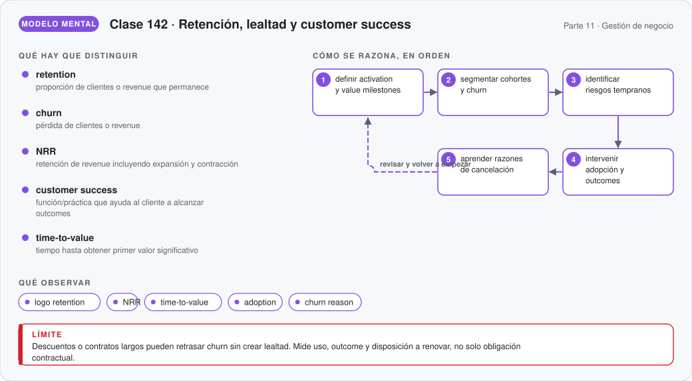

# Clase 142 — Retención, lealtad y customer success

<!-- nav:inicio -->
> **Parte 11 · Marketing, cliente y crecimiento** — clase 10 de 12 · [índice de la parte](../../README.md) · [temario](../../../../SYLLABUS.md)
<!-- nav:fin -->

**Parte:** 11 — Marketing, cliente y crecimiento  
**Nivel:** Etapa 3 — Manager → Gerente  
**Duración sugerida:** 150–180 minutos · **Estándar:** deep-class-v2

## 🎯 Propósito

Conseguir un cliente cuesta mucho; que se quede y compre más es lo que hace rentable al negocio. Sin embargo, muchas empresas invierten en adquisición el triple que en retención, miden la satisfacción con encuestas que no se conectan con el comportamiento, y descubren que un cliente se fue cuando no renueva. La retención no es un departamento ni una campaña: es el resultado de que el cliente **obtenga el valor que esperaba** y lo perciba, de que la relación tenga varios puntos de apoyo y de que la empresa detecte a tiempo las señales de problema. Y hay una diferencia sutil: un cliente puede quedarse porque está **satisfecho** o porque **no puede irse**; lo segundo no es lealtad, y es una deuda que se paga más tarde.

La clase se apoya en el análisis del valor de los clientes de Gupta y Zeithaml, en la teoría de expansión de Moore, en el tratamiento de la retención en el crecimiento de Ellis y Brown y en la gestión de cuentas de la clase 131. Al terminar sabrás medir retención, distinguir lealtad ganada de cautividad, diseñar una función de éxito del cliente, detectar señales de riesgo y evaluar el valor económico de retener.

## 📚 Resultados de aprendizaje

Al finalizar podrás:

1. **Medir** retención de clientes y de ingresos por cohortes.
2. **Distinguir** lealtad ganada de cautividad acumulada.
3. **Diseñar** el modelo de éxito del cliente: onboarding, adopción, valor y renovación.
4. **Detectar** señales tempranas de riesgo y definir respuestas.
5. **Calcular** el valor económico de mejorar la retención.

## 🧭 Agenda

| Tramo | Qué se hace |
|---|---|
| 0–20 min | Recuperación: ¿qué clientes tuyos permanecen por costumbre o por costo de cambio y cuáles por valor? |
| 20–60 min | Medición, tipos de lealtad, éxito del cliente y economía de la retención. |
| 60–105 min | Ejemplo trabajado: valor de mejorar la retención en una empresa de suscripción. |
| 105–150 min | Caso ejecutivo y práctica. |
| 150–175 min | Límites y entregable. |

## 🧩 Conceptos centrales

| Concepto | Definición | Cómo se reconoce |
|---|---|---|
| **Retención de clientes** | Proporción de clientes que permanece en un período. | Se mide por cohorte. |
| **Retención neta de ingresos** | Ingresos del grupo actual frente a los de hace un año, con aumentos y bajas. | Sobre 100 % indica expansión neta. |
| **Lealtad** | Disposición a seguir y a recomendar por el valor recibido. | Se ve en comportamiento y recomendación. |
| **Cautividad** | Permanencia por costos de salida o falta de alternativas. | El cliente critica pero no se va. |
| **Customer success** | Función que ayuda a los clientes a lograr sus resultados con el producto. | Onboarding, adopción, revisiones de valor. |
| **Costo de cambio** | Esfuerzo, dinero o riesgo de pasar a otra alternativa. | Integraciones, contratos, datos atrapados. |

## 🧠 Modelo mental

**Cómo leer el diagrama.** Dos paneles. A la izquierda, la **lealtad ganada**: el cliente percibe resultados, recomienda sin que se lo pidan y resiste ofertas de la competencia. A la derecha, la **cautividad acumulada**: el cliente permanece por costos de salida, sigue resentido y se va a la primera oportunidad (cuando cambia una regla o aparece una alternativa). La nota recuerda que la retención sana se mide por uso y resultados, no solo por renovaciones, y que la satisfacción declarada sin comportamiento asociado es una señal débil.

## 📖 Desarrollo

### 1. Por qué la retención

Gupta y Zeithaml revisan cómo las métricas de clientes (adquisición, retención, valor, satisfacción) se relacionan con los resultados financieros: mejoras de retención aumentan el valor del cliente de forma **compuesta**, porque cada cliente que permanece sigue generando margen y suele aumentar su gasto, mientras que su costo de adquisición ya se pagó. El efecto se amplifica cuando se combina con expansión. Por eso, un punto de mejora en retención puede valer más que el mismo esfuerzo en adquisición. Pero la retención se gana con valor y no con obstáculos para irse.

### 2. Medir bien la retención

Se mide **por cohortes** (los clientes que empezaron en un mismo período) para ver cómo se comporta la retención en el tiempo y si mejora entre cohortes. Se distingue la **retención de clientes** (cuántos permanecen) de la **retención de ingresos** (cuánto dinero permanece, incluidas bajas, reducciones y expansiones). Se segmenta por canal, por perfil, por plan y por tamaño, porque el promedio oculta diferencias que explican dónde actuar. Se atiende a las **bajas voluntarias** (decisión del cliente) y a las **involuntarias** (fallas de pago): estas últimas suelen ser un tercio de las bajas en servicios por suscripción y se pueden reducir con acciones operativas.

### 3. Lealtad ganada y cautividad

No toda permanencia es lealtad. La lealtad ganada se apoya en **resultados** (el cliente logra lo que buscaba), **experiencia** (el producto y el servicio son buenos), **confianza** y **relación**. La cautividad proviene de **costos de cambio** (integraciones, datos, contratos largos, aprendizaje), de **falta de alternativas** o de inercia. Moore advierte que las empresas pueden construir ventajas de cambio que se vuelven una trampa: los clientes se quedan, hablan mal y se van cuando aparece una opción. La cautividad no es necesariamente ilegítima (el valor del ecosistema es real), pero conviene no confundir una renovación con satisfacción. Se miden también **recomendación**, **uso** y **resultados logrados**.

### 4. Customer success: onboarding y adopción

La función de éxito del cliente asegura que cada cliente alcance sus resultados. Sus palancas: **onboarding** (los primeros días y semanas son los que más pesan en la retención; se define el **tiempo hasta el primer valor**), **adopción** (profundidad y amplitud de uso, usuarios activos frente a contratados), **revisiones de valor** (clase 131), **educación** (capacitación, comunidad, recursos) y **gestión de riesgos**. Ellis y Brown destacan la importancia de la activación temprana: los usuarios que alcanzan un hito de valor en los primeros días retienen mucho más. Se segmenta el nivel de servicio: contacto personalizado para cuentas grandes, programas escalables y automatización para el resto.

### 5. Señales de riesgo y respuestas

Se definen **señales** de que un cliente está en riesgo: caída de uso, ausencia de usuarios clave, aumento de reclamos, retraso en pagos, cambios de patrocinador, ausencia de respuesta a contactos, menciones de competidores. Se calcula un **indicador de salud** y se **valida** con datos de bajas pasadas (clase 101). Cada señal activa una **respuesta** definida: un contacto proactivo, una revisión del plan de adopción, una intervención de un directivo, un ajuste de plan. Los **cancelantes** se entrevistan: las razones de baja son una fuente primaria para mejorar producto y proceso (clase 134).

### 6. Valor económico de retener

Se calcula el efecto de mejorar la retención: si una empresa tiene 10.000 clientes con un ingreso medio de USD 600 al año, margen de 70 % y churn anual de 20 %, reducirlo a 17 % conserva 300 clientes por año, que valen USD 126.000 de margen anual cada año adicional que permanezcan, más su expansión. El valor del cliente aumenta porque la duración esperada pasa de 5 a casi 5,9 años. Se compara el costo de las acciones (equipo de éxito, programas, mejoras de producto) con ese valor. Y se vigila que las acciones de retención no se conviertan en descuentos que erosionen margen sin mejorar el valor percibido.

### 7. Retener sin obstaculizar

Las prácticas que dificultan irse (cancelaciones solo por teléfono, renovaciones automáticas sin aviso, retención de datos, penalizaciones desproporcionadas) pueden elevar las cifras de corto plazo, pero dañan la confianza y pueden violar normas de **protección al consumidor** y de **portabilidad de datos**. La retención sostenible ofrece **opciones** (pausa, plan menor, cambio de ciclo) que respetan al cliente. Un buen test: ¿el cliente que se va hablará bien de la empresa y podría volver? Las condiciones de renovación, cancelación y datos deben revisarse con asesoría legal y alinearse con las normas vigentes.

## 📚 Lectura comparada

| Obra | Qué aporta | Qué no resuelve | Pregunta para contrastar |
|---|---|---|---|
| Gupta y Zeithaml (2006) | Relación entre métricas de clientes y valor financiero. | Revisión de métricas, no guía operativa. | ¿Cuánto vale un punto de retención? |
| Moore | Expansión desde un segmento y riesgo de cautividad. | Contexto tecnológico. | ¿Te quedan por valor o por costo de cambio? |
| Ellis y Brown | Activación, retención y experimentación. | Enfoque en productos digitales. | ¿Cuál es tu hito de valor temprano? |
| Dixon y Adamson | Enseñar y relacionarse con varios niveles del cliente. | Orientado a ventas complejas. | ¿Quién enseña algo nuevo al cliente cada trimestre? |
| Gupta, Lehmann y Stuart (2004) | Valor de los clientes como activos. | Modelos con supuestos. | ¿Qué duración y qué margen supones? |

## 🧮 Ejemplo trabajado

**Situación (hipotética).** Una empresa de software de gestión de reservas para restaurantes tiene 8.000 clientes con ingresos de USD 100 al mes por cliente, margen de contribución de 75 % y una baja anual de 24 %. Su equipo de éxito del cliente tiene seis personas. Quiere decidir si invertir USD 360.000 al año en un programa de adopción.

**Diagnóstico.** Por cohortes: el 41 % de las bajas ocurre en los primeros 90 días; los clientes que configuran la integración de pagos y reservas en línea en los primeros 14 días tienen una baja anual de 11 %, frente a 36 % de los que no. Las bajas involuntarias por pagos fallidos representan 22 % del total.

**Intervenciones.** (1) Programa de onboarding guiado con una llamada y una lista de pasos que lleve a la integración en 14 días; (2) mejora del cobro automático con reintentos y avisos (reduce bajas involuntarias); (3) alertas de uso bajo con contacto proactivo; (4) entrevistas de salida.

**Estimación de efecto.** Supone que el onboarding aumenta del 38 % al 60 % la proporción de nuevos clientes que integran en 14 días, lo que reduce la baja anual global de 24 % a 21 %; las acciones sobre pagos reducen 1,5 puntos adicionales: baja anual de 19,5 %.

| Cálculo | Valor |
|---|---|
| Clientes que se evitan perder por año | 8.000 × (24 % − 19,5 %) = 360 |
| Margen anual por cliente | 100 × 12 × 75 % = USD 900 |
| Margen anual adicional el primer año | 360 × 900 = USD 324.000 |
| Duración esperada antes (1/0,24) | 4,17 años |
| Duración esperada después (1/0,195) | 5,13 años |
| Aumento del valor por cliente | 900 × (5,13 − 4,17) ≈ USD 860 |

**Lectura.** Con una inversión de USD 360.000 anuales, el margen retenido el primer año (USD 324.000) casi la cubre, y como los clientes retenidos siguen aportando margen años después, el retorno aumenta con el tiempo (los 360 clientes aportan USD 324.000 cada año adicional mientras permanezcan). Pero las estimaciones del efecto son hipótesis: se prueba el onboarding con un grupo de control durante tres meses antes de escalar.

**Señal de alerta.** En el análisis de 30 cuentas grandes, 12 renuevan por contrato plurianual pero con uso bajo y puntuaciones bajas de recomendación: cautividad. Se les ofrece capacitación y una revisión de valor antes de la renovación.

**Qué muestra.** (1) El análisis por cohortes mostró dónde actuar. (2) El valor económico guió la inversión. (3) Se distinguió la retención por valor de la retención por contrato.

## 🔀 Comparación y límites

**Retención frente a satisfacción.** La satisfacción es una actitud declarada; la retención es un comportamiento. La satisfacción alta no garantiza retención (si hay opciones mejores) ni la baja la impide (si hay cautividad). Se miden ambas y se relacionan.

**Límites.** Las estimaciones de efecto de programas de retención son inciertas y se validan con grupos de control. La retención depende de factores fuera de control (cierres, fusiones, cambios de presupuesto). Algunas bajas son saludables (clientes que no encajan). Los incentivos a retener pueden empujar a prácticas dañinas. Las condiciones de renovación, cancelación y tratamiento de datos tienen normas de consumo y protección de datos que se verifican con asesoría.

## 🪜 De profesional a owner

| Nivel | Cómo participa en la retención |
|---|---|
| **Profesional** | Ayuda al cliente a lograr su resultado y reporta señales de riesgo. |
| **Jefe / Team Lead** | Gestiona el onboarding y la adopción de su cartera. |
| **Gerente** | Define el modelo de éxito, los indicadores de salud y las respuestas. |
| **CEO / Director** | Exige que la retención se gane con valor y la mide por cohortes. |
| **Founder / Owner** | Habla con los clientes que se van y aprende de ellos. |

## 🏢 Caso ejecutivo

Una empresa de gimnasios en línea con 60.000 suscriptores a USD 20 mensuales tiene una baja mensual de 8 %. Su equipo de crecimiento propuso dificultar la cancelación (solo por chat, con tres pantallas de ofertas y una espera de 15 días), lo que redujo la baja mensual a 5,5 %, pero aumentó los reclamos ante la autoridad de consumo y las calificaciones en tiendas de aplicaciones bajaron de 4,6 a 3,9. Un análisis por cohortes muestra que quienes completan cinco clases en los primeros 21 días tienen una baja mensual de 3 %, y quienes no, de 12 %. Los suscriptores anuales se quedan por el descuento pero usan el servicio la mitad. El gerente de crecimiento quiere mantener las medidas; el de producto, rediseñar el onboarding.

Entrega un **plan de retención y éxito del cliente** que contenga: (a) la medición por cohortes y segmentos con el efecto de las medidas de cancelación; (b) la distinción entre lealtad y cautividad en la base; (c) el diseño del onboarding y de la adopción con su hito de valor; (d) las señales de riesgo y las respuestas; (e) el cálculo del valor económico de reducir la baja, con costos del programa; (f) los cambios necesarios en la política de cancelación y las verificaciones legales de consumo y datos.

## 🧪 Práctica

1. Arma una tabla de retención por cohortes de los últimos seis meses.
2. Identifica el hito de uso que mejor predice la retención en tu negocio.
3. Define cinco señales de riesgo y la respuesta a cada una.
4. Calcula el valor de mejorar un punto de retención en tu base.
5. Revisa tu proceso de cancelación y lista lo que cambiarías para ser honesto con el cliente.

## ⚠️ Errores frecuentes

| Error | Por qué ocurre | Cómo corregirlo |
|---|---|---|
| Retener con obstáculos | Mejora la cifra de corto plazo | Retener con valor y opciones. |
| Medir solo satisfacción | Es lo que se pregunta | Medir comportamiento y recomendación. |
| Promedios sin cohortes | Se simplifica | Retención por cohorte y segmento. |
| Descuentos para retener | Es lo fácil | Reforzar el valor percibido. |
| Ignorar bajas involuntarias | Parecen técnicas | Mejorar cobros y avisos. |
| No entrevistar a los que se van | Se piensa que ya no importa | Entrevistas de salida. |

## ❓ Preguntas de comprobación

1. ¿Qué diferencia hay entre retención de clientes y retención de ingresos?
2. ¿Por qué se mide por cohortes?
3. ¿Qué distingue la lealtad ganada de la cautividad?
4. ¿Qué funciones cumple customer success?
5. ¿Qué señales anticipan una baja?
6. ¿Cómo se calcula el valor de mejorar la retención?
7. ¿Qué riesgos tiene dificultar la cancelación?

Claves de respuesta

1. La de clientes cuenta cuántos permanecen; la de ingresos mide cuánto dinero permanece, con bajas, reducciones y expansiones.
2. Para ver cómo evoluciona la retención en el tiempo y si mejora entre grupos que empezaron en el mismo período.
3. La lealtad se basa en resultados y confianza; la cautividad, en costos de salida o falta de alternativas, y se va a la primera oportunidad.
4. Onboarding, adopción, revisiones de valor, educación y gestión de riesgos para que el cliente logre su resultado.
5. Caída de uso, ausencia de usuarios clave, reclamos, retrasos de pago, cambio de patrocinador, falta de respuesta y menciones de competidores.
6. Con los clientes que se evitan perder, su margen anual y la duración esperada, comparados con el costo del programa.
7. Dañan confianza y reputación, aumentan reclamos y pueden infringir normas de protección al consumidor.

## 📥 Entregable

Guarda en `portfolio/142-retencion-lealtad-y-customer-success/`:

- `commercial-decision-brief.md` (plantilla [Commercial decision brief](../../../../templates/commercial-decision-brief.md)) con el plan del caso ejecutivo;
- `kpi-tree.md` (plantilla [KPI tree](../../../../templates/kpi-tree.md)) con las métricas de retención y salud;
- `decision-journal.md` con las cohortes, el hito de valor y la política de cancelación.

## 📗 Fuentes y verificación

- Sunil Gupta & Valarie Zeithaml — *Customer Metrics and Their Impact on Financial Performance* (Marketing Science, 2006). **Uso en esta clase:** relación entre métricas de clientes y valor financiero. Lectura selectiva sobre **retención, lealtad y customer success**. **Localizador:** [DOI 10.1287/mksc.1060.0221](https://doi.org/10.1287/mksc.1060.0221).
- Geoffrey A. Moore — *Crossing the Chasm* (HarperBusiness, 1995). **Uso en esta clase:** expansión desde un segmento y riesgo de cautividad. Lectura selectiva sobre **retención, lealtad y customer success**. **Localizador:** [ISBN-13 9780887307171](https://openlibrary.org/isbn/9780887307171).
- Sean Ellis & Morgan Brown — *Hacking Growth* (Ebury Publishing, 2017). **Uso en esta clase:** activación, retención y experimentación. Lectura selectiva sobre **retención, lealtad y customer success**. **Localizador:** [ISBN-13 9780753545386](https://openlibrary.org/isbn/9780753545386).
- Matthew Dixon & Brent Adamson — *The Challenger Sale* (Portfolio/Penguin, 2011). **Uso en esta clase:** enseñar y relacionarse con varios niveles del cliente. Lectura selectiva sobre **retención, lealtad y customer success**. **Localizador:** [ISBN-13 9781591844358](https://openlibrary.org/isbn/9781591844358).
- Sunil Gupta, Donald R. Lehmann & Jennifer Ames Stuart — *Valuing Customers* (Journal of Marketing Research, 2004). **Uso en esta clase:** valor de los clientes como activos. Lectura selectiva sobre **retención, lealtad y customer success**. **Localizador:** [DOI 10.1509/jmkr.41.1.7.25084](https://doi.org/10.1509/jmkr.41.1.7.25084).

> **Regla de fuentes para Retención, lealtad y customer success:** las obras anteriores estructuran las perspectivas de esta materia; cualquier norma, ley o estándar vivo mencionado debe comprobarse nuevamente en su fuente primaria vigente, incluidas las normas de protección al consumidor, renovación y datos. Los ejemplos y casos son hipotéticos, con cifras ilustrativas. El desarrollo es original y no reproduce capítulos protegidos.

<!-- pie:inicio -->
---

| Anterior | Índice | Siguiente |
|---|---|---|
| [← 141 · Funnel y conversión](../141-funnel-y-conversion/README.md) | [Parte 11](../../README.md) · [Programa](../../../../SYLLABUS.md) | [143 · Growth loops y experimentación →](../143-growth-loops-y-experimentacion/README.md) |
<!-- pie:fin -->
