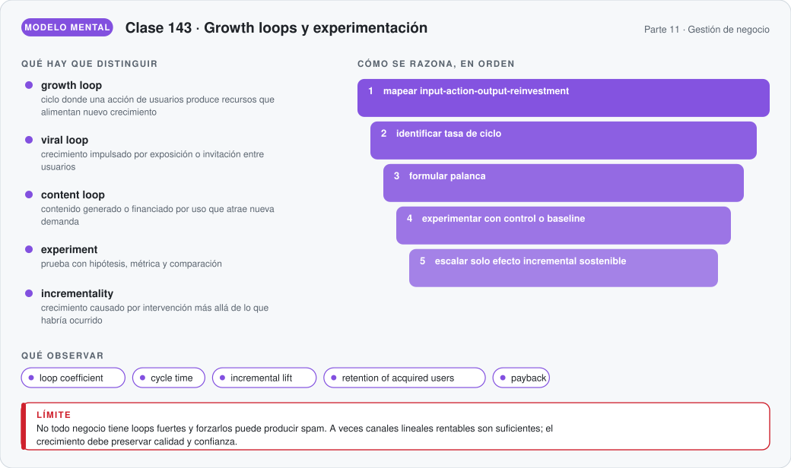

# Clase 143 — Growth loops y experimentación

<!-- nav:inicio -->
> **Parte 11 · Marketing, cliente y crecimiento** — clase 11 de 12 · [índice de la parte](../../README.md) · [temario](../../../../SYLLABUS.md)
<!-- nav:fin -->

**Parte:** 11 — Marketing, cliente y crecimiento  
**Nivel:** Etapa 3 — Manager → Gerente  
**Duración sugerida:** 150–180 minutos · **Estándar:** deep-class-v2

## 🎯 Propósito

La mayoría de las empresas piensa el crecimiento como un embudo: se invierte en atraer personas por arriba y se espera que algunas lleguen abajo. Pero hay otra forma de crecer, que se parece más a un motor que se alimenta a sí mismo: un **ciclo de crecimiento** (*growth loop*) en que el resultado de cada vuelta —un cliente satisfecho, un contenido publicado, una invitación enviada— se convierte en la entrada de la siguiente, de modo que cada cliente reduce el costo de conseguir al próximo. Los ciclos no se improvisan: se diseñan sobre un producto que entrega valor, se miden en cada paso y se mejoran con **experimentos** disciplinados. Sin experimentación honesta, el crecimiento se vuelve una lista de trucos cuyo efecto nadie sabe si es real.

La clase se apoya en el enfoque de crecimiento basado en experimentos de Ellis y Brown, en el rigor de las pruebas controladas de Kohavi, Tang y Xu, en el análisis de hábitos y usos de Eyal (con sus límites éticos) y en la búsqueda de canales de Weinberg y Mares. Al terminar sabrás distinguir embudo y ciclo, identificar los tipos de ciclo, diseñar un ciclo con sus métricas, priorizar y ejecutar experimentos válidos y reconocer los riesgos de un crecimiento que explota a los usuarios.

## 📚 Resultados de aprendizaje

Al finalizar podrás:

1. **Distinguir** un ciclo de crecimiento de un embudo lineal.
2. **Identificar** los tipos de ciclo: viral, de contenido, de pago y de producto.
3. **Diseñar** un ciclo con sus pasos, métricas y puntos de fricción.
4. **Priorizar y ejecutar** experimentos con un proceso disciplinado.
5. **Evaluar** los riesgos éticos, de calidad y de dependencia de los ciclos.

## 🧭 Agenda

| Tramo | Qué se hace |
|---|---|
| 0–20 min | Recuperación: ¿qué hacen tus clientes actuales que atrae, sin querer, a otros clientes? |
| 20–60 min | Ciclos, tipos, métricas, experimentación y ética. |
| 60–105 min | Ejemplo trabajado: ciclo de recomendación en una aplicación de servicios. |
| 105–150 min | Caso ejecutivo y práctica. |
| 150–175 min | Límites y entregable. |

## 🧩 Conceptos centrales

| Concepto | Definición | Cómo se reconoce |
|---|---|---|
| **Ciclo de crecimiento (growth loop)** | Secuencia en que la salida de un paso alimenta la entrada del siguiente, generando más usuarios. | Cada cliente aporta a captar otros. |
| **Ciclo viral** | Los usuarios invitan o exponen el producto a otros. | Invitaciones, compartir, menciones. |
| **Ciclo de contenido** | El uso o la contribución de usuarios genera contenido que atrae a otros. | Reseñas, publicaciones, resultados indexables. |
| **Ciclo de pago** | Los ingresos de los clientes se reinvierten en adquirir más clientes. | Retorno de la publicidad financia más publicidad. |
| **Coeficiente de ciclo** | Número promedio de usuarios nuevos que genera cada usuario en una vuelta. | Mayor que 1 implica crecimiento autosostenido. |
| **Experimento de crecimiento** | Prueba controlada de una hipótesis sobre una etapa del ciclo. | Tiene hipótesis, métrica, muestra y decisión. |

## 🧠 Modelo mental

**Cómo leer el diagrama.** Cuatro pasos con una flecha de retorno. **Llega un usuario** por algún canal; **recibe valor pronto** (activación); **genera una acción de crecimiento** (invita, comparte, publica o contribuye con su uso); y esa acción **atrae a otros**, que entran al ciclo. Cada vuelta reduce el costo de adquirir al siguiente. La nota advierte que un ciclo se diseña, se mide en cada paso y se mejora con experimentos, y que los ciclos que empujan a los usuarios a actuar contra sus intereses dañan la confianza.

## 📖 Desarrollo

### 1. Del embudo al ciclo

En un embudo, el crecimiento depende de seguir inyectando atención por arriba; si se deja de invertir, el flujo se detiene. En un ciclo, parte de la salida se **reinvierte** en la entrada: los usuarios satisfechos recomiendan, los contenidos generados por el uso atraen búsquedas, las ganancias de la publicidad financian más publicidad. Ellis y Brown describen el crecimiento como un proceso de análisis y experimentación sobre el **producto completo**, no solo sobre el marketing: el equipo de crecimiento reúne marketing, producto, datos e ingeniería para encontrar y mejorar los motores de crecimiento. Un ciclo no sustituye a los canales de adquisición; los complementa y los hace más baratos con el tiempo.

### 2. Tipos de ciclo

Entre los tipos más frecuentes: **viral** (los usuarios invitan a otros, por necesidad del producto —se necesita a otras personas para usarlo— o por incentivos); **de contenido** (lo que los usuarios crean o hacen genera contenido que atrae búsquedas y visitas, como reseñas, perfiles, preguntas y respuestas); **de pago** (el ingreso por cliente supera el costo de adquirirlo y se reinvierte); **de producto** (el uso mismo expone el producto a nuevos usuarios, como los documentos compartidos); y **de ventas o alianzas** (los clientes satisfechos generan referencias que alimentan al equipo comercial). Cada negocio tiene uno o dos ciclos naturales; forzar uno que no corresponde al producto fracasa.

### 3. Medir un ciclo

Para cada ciclo se definen: la **unidad** (usuario, cliente, contenido), los **pasos**, la **conversión** en cada uno, el **tiempo de vuelta** y el **coeficiente**: cuántos usuarios nuevos genera cada usuario en promedio. Si cada usuario invita a 3 personas y el 20 % de ellas se registra y se activa, el coeficiente es 0,6 por vuelta; si pasa de 1, el ciclo se sostiene por sí solo (algo muy raro y que decae), y si es menor que 1, **amplifica** la adquisición pagada: cada cliente comprado genera una fracción adicional. El **tiempo de vuelta** importa tanto como el coeficiente: un ciclo que tarda 30 días tiene mucho menos efecto que uno de 3. Se miden por cohortes.

### 4. Diseñar un ciclo

Se parte del **valor**: ¿por qué un usuario hablaría del producto o lo mostraría? El ciclo funciona si la acción de crecimiento es **natural** y **beneficia al usuario**, no si se le engaña o presiona. Eyal describe cómo los productos que crean hábitos siguen un patrón de **disparador, acción, recompensa variable e inversión**; sirve para entender el uso recurrente, pero tiene un riesgo evidente: el mismo patrón puede usarse para generar dependencia. Se aplica con una **prueba ética**: ¿el usuario, informado, estaría de acuerdo con lo que el diseño busca? El ciclo se simplifica: menos pasos, menos fricción, más claridad (clase 141).

### 5. Proceso de experimentación

Ellis y Brown proponen un ciclo semanal: **recoger ideas**, **priorizarlas** (con un puntaje que combine impacto esperado, confianza y facilidad), **ejecutar** las seleccionadas, **analizar** y **aprender**. Cada experimento tiene **hipótesis** («si mostramos el avance del usuario en la invitación, aumentará el porcentaje de usuarios que invitan en 10 %»), **métrica principal** y **de protección**, **muestra**, **duración** y **criterio de decisión**. Se registran todos, también los que fracasan, en una biblioteca de aprendizajes. La cadencia importa: un equipo que hace dos experimentos al trimestre aprende muy lento; uno que hace diez a la semana sin rigor aprende cosas falsas.

### 6. Rigor estadístico y prácticas

Kohavi, Tang y Xu advierten que la mayoría de las ideas **no mejora** la métrica (según su experiencia en grandes plataformas, solo una minoría de los experimentos logra un efecto positivo), que los resultados «espectaculares» suelen ser **errores** (fallos de asignación, de medición o de ruido) y que se requiere **desconfiar** de lo que parece demasiado bueno. Prácticas: pruebas **A/A** para validar la infraestructura, verificación de la **asignación aleatoria**, **no mirar** resultados para decidir cuándo detener, **corregir** por múltiples comparaciones, tener métricas de **calidad** y de **protección**, y replicar los hallazgos importantes. Con poco tráfico, se usan experimentos más grandes o evidencia cualitativa.

### 7. Riesgos y ética

Los ciclos pueden derivar en prácticas que dañan: **spam** (importar contactos y enviar invitaciones sin que el usuario lo entienda), **recompensas que distorsionan** (referidos falsos), **notificaciones que invaden**, **diseño adictivo**, **uso de datos de terceros sin consentimiento**. Pueden ser ilegales (normas de comunicaciones comerciales, de protección de datos y de consumo) y suelen terminar en pérdida de confianza y sanciones de plataformas. También hay riesgo de **dependencia**: un ciclo apoyado en una plataforma de terceros desaparece si esta cambia sus reglas. Una regla de oro: crecer porque el producto es mejor para quien lo usa, no porque se aprovecha de quien lo usa.

## 📚 Lectura comparada

| Obra | Qué aporta | Qué no resuelve | Pregunta para contrastar |
|---|---|---|---|
| Ellis y Brown | Proceso de crecimiento por experimentos y equipo multifuncional. | Enfoque en productos digitales. | ¿Cuál es tu cadencia de experimentos? |
| Kohavi, Tang y Xu | Rigor, trampas y cultura de experimentación. | Escala de plataformas grandes. | ¿Confías en tus resultados? |
| Eyal | Patrón de formación de hábitos y su aplicación en productos. | Riesgo ético; evidencia heterogénea. | ¿Tu diseño ayuda al usuario o lo captura? |
| Weinberg y Mares | Búsqueda sistemática de canales de tracción. | Casos de startups. | ¿Qué canal escalarías primero? |
| Moore | Expansión por adyacencia y referencias. | Contexto de tecnología B2B. | ¿Qué cliente puede ser tu referencia? |

## 🧮 Ejemplo trabajado

**Situación (hipotética).** Una aplicación para contratar servicios del hogar (limpieza, reparaciones) tiene 40.000 clientes activos y capta 3.000 nuevos al mes con publicidad a un costo de USD 28 cada uno. Quiere explorar un ciclo de recomendación.

**Ciclo propuesto.** Tras un servicio bien evaluado (calificación de 5), el cliente recibe la opción de compartir un código que da a un amigo USD 8 de descuento en su primer servicio y a quien invita otros USD 8 de crédito cuando el amigo completa su servicio.

**Medición de línea base (cohorte de 2 meses).**

| Paso | Dato |
|---|---|
| Clientes que completan un servicio con 5 estrellas | 52 % |
| De ellos, ven la opción de compartir | 100 % |
| Porcentaje que comparte | 9 % |
| Invitaciones promedio por quien comparte | 2,4 |
| Porcentaje de invitados que completa un primer servicio | 18 % |

**Coeficiente de ciclo por cliente que completa un servicio.** 0,52 × 0,09 × 2,4 × 0,18 ≈ 0,020 por cada cliente activo que completa un servicio. Con 3.000 nuevos al mes, cada vuelta aporta cerca de 60 clientes adicionales (2 %), con un costo de USD 16 en descuentos y créditos por cliente nuevo: un 43 % menos que los USD 28 de la publicidad.

**Experimentos de mejora (prioridad por impacto, confianza y facilidad).**

| Experimento | Hipótesis | Métrica | Resultado |
|---|---|---|---|
| Mensaje en el momento de calificar 5 estrellas | Pedir compartir justo tras la calificación sube el porcentaje que comparte de 9 % a 12 % | Compartir | 11,4 % (mejora relativa 27 %, significativa) |
| Mostrar el beneficio al amigo, no solo al que invita | Aumenta la tasa de uso del invitado de 18 % a 23 % | Servicios completados | 21 % (mejora no concluyente en 4 semanas) |
| Permitir compartir por mensajería sin acceso a contactos | Evita fricción y rechazo de permisos | Compartir y quejas | Compartir +15 %; quejas sin cambio |

**Protección.** Se miden quejas de spam, calificación de la aplicación y devoluciones; no se importan contactos del usuario sin consentimiento claro. Se registra cada experimento en la biblioteca de aprendizajes.

**Resultado a tres meses.** El coeficiente sube a 0,031 y el costo por cliente adquirido por el ciclo baja a USD 15, sin afectar la satisfacción. El ciclo complementa, no reemplaza, la publicidad: la dirección decide aumentar el presupuesto del programa y mantener la inversión en canales pagados.

**Qué muestra.** (1) El coeficiente se descompuso en pasos medibles. (2) Los experimentos atacaron un paso cada vez. (3) Se cuidó la calidad y la privacidad.

## 🔀 Comparación y límites

**Ciclo frente a canal.** Un canal es un camino de adquisición que se compra o se trabaja; un ciclo es un mecanismo en que los clientes generan adquisición. Se combinan.

**Límites.** Los coeficientes típicos de ciclos son menores que 1, por lo que rara vez reemplazan la adquisición: la reducen. Los ciclos dependen del producto y del contexto. Los experimentos fallidos son la norma, y los resultados positivos pueden no replicarse. Existen riesgos éticos y legales (comunicaciones, datos, consumo) que se verifican en su fuente vigente y con asesoría. Las cifras del ejemplo son ilustrativas y la baja proporción de experimentos exitosos proviene de la experiencia de grandes plataformas.

## 🪜 De profesional a owner

| Nivel | Cómo participa en ciclos y experimentos |
|---|---|
| **Profesional** | Propone hipótesis y ejecuta experimentos con rigor. |
| **Jefe / Team Lead** | Gestiona la cadencia y la biblioteca de aprendizajes. |
| **Gerente** | Define los ciclos, las métricas y los límites éticos. |
| **CEO / Director** | Protege la cultura de aprender de los resultados negativos. |
| **Founder / Owner** | Busca primero que el producto sea tan útil que los usuarios lo recomienden. |

## 🏢 Caso ejecutivo

Una aplicación de finanzas personales con 500.000 usuarios lanzó un programa de referidos con USD 10 por cada invitado que se registre. El equipo de crecimiento implementó un paso en que, al registrarse, la aplicación solicita acceso a los contactos y envía invitaciones preseleccionadas con el nombre del usuario. En dos meses, los registros subieron 38 %, pero el 41 % de los referidos son cuentas que nunca se activan, se detectaron redes de cuentas falsas que cobran el incentivo, las quejas por correos no solicitados se multiplicaron por cuatro y el proveedor de correo bloqueó parte del dominio. La retención a 90 días de los referidos es de 12 %, frente a 38 % de los otros canales. La gerencia de producto propone retirar el programa; la de crecimiento, mejorarlo con controles.

Entrega un **diseño de ciclo y programa de experimentos** que contenga: (a) el ciclo actual, sus pasos, el coeficiente y los problemas de calidad; (b) un rediseño del ciclo basado en valor para el usuario y su invitado; (c) las métricas de ciclo y de protección; (d) un plan de experimentos priorizado con hipótesis, muestra y criterios; (e) los controles contra fraude y spam; (f) las verificaciones de comunicaciones comerciales, consentimiento y protección de datos y del dinero que se realizarán con asesoría y las normas vigentes.

## 🧪 Práctica

1. Dibuja un ciclo de crecimiento posible de tu producto con sus cuatro pasos.
2. Calcula su coeficiente con datos aproximados y el tiempo de una vuelta.
3. Escribe tres hipótesis de experimentos para el paso más débil.
4. Define las métricas de protección de tu ciclo.
5. Haz la prueba ética: ¿qué diría un usuario informado de tu diseño?

## ⚠️ Errores frecuentes

| Error | Por qué ocurre | Cómo corregirlo |
|---|---|---|
| Forzar un ciclo que el producto no tiene | Se copian casos ajenos | Partir del valor y del uso natural. |
| Medir solo registros | Es fácil | Medir activación, retención y calidad. |
| Experimentos sin rigor | Se busca velocidad | Hipótesis, muestra y criterio previos. |
| Premiar referidos sin control | Se busca volumen | Controles contra fraude y calidad. |
| Spam y permisos invasivos | Se maximiza el corto plazo | Consentimiento y diseño honesto. |
| Depender de una plataforma | Es el canal del ciclo | Diversificar y proteger la propiedad de datos. |

## ❓ Preguntas de comprobación

1. ¿Qué diferencia hay entre un embudo y un ciclo de crecimiento?
2. ¿Qué tipos de ciclo existen?
3. ¿Qué mide el coeficiente de ciclo y por qué importa el tiempo de vuelta?
4. ¿Cuáles son los componentes de un experimento de crecimiento?
5. ¿Por qué se desconfía de resultados espectaculares?
6. ¿Qué riesgos éticos tienen los ciclos?
7. ¿Por qué rara vez un ciclo reemplaza la adquisición?

Claves de respuesta

1. El embudo depende de inyectar atención por arriba; el ciclo reinvierte parte de la salida en la entrada, de modo que cada cliente ayuda a captar al siguiente.
2. Viral, de contenido, de pago, de producto y de ventas o alianzas.
3. El número de usuarios nuevos que genera cada usuario por vuelta; el tiempo de vuelta determina qué tan rápido actúa el ciclo.
4. Hipótesis, métrica principal y de protección, muestra, duración y criterio de decisión.
5. Porque suelen deberse a errores de asignación, de medición o de ruido, y la mayoría de las ideas no mejora la métrica.
6. Spam, incentivos que distorsionan, notificaciones invasivas, diseño adictivo y uso de datos sin consentimiento.
7. Porque su coeficiente suele ser menor que 1: la reducen y complementan, no la sustituyen.

## 📥 Entregable

Guarda en `portfolio/143-growth-loops-y-experimentacion/`:

- `leadership-decision-brief.md` (plantilla [Leadership Decision Brief](../../../../templates/leadership-decision-brief.md)) con el diseño del caso ejecutivo;
- `product-experiment.md` (plantilla [Product experiment](../../../../templates/product-experiment.md)) con el plan de experimentos y las métricas de protección;
- `decision-journal.md` con los aprendizajes, el coeficiente y los límites éticos.

## 📗 Fuentes y verificación

- Sean Ellis & Morgan Brown — *Hacking Growth* (Ebury Publishing, 2017). **Uso en esta clase:** proceso de crecimiento por experimentos y equipo multifuncional. Lectura selectiva sobre **growth loops y experimentación**. **Localizador:** [ISBN-13 9780753545386](https://openlibrary.org/isbn/9780753545386).
- Ron Kohavi, Diane Tang & Ya Xu — *Trustworthy Online Controlled Experiments* (Cambridge University Press, 2020). **Uso en esta clase:** rigor, trampas y cultura de experimentación. Lectura selectiva sobre **growth loops y experimentación**. **Localizador:** [ISBN-13 9781108724265](https://openlibrary.org/isbn/9781108724265).
- Nir Eyal — *Hooked* (Portfolio/Penguin, 2014). **Uso en esta clase:** patrón de formación de hábitos y su aplicación. Lectura selectiva sobre **growth loops y experimentación**. **Localizador:** [ISBN-13 9781591847786](https://openlibrary.org/isbn/9781591847786).
- Gabriel Weinberg & Justin Mares — *Traction* (Gildan Media, 2015). **Uso en esta clase:** búsqueda sistemática de canales de tracción. Lectura selectiva sobre **growth loops y experimentación**. **Localizador:** [ISBN-13 9781469096230](https://openlibrary.org/isbn/9781469096230).
- Geoffrey A. Moore — *Crossing the Chasm* (HarperBusiness, 1995). **Uso en esta clase:** expansión por adyacencia y referencias. Lectura selectiva sobre **growth loops y experimentación**. **Localizador:** [ISBN-13 9780887307171](https://openlibrary.org/isbn/9780887307171).

> **Regla de fuentes para Growth loops y experimentación:** las obras anteriores estructuran las perspectivas de esta materia; cualquier norma, ley o estándar vivo mencionado debe comprobarse nuevamente en su fuente primaria vigente, incluidas las de comunicaciones comerciales, protección de datos, consumo y programas de incentivos. Los ejemplos y casos son hipotéticos, con cifras ilustrativas. El desarrollo es original y no reproduce capítulos protegidos.

<!-- pie:inicio -->
---

| Anterior | Índice | Siguiente |
|---|---|---|
| [← 142 · Retención, lealtad y customer success](../142-retencion-lealtad-y-customer-success/README.md) | [Parte 11](../../README.md) · [Programa](../../../../SYLLABUS.md) | [144 · Capstone: go-to-market →](../144-capstone-go-to-market/README.md) |
<!-- pie:fin -->
