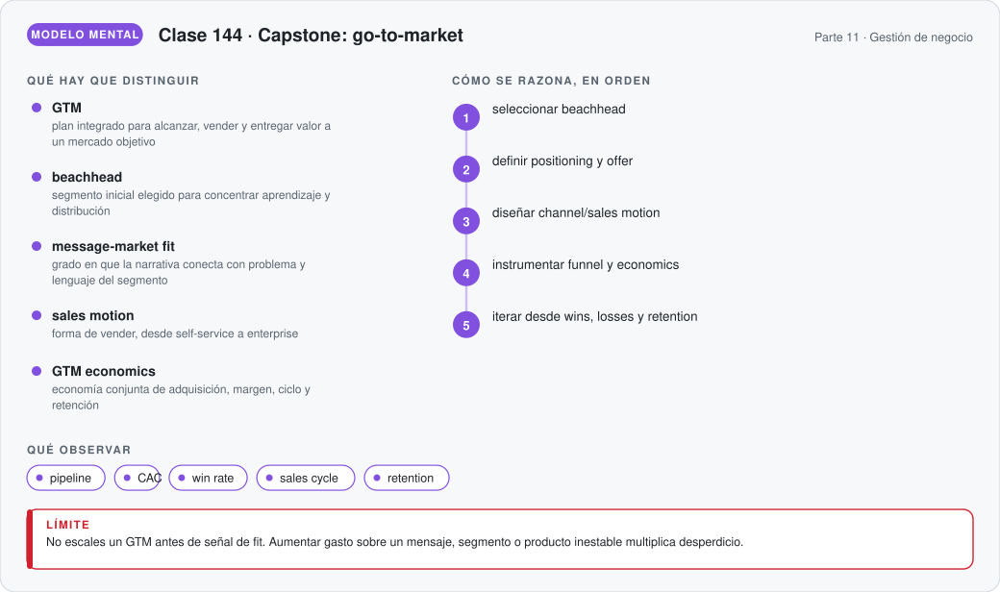

# Clase 144 — Capstone: go-to-market

<!-- nav:inicio -->
> **Parte 11 · Marketing, cliente y crecimiento** — clase 12 de 12 · [índice de la parte](../../README.md) · [temario](../../../../SYLLABUS.md)
<!-- nav:fin -->

**Parte:** 11 — Marketing, cliente y crecimiento  
**Nivel:** Etapa 3 — Manager → Gerente  
**Duración sugerida:** 150–180 minutos · **Estándar:** deep-class-v2

## 🎯 Propósito

Un plan de salida al mercado (*go-to-market*) no es un calendario de campañas: es el conjunto de decisiones que determinan **a quién** se le vende, **qué** se le ofrece, **cómo** se le llega, **cuánto** se cobra y **cómo se sabrá** si funciona. Muchos lanzamientos fracasan porque se resuelve primero lo visible (el logotipo, la campaña, el sitio) y se posponen las preguntas difíciles: ¿hay suficientes clientes con este problema?, ¿pagarían este precio?, ¿cómo llegamos a ellos con un costo sostenible?, ¿qué ocurre después de la primera compra? Un buen plan convierte esas preguntas en hipótesis con métricas de éxito y de detención.

Este capstone integra la parte 11: mercado y demanda (133), investigación (134), segmentación (135), posicionamiento (136), marca y confianza (137), recorrido del cliente (138), canales (139), adquisición y contenido (140), conversión (141), retención (142) y crecimiento por experimentos (143). Se apoya en Kotler y Keller, Moore, Dunford, Sharp, Ellis y Brown, y Weinberg y Mares. Al terminar sabrás construir un plan de salida al mercado coherente, someterlo a crítica, definir su economía unitaria y su calendario de aprendizaje, y decidir con criterios cuándo escalar, ajustar o detener.

## 📚 Resultados de aprendizaje

Al finalizar podrás:

1. **Estructurar** un plan de salida al mercado de dónde jugar, cómo ganar y cómo aprender.
2. **Conectar** mercado, segmento, posicionamiento, precio, canales y mensajes en una lógica coherente.
3. **Estimar** la economía unitaria y el capital necesario del plan.
4. **Diseñar** los experimentos y los hitos de decisión del lanzamiento.
5. **Presentar** el plan a un comité con riesgos, supuestos y criterios de detención.

## 🧭 Agenda

| Tramo | Qué se hace |
|---|---|
| 0–20 min | Recuperación: ordena las diez preguntas que harías a un plan de lanzamiento antes de aprobar el presupuesto. |
| 20–60 min | Dónde jugar, cómo ganar, cómo aprender. |
| 60–105 min | Ejemplo trabajado: plan de salida al mercado de un servicio de datos para pymes. |
| 105–150 min | Caso ejecutivo integrado. |
| 150–175 min | Rúbrica, límites y entregable. |

## 🧩 Conceptos centrales

| Concepto | Definición | Cómo se reconoce |
|---|---|---|
| **Plan de salida al mercado (GTM)** | Conjunto de decisiones y acciones para llevar una oferta a un segmento y crecer con ella. | Une mercado, oferta, precio, canales y métricas. |
| **Hipótesis de lanzamiento** | Supuesto sobre clientes, valor, precio o canales que se debe probar. | Tiene métrica y fecha de decisión. |
| **Economía unitaria** | Valor y costo de ganar y servir a un cliente. | CAC, margen, retención y payback. |
| **Hito de decisión** | Punto en que se decide escalar, ajustar o detener. | Criterios definidos de antemano. |
| **Mínimo producto vendible** | Oferta más simple que un segmento pagaría. | Permite aprender con ventas reales. |
| **Criterio de detención** | Resultado que lleva a pausar o cerrar el lanzamiento. | Evita seguir por inercia. |

## 🧠 Modelo mental

**Cómo leer el diagrama.** Tres columnas. **Dónde jugar** reúne el mercado, el segmento y el cliente ideal (133 a 135), las alternativas del cliente y la categoría (136) y la marca y la confianza (137). **Cómo ganar** reúne la propuesta y el recorrido del cliente (138), los canales y la adquisición (139 y 140) y la conversión y la retención (141 y 142). **Cómo aprender** reúne las métricas por etapa, la economía unitaria, los experimentos (143) y la revisión trimestral con reasignación de recursos. La nota recuerda que el plan es un conjunto de hipótesis con métricas de éxito y de detención.

## 📖 Desarrollo

### 1. Dónde jugar

Se parte del **mercado** definido desde el problema del cliente y estimado desde abajo (clase 133), de la **investigación** que valida que el problema existe y es importante (134) y de la **segmentación** que elige el segmento inicial y describe al cliente ideal (135). Se define el **posicionamiento**: alternativas, atributos únicos, valor, clientes que más lo valoran y categoría (136), junto con la **marca** y las señales de confianza que hacen creíble la promesa (137). La salida de este bloque es una página: **para quién**, **qué problema**, **qué valor**, **frente a qué alternativa** y **con qué prueba**. Si esa página no es clara, lo demás se construye sobre arena.

### 2. Cómo ganar: propuesta, precio y recorrido

Con el posicionamiento, se diseña la **oferta mínima vendible**, el **precio** (basado en valor, clase 129) y el **recorrido del cliente** (138): cómo descubre, considera, compra, usa y renueva, con los momentos críticos y quién es dueño de cada uno. El **mensaje** se adapta a cada etapa y a cada rol del comprador. La **promesa** se contrasta con lo que el producto y el servicio pueden cumplir: Dunford destaca que el mayor riesgo del posicionamiento es prometer lo que la organización no entrega. Se prepara el **plan de implantación** o de primer valor, porque la retención se juega en las primeras semanas (142).

### 3. Cómo ganar: canales y adquisición

Se eligen **canales** según el segmento y la economía (139) y se planifica la **adquisición** con medios pagados, propios y ganados (140). Weinberg y Mares sugieren probar varios canales con inversiones pequeñas y concentrarse en uno o dos que muestren costo por cliente sostenible. Se define el **contenido** que responde las preguntas reales del cliente, las **alianzas** con quienes ya tienen acceso a él y el rol de **ventas** si el producto lo exige. Se fija un **presupuesto de aprendizaje** distinto del de escala: primero se gasta para saber qué funciona; después, para ampliarlo.

### 4. Cómo ganar: conversión y retención

Se define el **embudo** con eventos medibles (141), el momento de **activación** y las acciones para llegar a él pronto. Se diseñan las prácticas de **éxito del cliente** (142), las señales de riesgo y la política de cancelación y de datos, que debe ser honesta. Se planifica el **ciclo de crecimiento** posible (143): referencias, contenido, uso compartido, sin técnicas que engañen. Sharp recuerda que las marcas crecen sobre todo ampliando el alcance; por eso se equilibra la inversión entre capturar la demanda actual y construir **disponibilidad mental y física** para los compradores futuros.

### 5. Cómo aprender: métricas, economía y experimentos

Se define un **tablero** corto con indicadores por etapa y de resultado: tráfico calificado, conversión por etapa, activación, CAC por canal, margen, retención por cohorte, ingresos y caja. Se calcula la **economía unitaria** esperada (clase 117) y el **capital necesario** hasta el punto de equilibrio. Se listan las **hipótesis principales** (segmento, precio, canal, mensaje, activación) con la **prueba** más barata de cada una y su **criterio de éxito**. Ellis y Brown proponen una cadencia semanal de experimentos; Kohavi, Tang y Xu, rigor para no engañarse con el ruido. Un plan sin hipótesis explícitas no aprende: ejecuta.

### 6. Hitos, escalamiento y detención

El plan se divide en **fases**: **validar** (clientes reales, señales de pago, primeros resultados), **demostrar** (economía unitaria positiva en el segmento inicial) y **escalar** (más canales, más segmentos, más inversión). Cada fase termina con un **hito de decisión** con criterios numéricos acordados antes: por ejemplo, «si en 90 días no logramos 20 clientes con un CAC menor a USD 400 y activación sobre 50 %, se pausa la inversión y se replantea el segmento». Los criterios de detención evitan la **escalada del compromiso** (clase 083). Se acuerdan **dueños**, **calendario**, **presupuesto por fase** y **quién decide**.

### 7. Presentar el plan y gestionar riesgos

Se presenta al comité con la **tesis** de una página, la **economía unitaria**, el **capital** y el **calendario**, los **riesgos** principales (mercado, producto, canal, competencia, ejecución, regulación, dependencia de plataformas) con **mitigaciones** y los **supuestos** más sensibles con su sensibilidad. Se incluye la **alternativa cero** (no lanzar o esperar) y una versión **por etapas**. Se aplican las reglas de publicidad, consumo, datos y competencia del mercado de destino, verificadas en su fuente vigente y con asesoría. El comité evalúa con los criterios de la clase 120: tesis, números, riesgos y decisión con condiciones.

## 📚 Lectura comparada

| Obra | Qué aporta | Qué no resuelve | Pregunta para contrastar |
|---|---|---|---|
| Kotler y Keller | Proceso de marketing: segmentar, elegir, posicionar y gestionar el mix. | Marco general. | ¿Tu plan responde a cada decisión del mix? |
| Moore | Segmento inicial y expansión por adyacencia. | Contexto tecnológico. | ¿Qué segmento dominarás primero? |
| Dunford | Posicionamiento como base del plan. | Se centra en el posicionamiento. | ¿Tu promesa es cumplible? |
| Sharp | Alcance, disponibilidad y distintividad como motores del crecimiento. | Visión de marcas de consumo. | ¿Estás construyendo alcance o solo capturando? |
| Ellis y Brown | Cadencia de experimentación y crecimiento multifuncional. | Enfoque digital. | ¿Qué hipótesis probarás primero? |

## 🧮 Ejemplo trabajado

**Situación (hipotética).** Una empresa ofrece un servicio de tableros de gestión con datos de ventas e inventario para distribuidoras pequeñas y medianas (10 a 60 empleados) en un país de 20 millones de habitantes. Dispone de USD 600.000 de capital para 18 meses.

**Dónde jugar.** Mercado alcanzable: 3.800 distribuidoras de ese tamaño que usan algún sistema contable y venden a comercios; precio anual de USD 2.400 → USD 9,1 millones. Obtenible a 3 años con 3 vendedores y una alianza con contadores: 5 % (190 clientes) → USD 456.000 anuales. Segmento inicial: distribuidoras de alimentos y de ferretería con 15 a 40 empleados. Posicionamiento: alternativa principal, las planillas; atributo único, conexión sin programar con tres sistemas contables comunes; valor: ver cada mañana margen por cliente y quiebres de stock; categoría: «control de gestión diario para distribuidoras».

**Cómo ganar.** Oferta mínima: tres tableros y alertas; precio USD 200 mensuales con 30 días de prueba con datos propios. Canales: alianza con 15 estudios contables (comisión del 15 % del primer año), contenido práctico (guías con las preguntas más frecuentes) y venta directa a cuentas elegidas. Recorrido: primer tablero con datos reales en 5 días (hito de activación). Retención: revisión de valor a los 45 y 90 días.

**Cómo aprender.**

| Hipótesis | Prueba | Criterio de éxito (90 días) |
|---|---|---|
| Los distribuidores pagan USD 200 mensuales | 25 pruebas con datos propios; conversión a pago | ≥ 36 % (9 pagos) |
| Los contadores recomiendan y cierran | 6 estudios activos con 3 referencias cada uno | ≥ 8 clientes por canal de alianza, CAC ≤ USD 450 |
| La activación en 5 días predice retención | Cohorte de 40 clientes | Retención a 90 días ≥ 85 % entre los activados |
| El contenido genera oportunidades calificadas | 12 guías | ≥ 25 oportunidades a USD ≤ 150 |

**Economía unitaria esperada.** Margen mensual 78 % (USD 156), baja anual 15 % (duración ≈ 6,7 años); LTV aproximado (sin descuento) USD 12.500; CAC objetivo ≤ USD 700; payback ≈ 4,5 meses. Capital necesario hasta equilibrio: USD 450.000 en 18 meses, con holgura de 25 %.

**Hitos.** Día 90: validación (criterios arriba). Mes 9: economía unitaria positiva en el segmento inicial (CAC ≤ 700; retención ≥ 85 %); si se cumple, se amplía a ferreterías de mayor tamaño y a un segundo país. Mes 15: decisión de escalar con inversión adicional o consolidar.

**Riesgos principales.** Dependencia de tres sistemas contables (cambios en sus interfaces); ciclos de decisión más largos que los supuestos; bajo ticket que limita el costo de venta; reglas de datos de clientes de las distribuidoras. Mitigaciones: acuerdos de integración, prueba con datos propios, canal de alianzas, política de datos y cláusulas contractuales revisadas por asesoría.

**Qué muestra.** (1) El plan encadenó mercado, posicionamiento, canal, precio y métricas. (2) Cada hipótesis tenía prueba y criterio. (3) Los hitos de decisión protegieron el capital.

## 🔀 Comparación y límites

**Plan de salida al mercado frente a plan de marketing.** El de marketing detalla acciones y presupuestos de comunicación; el de salida al mercado decide a quién, con qué oferta y por qué canales se crece, y cómo se sabrá si funciona. El primero es parte del segundo.

**Límites.** Todo plan de lanzamiento contiene incertidumbre irreducible; el valor está en aprender rápido y barato. Las cifras del ejemplo son ilustrativas. Los plazos reales dependen de la capacidad de la empresa y de la competencia. Los casos y marcos citados provienen de sectores y épocas distintas. Las decisiones con implicancias legales, regulatorias, tributarias, de publicidad, de datos y de contratos con socios y proveedores requieren asesoría especializada.

## 🪜 De profesional a owner

| Nivel | Cómo participa en el plan de salida al mercado |
|---|---|
| **Profesional** | Ejecuta con calidad, mide y aporta lo que escucha de clientes. |
| **Jefe / Team Lead** | Lleva una parte del plan con hipótesis y métricas propias. |
| **Gerente** | Integra mercado, oferta, canales y métricas y responde por el resultado. |
| **CEO / Director** | Aprueba por fases, protege el aprendizaje y respeta los criterios de detención. |
| **Founder / Owner** | Vende personalmente a los primeros clientes y aprende de cada conversación. |

## 🏢 Caso ejecutivo

Una empresa de salud digital de 80 personas ha desarrollado una aplicación de seguimiento de enfermedades crónicas para pacientes y clínicas. Presenta al comité un plan de salida al mercado en tres países con un presupuesto de USD 4 millones en 24 meses. El plan incluye una campaña de publicidad masiva a pacientes, un equipo de 12 vendedores para clínicas, alianzas con aseguradoras y una versión en tres idiomas. Los argumentos: «el mercado de salud digital es de USD 200.000 millones» y «con el 0,1 % tendremos USD 200 millones». Los datos del piloto: 6 clínicas, 1.100 pacientes; la adherencia a 90 días es de 58 %; solo 2 de las 6 clínicas quieren pagar; los pacientes no pagan; las aseguradoras piden evidencia de reducción de costos que aún no existe. Hay regulación de dispositivos médicos y de datos de salud en cada país.

Entrega un **plan de salida al mercado revisado** que contenga: (a) el mercado alcanzable y obtenible con método ascendente y el segmento inicial; (b) el posicionamiento con alternativas y la propuesta; (c) el modelo de ingresos, el precio y los canales con la economía unitaria; (d) las hipótesis críticas, los experimentos y los hitos de decisión por fases; (e) el capital por fase y los criterios de detención; (f) los riesgos y los requisitos regulatorios, de datos de salud y de publicidad que se verificarán en las normas vigentes de cada país y con asesoría.

## 🧪 Práctica

1. Escribe la página «dónde jugar» de un producto real: para quién, problema, valor, alternativa y prueba.
2. Calcula el mercado obtenible con método ascendente y la capacidad comercial necesaria.
3. Lista cinco hipótesis críticas con prueba y criterio de éxito.
4. Define tres hitos de decisión con criterios numéricos y los de detención.
5. Redacta la síntesis de una página que presentarías a un comité.

## ⚠️ Errores frecuentes

| Error | Por qué ocurre | Cómo corregirlo |
|---|---|---|
| Empezar por la campaña | Es lo visible | Partir de mercado, segmento y valor. |
| Un mercado enorme como justificación | Se confunde total con obtenible | Estimar desde abajo con clientes concretos. |
| Plan sin hipótesis | Se planifica actividades | Hipótesis, pruebas y criterios. |
| Escalar antes de validar | Presión por crecer | Fases con hitos de decisión. |
| Ignorar la retención | Se piensa en adquirir | Planificar activación y éxito del cliente. |
| Sin criterios de detención | Se evita el conflicto | Acordarlos antes de gastar. |

## ❓ Preguntas de comprobación

1. ¿Qué tres bloques componen el plan de salida al mercado?
2. ¿Por qué se parte de «dónde jugar»?
3. ¿Qué incluye la economía unitaria del plan?
4. ¿Qué es un hito de decisión y para qué sirve?
5. ¿Cómo se equilibra capturar demanda y construir alcance?
6. ¿Qué debe incluir la presentación al comité?
7. ¿Qué límites tiene un plan de lanzamiento?

Claves de respuesta

1. Dónde jugar, cómo ganar y cómo aprender.
2. Porque mercado, segmento, valor y alternativas definen todo lo demás; sin claridad ahí, el resto se construye sobre supuestos débiles.
3. CAC, margen, retención, duración, valor del cliente y payback, con el capital necesario hasta el equilibrio.
4. Un punto con criterios numéricos acordados antes para escalar, ajustar o detener; evita seguir por inercia.
5. Invirtiendo en respuesta (captura) y también en alcance, disponibilidad mental y física y señales distintivas (construcción).
6. Tesis, economía unitaria, capital y calendario, riesgos con mitigaciones, supuestos sensibles, alternativa cero y versión por etapas.
7. Contiene incertidumbre irreducible; su valor está en aprender rápido y barato, y las decisiones legales y regulatorias requieren asesoría.

## 📥 Entregable

Guarda en `portfolio/144-capstone-go-to-market/`:

- `gtm-plan.md` (plantilla [GTM plan](../../../../templates/gtm-plan.md)) con el plan revisado del caso ejecutivo;
- `leadership-decision-brief.md` (plantilla [Leadership Decision Brief](../../../../templates/leadership-decision-brief.md)) con la síntesis de una página para el comité;
- `modelo-financiero-y-memo-de-decision.md` (plantilla [Modelo financiero y memo de decisión](../../../../templates/modelo-financiero-y-memo-de-decision.md)) con la economía unitaria y el capital por fase;
- `decision-journal.md` con las hipótesis, los hitos y los criterios de detención.

## 📗 Fuentes y verificación

- Philip Kotler & Kevin Lane Keller — *Marketing Management* (Pearson Education, 2016). **Uso en esta clase:** proceso de marketing y mix. Lectura selectiva sobre **capstone: go-to-market**. **Localizador:** [ISBN-13 9781292092621](https://openlibrary.org/isbn/9781292092621).
- Geoffrey A. Moore — *Crossing the Chasm* (HarperBusiness, 1995). **Uso en esta clase:** segmento inicial y expansión por adyacencia. Lectura selectiva sobre **capstone: go-to-market**. **Localizador:** [ISBN-13 9780887307171](https://openlibrary.org/isbn/9780887307171).
- April Dunford — *Obviously Awesome* (Ambient Press, 2019). **Uso en esta clase:** posicionamiento como base del plan. Lectura selectiva sobre **capstone: go-to-market**. **Localizador:** [ISBN-13 9781999023003](https://openlibrary.org/isbn/9781999023003).
- Byron Sharp — *How Brands Grow* (BookBaby, 2010). **Uso en esta clase:** alcance, disponibilidad y distintividad. Lectura selectiva sobre **capstone: go-to-market**. **Localizador:** [ISBN-13 9781483534701](https://openlibrary.org/isbn/9781483534701).
- Sean Ellis & Morgan Brown — *Hacking Growth* (Ebury Publishing, 2017). **Uso en esta clase:** cadencia de experimentación y crecimiento multifuncional. Lectura selectiva sobre **capstone: go-to-market**. **Localizador:** [ISBN-13 9780753545386](https://openlibrary.org/isbn/9780753545386).

> **Regla de fuentes para Capstone: go-to-market:** las obras anteriores estructuran las perspectivas de esta materia; cualquier norma, ley o estándar vivo mencionado debe comprobarse nuevamente en su fuente primaria vigente, incluidas la regulación de dispositivos y datos de salud, publicidad y consumo de cada país. Los ejemplos y casos son hipotéticos y no describen a ninguna empresa real. El desarrollo es original y no reproduce capítulos protegidos.

<!-- pie:inicio -->
---

| Anterior | Índice | Siguiente |
|---|---|---|
| [← 143 · Growth loops y experimentación](../143-growth-loops-y-experimentacion/README.md) | [Parte 11](../../README.md) · [Programa](../../../../SYLLABUS.md) | [145 · Producto versus proyecto →](../../../12-product-innovation/classes/145-producto-versus-proyecto/README.md) |
<!-- pie:fin -->
