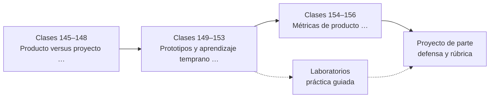

# Parte 12 — Producto e innovación

<!-- parte:inicio -->

> ← [Parte 11 — Marketing, cliente y crecimiento](../11-marketing-customers-growth/README.md) · [Temario](../../SYLLABUS.md) · [Parte 13 — Estrategia y competencia](../13-strategy-competition/README.md) →

*Decidir qué construir, para quién y por qué antes de gastar*

**Etapa:** 4 — Dirección, estrategia y organización  
**Duración:** 12 clases · 30 horas  
**Resultado de salida:** Decidir qué construir, para quién y por qué antes de gastar recursos en ejecución.

🟠 [Ver las 6 etapas](../../SYLLABUS.md) · 12 clases (145–156) · 4 laboratorios · [proyecto de parte](project.md)

## 🎯 De qué trata esta parte

Construir lo que nadie necesita es el desperdicio más caro de una empresa. Esta parte da el método para descubrir problemas reales, probar hipótesis con poco costo y decidir con evidencia.

El eje es **aprendizaje validado**: el MVP es una prueba de hipótesis, el roadmap se ordena por resultados y la señal de ajuste se verifica con conducta, no con opiniones.

## 🧱 Con qué hay que llegar

| Parte | Qué aporta |
|---|---|
| [11 — Marketing, cliente y crecimiento](../11-marketing-customers-growth/README.md) | Segmentación y recorrido del cliente. |
| [01 — Pensamiento crítico y toma de decisiones](../01-critical-thinking-and-decisions/README.md) | Hipótesis, experimentos y causa raíz. |

Cada clase supone la anterior: el orden importa, y saltarse una deja sin base a las que vienen después.

## 📚 Resultados de la parte

Al terminar esta parte podrás:

1. **Distinguir** producto de proyecto y el problema de la solución.
2. **Descubrir** necesidades con entrevistas y Jobs to Be Done.
3. **Probar** con prototipos y MVP como hipótesis.
4. **Ordenar** un roadmap por resultados y costo de oportunidad.
5. **Interpretar** métricas de producto y señales de product-market fit.

## 🗺️ Mapa de la parte

## 🧭 Cómo se encadenan las 12 clases

Las clases **145 a 148** definen el problema: producto, usuario, discovery y Jobs to Be Done.

Las clases **149 a 153** lo prueban: prototipos, MVP, roadmap, priorización y experimentos.

Las clases **154 a 156** lo evalúan: métricas, product-market fit y el capstone de comité de producto.

## 📘 Las 12 clases

| # | Clase | Qué se trabaja | Entregable | Min |
|---:|---|---|---|---:|
| 145 | [Producto versus proyecto](classes/145-producto-versus-proyecto/README.md) | Proyecto, Producto, Resultado (outcome) | [product-evidence-brief](../../templates/product-evidence-brief.md) | 150 |
| 146 | [Problema, usuario y outcome](classes/146-problema-usuario-y-outcome/README.md) | Usuario, Problema, Resultado (outcome) | [leadership-decision-brief](../../templates/leadership-decision-brief.md) | 150 |
| 147 | [Customer discovery](classes/147-customer-discovery/README.md) | Descubrimiento de clientes, Prueba de la madre (Mom Test), Cortesía | [product-evidence-brief](../../templates/product-evidence-brief.md) | 150 |
| 148 | [Jobs to Be Done](classes/148-jobs-to-be-done/README.md) | Trabajo a realizar (job), Contratar y despedir, Circunstancia | [leadership-decision-brief](../../templates/leadership-decision-brief.md) | 150 |
| 149 | [Prototipos y aprendizaje temprano](classes/149-prototipos-y-aprendizaje-temprano/README.md) | Prototipo, Fidelidad, Prueba de usabilidad | [product-evidence-brief](../../templates/product-evidence-brief.md) | 150 |
| 150 | [MVP: prueba de hipótesis](classes/150-mvp-prueba-de-hipotesis/README.md) | MVP (producto mínimo viable), Hipótesis de valor, Hipótesis de crecimiento | [product-evidence-brief](../../templates/product-evidence-brief.md) | 150 |
| 151 | [Roadmap orientado a outcomes](classes/151-roadmap-orientado-a-outcomes/README.md) | Roadmap, Roadmap de funciones, Roadmap de resultados | [product-evidence-brief](../../templates/product-evidence-brief.md) | 150 |
| 152 | [Priorización y costo de oportunidad](classes/152-priorizacion-y-costo-de-oportunidad/README.md) | Costo de oportunidad, Costo del retraso (CoD), CD3 | [leadership-decision-brief](../../templates/leadership-decision-brief.md) | 150 |
| 153 | [Experimentos y evidencia](classes/153-experimentos-y-evidencia/README.md) | Experimento controlado (A/B), Hipótesis, Métrica principal | [product-evidence-brief](../../templates/product-evidence-brief.md) | 150 |
| 154 | [Métricas de producto](classes/154-metricas-de-producto/README.md) | Métrica guía (north star), Indicador de entrada, Activación | [product-evidence-brief](../../templates/product-evidence-brief.md) | 150 |
| 155 | [Product-market fit](classes/155-product-market-fit/README.md) | Ajuste producto–mercado, Primeros adoptantes, Mercado principal | [product-evidence-brief](../../templates/product-evidence-brief.md) | 150 |
| 156 | [Capstone: comité de producto](classes/156-capstone-comite-de-producto/README.md) | Comité de producto, Escala de evidencia, Inversión por etapas | [product-evidence-brief](../../templates/product-evidence-brief.md) | 150 |

## ⚠️ Riesgos característicos

- Construir sin haber validado el problema.
- Tratar el MVP como versión pequeña y no como prueba.
- Priorizar por quien insiste más.
- Declarar ajuste con producto sin retención.

## 🔤 Glosario de la parte

71 conceptos definidos en las clases, con la definición operacional que usa cada una.

| Concepto | Definición operacional |
|---|---|
| **Activación** | Momento en que el usuario experimenta el valor central por primera vez. |
| **Ajuste producto–mercado** | Situación en que un producto satisface bien una necesidad fuerte de un mercado que lo valora. |
| **Aprendizaje temprano** | Información valiosa obtenida antes de construir. |
| **Aprendizaje validado** | Conocimiento obtenido con datos del comportamiento de clientes. |
| **Apuesta** | Iniciativa de resultado incierto que se explora. |
| **Avance** | Resultado de una conversación que lleva al siguiente paso real. |
| **CD3** | Costo del retraso dividido por la duración. |
| **Circunstancia** | Contexto específico (cuándo, dónde, con quién, con qué limitaciones) que define el trabajo. |
| **Comité de producto** | Instancia que decide inversión y prioridades en producto. |
| **Competencia real** | Todo lo que el cliente podría contratar para el mismo trabajo. |
| **Compromiso** | Acción del cliente que cuesta algo: tiempo, dinero, reputación. |
| **Compromiso con fecha** | Entrega que debe ocurrir en un plazo por razones externas. |
| **Contratar y despedir** | Metáfora de elegir y abandonar un producto para hacer un trabajo. |
| **Cortesía** | Elogio o interés que no implica acción. |
| **Costo de oportunidad** | Valor de la mejor alternativa a la que se renuncia al elegir. |
| **Costo del retraso (CoD)** | Valor económico que se pierde por cada unidad de tiempo que se aplaza una iniciativa. |
| **Crecimiento comprado** | Crecimiento sostenido con incentivos o publicidad que no persiste. |
| **Dato falso** | Respuesta que parece evidencia y no lo es: cumplidos, ideas, promesas futuras. |
| **Descubrimiento de clientes** | Proceso de aprender sobre problemas, contexto y comportamiento de clientes potenciales. |
| **Descubrimiento y entrega** | Descubrir qué construir y construirlo bien. |
| **Dimensiones del trabajo** | Aspectos funcional, emocional y social. |
| **Efecto de novedad** | Cambio inicial que se disipa con el tiempo. |
| **Escala de evidencia** | Ordenamiento de las fuentes de información según su fuerza para sostener una afirmación. |
| **Experimento controlado (A/B)** | Comparación de una versión con otra, con asignación aleatoria de personas. |
| **Fidelidad** | Cuánto se parece el prototipo al producto final. |
| **Fuerzas de decisión** | Empuje del problema, atracción de la solución, ansiedad y hábito. |
| **Hipótesis** | Afirmación que el experimento busca confirmar o refutar. |
| **Hipótesis de crecimiento** | Creencia sobre cómo se adquirirán y retendrán clientes. |
| **Hipótesis de prueba** | Lo que se espera confirmar o refutar. |
| **Hipótesis de valor** | Creencia de que el producto entrega valor a un cliente definido. |
| **Horizonte de certeza** | Agrupación por nivel de conocimiento: ahora, siguiente, después. |
| **Indicador de entrada** | Variable que influye en la métrica guía y que un equipo puede mover. |
| **Innovación incremental y arquitectónica** | Mejora de componentes frente a reconfiguración de cómo se combinan. |
| **Inversión por etapas** | Financiamiento de una apuesta en tramos ligados a hitos de aprendizaje. |
| **Mago de Oz** | Prototipo en que una persona simula manualmente lo que luego hará el sistema. |
| **Mercado principal** | Clientes pragmáticos que quieren una solución completa y confiable. |
| **MVP (producto mínimo viable)** | Versión que permite aprender lo máximo con el menor esfuerzo, probando una hipótesis con clientes reales. |
| **Métrica accionable** | Medida que se relaciona con una decisión. |
| **Métrica de protección** | Indicador que no debe empeorar al optimizar otro. |
| **Métrica de protección (guardrail)** | Indicador que no debe empeorar. |
| **Métrica de vanidad** | Cifra que sube sin informar decisiones. |
| **Métrica guía (north star)** | Indicador que mejor refleja el valor que el producto entrega al usuario y se relaciona con el negocio. |
| **Métrica principal** | Indicador que decide el experimento. |
| **Necesidad insatisfecha** | Necesidad importante con baja satisfacción actual. |
| **Oportunidad** | Necesidad, dolor o deseo no resuelto del cliente. |
| **Perfil de urgencia** | Forma en que el costo del retraso evoluciona con el tiempo. |
| **Pivote** | Cambio de rumbo estratégico basado en el aprendizaje. |
| **Primeros adoptantes** | Clientes que aceptan novedades imperfectas por una necesidad intensa. |
| **Problema** | Obstáculo que impide a alguien lograr algo que le importa. |
| **Producto** | Oferta que evoluciona mientras genere valor para clientes y negocio. |
| **Prototipo** | Representación de una idea hecha para aprender. |
| **Proyecto** | Esfuerzo temporal para producir un resultado acordado. |
| **Prueba de decepción** | Pregunta «¿cómo te sentirías si no pudieras usar el producto?». |
| **Prueba de la madre (Mom Test)** | Regla de formular preguntas que ni tu madre pueda responder por cortesía. |
| **Prueba de usabilidad** | Observación de personas haciendo tareas con el prototipo. |
| **Puerta (gate)** | Punto de decisión para continuar, ajustar o detener. |
| **Registro de decisiones** | Documento con lo decidido, razón, evidencia y supuestos. |
| **Resultado (outcome)** | Cambio en el comportamiento de las personas que crea valor. |
| **Retención aplanada** | Curva de retención que se estabiliza en un nivel sano. |
| **Retención por cohorte** | Proporción de usuarios de un mismo período que sigue activa con el tiempo. |
| **Roadmap** | Comunicación de la dirección del producto y sus prioridades en el tiempo. |
| **Roadmap de funciones** | Lista de funciones con fechas. |
| **Roadmap de resultados** | Lista de problemas o resultados con evidencia y nivel de certeza. |
| **Ruido** | Variabilidad injustificada en los juicios sobre una misma decisión. |
| **Salida (output)** | Lo que el equipo produce: funciones, lanzamientos. |
| **Significancia y potencia** | Control de falsos positivos y capacidad de detectar un efecto real. |
| **Trabajo a realizar (job)** | Progreso que una persona quiere lograr en una circunstancia concreta. |
| **Trabajo en curso** | Iniciativas empezadas y no terminadas. |
| **Trampa de la construcción** | Medir el éxito por lo que se construye y no por lo que cambia. |
| **Usuario** | Persona que usa el producto en un contexto concreto. |
| **Árbol de oportunidades y soluciones** | Mapa que conecta un resultado con oportunidades y soluciones posibles. |

## 📦 Qué queda como evidencia

- Un resumen de discovery con entrevistas reales o simuladas.
- Un MVP definido como hipótesis con criterio de éxito.
- Un roadmap por resultados.
- El capstone: comité de producto.

## 🔗 Cómo se conecta

Alimenta la parte 13 (estrategia), la 19 (tecnología) y la validación del fundador de la parte 20.

## 🧪 Cómo se trabaja

Son **12 clases de 150 minutos** —30 horas— con **4 laboratorios** y un proyecto integrador. Cada clase trae su propósito, sus conceptos, un caso, práctica, errores frecuentes, preguntas de comprobación, entregable y fuentes, y se evalúa con su `assessment.md`. Los laboratorios se resuelven con datos propios o sintéticos, nunca con datos reales de terceros, y la parte se cierra con el proyecto y su defensa. Las reglas de recorrido están en [la guía de navegación](../../docs/NAVIGATION.md).

<!-- parte:fin -->

## Laboratorios

- [Lab 01 — Opportunity solution tree](labs/lab-01.md)
- [Lab 02 — MVP experiment](labs/lab-02.md)
- [Lab 03 — Prioritization workshop](labs/lab-03.md)
- [Lab 04 — Product review](labs/lab-04.md)

## Proyecto de parte

Defender ante un comité qué NO construir y cuál experimento ejecutar primero.

## Bibliografía rectora

- Marty Cagan — *Inspired* (Producto)
- Teresa Torres — *Continuous Discovery Habits* (Product discovery)
- David J. Bland & Alexander Osterwalder — *Testing Business Ideas* (Validación)
- Clayton M. Christensen et al. — *Competing Against Luck* (Jobs to Be Done)
- Eric Ries — *The Lean Startup* (Emprendimiento)

## Criterio de aprobación

80/100 y entrega del proyecto integrador.
