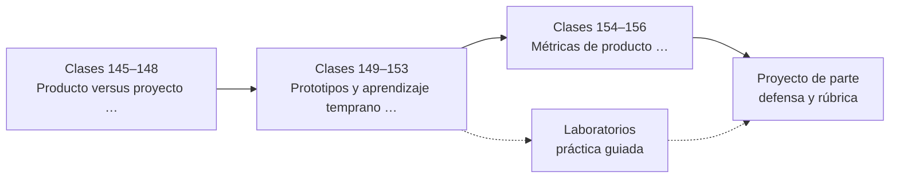

# Parte 12 — Producto e innovación

<!-- parte:inicio -->

> ← [Parte 11 — Marketing, cliente y crecimiento](../11-marketing-customers-growth/README.md) · [Temario](../../SYLLABUS.md) · [Parte 13 — Estrategia y competencia](../13-strategy-competition/README.md) →

*Decidir qué construir, para quién y por qué antes de gastar*

**Etapa:** 4 — Dirección, estrategia y organización  
**Duración:** 12 clases · 30 horas  
**Resultado de salida:** Decidir qué construir, para quién y por qué antes de gastar recursos en ejecución.

🟠 [Ver las 6 etapas](../../SYLLABUS.md) · 12 clases (145–156) · 4 laboratorios · [proyecto de parte](project.md)

## 🎯 De qué trata esta parte

Construir lo que nadie necesita es el desperdicio más caro de una empresa. Esta parte da el método para descubrir problemas reales, probar hipótesis con poco costo y decidir con evidencia.

El eje es **aprendizaje validado**: el MVP es una prueba de hipótesis, el roadmap se ordena por resultados y la señal de ajuste se verifica con conducta, no con opiniones.

## 🧱 Con qué hay que llegar

| Parte | Qué aporta |
|---|---|
| [11 — Marketing, cliente y crecimiento](../11-marketing-customers-growth/README.md) | Segmentación y recorrido del cliente. |
| [01 — Pensamiento crítico y toma de decisiones](../01-critical-thinking-and-decisions/README.md) | Hipótesis, experimentos y causa raíz. |

Cada clase supone la anterior: el orden importa, y saltarse una deja sin base a las que vienen después.

## 📚 Resultados de la parte

Al terminar esta parte podrás:

1. **Distinguir** producto de proyecto y el problema de la solución.
2. **Descubrir** necesidades con entrevistas y Jobs to Be Done.
3. **Probar** con prototipos y MVP como hipótesis.
4. **Ordenar** un roadmap por resultados y costo de oportunidad.
5. **Interpretar** métricas de producto y señales de product-market fit.

## 🗺️ Mapa de la parte

## 🧭 Cómo se encadenan las 12 clases

Las clases **145 a 148** definen el problema: producto, usuario, discovery y Jobs to Be Done.

Las clases **149 a 153** lo prueban: prototipos, MVP, roadmap, priorización y experimentos.

Las clases **154 a 156** lo evalúan: métricas, product-market fit y el capstone de comité de producto.

## 📘 Las 12 clases

| # | Clase | Qué se trabaja | Entregable | Min |
|---:|---|---|---|---:|
| 145 | [Producto versus proyecto](classes/145-producto-versus-proyecto/README.md) | product, project, output | [product-evidence-brief](../../templates/product-evidence-brief.md) | 150 |
| 146 | [Problema, usuario y outcome](classes/146-problema-usuario-y-outcome/README.md) | problem statement, need, pain | [leadership-decision-brief](../../templates/leadership-decision-brief.md) | 150 |
| 147 | [Customer discovery](classes/147-customer-discovery/README.md) | customer discovery, behavioral evidence, leading question | [product-evidence-brief](../../templates/product-evidence-brief.md) | 150 |
| 148 | [Jobs to Be Done](classes/148-jobs-to-be-done/README.md) | job, circumstance, push | [leadership-decision-brief](../../templates/leadership-decision-brief.md) | 150 |
| 149 | [Prototipos y aprendizaje temprano](classes/149-prototipos-y-aprendizaje-temprano/README.md) | prototype, fidelity, desirability risk | [product-evidence-brief](../../templates/product-evidence-brief.md) | 150 |
| 150 | [MVP: prueba de hipótesis](classes/150-mvp-prueba-de-hipotesis/README.md) | MVP, hypothesis, minimum | [product-evidence-brief](../../templates/product-evidence-brief.md) | 150 |
| 151 | [Roadmap orientado a outcomes](classes/151-roadmap-orientado-a-outcomes/README.md) | roadmap, theme, commitment | [product-evidence-brief](../../templates/product-evidence-brief.md) | 150 |
| 152 | [Priorización y costo de oportunidad](classes/152-priorizacion-y-costo-de-oportunidad/README.md) | priority, opportunity cost, RICE | [leadership-decision-brief](../../templates/leadership-decision-brief.md) | 150 |
| 153 | [Experimentos y evidencia](classes/153-experimentos-y-evidencia/README.md) | experiment, control, metric guardrail | [product-evidence-brief](../../templates/product-evidence-brief.md) | 150 |
| 154 | [Métricas de producto](classes/154-metricas-de-producto/README.md) | north star metric, activation, retention | [product-evidence-brief](../../templates/product-evidence-brief.md) | 150 |
| 155 | [Product-market fit](classes/155-product-market-fit/README.md) | product-market fit, retention curve, pull | [product-evidence-brief](../../templates/product-evidence-brief.md) | 150 |
| 156 | [Capstone: comité de producto](classes/156-capstone-comite-de-producto/README.md) | product portfolio, product thesis, kill criteria | [product-evidence-brief](../../templates/product-evidence-brief.md) | 150 |

## ⚠️ Riesgos característicos

- Construir sin haber validado el problema.
- Tratar el MVP como versión pequeña y no como prueba.
- Priorizar por quien insiste más.
- Declarar ajuste con producto sin retención.

## 🔤 Glosario de la parte

58 conceptos definidos en las clases, con la definición operacional que usa cada una.

| Concepto | Definición operacional |
|---|---|
| **activation** | evento que indica que un nuevo usuario alcanzó valor inicial. |
| **anxiety-habit** | fuerzas que frenan el cambio por riesgo o rutina. |
| **behavioral evidence** | hechos sobre lo que la persona hizo y no solo lo que dice que haría. |
| **circumstance** | contexto que activa o condiciona el job. |
| **commitment** | promesa con costo explícito de cambio. |
| **confidence** | grado de evidencia que sustenta los supuestos de puntuación. |
| **control** | condición de comparación que permite atribución. |
| **customer discovery** | proceso de aprendizaje sistemático sobre cliente y problema. |
| **desirability risk** | incertidumbre sobre si el usuario quiere o valora la solución. |
| **engagement** | frecuencia o profundidad de conducta valiosa. |
| **evidence ladder** | progresión desde señales débiles hasta comportamiento real y pago. |
| **experiment** | intervención diseñada para aprender sobre una hipótesis. |
| **external validity** | grado en que el aprendizaje se transfiere a otros contextos. |
| **fidelity** | nivel de detalle y realismo del prototipo. |
| **hypothesis** | afirmación falsable sobre cliente valor canal o comportamiento. |
| **job** | progreso que una persona busca en una circunstancia. |
| **kill criteria** | condiciones predefinidas para detener una apuesta. |
| **leading question** | pregunta que induce la respuesta esperada. |
| **learning milestone** | umbral de evidencia que decide continuar pivotar o detener. |
| **market segment** | grupo con problema y proceso de compra suficientemente homogéneos. |
| **metric guardrail** | señal que no debe deteriorarse al optimizar otra. |
| **minimum** | alcance mínimo necesario para obtener evidencia válida. |
| **MVP** | vehículo mínimo para validar una hipótesis de negocio o producto con usuarios reales. |
| **need** | progreso o condición que el usuario intenta alcanzar. |
| **north star metric** | señal de valor recurrente creada para clientes y negocio. |
| **now-next-later** | forma de expresar prioridad con distintos niveles de certeza. |
| **opportunity cost** | valor de la mejor alternativa sacrificada. |
| **outcome** | cambio observable en conducta, capacidad o resultado del usuario. |
| **output** | entregable producido por el equipo. |
| **pain** | fricción o costo percibido dentro de ese intento. |
| **portfolio balance** | distribución de apuestas por horizonte riesgo y retorno. |
| **priority** | orden relativo de asignación de atención y recursos. |
| **problem statement** | descripción comprobable de una dificultad en un contexto. |
| **product** | vehículo continuo para crear valor a un usuario y capturarlo para la organización. |
| **product lifecycle** | secuencia desde descubrimiento y crecimiento hasta madurez o retiro. |
| **product portfolio** | conjunto de productos o apuestas que compiten por capital y talento. |
| **product thesis** | argumento que conecta problema segmento propuesta y ventaja. |
| **product-market fit** | grado en que un producto satisface de manera repetible un mercado definido. |
| **project** | esfuerzo temporal con inicio y fin para producir un resultado. |
| **prototype** | representación temporal para probar una hipótesis. |
| **pull** | atractivo que acerca a una alternativa. |
| **push** | insatisfacción que empuja fuera de la solución actual. |
| **repeatability** | capacidad de reproducir adquisición y valor sin intervención artesanal extrema. |
| **retention** | proporción que vuelve o mantiene uso relevante después de un periodo. |
| **retention curve** | trayectoria de permanencia de cohortes a lo largo del tiempo. |
| **RICE** | alcance por impacto por confianza dividido por esfuerzo. |
| **roadmap** | representación de intención y secuencia para alcanzar outcomes. |
| **roadmap confidence** | grado de certeza justificable sobre cada horizonte. |
| **sample bias** | distorsión por entrevistar solo personas convenientes. |
| **sample size** | tamaño requerido para detectar un efecto relevante con error controlado. |
| **solution bias** | tendencia a saltar a funcionalidades antes de entender el problema. |
| **technical spike** | experimento corto para reducir incertidumbre técnica. |
| **theme** | área estratégica que agrupa problemas y oportunidades. |
| **usability risk** | incertidumbre sobre si puede comprenderla y usarla. |
| **vanity metric** | número atractivo que no guía una decisión causal u operativa. |
| **viable** | suficientemente creíble y seguro para la prueba. |
| **workaround** | solución actual imperfecta que revela prioridad. |
| **WSJF** | cost of delay dividido por job size. |

## 📦 Qué queda como evidencia

- Un resumen de discovery con entrevistas reales o simuladas.
- Un MVP definido como hipótesis con criterio de éxito.
- Un roadmap por resultados.
- El capstone: comité de producto.

## 🔗 Cómo se conecta

Alimenta la parte 13 (estrategia), la 19 (tecnología) y la validación del fundador de la parte 20.

## 🧪 Cómo se trabaja

Son **12 clases de 150 minutos** —30 horas— con **4 laboratorios** y un proyecto integrador. Cada clase trae su propósito, sus conceptos, un caso, práctica, errores frecuentes, preguntas de comprobación, entregable y fuentes, y se evalúa con su `assessment.md`. Los laboratorios se resuelven con datos propios o sintéticos, nunca con datos reales de terceros, y la parte se cierra con el proyecto y su defensa. Las reglas de recorrido están en [la guía de navegación](../../docs/NAVIGATION.md).

<!-- parte:fin -->

## Laboratorios

- [Lab 01 — Opportunity solution tree](labs/lab-01.md)
- [Lab 02 — MVP experiment](labs/lab-02.md)
- [Lab 03 — Prioritization workshop](labs/lab-03.md)
- [Lab 04 — Product review](labs/lab-04.md)

## Proyecto de parte

Defender ante un comité qué NO construir y cuál experimento ejecutar primero.

## Bibliografía rectora

- Marty Cagan — *Inspired* (Producto)
- Teresa Torres — *Continuous Discovery Habits* (Product discovery)
- David J. Bland & Alexander Osterwalder — *Testing Business Ideas* (Validación)
- Clayton M. Christensen et al. — *Competing Against Luck* (Jobs to Be Done)
- Eric Ries — *The Lean Startup* (Emprendimiento)

## Criterio de aprobación

80/100 y entrega del proyecto integrador.
