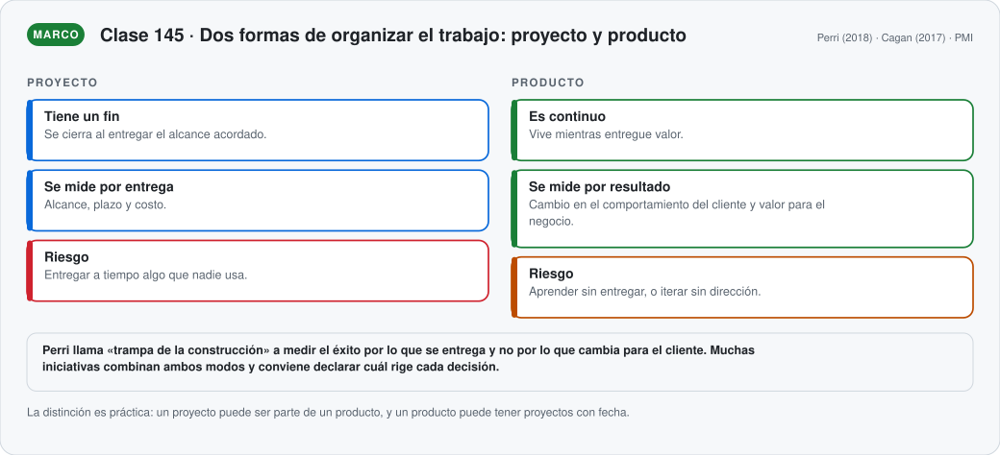

# Clase 145 — Producto versus proyecto

<!-- nav:inicio -->
> **Parte 12 · Producto e innovación** — clase 1 de 12 · [índice de la parte](../../README.md) · [temario](../../../../SYLLABUS.md)
<!-- nav:fin -->

**Parte:** 12 — Producto e innovación  
**Nivel:** Etapa 3 — Manager → Gerente  
**Duración sugerida:** 150–180 minutos · **Estándar:** deep-class-v2

## 🎯 Propósito

Una de las confusiones más caras de las empresas es tratar como proyecto lo que debería ser producto. Un **proyecto** tiene alcance, plazo y presupuesto, y se da por exitoso cuando entrega lo acordado. Un **producto** vive mientras entregue valor a clientes y al negocio, y su éxito se mide por lo que cambia en el comportamiento de las personas que lo usan. Cuando una organización gestiona un producto con lógica de proyecto, entrega a tiempo funciones que nadie usa, celebra el lanzamiento y desarma el equipo, y descubre un año después que el problema que quería resolver sigue ahí. Melissa Perri llama a esto la **trampa de la construcción**: medir el éxito por lo que se construye en lugar de por los resultados.

La clase se apoya en el análisis de Perri sobre organizaciones orientadas a resultados, en la visión de Cagan sobre equipos de producto empoderados y en los fundamentos de gestión de proyectos de la parte 06. Al terminar sabrás distinguir producto de proyecto, reconocer síntomas de la trampa de la construcción, entender los tres riesgos que el trabajo de producto debe resolver antes de construir y decidir cuándo conviene cada modo de trabajo.

## 📚 Resultados de aprendizaje

Al finalizar podrás:

1. **Distinguir** producto, proyecto, programa y operación según su fin y su medida de éxito.
2. **Reconocer** los síntomas de la trampa de la construcción.
3. **Explicar** los riesgos de valor, usabilidad, viabilidad técnica y viabilidad de negocio.
4. **Reformular** una iniciativa de «entregar» a «lograr un resultado».
5. **Decidir** cuándo usar lógica de proyecto y cuándo lógica de producto.

## 🧭 Agenda

| Tramo | Qué se hace |
|---|---|
| 0–20 min | Recuperación: toma una iniciativa reciente de tu empresa y pregúntate cómo se sabrá, dentro de un año, si funcionó. |
| 20–60 min | Producto y proyecto, trampa de la construcción, riesgos y equipos. |
| 60–105 min | Ejemplo trabajado: un proyecto de onboarding digital que se entregó y no cambió nada. |
| 105–150 min | Caso ejecutivo y práctica. |
| 150–175 min | Límites y entregable. |

## 🧩 Conceptos centrales

| Concepto | Definición | Cómo se reconoce |
|---|---|---|
| **Proyecto** | Esfuerzo temporal para producir un resultado acordado. | Alcance, plazo, presupuesto y cierre. |
| **Producto** | Oferta que evoluciona mientras genere valor para clientes y negocio. | Equipo estable, resultados y aprendizaje continuo. |
| **Resultado (outcome)** | Cambio en el comportamiento de las personas que crea valor. | «Más clientes completan su primera compra». |
| **Salida (output)** | Lo que el equipo produce: funciones, lanzamientos. | Se cuenta; no prueba valor. |
| **Trampa de la construcción** | Medir el éxito por lo que se construye y no por lo que cambia. | Hojas de ruta de funciones y celebraciones de lanzamiento. |
| **Descubrimiento y entrega** | Descubrir qué construir y construirlo bien. | Dos actividades en paralelo. |

## 🧠 Modelo mental

**Cómo leer el diagrama.** Dos paneles. El **proyecto** tiene un fin, se mide por alcance, plazo y costo, y su riesgo es entregar a tiempo algo que nadie usa. El **producto** es continuo, se mide por resultados y su riesgo es aprender sin entregar o iterar sin dirección. La nota recoge la idea de Perri sobre la trampa de la construcción y aclara que muchas iniciativas combinan ambos modos, de modo que conviene declarar cuál rige cada decisión.

## 📖 Desarrollo

### 1. Dos lógicas de trabajo

La gestión de proyectos (clase 073) organiza el trabajo por **entrega**: un alcance definido, una fecha, un presupuesto y un responsable; funciona bien cuando se sabe qué hay que hacer (construir un edificio, migrar un sistema, cumplir una norma). La gestión de producto organiza el trabajo por **problemas y resultados**: se sabe qué cambio se busca en el comportamiento de las personas, pero no se sabe cuál solución lo logrará; se descubre construyendo, probando y midiendo. Ambas son legítimas. El error es aplicar una a un trabajo que exige la otra: gestionar por alcance una apuesta incierta o gestionar por exploración una obligación regulatoria con fecha.

### 2. La trampa de la construcción

Perri describe organizaciones que se centran en **entregar funciones**: las hojas de ruta son listas de funciones con fechas, los equipos se miden por velocidad y entregas, los ejecutivos piden funciones concretas para clientes concretos, y el éxito es el lanzamiento. Los síntomas: (1) **hojas de ruta de funciones** sin objetivos, (2) **comités** que aprueban funciones, no problemas, (3) **celebración del lanzamiento** y no del resultado, (4) **equipos que se disuelven** al terminar, (5) **ausencia de datos** posteriores al lanzamiento. La salida es cambiar la pregunta: de «¿qué construimos?» a «¿qué resultado queremos lograr y cómo lo sabremos?».

### 3. Los cuatro riesgos de producto

Cagan sostiene que el trabajo de descubrimiento de producto debe reducir cuatro riesgos antes de invertir en construir: **de valor** (¿los clientes lo querrán o lo comprarán?), **de usabilidad** (¿podrán usarlo?), **de viabilidad técnica** (¿se puede construir con el tiempo, las habilidades y la tecnología disponibles?) y **de viabilidad de negocio** (¿funciona para el negocio: ingresos, costos, legal, marca, socios?). Un proyecto tradicional asume resueltos los tres primeros y gestiona el cuarto; un equipo de producto trabaja para resolverlos. Ignorar el riesgo de valor es la causa más común de fracasos caros.

### 4. Equipos de producto

Cagan y Perri coinciden en que los productos se construyen mejor con **equipos estables y multidisciplinarios** (producto, diseño, ingeniería y datos) a los que se les asigna un **problema** y un **resultado**, no una lista de funciones, y que tienen **autonomía** para decidir cómo lograrlo y **responsabilidad** por el resultado. Se contrapone a los **equipos de funciones** que ejecutan pedidos de otras áreas. La autonomía exige claridad estratégica: los equipos deben entender la visión y los objetivos de la empresa, y los líderes deben dar contexto, no órdenes de qué construir. Sin contexto, la autonomía produce dispersión.

### 5. Descubrimiento y entrega en paralelo

En producto, **descubrir** (qué construir, para quién, por qué) y **entregar** (construirlo con calidad) ocurren a la vez, de forma continua. Torres propone hábitos de **descubrimiento continuo**: contacto semanal con clientes, mapas de oportunidades y pruebas pequeñas de suposiciones. La ingeniería no espera a que el descubrimiento «termine» ni el descubrimiento se reduce a una fase previa: se alimentan. La gestión de proyectos, por su parte, conserva su valor en la **entrega** de compromisos con fecha y alcance conocidos.

### 6. De entregar a lograr

Para pasar de una iniciativa de entrega a una de producto se reformula: en lugar de «lanzar la nueva aplicación en marzo», «**aumentar de 30 % a 50 % el porcentaje de clientes nuevos que completan su primera compra en la primera semana**». El primer enunciado se cumple lanzando; el segundo, solo si el cliente cambia su comportamiento. Se acompaña de **línea base**, **plazo** y **hipótesis** sobre cómo lograrlo, y se acuerda con el negocio. Se separan los compromisos con fecha (regulación, contratos) del resto, que se gestiona por resultados (clase 151).

### 7. Cuándo conviene cada modo

Se usa lógica de **proyecto** cuando el alcance es claro, el valor ya está validado y la fecha o el presupuesto son restricciones relevantes: obligaciones legales, migraciones, implantaciones conocidas. Se usa lógica de **producto** cuando hay **incertidumbre** sobre el problema, la solución o el cliente, y el valor depende de cómo se comporten las personas. Muchas iniciativas necesitan ambas: un producto puede tener un proyecto de migración con fecha. Lo importante es declarar **qué riesgo se está gestionando** y **cómo se medirá el éxito**; y recordar que, tras un proyecto, alguien debe ser **dueño del resultado**.

## 📚 Lectura comparada

| Obra | Qué aporta | Qué no resuelve | Pregunta para contrastar |
|---|---|---|---|
| Perri (*Escaping the Build Trap*) | Organización orientada a resultados y síntomas de la trampa. | Describe patrones; no prescribe una única forma de transformar. | ¿Tu hoja de ruta es una lista de funciones? |
| Cagan (*Inspired*) | Cuatro riesgos y equipos de producto empoderados. | Basado en experiencia de tecnología. | ¿Quién responde por el riesgo de valor? |
| Torres | Descubrimiento continuo con contacto semanal con clientes. | Presupone un equipo con acceso a clientes. | ¿Cuántos clientes ves por semana? |
| Ries | Aprendizaje validado y ciclo construir–medir–aprender. | Casos de startups. | ¿Qué aprendiste la última vez que lanzaste algo? |
| Kerzner y PMI (clases 073 y 083) | Gestión de proyectos y control de alcance, plazo y costo. | Supone resultado definido. | ¿Está definido el resultado o hay que descubrirlo? |

## 🧮 Ejemplo trabajado

**Situación (hipotética).** Un banco aprobó un proyecto de **apertura digital de cuentas**: presupuesto USD 1,2 millones, 9 meses, entrega de una aplicación con verificación de identidad, firma electrónica y seguimiento. Se entregó en el plazo y con el presupuesto, y se celebró el lanzamiento. El objetivo del negocio, que no figuraba en el proyecto, era reducir de 4 días a menos de 1 día el tiempo de apertura y aumentar las cuentas activas.

**Seis meses después.**

| Indicador | Antes | Después |
|---|---|---|
| Solicitudes de apertura por mes | 6.000 | 6.400 |
| Porcentaje que usa la apertura digital | — | 18 % |
| Abandono en la verificación de identidad | — | 63 % |
| Tiempo promedio de apertura (todas las vías) | 4,1 días | 3,6 días |
| Cuentas con uso en los primeros 30 días | 41 % | 43 % |

**Lectura.** El proyecto cumplió su alcance, pero el resultado casi no cambió. El mayor obstáculo (abandono en verificación de identidad por problemas con documentos y con cámaras de baja calidad) no se había descubierto antes de construir; el equipo se había disuelto y no había dueño del resultado.

**Reformulación como producto.** Resultado: «aumentar de 41 % a 60 % las cuentas con uso en los primeros 30 días y reducir a menos de 1 día el tiempo de apertura para quienes completan el proceso». Un equipo estable (producto, diseño, ingeniería, riesgo y operaciones) con acceso semanal a clientes; hipótesis a probar: (1) el abandono se debe a la calidad de la verificación, (2) a que no entienden qué documentos necesitan, (3) a que no ven beneficio inmediato de abrir la cuenta. Se prueban con entrevistas a 15 abandonos, un prototipo de guía de documentos y una oferta de primer uso.

**Riesgos revisados.** Valor: ¿lo quieren?; usabilidad: ¿completan el proceso?; viabilidad técnica: ¿la verificación funciona con fotos de distintos teléfonos?; negocio y regulación: ¿cumple las normas de identificación del cliente? Esta última se verifica con la normativa vigente y con el área de cumplimiento.

**Resultado a 4 meses.** El abandono en identidad baja de 63 % a 38 %; el uso digital sube a 34 %; las cuentas activas a 30 días llegan a 52 %. El dueño del resultado presenta un informe trimestral al comité.

**Qué muestra.** (1) El proyecto se midió por entrega y el negocio por resultado. (2) El riesgo de valor y usabilidad no se había resuelto. (3) Un equipo estable con un resultado cambió el aprendizaje.

## 🔀 Comparación y límites

**Producto frente a servicio y operación.** La operación mantiene un servicio estable (clase 085); el producto lo evoluciona. Una operación sana alimenta con datos al producto, y un producto sano facilita la operación.

**Límites.** La distinción es una simplificación útil: hay trabajos mixtos. Los equipos autónomos requieren confianza y capacidades que no siempre existen. Los resultados dependen de factores externos (mercado, regulación, competencia), de modo que no deben usarse como evaluación mecánica de personas. Los libros citados describen experiencias de empresas de tecnología y las traslaciones a sectores regulados exigen adaptación. En sectores regulados, las obligaciones normativas se verifican en su fuente vigente y con asesoría.

## 🪜 De profesional a owner

| Nivel | Cómo participa en producto frente a proyecto |
|---|---|
| **Profesional** | Pregunta qué resultado busca el trabajo y cómo se verá. |
| **Jefe / Team Lead** | Lidera un equipo con un resultado y no con una lista de funciones. |
| **Gerente** | Define resultados, protege la autonomía y mide lo que cambia. |
| **CEO / Director** | Evita la trampa de la construcción y exige evidencia posterior al lanzamiento. |
| **Founder / Owner** | Construye lo mínimo para aprender y vuelve al cliente antes de construir más. |

## 🏢 Caso ejecutivo

Una cadena de farmacias aprobó un «proyecto de transformación digital» de USD 6 millones y 18 meses: una nueva aplicación móvil, un programa de fidelidad digital y un módulo de entrega a domicilio. Se definieron 74 funciones y un calendario. El proyecto está en el mes 14, ha entregado el 60 % de las funciones y el comité informa verde en plazo y presupuesto. Pero la aplicación solo tiene 3 % de uso entre los clientes que compran, el programa de fidelidad no ha cambiado la frecuencia de compra y el reparto genera pérdidas por pedido. El gerente de tecnología pide terminar el alcance; el de marketing, ajustar sobre la marcha; el director financiero pide evidencia de retorno antes de liberar el siguiente tramo.

Entrega un **diagnóstico y plan de transición a producto** que contenga: (a) el análisis de síntomas de la trampa de la construcción; (b) los resultados que se buscaban y los datos actuales; (c) los riesgos de valor, usabilidad, viabilidad técnica y de negocio de cada componente; (d) la propuesta de equipos, resultados y descubrimiento continuo; (e) qué parte mantiene lógica de proyecto y cuál pasa a producto; (f) los criterios para liberar fondos y las verificaciones regulatorias de datos de salud y de entrega de medicamentos.

## 🧪 Práctica

1. Reformula tres iniciativas de «entregar» a «lograr un resultado» con línea base y plazo.
2. Evalúa una iniciativa con los cuatro riesgos de producto y ordénalos.
3. Identifica dos síntomas de la trampa de la construcción en tu organización.
4. Define qué compromisos con fecha de tu área se mantienen como proyecto.
5. Escribe cómo sabrás, un año después, si una iniciativa funcionó.

## ⚠️ Errores frecuentes

| Error | Por qué ocurre | Cómo corregirlo |
|---|---|---|
| Medir producto por entrega | Es lo que se ve y se controla | Medir resultados y comportamiento. |
| Hojas de ruta de funciones | Se piden soluciones | Pedir problemas y resultados. |
| Disolver el equipo al lanzar | Se cierra el proyecto | Dueño estable del resultado. |
| Asumir que el cliente lo querrá | No se prueba | Resolver el riesgo de valor primero. |
| Autonomía sin contexto | Se da libertad sin dirección | Visión y objetivos claros. |
| Aplicar «producto» a un cumplimiento con fecha | Se confunde modo con moda | Usar lógica de proyecto cuando corresponde. |

## ❓ Preguntas de comprobación

1. ¿Qué diferencia hay entre proyecto y producto?
2. ¿Qué es la trampa de la construcción y cuáles son sus síntomas?
3. ¿Cuáles son los cuatro riesgos de producto según Cagan?
4. ¿Qué diferencia hay entre salida y resultado?
5. ¿Por qué el descubrimiento y la entrega ocurren en paralelo?
6. ¿Cómo se reformula una iniciativa para lograr un resultado?
7. ¿Cuándo conviene lógica de proyecto?

Claves de respuesta

1. El proyecto termina al entregar un alcance, plazo y costo acordados; el producto es continuo y se mide por el valor y los resultados que genera.
2. Medir el éxito por lo que se construye; se ve en hojas de ruta de funciones, celebración del lanzamiento, equipos que se disuelven y falta de datos posteriores.
3. Valor, usabilidad, viabilidad técnica y viabilidad de negocio.
4. La salida es lo que el equipo produce (funciones); el resultado es el cambio de comportamiento que crea valor.
5. Porque lo que se aprende al construir y medir corrige qué construir, y la entrega no puede esperar a un descubrimiento que nunca termina.
6. Pasando de «lanzar X» a un cambio medible en el comportamiento, con línea base, plazo e hipótesis.
7. Cuando el alcance es claro, el valor ya está validado y la fecha o el presupuesto son restricciones relevantes, como obligaciones legales o migraciones.

## 📥 Entregable

Guarda en `portfolio/145-producto-versus-proyecto/`:

- `product-evidence-brief.md` (plantilla [Product evidence brief](../../../../templates/product-evidence-brief.md)) con el diagnóstico del caso ejecutivo;
- `leadership-decision-brief.md` (plantilla [Leadership Decision Brief](../../../../templates/leadership-decision-brief.md)) con la propuesta de transición;
- `decision-journal.md` con los resultados definidos, los riesgos y los criterios de liberación de fondos.

## 📗 Fuentes y verificación

- Melissa Perri — *Escaping the Build Trap* (O'Reilly, 2019). **Uso en esta clase:** organización orientada a resultados y trampa de la construcción. Lectura selectiva sobre **producto versus proyecto**. **Localizador:** [ISBN-13 9781491973790](https://openlibrary.org/isbn/9781491973790).
- Marty Cagan — *Inspired* (Shroff, 2008). **Uso en esta clase:** cuatro riesgos y equipos de producto empoderados. Lectura selectiva sobre **producto versus proyecto**. **Localizador:** [ISBN-13 9789352131501](https://openlibrary.org/isbn/9789352131501).
- Teresa Torres — *Continuous Discovery Habits* (Product Talk LLC, 2021). **Uso en esta clase:** descubrimiento continuo con contacto semanal con clientes. Lectura selectiva sobre **producto versus proyecto**. **Localizador:** [ISBN-13 9781736633304](https://openlibrary.org/isbn/9781736633304).
- Eric Ries — *The Lean Startup* (Crown Business, 2011). **Uso en esta clase:** aprendizaje validado y ciclo construir–medir–aprender. Lectura selectiva sobre **producto versus proyecto**. **Localizador:** [ISBN-13 9780307887894](https://openlibrary.org/isbn/9780307887894).
- Harold Kerzner — *Project Management* (John Wiley & Sons Inc, 2003). **Uso en esta clase:** gestión de proyectos y control de alcance, plazo y costo. Lectura selectiva sobre **producto versus proyecto**. **Localizador:** [ISBN-13 9780471281580](https://openlibrary.org/isbn/9780471281580).

> **Regla de fuentes para Producto versus proyecto:** las obras anteriores estructuran las perspectivas de esta materia; cualquier norma, ley o estándar vivo mencionado debe comprobarse nuevamente en su fuente primaria vigente, incluidas las normas de identificación de clientes, datos de salud y regulación sectorial. Los ejemplos y casos son hipotéticos, con cifras ilustrativas. El desarrollo es original y no reproduce capítulos protegidos.

<!-- pie:inicio -->
---

| Anterior | Índice | Siguiente |
|---|---|---|
| [← 144 · Capstone: go-to-market](../../../11-marketing-customers-growth/classes/144-capstone-go-to-market/README.md) | [Parte 12](../../README.md) · [Programa](../../../../SYLLABUS.md) | [146 · Problema, usuario y outcome →](../146-problema-usuario-y-outcome/README.md) |
<!-- pie:fin -->
