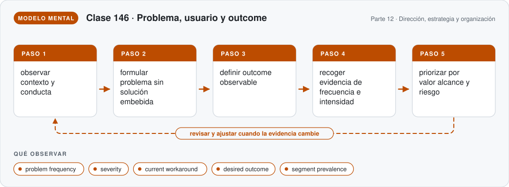

# Clase 146 — Problema, usuario y outcome

<!-- nav:inicio -->
> **Parte 12 · Producto e innovación** — clase 2 de 12 · [índice de la parte](../../README.md) · [temario](../../../../SYLLABUS.md)
<!-- nav:fin -->

**Parte:** 12 — Producto e innovación  
**Nivel:** Etapa 3 — Manager → Gerente  
**Duración sugerida:** 150–180 minutos · **Estándar:** deep-class-v2

## 🎯 Propósito

La mayoría de los productos fracasan no porque estén mal construidos, sino porque resuelven un problema que casi nadie tiene, o que tiene poca gente con la intensidad suficiente como para pagar y cambiar de hábitos. Y la mayoría de las discusiones de producto comienzan en el lugar equivocado: la solución. «Necesitamos una aplicación», «necesitamos un chatbot», «necesitamos un portal». Formular bien el problema, el usuario y el resultado es el trabajo más barato y más valioso del ciclo de producto: reduce el riesgo de construir lo equivocado y da al equipo un criterio compartido para decidir entre opciones.

La clase se apoya en la distinción entre salidas y resultados de Perri, en el modelo de oportunidades y soluciones de Torres, en la pirámide de ajuste producto–mercado de Olsen y en la teoría de trabajos a realizar de Christensen y colaboradores. Al terminar sabrás describir a un usuario con su contexto, formular un problema sin sugerir la solución, definir un resultado medible con línea base y priorizar oportunidades por la brecha entre importancia y satisfacción.

## 📚 Resultados de aprendizaje

Al finalizar podrás:

1. **Describir** al usuario y su contexto con evidencia y no con estereotipos.
2. **Formular** un problema sin prescribir la solución.
3. **Definir** un resultado medible con línea base, meta y plazo.
4. **Organizar** oportunidades en un árbol que conecte resultado, oportunidades y soluciones.
5. **Priorizar** oportunidades por importancia, satisfacción actual y alcance.

## 🧭 Agenda

| Tramo | Qué se hace |
|---|---|
| 0–20 min | Recuperación: escribe el problema que resuelve tu producto sin mencionar la solución; luego léelo a alguien que no lo conozca. |
| 20–60 min | Usuario, problema, resultado, árbol de oportunidades y priorización. |
| 60–105 min | Ejemplo trabajado: producto de gestión de turnos con tres oportunidades. |
| 105–150 min | Caso ejecutivo y práctica. |
| 150–175 min | Límites y entregable. |

## 🧩 Conceptos centrales

| Concepto | Definición | Cómo se reconoce |
|---|---|---|
| **Usuario** | Persona que usa el producto en un contexto concreto. | Se describe por situación y comportamiento. |
| **Problema** | Obstáculo que impide a alguien lograr algo que le importa. | Se enuncia sin solución. |
| **Resultado (outcome)** | Cambio de comportamiento que crea valor para el cliente y el negocio. | Se mide con un indicador. |
| **Oportunidad** | Necesidad, dolor o deseo no resuelto del cliente. | Se descubre en entrevistas. |
| **Árbol de oportunidades y soluciones** | Mapa que conecta un resultado con oportunidades y soluciones posibles. | Evita saltar a una sola solución. |
| **Necesidad insatisfecha** | Necesidad importante con baja satisfacción actual. | Alta importancia y baja satisfacción. |

## 🧠 Modelo mental

**Cómo leer el diagrama.** Cinco pasos. Se parte del **usuario** y su contexto; se formula el **problema** (qué intenta lograr y qué se lo impide); se define el **resultado deseado** (el cambio de comportamiento que importa); se propone una **hipótesis de solución** (qué se cree que lo resolvería y por qué); y se fija la **medida de éxito** con línea base y plazo. Si la medida no se mueve, se revisa la hipótesis. La nota recuerda que una función entregada no es un resultado.

## 📖 Desarrollo

### 1. El usuario en su contexto

Se describe al usuario por **qué intenta lograr y en qué situación**, no por su edad ni su profesión. Olsen sitúa al **cliente objetivo** como la base de la pirámide de ajuste producto–mercado: sin una definición clara de quién es y qué contexto tiene, las demás capas no tienen dónde apoyarse. Una buena descripción incluye: contexto (dónde, cuándo, con quién), objetivos, **soluciones alternativas** que usa hoy, **frustraciones** y señales de comportamiento (con qué frecuencia lo intenta, cuánto gasta, cómo decide). Se construye con entrevistas y datos de uso (clase 147); evita «personas» inventadas en una sala.

### 2. Formular el problema sin la solución

Un problema bien formulado describe una **dificultad** del usuario, no una carencia de nuestro producto. «Los supervisores pasan 6 horas semanales armando turnos en planillas y aun así hay turnos sin cubrir» es un problema. «Necesitamos un módulo de turnos» es una solución disfrazada. Una prueba útil: ¿el enunciado admite más de una solución?, ¿un usuario lo reconocería como propio?, ¿se puede observar? Formular el problema evita el sesgo de anclaje en la primera idea y abre el espacio de soluciones posibles (incluidas procesos, políticas o servicios, no solo tecnología).

### 3. Resultados y no salidas

Perri insiste en que los equipos deben ser responsables de **resultados**: cambios en el comportamiento de clientes o usuarios que crean valor para el negocio. «Lanzar el módulo de turnos» es una salida; «reducir de 6 a 2 las horas semanales que un supervisor dedica a armar turnos y bajar de 14 % a 5 % los turnos sin cubrir» es un resultado. Un buen resultado es **medible**, tiene **línea base** y **plazo**, depende en buena parte del equipo (si no, es un impacto del negocio que se influye, clase 097) y se puede observar a través de comportamiento. También se alinea con los objetivos de la empresa para que ganar el resultado signifique ganar para el negocio.

### 4. Del resultado a las oportunidades

Torres propone un **árbol de oportunidades y soluciones**: en la raíz, el resultado deseado; en el siguiente nivel, las **oportunidades** (necesidades, dolores y deseos de los clientes que, si se atienden, moverían el resultado); más abajo, las **soluciones** posibles para cada oportunidad, y al final, los **experimentos** para probar suposiciones. El árbol obliga a considerar varias oportunidades en vez de saltar a una, a distinguir lo que el cliente necesita de lo que se imagina que quiere, y a mantener la conexión con el resultado. Se alimenta de entrevistas semanales con clientes (clase 147).

### 5. Priorizar oportunidades

Una forma de priorizar es comparar la **importancia** de cada necesidad para el usuario con su **satisfacción** con las soluciones actuales: las necesidades **muy importantes y poco satisfechas** son las que dejan espacio. Olsen presenta este análisis como parte de la búsqueda de necesidades no satisfechas. Se combina con el **alcance** (cuántos usuarios), la **frecuencia**, el **valor** para el negocio y la **capacidad** de resolverla. Los números provienen de entrevistas y encuestas pequeñas y son aproximaciones: sirven para ordenar la conversación, no para sustituir el juicio ni la prueba (clases 149 y 150).

### 6. Hipótesis de solución

Con una oportunidad priorizada, se formulan **hipótesis de solución**: «Creemos que, si ofrecemos X a usuarios del tipo Y, lograremos Z porque …». Cada hipótesis tiene **suposiciones** críticas (¿lo entenderán?, ¿lo usarán?, ¿pagarán?, ¿podemos construirlo?) y se **prueban de la más arriesgada a la menos**. Se prefieren varias soluciones alternativas por oportunidad: los equipos que consideran solo una tienden a defenderla. Cagan recuerda que las soluciones deben pasar los cuatro riesgos (valor, usabilidad, viabilidad técnica y de negocio) antes de construirse a fondo.

### 7. Medir y volver

Se define la **medida de éxito** antes de construir y se revisa de forma periódica. Si no se mueve, se aprende por qué: ¿la solución no resolvía el problema?, ¿el problema no era importante?, ¿el usuario era otro?, ¿la medida era la equivocada? El ciclo continúa con una nueva hipótesis (clase 153). Un error frecuente es **cambiar la medida** cuando no se mueve; otro, **declarar éxito** por un indicador secundario. Se registran los aprendizajes, también los de los problemas descartados. Si el usuario o el contexto cambian, el problema se revisa.

## 📚 Lectura comparada

| Obra | Qué aporta | Qué no resuelve | Pregunta para contrastar |
|---|---|---|---|
| Perri | Resultados frente a salidas y alineación con estrategia. | Es un enfoque organizacional. | ¿Cuál es tu resultado y cómo lo medirás? |
| Torres | Árbol de oportunidades y soluciones, y descubrimiento continuo. | Requiere acceso frecuente a clientes. | ¿Cuántas oportunidades consideraste? |
| Olsen | Pirámide de ajuste y análisis de necesidades insatisfechas. | Las cifras de importancia y satisfacción son subjetivas. | ¿Qué necesidad es importante y está mal atendida? |
| Christensen et al. | Trabajo a realizar y contexto. | Marco conceptual. | ¿Qué progreso busca el usuario en esta situación? |
| Cagan | Riesgos de valor, usabilidad, viabilidad técnica y de negocio. | No entrega un método de formulación. | ¿Qué riesgo debes resolver primero? |

## 🧮 Ejemplo trabajado

**Situación (hipotética).** Una empresa de software de turnos para clínicas quiere decidir qué construir el próximo trimestre. El objetivo del negocio: aumentar la retención a 12 meses de 74 % a 82 %.

**Usuario.** Jefas de enfermería y coordinadores de turnos en clínicas de 50 a 300 personas, que arman turnos cada 2 semanas con una planilla y mensajes.

**Resultado del equipo.** Que un porcentaje mayor de clínicas adopte el producto en todos sus servicios en los primeros 90 días (línea base 38 %, meta 60 %); la adopción se relaciona con la retención: las clínicas con tres o más servicios activos retienen al 91 %, frente a 61 % de las demás.

**Oportunidades (entrevistas a 18 coordinadoras y 9 jefas).**

| Oportunidad | Importancia (1–5) | Satisfacción actual (1–5) | Alcance | Brecha |
|---|---|---|---|---|
| Cubrir un turno de última hora sin llamar a 10 personas | 4,8 | 2,1 | 80 % semanal | 2,7 |
| Respetar reglas laborales y límites de horas sin cálculo manual | 4,6 | 3,0 | 100 % | 1,6 |
| Intercambio de turnos entre personas con aprobación | 4,0 | 2,8 | 70 % | 1,2 |
| Ver costo de horas extra por servicio | 3,5 | 2,2 | 30 % (gerencia) | 1,3 |
| Reportes de asistencia para el área de personas | 3,2 | 3,5 | 50 % | 0 |

**Lectura.** La oportunidad con mayor brecha y alcance es cubrir turnos de última hora; la segunda, reglas laborales. La de reportes de asistencia ya está satisfecha. Se propone un árbol con tres soluciones para la oportunidad 1: aviso masivo con aceptación en un toque, lista de reemplazos preferidos con prioridad, y «bolsa de turnos» abierta. Hipótesis: «Creemos que, si las coordinadoras cubren turnos de última hora en menos de 15 minutos, más servicios dejarán las planillas y la adopción pasará de 38 % a 60 %, porque es la tarea más dolorosa».

**Suposiciones críticas.** Las personas responderán a avisos por la aplicación; las reglas laborales pueden codificarse (se verifican con la normativa y con el asesor del cliente); la coordinadora confía en la lista. Se prueban con una maqueta y un piloto de 3 clínicas (clase 149).

**Medida de éxito.** Tiempo para cubrir un turno de última hora (línea base 52 minutos, meta menos de 15) y porcentaje de servicios con todos los turnos en la aplicación (38 % → 60 % en 90 días).

**Qué muestra.** (1) El problema se formuló sin la solución. (2) Las oportunidades se compararon con datos. (3) La hipótesis y la medida quedaron explícitas.

## 🔀 Comparación y límites

**Problema frente a deseo del cliente.** Lo que los clientes piden suelen ser soluciones basadas en lo que conocen; el problema subyacente puede ser otro. El trabajo consiste en descubrir qué intentan lograr, no en transcribir pedidos.

**Límites.** Las puntuaciones de importancia y satisfacción dependen de muestras pequeñas y de cómo se pregunte. El árbol puede crecer más rápido que la capacidad de probar. Un resultado bien definido no garantiza que sea el correcto para el negocio. Las normas laborales, de datos o sectoriales que condicionan las soluciones deben comprobarse con fuentes vigentes y asesoría. Los ejemplos son ilustrativos.

## 🪜 De profesional a owner

| Nivel | Cómo trabaja problema, usuario y resultado |
|---|---|
| **Profesional** | Escucha al usuario y trae hechos, no soluciones. |
| **Jefe / Team Lead** | Define problemas y resultados con su equipo y los mide. |
| **Gerente** | Alinea resultados de equipos con objetivos del negocio. |
| **CEO / Director** | Pide resultados y evidencia, no funciones. |
| **Founder / Owner** | Se enamora del problema, no de la solución. |

## 🏢 Caso ejecutivo

Una empresa de logística tiene una aplicación para conductores que se usa poco. El gerente de operaciones pide «agregar un chat» porque los conductores llaman por teléfono; el de tecnología propone un rediseño completo; el de seguridad pide funciones de control de tiempos de conducción. El objetivo del negocio es reducir los retrasos de entrega de 17 % a 10 %. Los datos muestran que los retrasos se concentran en el paso de recepción en bodegas de clientes (espera promedio de 48 minutos), que los conductores usan tres aplicaciones distintas y que el 40 % de las llamadas son para confirmar horarios de ventana. Hay normas sobre horas de conducción y de descanso que el sistema debe respetar.

Entrega una **formulación de problema, usuario y resultado** que contenga: (a) la descripción del usuario y su contexto con las fuentes; (b) el problema sin la solución; (c) el resultado medible con línea base, meta y plazo y su conexión con el objetivo del negocio; (d) un árbol de oportunidades con al menos tres oportunidades priorizadas por importancia, satisfacción y alcance; (e) dos hipótesis de solución con sus suposiciones críticas; (f) la medida de éxito y las verificaciones normativas de horas de conducción que se harán en la norma vigente.

## 🧪 Práctica

1. Escribe el problema de tu producto en una frase sin mencionar la solución y pruébalo con dos personas.
2. Define el resultado de tu equipo con línea base, meta y plazo.
3. Dibuja un árbol de oportunidades con tres oportunidades y dos soluciones para cada una.
4. Puntúa la importancia y satisfacción de cuatro oportunidades con cinco entrevistas.
5. Redacta una hipótesis de solución con su suposición más arriesgada.

## ⚠️ Errores frecuentes

| Error | Por qué ocurre | Cómo corregirlo |
|---|---|---|
| Problema que es una solución | Se piensa en lo que se quiere construir | Probar si admite más de una solución. |
| Usuario descrito por estereotipo | Se imagina | Contexto, objetivos y comportamiento observados. |
| Resultado = salida | Es más fácil de controlar | Definir cambio de comportamiento medible. |
| Una sola oportunidad | Se salta a la solución | Árbol con varias oportunidades. |
| Cambiar la medida si no se mueve | Se evita el fracaso | Mantenerla y aprender por qué. |
| No conectar con el negocio | Se trabaja aislado | Alinear con objetivos de la empresa. |

## ❓ Preguntas de comprobación

1. ¿Cómo se describe a un usuario útil para producto?
2. ¿Cómo se sabe que un problema está bien formulado?
3. ¿Qué diferencia hay entre salida y resultado?
4. ¿Qué conecta un árbol de oportunidades y soluciones?
5. ¿Cómo se priorizan las oportunidades?
6. ¿Qué contiene una hipótesis de solución?
7. ¿Qué límites tienen las puntuaciones de importancia y satisfacción?

Claves de respuesta

1. Por lo que intenta lograr y en qué situación, con su contexto, alternativas y frustraciones observadas, no por estereotipos.
2. Describe una dificultad observable que el usuario reconocería y admite más de una solución.
3. La salida es lo que se produce; el resultado es el cambio de comportamiento que crea valor y se mide.
4. Un resultado con las oportunidades que lo moverían, las soluciones para cada una y los experimentos para probar suposiciones.
5. Por importancia y satisfacción actual, alcance, frecuencia, valor para el negocio y capacidad de resolverlas.
6. A quién va dirigida, qué se ofrece, qué se espera lograr y por qué, con suposiciones críticas que se probarán.
7. Dependen de muestras pequeñas y de cómo se pregunta; sirven para ordenar la conversación, no para sustituir la prueba.

## 📥 Entregable

Guarda en `portfolio/146-problema-usuario-y-outcome/`:

- `leadership-decision-brief.md` (plantilla [Leadership Decision Brief](../../../../templates/leadership-decision-brief.md)) con la formulación del caso ejecutivo;
- `product-evidence-brief.md` (plantilla [Product evidence brief](../../../../templates/product-evidence-brief.md)) con el árbol de oportunidades y la evidencia;
- `decision-journal.md` con las hipótesis, la medida de éxito y las verificaciones normativas.

## 📗 Fuentes y verificación

- Melissa Perri — *Escaping the Build Trap* (O'Reilly, 2019). **Uso en esta clase:** resultados frente a salidas y alineación con estrategia. Lectura selectiva sobre **problema, usuario y outcome**. **Localizador:** [ISBN-13 9781491973790](https://openlibrary.org/isbn/9781491973790).
- Teresa Torres — *Continuous Discovery Habits* (Product Talk LLC, 2021). **Uso en esta clase:** árbol de oportunidades y soluciones. Lectura selectiva sobre **problema, usuario y outcome**. **Localizador:** [ISBN-13 9781736633304](https://openlibrary.org/isbn/9781736633304).
- Dan Olsen — *The Lean Product Playbook* (Wiley, 2015). **Uso en esta clase:** pirámide de ajuste y necesidades insatisfechas. Lectura selectiva sobre **problema, usuario y outcome**. **Localizador:** [ISBN-13 9781118960875](https://openlibrary.org/isbn/9781118960875).
- Clayton M. Christensen et al. — *Competing Against Luck* (HarperBusiness, 2016). **Uso en esta clase:** trabajo a realizar y contexto. Lectura selectiva sobre **problema, usuario y outcome**. **Localizador:** [ISBN-13 9780062435613](https://openlibrary.org/isbn/9780062435613).
- Marty Cagan — *Inspired* (Shroff, 2008). **Uso en esta clase:** riesgos de valor, usabilidad, viabilidad técnica y de negocio. Lectura selectiva sobre **problema, usuario y outcome**. **Localizador:** [ISBN-13 9789352131501](https://openlibrary.org/isbn/9789352131501).

> **Regla de fuentes para Problema, usuario y outcome:** las obras anteriores estructuran las perspectivas de esta materia; cualquier norma, ley o estándar vivo mencionado debe comprobarse nuevamente en su fuente primaria vigente, incluidas las normas laborales y de seguridad aplicables. Los ejemplos y casos son hipotéticos, con cifras ilustrativas. El desarrollo es original y no reproduce capítulos protegidos.

<!-- pie:inicio -->
---

| Anterior | Índice | Siguiente |
|---|---|---|
| [← 145 · Producto versus proyecto](../145-producto-versus-proyecto/README.md) | [Parte 12](../../README.md) · [Programa](../../../../SYLLABUS.md) | [147 · Customer discovery →](../147-customer-discovery/README.md) |
<!-- pie:fin -->
