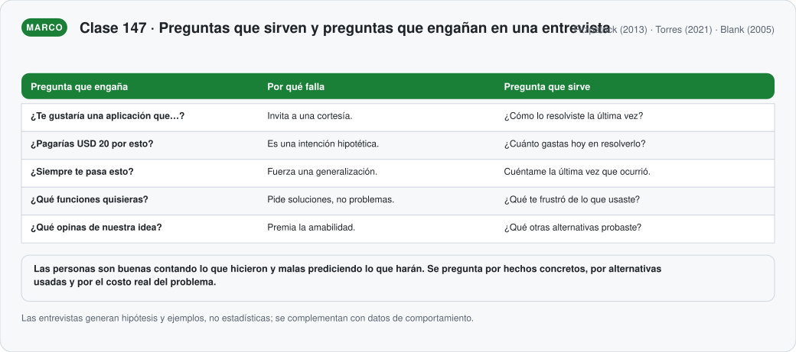

# Clase 147 — Customer discovery

<!-- nav:inicio -->
> **Parte 12 · Producto e innovación** — clase 3 de 12 · [índice de la parte](../../README.md) · [temario](../../../../SYLLABUS.md)
<!-- nav:fin -->

**Parte:** 12 — Producto e innovación  
**Nivel:** Etapa 3 — Manager → Gerente  
**Duración sugerida:** 150–180 minutos · **Estándar:** deep-class-v2

## 🎯 Propósito

Casi todos los fundadores y equipos de producto «hablan con clientes», y casi todos salen de esas conversaciones con la convicción de que su idea es buena. La razón es incómoda: las personas son amables, tienden a decir lo que creen que queremos oír, y responden con entusiasmo a ideas hipotéticas que nunca pagarían. **Customer discovery** es la disciplina de hablar con clientes para **aprender la verdad sobre su vida y sus problemas**, no para validar una idea. Hecha bien, es la inversión más barata del ciclo de producto; hecha mal, produce falsas certezas y proyectos que se construyen sobre cortesías.

La clase se apoya en *The Mom Test* de Fitzpatrick, en el proceso de desarrollo de clientes de Blank, en los hábitos de descubrimiento continuo de Torres y en la teoría de trabajos a realizar de Christensen y colaboradores. Al terminar sabrás preparar entrevistas con objetivos de aprendizaje, formular preguntas sobre hechos pasados, detectar cortesías, ideas y datos falsos, buscar compromisos reales del cliente y convertir lo aprendido en decisiones.

## 📚 Resultados de aprendizaje

Al finalizar podrás:

1. **Preparar** entrevistas con las tres preguntas que más importa responder.
2. **Formular** preguntas sobre comportamiento pasado y no sobre intenciones.
3. **Clasificar** lo que dice el cliente en hechos, opiniones, cortesías e ideas.
4. **Pedir** compromisos que muestren interés real.
5. **Sintetizar** aprendizajes y decidir qué hacer con ellos.

## 🧭 Agenda

| Tramo | Qué se hace |
|---|---|
| 0–20 min | Recuperación: recuerda una conversación con un cliente que te dejó entusiasmado y analiza qué datos concretos aportó. |
| 20–60 min | Objetivos, preguntas, señales, compromisos y síntesis. |
| 60–105 min | Ejemplo trabajado: entrevistas a gerentes de operaciones de pequeñas distribuidoras. |
| 105–150 min | Caso ejecutivo y práctica de entrevistas. |
| 150–175 min | Límites y entregable. |

## 🧩 Conceptos centrales

| Concepto | Definición | Cómo se reconoce |
|---|---|---|
| **Descubrimiento de clientes** | Proceso de aprender sobre problemas, contexto y comportamiento de clientes potenciales. | Muchas conversaciones, pocas presentaciones. |
| **Prueba de la madre (Mom Test)** | Regla de formular preguntas que ni tu madre pueda responder por cortesía. | Preguntas sobre su vida, no sobre tu idea. |
| **Cortesía** | Elogio o interés que no implica acción. | «Suena genial». |
| **Dato falso** | Respuesta que parece evidencia y no lo es: cumplidos, ideas, promesas futuras. | «Lo usaría seguro». |
| **Compromiso** | Acción del cliente que cuesta algo: tiempo, dinero, reputación. | Presentar a su jefe, pagar un piloto. |
| **Avance** | Resultado de una conversación que lleva al siguiente paso real. | Fecha, persona o dato concreto. |

## 🧠 Modelo mental

**Cómo leer el diagrama.** Una tabla con cinco preguntas típicas que **engañan** y su versión que **sirve**. «¿Te gustaría una aplicación que…?» invita a una cortesía; «¿cómo lo resolviste la última vez?» pide un hecho. «¿Pagarías USD 20?» es una intención hipotética; «¿cuánto gastas hoy en resolverlo?» es un dato. La nota resume la lección central: las personas cuentan bien lo que hicieron y predicen mal lo que harán.

## 📖 Desarrollo

### 1. Qué se busca aprender

Fitzpatrick propone empezar cada ronda de conversaciones con **tres preguntas** que realmente importan para el negocio: qué se necesita saber para decidir. Por ejemplo: ¿el problema existe y es importante?, ¿cómo lo resuelven hoy y cuánto les cuesta?, ¿quién decide y paga? Con esas tres en mente se evitan conversaciones agradables y vacías. Blank complementa: el **desarrollo de clientes** consiste en «salir del edificio» para probar las hipótesis del modelo de negocio (clientes, problema, propuesta, canales, ingresos) contra la realidad, no solo escuchar a quienes ya conocemos.

### 2. La prueba de la madre

La idea central es que **una buena pregunta no depende de que el interlocutor sea sincero con tu idea**. Las malas preguntas mencionan tu idea («¿te gustaría…?»), piden opiniones sobre el futuro («¿lo usarías?») o buscan generalidades («¿normalmente cómo…?»). Las buenas preguntas hablan de **su vida y sus problemas**, piden **ejemplos específicos del pasado** («cuéntame la última vez que…»), exploran **qué han probado** y **cuánto les cuesta** el problema, y prestan atención a **emociones fuertes** (frustración, vergüenza, urgencia). La regla de oro: **habla de ellos, no de ti**. Las presentaciones del producto llegan después, y cortas.

### 3. Clasificar lo que se oye

Después de cada conversación se clasifica lo escuchado. **Hechos** (qué hicieron, cuánto gastaron, qué herramientas usan): son evidencia. **Opiniones** sobre sus problemas y prioridades: útiles con cautela. **Cortesías y elogios** («qué buena idea»): ruido que se descarta. **Ideas y deseos de funciones** («sería genial que tuviera…»): se registra el problema que hay detrás, no la función. **Promesas futuras** («si lo tuvieras, lo compraría»): casi sin valor. Una regla útil: si no hay un hecho concreto ni un compromiso, la conversación fue agradable pero no aportó evidencia.

### 4. Buscar compromisos y avances

Una conversación sirve cuando produce un **avance**: un siguiente paso concreto. Fitzpatrick distingue **compromiso** (el cliente da algo que le cuesta: tiempo, reputación o dinero) de **cortesía**. Ejemplos de compromisos: presentar al decisor, compartir datos reales, participar en un piloto, firmar una carta de intención, pagar una reserva o un anticipo. Ejemplos de falsos avances: «mándame información», «suena interesante, hablemos más adelante». Si la conversación no produjo avance, se pregunta con respeto: «¿qué te parece como siguiente paso?». Si el cliente rehúye, es información sobre la fuerza del problema.

### 5. A quién y cuántas entrevistas

Se entrevista a personas que **tienen el problema** (usuarios y decisores), de un **segmento definido** (clase 135) y con diversidad de contextos. Se evita quedarse con amigos y conocidos. Se pueden usar redes profesionales, comunidades, clientes actuales, personas que abandonaron y referidos. Con 10 a 20 entrevistas de un segmento suelen aparecer patrones; si cada conversación revela algo nuevo, se continúa. Torres sugiere un ritmo **semanal**: cada semana, al menos una conversación con un cliente por parte del equipo de producto (producto, diseño e ingeniería), de modo que el descubrimiento no sea una fase sino un hábito.

### 6. Entrevistas centradas en momentos de decisión

Christensen y colaboradores sugieren entrevistar sobre **el momento en que contrataron o cambiaron** una solución: ¿qué pasó antes?, ¿qué los llevó a buscar?, ¿qué alternativas miraron?, ¿qué los frenó?, ¿qué los hizo decidir?, ¿cómo fue la primera semana de uso? Esta línea de tiempo revela **fuerzas** que empujan (el problema, la frustración), que atraen (la promesa de la nueva solución), que frenan (ansiedad, inercia, costos de cambio) y que mantienen la situación actual. Es una forma de descubrir el trabajo a realizar (clase 148) con hechos concretos.

### 7. Registrar, sintetizar y decidir

Se **registra** cada conversación en notas con citas textuales, hechos y avances, y se comparte con el equipo, idealmente poco después. Se **sintetiza** buscando patrones entre entrevistas: problemas repetidos, soluciones actuales, criterios de decisión, objeciones. Se **actualizan** las hipótesis: se confirman, se descartan o se refinan. Se decide: seguir con el segmento y el problema, ajustar, o detenerse. Se evitan los errores de **confirmación** (recordar lo que gusta), **generalización** (basarse en una voz fuerte) y **sesgo de supervivencia** (entrevistar solo a clientes actuales). En entrevistas con datos personales se cuida el consentimiento y la privacidad.

## 📚 Lectura comparada

| Obra | Qué aporta | Qué no resuelve | Pregunta para contrastar |
|---|---|---|---|
| Fitzpatrick (*The Mom Test*) | Preguntas útiles, cortesías, compromisos y avances. | Es una guía práctica; no sustituye datos cuantitativos. | ¿Cuántas de tus preguntas mencionan tu idea? |
| Blank | Proceso de desarrollo de clientes y salir del edificio. | Contexto de startups tecnológicas. | ¿Qué hipótesis del modelo pruebas? |
| Torres | Contacto semanal con clientes y descubrimiento continuo. | Presupone acceso a clientes. | ¿Qué hábito semanal sostienes? |
| Christensen et al. | Entrevistas de momento de contratación. | Método cualitativo; no cuantifica. | ¿Qué fuerzas empujaron y frenaron la compra? |
| Osterwalder et al. | Cómo traducir hallazgos a propuesta de valor. | Marco de diseño. | ¿Qué dolor y qué ganancia aparecen? |

## 🧮 Ejemplo trabajado

**Situación (hipotética).** Un equipo quiere construir una herramienta para que pequeñas distribuidoras (10 a 40 empleados) planifiquen rutas de reparto. Las tres preguntas que necesitan responder: (1) ¿planificar rutas es un problema importante y costoso?, (2) ¿cómo lo resuelven hoy y qué les falta?, (3) ¿quién decide y paga?

**Primeras cinco entrevistas (promedio de 40 minutos).** El fundador presenta la idea en 10 minutos y pregunta «¿lo usarías?». Resultado: cuatro dicen «sí, interesante», uno «tal vez». Ningún dato de costos; ningún siguiente paso.

**Reformulación.** Siguientes diez entrevistas con la prueba de la madre: se pide **contar el último reparto que salió mal**, cuánto tiempo dedican semanalmente a planificar, qué herramientas usan, cuánto gastaron en combustible y retrasos el último mes, qué probaron antes y qué pasó, quién decide cambios.

**Hechos recogidos.**

| Hallazgo | Casos (de 10) |
|---|---|
| Planifican rutas en planilla o a mano, 3 a 8 horas semanales | 9 |
| Han probado una aplicación y la abandonaron por cambios de pedidos de último momento | 5 |
| Cuantifican costo de retrasos o combustible | 3 (entre USD 1.800 y 4.500 mensuales) |
| Quien decide es el dueño; el jefe de bodega es quien usa | 8 |
| Pidieron ver una demostración | 6 |

**Avances.** Tres aceptaron compartir los datos de un mes de repartos y presentar al dueño; uno ofreció pagar un piloto de USD 150 mensuales; cuatro se limitaron a «mándame información». Se descartan los cuatro últimos como señal débil.

**Aprendizajes.** El problema que más pesa no es optimizar la ruta (ya tienen conductores con experiencia) sino **reorganizarla cuando entran pedidos de última hora**; el usuario es el jefe de bodega, pero decide el dueño; el valor está en reducir la espera y los kilómetros vacíos.

**Decisión.** Se redefine el problema («responder a cambios de pedidos durante el día») y se diseña una maqueta para probar con los tres que compartieron datos (clase 149). Se deja de construir el módulo de optimización completa. Se almacenan las notas con consentimiento.

**Qué muestra.** (1) Las primeras entrevistas produjeron cortesías. (2) Las reformuladas produjeron hechos y avances. (3) Cambió el problema y el usuario.

## 🔀 Comparación y límites

**Entrevistas frente a encuestas.** Las entrevistas descubren razones y contextos con pocos casos; las encuestas miden frecuencias en muestras grandes cuando ya se sabe qué preguntar (clase 134). Se usan en ese orden.

**Límites.** Las entrevistas no permiten estimar el tamaño del mercado ni la probabilidad de compra. Los entrevistados recuerdan con sesgos. Se tiende a entrevistar a quienes responden. El método fue desarrollado principalmente para startups y productos digitales; en ventas empresariales largas o sectores regulados se adapta. El tratamiento de datos de personas exige consentimiento y cumplimiento de las normas de protección de datos.

## 🪜 De profesional a owner

| Nivel | Cómo participa en el descubrimiento |
|---|---|
| **Profesional** | Hace buenas preguntas y registra hechos. |
| **Jefe / Team Lead** | Sostiene un ritmo semanal de entrevistas con el equipo. |
| **Gerente** | Exige evidencia de descubrimiento antes de aprobar inversiones. |
| **CEO / Director** | Habla con clientes y evita decidir por anécdotas o por la voz más fuerte. |
| **Founder / Owner** | Conversa con sus clientes cada semana y desconfía de los elogios. |

## 🏢 Caso ejecutivo

Una empresa de educación financiera quiere lanzar una aplicación para jóvenes de 18 a 25 años que ayude a ahorrar. El equipo hizo 30 encuestas y 10 entrevistas con estudiantes universitarios conocidos de los fundadores: el 87 % dijo que «le gustaría» una aplicación así y el 70 % «seguro la usaría». Con ese dato, la dirección está dispuesta a invertir USD 400.000 en desarrollo. Una analista advierte que ninguno de los entrevistados ahorraba de forma constante, que ninguna entrevista indagó cómo gestionan hoy el dinero, que las encuestas se aplicaron con un sorteo y que la muestra no incluye a jóvenes que trabajan y no estudian. Hay normas de protección de datos financieros y de menores de edad que aplicar.

Entrega un **plan de descubrimiento** que contenga: (a) las tres preguntas clave y las hipótesis del modelo; (b) el perfil de los entrevistados y cómo los encontrarás; (c) la guía de entrevista con preguntas de hechos pasados y de momentos de decisión; (d) la crítica de las encuestas e entrevistas anteriores; (e) los compromisos y avances que buscarás y los criterios de decisión; (f) cómo registrar, sintetizar y proteger los datos de las personas entrevistadas.

## 🧪 Práctica

1. Escribe las tres preguntas que más importa responder sobre tu idea.
2. Redacta diez preguntas de entrevista que cumplan la prueba de la madre.
3. Clasifica diez frases de una conversación real en hecho, opinión, cortesía, idea o promesa.
4. Define qué compromisos concretos buscarás al final de cada entrevista.
5. Programa cinco entrevistas con personas del segmento y registra tus aprendizajes.

## ⚠️ Errores frecuentes

| Error | Por qué ocurre | Cómo corregirlo |
|---|---|---|
| Presentar la idea en vez de preguntar | Se quiere convencer | Hablar de su vida y sus problemas. |
| Aceptar elogios como evidencia | Son agradables | Buscar hechos y compromisos. |
| Entrevistar a conocidos | Es fácil | Buscar personas del segmento. |
| Preguntar por el futuro | Es natural | Preguntar por el pasado concreto. |
| No registrar | Se confía en la memoria | Notas con citas y avances. |
| Generalizar una voz | Impresiona | Buscar patrones entre muchas entrevistas. |

## ❓ Preguntas de comprobación

1. ¿Qué busca el descubrimiento de clientes?
2. ¿Qué es la prueba de la madre?
3. ¿Qué diferencia hay entre un compromiso y una cortesía?
4. ¿Qué tipos de dato falso describe Fitzpatrick?
5. ¿Por qué se entrevista sobre momentos de decisión?
6. ¿Cuántas entrevistas bastan y por qué se hace semanalmente?
7. ¿Qué límites tienen las entrevistas?

Claves de respuesta

1. Aprender la verdad sobre los problemas, el contexto y el comportamiento de los clientes, no validar una idea.
2. La regla de formular preguntas que ni tu madre pueda responder con cortesía: hablar de su vida y problemas, con ejemplos del pasado, sin mencionar tu idea.
3. El compromiso cuesta algo al cliente (tiempo, reputación, dinero); la cortesía es amabilidad sin acción.
4. Elogios, ideas o deseos de funciones y promesas futuras.
5. Revelan las fuerzas que empujan, atraen, frenan y mantienen la situación actual con hechos concretos.
6. Entre 10 y 20 de un segmento suelen mostrar patrones; el ritmo semanal convierte el descubrimiento en hábito, no en fase.
7. No estiman tamaño de mercado ni probabilidad de compra, tienen sesgos de recuerdo y de selección y requieren consentimiento para datos personales.

## 📥 Entregable

Guarda en `portfolio/147-customer-discovery/`:

- `product-evidence-brief.md` (plantilla [Product evidence brief](../../../../templates/product-evidence-brief.md)) con el plan de descubrimiento y los primeros hallazgos;
- `venture-validation.md` (plantilla [Venture validation](../../../../templates/venture-validation.md)) con las hipótesis y los criterios de decisión;
- `decision-journal.md` con las notas de entrevistas, los avances y los aprendizajes.

## 📗 Fuentes y verificación

- Rob Fitzpatrick — *The Mom Test* (CreateSpace, 2014). **Uso en esta clase:** preguntas útiles, cortesías, compromisos y avances. Lectura selectiva sobre **customer discovery**. **Localizador:** [ISBN-13 9781492180746](https://openlibrary.org/isbn/9781492180746).
- Steve Blank — *The Four Steps to the Epiphany* ([Steve Blank?], 2013). **Uso en esta clase:** proceso de desarrollo de clientes y salir del edificio. Lectura selectiva sobre **customer discovery**. **Localizador:** [ISBN-13 9780989200509](https://openlibrary.org/isbn/9780989200509).
- Teresa Torres — *Continuous Discovery Habits* (Product Talk LLC, 2021). **Uso en esta clase:** contacto semanal con clientes y descubrimiento continuo. Lectura selectiva sobre **customer discovery**. **Localizador:** [ISBN-13 9781736633304](https://openlibrary.org/isbn/9781736633304).
- Clayton M. Christensen et al. — *Competing Against Luck* (HarperBusiness, 2016). **Uso en esta clase:** entrevistas de momento de contratación. Lectura selectiva sobre **customer discovery**. **Localizador:** [ISBN-13 9780062435613](https://openlibrary.org/isbn/9780062435613).
- Alexander Osterwalder et al. — *Value Proposition Design* (John Wiley & Sons, Incorporated, 2014). **Uso en esta clase:** traducir hallazgos a propuesta de valor. Lectura selectiva sobre **customer discovery**. **Localizador:** [ISBN-13 9781118968062](https://openlibrary.org/isbn/9781118968062).

> **Regla de fuentes para Customer discovery:** las obras anteriores estructuran las perspectivas de esta materia; cualquier norma, ley o estándar vivo mencionado debe comprobarse nuevamente en su fuente primaria vigente, incluidas las de protección de datos personales y de menores. Los ejemplos y casos son hipotéticos, con cifras ilustrativas. El desarrollo es original y no reproduce capítulos protegidos.

<!-- pie:inicio -->
---

| Anterior | Índice | Siguiente |
|---|---|---|
| [← 146 · Problema, usuario y outcome](../146-problema-usuario-y-outcome/README.md) | [Parte 12](../../README.md) · [Programa](../../../../SYLLABUS.md) | [148 · Jobs to Be Done →](../148-jobs-to-be-done/README.md) |
<!-- pie:fin -->
