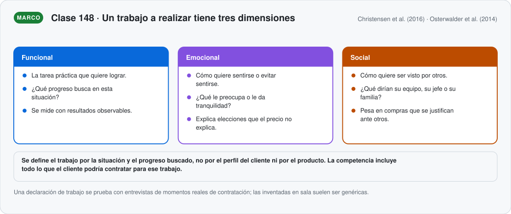

# Clase 148 — Jobs to Be Done

<!-- nav:inicio -->
> **Parte 12 · Producto e innovación** — clase 4 de 12 · [índice de la parte](../../README.md) · [temario](../../../../SYLLABUS.md)
<!-- nav:fin -->

**Parte:** 12 — Producto e innovación  
**Nivel:** Etapa 3 — Manager → Gerente  
**Duración sugerida:** 150–180 minutos · **Estándar:** deep-class-v2

## 🎯 Propósito

¿Por qué alguien «contrata» un producto? Las empresas suelen responder con el perfil del cliente («mujeres de 30 a 45 años», «pymes del sector retail») o con los atributos del producto («más rápido», «más barato»), y fallan al predecir qué comprarán. La teoría de los **trabajos a realizar** (*Jobs to Be Done*, JTBD) propone otra unidad de análisis: no el cliente ni el producto, sino **el progreso que alguien intenta lograr en una situación concreta**. Las personas «contratan» productos para hacer un trabajo; cuando lo hacen mal, los «despiden». Entender el trabajo explica por qué compran, con quién compiten realmente y qué atributos importan.

La clase se apoya en *Competing Against Luck* de Christensen y colaboradores, en el diseño de propuestas de valor de Osterwalder y su equipo y en las técnicas de entrevista de Fitzpatrick y Torres. Al terminar sabrás formular un trabajo a realizar con situación, motivación y resultado esperado, distinguir sus dimensiones funcional, emocional y social, identificar la competencia real, mapear las fuerzas que mueven una decisión y traducir el trabajo en decisiones de producto, mensaje y oferta.

## 📚 Resultados de aprendizaje

Al finalizar podrás:

1. **Formular** un trabajo a realizar con situación, motivación y resultado.
2. **Distinguir** las dimensiones funcional, emocional y social del trabajo.
3. **Identificar** la competencia real: todo lo que el cliente contrata para ese trabajo.
4. **Mapear** las fuerzas que empujan, atraen, frenan y mantienen una decisión.
5. **Traducir** el trabajo en criterios de producto, mensaje y oferta.

## 🧭 Agenda

| Tramo | Qué se hace |
|---|---|
| 0–20 min | Recuperación: ¿para qué «contrataste» tu último producto de uso frecuente, y qué otras cosas pudiste contratar? |
| 20–60 min | Concepto, dimensiones, competencia, fuerzas y aplicación. |
| 60–105 min | Ejemplo trabajado: el trabajo detrás de un servicio de comidas preparadas. |
| 105–150 min | Caso ejecutivo y práctica. |
| 150–175 min | Límites y entregable. |

## 🧩 Conceptos centrales

| Concepto | Definición | Cómo se reconoce |
|---|---|---|
| **Trabajo a realizar (job)** | Progreso que una persona quiere lograr en una circunstancia concreta. | Se enuncia con situación y resultado. |
| **Contratar y despedir** | Metáfora de elegir y abandonar un producto para hacer un trabajo. | Cambios de proveedor. |
| **Circunstancia** | Contexto específico (cuándo, dónde, con quién, con qué limitaciones) que define el trabajo. | Mismo cliente, trabajos distintos. |
| **Dimensiones del trabajo** | Aspectos funcional, emocional y social. | Explican decisiones que el precio no explica. |
| **Competencia real** | Todo lo que el cliente podría contratar para el mismo trabajo. | Incluye soluciones de otras categorías y no hacer nada. |
| **Fuerzas de decisión** | Empuje del problema, atracción de la solución, ansiedad y hábito. | Se descubren en entrevistas de decisión. |

## 🧠 Modelo mental

**Cómo leer el diagrama.** Tres columnas. La dimensión **funcional** es la tarea práctica que se quiere lograr; la **emocional**, cómo se quiere sentir o evitar sentirse; la **social**, cómo se quiere ser visto por otros. Cada columna incluye una pregunta que ayuda a explorarla. La nota recuerda que el trabajo se define por la **situación y el progreso buscado**, no por el perfil del cliente ni por el producto, y que la competencia incluye todo lo que podría contratarse para ese trabajo.

## 📖 Desarrollo

### 1. La unidad de análisis

Christensen y colaboradores sostienen que las empresas fallan en innovar porque se centran en **correlaciones** (qué tipo de cliente compra qué) en lugar de **causas** (por qué se compra). Dos clientes con el mismo perfil pueden contratar el mismo producto para trabajos distintos, y dos de perfiles distintos pueden contratarlo para el mismo trabajo. Entender el trabajo permite explicar el comportamiento: alguien compra un batido por la mañana para que el trayecto en auto sea menos aburrido y sentirse saciado; esa persona compite con una banana, una dona o un café. La pregunta cambia de «¿quién es nuestro cliente?» a «¿qué progreso está intentando lograr?».

### 2. Formular un trabajo

Una declaración útil tiene tres partes: **situación** («cuando…»), **motivación** («quiero…») y **resultado esperado** («para poder…»). Por ejemplo: «Cuando termino una jornada larga y debo alimentar a mi familia, quiero resolver la cena sin cocinar ni pensar demasiado, para sentir que cuido a los míos sin agotarme». No menciona el producto ni un perfil, y puede cumplirse de muchas formas. Se evita el trabajo demasiado general («alimentarse») y el demasiado específico («usar nuestra aplicación»). Se prueba con clientes: ¿se reconocen en el enunciado?

### 3. Dimensiones funcional, emocional y social

Christensen y su equipo subrayan que los trabajos tienen **tres dimensiones**. La **funcional** es la tarea práctica. La **emocional** es cómo la persona quiere sentirse o evitar sentirse (tranquilidad, control, orgullo, culpa). La **social** es cómo quiere ser percibida por otros (profesional, responsable, moderna). Muchas decisiones que parecen irracionales en términos de precio se explican por estas dimensiones: se contrata una consultora conocida no por mejor solución sino para sentirse protegido ante el directorio. Un producto que cumple solo la dimensión funcional compite por precio; uno que atiende las tres puede diferenciarse.

### 4. La competencia real

Si el trabajo define la contratación, la competencia es **todo lo que se podría contratar para ese trabajo**, sin importar la categoría: productos de otras industrias, soluciones caseras, servicios de personas, planillas, no hacer nada. Esto cambia el análisis competitivo (clase 133) y el posicionamiento (clase 136): el rival de una aplicación de meditación puede ser una caminata o una copa de vino; el de un software de contabilidad, una planilla y un contador amigo. Identificar la competencia real revela por qué se pierden ventas y qué atributos cuentan. Se encuentra preguntando a los clientes qué usaban antes, qué consideraron y qué los habría hecho no cambiar.

### 5. Las cuatro fuerzas de la decisión

Las entrevistas centradas en el momento de decisión (clase 147) permiten reconstruir las **fuerzas** que mueven el cambio: **el empuje del problema** (insatisfacción con la situación actual), **la atracción de la nueva solución** (la promesa de progreso), **la ansiedad** respecto de lo nuevo (¿funcionará?, ¿me costará aprender?, ¿me equivocaré?) y **el hábito** o la inercia que mantiene lo actual. Para que alguien cambie, el empuje y la atracción deben superar a la ansiedad y al hábito. Esto da una lista de acciones: aumentar la claridad del problema, reducir la ansiedad con pruebas y garantías, facilitar la transición y atenuar el hábito.

### 6. Del trabajo al producto y al mensaje

Una vez formulado el trabajo, guía decisiones: **producto** (qué atributos mejoran el progreso, qué eliminar), **experiencia** (cómo atender la dimensión emocional y la social), **mensaje** (hablar de la situación y el progreso, no de características), **precio** (según el valor del progreso) y **canal** (dónde ocurre la circunstancia). Osterwalder y colaboradores ofrecen una herramienta complementaria: el **perfil del cliente** (trabajos, frustraciones y ganancias) y el **mapa de valor** (productos y servicios, aliviadores de frustraciones y creadores de ganancias), que busca el **encaje** entre ambos. Los trabajos se priorizan por importancia, frecuencia y nivel de insatisfacción.

### 7. Cómo usarlo bien y qué evitar

Se usa mejor como una **lente de descubrimiento**, no como una plantilla que se llena en sala. Los errores frecuentes: **confundir trabajo con tarea o función** («exportar a PDF»), **confundir trabajo con producto** («usar nuestra aplicación»), **olvidar la circunstancia**, **ignorar las dimensiones emocional y social**, **no conectar el trabajo con decisiones** y **basarse en pocas entrevistas**. Por último, los trabajos pueden cambiar con el tiempo y con la tecnología, y conviene revisarlos. El valor del enfoque es dejar de preguntar «¿qué quieren los clientes?» y empezar a preguntar «¿qué están intentando lograr?».

## 📚 Lectura comparada

| Obra | Qué aporta | Qué no resuelve | Pregunta para contrastar |
|---|---|---|---|
| Christensen et al. (*Competing Against Luck*) | Teoría del trabajo, dimensiones y competencia real. | Casos seleccionados; método cualitativo. | ¿Para qué trabajo te contratan? |
| Osterwalder et al. (*Value Proposition Design*) | Perfil del cliente y mapa de valor. | Es una herramienta de diseño, no de investigación. | ¿Tu oferta alivia frustraciones reales? |
| Fitzpatrick | Cómo entrevistar con hechos. | No es una teoría del trabajo. | ¿Qué hecho respalda tu trabajo? |
| Torres | Oportunidades a partir de entrevistas. | Enfoque de descubrimiento continuo. | ¿Qué oportunidad nace de este trabajo? |
| Christensen (*Innovator's Dilemma*) | Innovaciones sostenidas y disruptivas. | Teoría de industrias. | ¿Qué trabajo está desatendido? |

## 🧮 Ejemplo trabajado

**Situación (hipotética).** Un servicio de comidas preparadas por suscripción tiene un abandono mensual de 11 % y no entiende por qué. Hace 20 entrevistas con clientes recientes y con quienes se dieron de baja, centradas en el momento de decisión.

**Trabajos que aparecen.**

| Trabajo | Situación y motivación | Frecuencia (de 20) |
|---|---|---|
| A. «Resolver la cena sin pensar» | Después de trabajar, con hijos pequeños; quiero cenar bien sin planificar ni cocinar, para sentir que cuido a mi familia | 8 |
| B. «Comer saludable con un objetivo» | Estoy en un plan de salud; quiero porciones controladas para cumplir y sentir que avanzo | 6 |
| C. «Tener la comida resuelta cuando recibo visitas o estoy muy ocupado» | Ocasiones especiales o semanas de trabajo intenso | 4 |
| D. «Probar algo distinto» | Curiosidad por variedad y novedad | 2 |

**Competencia real.** Para A: comida de supermercado, delivery, comida casera preparada los fines de semana y comida de la suegra. Para B: nutricionista con plan, aplicaciones de recetas y programas de otros proveedores. Para C: restaurantes y servicios de catering.

**Fuerzas (trabajo A, clientes que abandonaron).** Empuje: cansancio de cocinar. Atracción: «cenas listas». Ansiedad: «¿y si la entrega llega tarde y no tengo cena?», «¿y si los niños no la comen?». Hábito: la comida del supermercado. Quienes abandonan lo hacen cuando una entrega falla una vez y la cena se arruina: la ansiedad vence.

**Dimensiones del trabajo A.** Funcional: cena lista en 10 minutos. Emocional: tranquilidad («no tengo que improvisar»). Social: ser una madre o un padre que alimenta bien a su familia.

**Decisiones.** (1) Garantizar la cena: si una entrega falla, ofrecer una alternativa (cupón de reemplazo inmediato); (2) menú «aprobado por niños» con comentarios de otros hogares; (3) mensaje centrado en la situación («Esta noche, la cena ya está resuelta»); (4) flexibilidad de entrega, pausa y cambio; (5) plan B para quienes buscan objetivos de salud con porciones y seguimiento. Se mide el abandono por tipo de trabajo.

**Resultado a 4 meses.** El abandono del segmento A baja de 12,5 % a 7,8 % mensual; la reposición por entrega fallida se usa en el 2,1 % de los pedidos. Se evaluarán los trabajos B y C con ofertas distintas.

**Qué muestra.** (1) El perfil del cliente no explicaba el abandono; el trabajo sí. (2) La ansiedad frenaba más que el precio. (3) La respuesta incluyó garantía, mensaje y producto.

## 🔀 Comparación y límites

**Trabajo frente a segmento.** El segmento describe a quién se atiende; el trabajo, por qué se contrata. Se complementan: el trabajo orienta la propuesta; el segmento, el alcance y los canales (clase 135).

**Límites.** JTBD es una **teoría explicativa** con aplicación cualitativa; no entrega por sí misma el tamaño de cada trabajo ni su probabilidad. Existen varias escuelas (la de Christensen, la basada en resultados deseados, la de fuerzas de decisión) con vocabularios distintos. Los casos publicados son seleccionados. Las entrevistas requieren habilidad y tiempo. Y los datos personales de los entrevistados deben tratarse conforme a la normativa de protección de datos.

## 🪜 De profesional a owner

| Nivel | Cómo usa Jobs to Be Done |
|---|---|
| **Profesional** | Escucha qué progreso busca el cliente, no solo qué pide. |
| **Jefe / Team Lead** | Organiza entrevistas de decisión y sintetiza trabajos. |
| **Gerente** | Prioriza trabajos y ajusta oferta, mensaje y experiencia. |
| **CEO / Director** | Define la competencia por el trabajo, no por la categoría. |
| **Founder / Owner** | Vende progreso y no características. |

## 🏢 Caso ejecutivo

Una empresa de seguros ofrece un seguro de hogar con características muy completas, pero sus ventas se estancan: compite en precio con otros 12 proveedores y sus clientes lo cancelan al año al encontrar uno más barato. Una investigación con 25 clientes que contrataron, 12 que cancelaron y 10 que lo evaluaron y no compraron muestra trabajos distintos: quienes compran tras mudarse buscan «tener tranquilidad de que mi nueva casa está cubierta», quienes lo hacen por exigencia del banco quieren «cumplir con el trámite al menor costo», y quienes compran tras un siniestro de un vecino buscan «no quedar desprotegido». Las quejas más frecuentes son de procesos de reclamo largos y confusos. El gerente comercial propone bajar precios 15 %; el de producto, agregar coberturas; el de operaciones, rediseñar el proceso de siniestros.

Entrega un **análisis de trabajos a realizar** que contenga: (a) los trabajos con situación, motivación y resultado, y sus dimensiones; (b) la competencia real de cada trabajo; (c) las fuerzas de decisión para cada uno, con sus ansiedades; (d) los trabajos prioritarios con criterios; (e) las decisiones de producto, mensaje, precio y proceso asociadas; (f) cómo medirás el efecto y las verificaciones regulatorias de seguros y de datos que se harán con asesoría.

## 🧪 Práctica

1. Escribe tres trabajos que tus clientes contratan, con situación, motivación y resultado.
2. Identifica la competencia real de uno de ellos (cinco alternativas).
3. Mapea las cuatro fuerzas de una decisión de cambio reciente de un cliente.
4. Para un trabajo, describe sus dimensiones funcional, emocional y social.
5. Elige una decisión de producto o mensaje que cambiaría con este análisis.

## ⚠️ Errores frecuentes

| Error | Por qué ocurre | Cómo corregirlo |
|---|---|---|
| Trabajo = función | Se piensa en el producto | Enunciar situación, motivación y resultado. |
| Ignorar la circunstancia | Se generaliza | Describir cuándo, dónde y con quién. |
| Solo dimensión funcional | Es la más evidente | Explorar lo emocional y lo social. |
| Competencia por categoría | Es la costumbre | Buscar todo lo que se contrata para el trabajo. |
| Pocas entrevistas | Es costoso | 15 a 20 por segmento y momento. |
| No traducir a decisiones | Se queda en el diagnóstico | Conectar con producto, mensaje, precio y proceso. |

## ❓ Preguntas de comprobación

1. ¿Qué es un trabajo a realizar y qué lo diferencia de un perfil de cliente?
2. ¿Qué partes tiene una declaración de trabajo?
3. ¿Cuáles son las tres dimensiones del trabajo?
4. ¿Cómo se identifica la competencia real?
5. ¿Qué cuatro fuerzas intervienen en una decisión de cambio?
6. ¿Cómo orienta el trabajo las decisiones de producto y mensaje?
7. ¿Qué límites tiene el enfoque?

Claves de respuesta

1. El progreso que alguien quiere lograr en una circunstancia; explica por qué compra, mientras el perfil solo describe quién es.
2. Situación, motivación y resultado esperado.
3. Funcional, emocional y social.
4. Preguntando qué usaban antes, qué consideraron y qué los habría hecho no cambiar; incluye soluciones de otras categorías y no hacer nada.
5. El empuje del problema, la atracción de la solución, la ansiedad ante lo nuevo y el hábito o la inercia.
6. Define qué atributos importan, cómo hablar al cliente (situación y progreso), qué experiencia atender, qué precio es razonable y en qué canal ocurre la circunstancia.
7. Es una teoría explicativa cualitativa: no dimensiona por sí misma cada trabajo, hay varias escuelas, los casos son seleccionados y requiere buenas entrevistas.

## 📥 Entregable

Guarda en `portfolio/148-jobs-to-be-done/`:

- `leadership-decision-brief.md` (plantilla [Leadership Decision Brief](../../../../templates/leadership-decision-brief.md)) con el análisis del caso ejecutivo;
- `product-evidence-brief.md` (plantilla [Product evidence brief](../../../../templates/product-evidence-brief.md)) con los trabajos, las fuerzas y la evidencia;
- `decision-journal.md` con las decisiones derivadas y las métricas de efecto.

## 📗 Fuentes y verificación

- Clayton M. Christensen et al. — *Competing Against Luck* (HarperBusiness, 2016). **Uso en esta clase:** teoría del trabajo, dimensiones y competencia real. Lectura selectiva sobre **jobs to be done**. **Localizador:** [ISBN-13 9780062435613](https://openlibrary.org/isbn/9780062435613).
- Alexander Osterwalder et al. — *Value Proposition Design* (John Wiley & Sons, Incorporated, 2014). **Uso en esta clase:** perfil del cliente y mapa de valor. Lectura selectiva sobre **jobs to be done**. **Localizador:** [ISBN-13 9781118968062](https://openlibrary.org/isbn/9781118968062).
- Rob Fitzpatrick — *The Mom Test* (CreateSpace, 2014). **Uso en esta clase:** entrevistas con hechos. Lectura selectiva sobre **jobs to be done**. **Localizador:** [ISBN-13 9781492180746](https://openlibrary.org/isbn/9781492180746).
- Teresa Torres — *Continuous Discovery Habits* (Product Talk LLC, 2021). **Uso en esta clase:** oportunidades a partir de entrevistas. Lectura selectiva sobre **jobs to be done**. **Localizador:** [ISBN-13 9781736633304](https://openlibrary.org/isbn/9781736633304).
- Clayton M. Christensen — *The Innovator's Dilemma* (Harvard Business School Press, 1997). **Uso en esta clase:** innovaciones sostenidas y disruptivas. Lectura selectiva sobre **jobs to be done**. **Localizador:** [ISBN-13 9780875845852](https://openlibrary.org/isbn/9780875845852).

> **Regla de fuentes para Jobs to Be Done:** las obras anteriores estructuran las perspectivas de esta materia; cualquier norma, ley o estándar vivo mencionado debe comprobarse nuevamente en su fuente primaria vigente, incluidas las normas de seguros y de protección de datos. Los ejemplos y casos son hipotéticos, con cifras ilustrativas. El desarrollo es original y no reproduce capítulos protegidos.

<!-- pie:inicio -->
---

| Anterior | Índice | Siguiente |
|---|---|---|
| [← 147 · Customer discovery](../147-customer-discovery/README.md) | [Parte 12](../../README.md) · [Programa](../../../../SYLLABUS.md) | [149 · Prototipos y aprendizaje temprano →](../149-prototipos-y-aprendizaje-temprano/README.md) |
<!-- pie:fin -->
