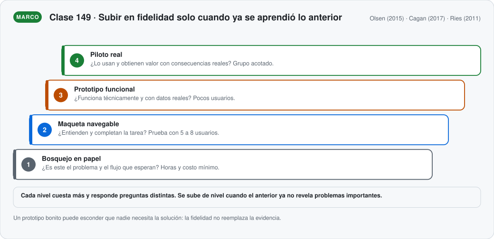

# Clase 149 — Prototipos y aprendizaje temprano

<!-- nav:inicio -->
> **Parte 12 · Producto e innovación** — clase 5 de 12 · [índice de la parte](../../README.md) · [temario](../../../../SYLLABUS.md)
<!-- nav:fin -->

**Parte:** 12 — Producto e innovación  
**Nivel:** Etapa 3 — Manager → Gerente  
**Duración sugerida:** 150–180 minutos · **Estándar:** deep-class-v2

## 🎯 Propósito

Construir un producto completo para descubrir si alguien lo quiere es el modo más caro de aprender. Un **prototipo** es una representación de una idea, hecha con el mínimo esfuerzo posible, cuyo propósito es **aprender algo específico** antes de invertir en construir de verdad: si el usuario entiende el concepto, si completa la tarea, si el flujo tiene sentido, si la tecnología es viable. Los equipos que prototipan bien descubren errores en horas que, de otro modo, aparecerían meses después y costarían cientos de veces más. Los que prototipan mal construyen maquetas pulidas que nadie prueba o prototipos que se convierten, sin querer, en el producto.

La clase se apoya en el enfoque de producto delgado de Olsen, en las prácticas de descubrimiento de Cagan, en el aprendizaje validado de Ries y en los hábitos de descubrimiento de Torres. Al terminar sabrás elegir el nivel de fidelidad adecuado a la pregunta que se quiere responder, diseñar una prueba con usuarios, interpretar lo que se observa sin sesgarlo y decidir cuándo pasar de prototipo a construcción.

## 📚 Resultados de aprendizaje

Al finalizar podrás:

1. **Definir** la pregunta que un prototipo debe responder.
2. **Elegir** el nivel de fidelidad: bosquejo, maqueta, prototipo funcional o piloto.
3. **Diseñar** una prueba con usuarios con tareas, observación y criterios.
4. **Interpretar** los resultados distinguiendo problemas de usabilidad, de valor y de viabilidad.
5. **Decidir** cuándo parar, iterar o construir.

## 🧭 Agenda

| Tramo | Qué se hace |
|---|---|
| 0–20 min | Recuperación: ¿cuál fue la última función que construiste y cuánto tardaste en saber si servía? |
| 20–60 min | Pregunta, fidelidad, pruebas con usuarios e interpretación. |
| 60–105 min | Ejemplo trabajado: probar un flujo de reserva de turnos con cuatro prototipos. |
| 105–150 min | Caso ejecutivo y práctica. |
| 150–175 min | Límites y entregable. |

## 🧩 Conceptos centrales

| Concepto | Definición | Cómo se reconoce |
|---|---|---|
| **Prototipo** | Representación de una idea hecha para aprender. | Se descarta o se rehace. |
| **Fidelidad** | Cuánto se parece el prototipo al producto final. | Baja (papel) a alta (funcional). |
| **Prueba de usabilidad** | Observación de personas haciendo tareas con el prototipo. | Se mide si completan y dónde se traban. |
| **Hipótesis de prueba** | Lo que se espera confirmar o refutar. | «Cuatro de cinco completarán la reserva sin ayuda». |
| **Mago de Oz** | Prototipo en que una persona simula manualmente lo que luego hará el sistema. | El usuario cree que es automático. |
| **Aprendizaje temprano** | Información valiosa obtenida antes de construir. | Cambia una decisión. |

## 🧠 Modelo mental

**Cómo leer el diagrama.** Una escalera de cuatro niveles de fidelidad creciente. El **bosquejo en papel** responde si es el problema y el flujo esperados, en horas y a costo mínimo. La **maqueta navegable** prueba si las personas entienden y completan la tarea, con cinco a ocho usuarios. El **prototipo funcional** prueba si funciona técnicamente con datos reales. El **piloto real** prueba si lo usan y obtienen valor con consecuencias reales. La nota recuerda que cada nivel cuesta más y que se sube cuando el anterior ya no revela problemas importantes.

## 📖 Desarrollo

### 1. Prototipar para aprender, no para mostrar

Olsen insiste en que el objetivo de un prototipo es **aprender qué necesita el cliente** y obtener evidencia rápida de si la propuesta de valor se sostiene, para hacer pivotes baratos. Un prototipo no es una versión «chica» del producto ni una demostración para convencer a interesados; es una **herramienta de investigación**. La primera pregunta, entonces, no es qué prototipo hacer sino **qué quiero aprender**: ¿entienden la propuesta?, ¿completan la tarea?, ¿les parece útil?, ¿pagarían?, ¿es técnicamente posible? Cada pregunta puede responderse con un prototipo distinto, más barato de lo que se piensa.

### 2. Elegir la fidelidad

La fidelidad se elige según la pregunta y el riesgo. **Baja fidelidad** (bosquejos, flujos en papel, diapositivas): rápida, permite descartar y es buena para validar el concepto y el flujo; sirve para pruebas de las primeras horas. **Fidelidad media** (maquetas navegables con herramientas de diseño): permite probar la comprensión y la finalización de tareas con usuarios reales. **Alta fidelidad o funcional** (código que usa datos reales): se justifica para riesgos técnicos o para pruebas de rendimiento. **Piloto** (producto real con un grupo acotado): prueba el valor y la conducta con consecuencias reales. Cagan recomienda prototipos para atacar los cuatro riesgos (valor, usabilidad, viabilidad técnica y de negocio) antes de construir.

### 3. Prototipos que no son código

Muchas hipótesis se prueban sin programar: **prototipo de papel** (se muestra una pantalla dibujada y se pregunta qué haría); **mago de Oz** (una persona ejecuta manualmente lo que luego hará el sistema: el usuario pide, el equipo responde en minutos con asistencia humana); **concierge** (se presta el servicio de forma totalmente manual a pocos clientes para aprender); **página de prueba** (una página que describe el producto y mide cuántos dejan sus datos o hacen una reserva); **video demostrativo** (para medir interés). Ries presenta estos recursos como formas de producto mínimo viable (clase 150). Su valor es la **velocidad** y que se aprende del comportamiento.

### 4. Probar con usuarios

Una prueba de usabilidad bien hecha tiene: **objetivo** (qué se quiere saber), **tareas realistas** («reserva un turno para tu madre la próxima semana»), **5 a 8 participantes** del segmento, **observación** (no explicar, no ayudar, pedir que piensen en voz alta), **registro** (dónde dudan, dónde fallan, qué dicen) y **síntesis** de hallazgos. Con cinco usuarios suelen aparecer la mayor parte de los problemas importantes de usabilidad de un flujo; para estimar proporciones se necesitan más. Torres sugiere probar **suposiciones específicas** y no «el producto en general»: «los usuarios entenderán que el turno no está confirmado hasta recibir el correo».

### 5. Interpretar los resultados

Los hallazgos se clasifican: **usabilidad** (no pudieron hacerlo: se rediseña), **valor** (lo hicieron, pero no les importa: se revisa el problema o la propuesta), **comprensión** (no entendieron qué era: se cambia el mensaje), **viabilidad** (funciona en la maqueta, no en la práctica: se investiga la técnica). Se distingue lo que **hacen** de lo que **dicen**: observar que alguien completa la tarea sin ayuda pesa más que su comentario de que «fue fácil». Se desconfía de la **cortesía** del participante y del **sesgo de confirmación** del equipo, que tiende a explicar cada tropiezo como «error de ese usuario». Se registran los hallazgos antes de discutir soluciones.

### 6. Iterar con criterio

Cada ronda debería **cambiar algo**: se corrige el problema más importante y se vuelve a probar. Se establecen **criterios de salida** antes de empezar: «cuando 4 de 5 usuarios completen la reserva sin ayuda en menos de dos minutos, se pasa a construir». Las rondas se hacen en **días**, no en meses. Se evita **iterar sobre detalles** mientras el concepto es dudoso: si nadie ve valor, mejorar los colores no ayuda. Y se evita el **perfeccionismo del prototipo**: invertir demasiado en uno lo vuelve difícil de abandonar.

### 7. De prototipo a producto

Pasar a construir exige: **evidencia de valor** (señales de interés reales, clase 147), **flujo validado** (los usuarios lo completan), **viabilidad técnica** (probada o con riesgo acotado) y **viabilidad de negocio** (economía y normativa). Se define qué se construye primero (la parte mínima que entrega el valor, clase 150) y cómo se medirá. Los prototipos se **archivan** como memoria de aprendizaje. Se evita convertir el código del prototipo en producto sin refactorizar: puede acarrear deuda técnica. En sectores regulados (salud, finanzas), los prototipos con datos reales deben cumplir las normas de protección de datos y de ensayos con usuarios.

## 📚 Lectura comparada

| Obra | Qué aporta | Qué no resuelve | Pregunta para contrastar |
|---|---|---|---|
| Olsen | Prototipos para aprender y evidencia de ajuste. | Metodología general. | ¿Qué hipótesis prueba este prototipo? |
| Cagan | Prototipos para reducir cuatro riesgos de producto. | Basado en experiencia tecnológica. | ¿Qué riesgo reduce esta prueba? |
| Ries | Producto mínimo viable y aprendizaje validado. | Contexto de startups. | ¿Cuál es la forma más barata de aprender esto? |
| Torres | Probar suposiciones con pruebas pequeñas. | Enfoque de descubrimiento continuo. | ¿Cuál es tu suposición más arriesgada? |
| Bland y Osterwalder | Catálogo de experimentos para validar ideas. | Etapa de validación. | ¿Qué experimento de bajo costo hay para tu hipótesis? |

## 🧮 Ejemplo trabajado

**Situación (hipotética).** Una red de clínicas quiere permitir que los pacientes reserven turnos desde el celular. El equipo estima 5 meses de desarrollo y USD 280.000. Antes de construir, decide aprender con cuatro prototipos.

**Pregunta y criterios.** ¿Pueden pacientes de 30 a 70 años reservar un turno sin ayuda? Criterio: al menos 4 de 5 completan la tarea en menos de 3 minutos y sin pedir ayuda; además, que digan qué ocurriría si no hay turnos disponibles.

| Prototipo | Costo y tiempo | Qué se aprendió |
|---|---|---|
| 1. Bosquejos en papel de 6 pantallas con 5 personas | 1 día, USD 0 | 3 de 5 no entendieron la diferencia entre «especialidad» y «profesional»; buscaban por síntoma |
| 2. Maqueta navegable en una herramienta de diseño, con 6 usuarios | 3 días, USD 600 | 4 de 6 completaron la reserva, pero dos no vieron el botón de confirmación; la ventana de «sin turnos» dejó a 3 sin saber qué hacer |
| 3. Mago de Oz: formulario simple que activa a una recepcionista que busca turnos y responde en 10 minutos, 12 pacientes | 1 semana, USD 1.200 | 9 de 12 reservaron; 7 pidieron «el próximo turno más cercano»; 5 se ofrecieron a recibir recordatorios por mensaje |
| 4. Prototipo funcional con datos reales de agenda de 1 clínica, 40 pacientes durante 2 semanas | 3 semanas, USD 9.000 | Los turnos duplicados aparecen cuando la agenda se modifica en el sistema antiguo; el 22 % de los pacientes usó la aplicación sin llamar |

**Hallazgos clasificados.** Comprensión (especialidad frente a síntoma), usabilidad (confirmación y falta de turnos), valor (el «próximo turno más cercano» es lo que más se pide), viabilidad (sincronización con el sistema actual de agendas).

**Decisión.** Antes de construir se rediseña la búsqueda (por síntoma y por «próximo turno disponible»), se simplifica la confirmación y se resuelve primero la sincronización técnica con un diseño que evita duplicados. El primer incremento real incluye solo la reserva y el recordatorio; el resto se difiere. El gasto total en aprender fue de USD 10.800, frente a USD 280.000 de la construcción completa, y evitó construir un flujo con tres problemas graves.

**Cumplimiento.** El prototipo con datos reales se probó con consentimiento de los pacientes y con acceso restringido, siguiendo la normativa de datos de salud verificada con el área legal.

**Qué muestra.** (1) Cada prototipo respondió una pregunta distinta. (2) Los hallazgos se clasificaron por tipo de riesgo. (3) El costo de aprender fue una fracción del de construir.

## 🔀 Comparación y límites

**Prototipo frente a producto mínimo viable.** El prototipo busca aprender sobre uso y comprensión, a menudo sin entregar valor real; el producto mínimo viable (clase 150) entrega valor real a clientes reales a una escala mínima para probar la hipótesis de negocio. Una secuencia habitual es prototipos, luego un producto mínimo.

**Límites.** Las pruebas con pocos usuarios detectan problemas, no miden proporciones. Los prototipos no prueban la **retención** ni el **comportamiento a largo plazo**. Los participantes se comportan distinto en una prueba que en la vida real. Los prototipos de baja fidelidad pueden subestimar problemas técnicos. En sectores regulados, el uso de datos reales y de participantes exige cumplimiento. Los costos de ejemplo son ilustrativos.

## 🪜 De profesional a owner

| Nivel | Cómo participa en el prototipado |
|---|---|
| **Profesional** | Construye y prueba prototipos con curiosidad y sin apego. |
| **Jefe / Team Lead** | Define la pregunta, los criterios de salida y la cadencia. |
| **Gerente** | Exige evidencia de prototipos antes de aprobar la construcción. |
| **CEO / Director** | Aprecia el aprendizaje temprano y premia descartar a tiempo. |
| **Founder / Owner** | Prueba una idea con un papel y un cliente antes de escribir una línea de código. |

## 🏢 Caso ejecutivo

Una aseguradora planea construir un asistente conversacional para que los clientes soliciten reembolsos de gastos médicos. El proyecto está presupuestado en USD 1,5 millones y 8 meses, con entrega a fin de año. El equipo ya diseñó la arquitectura y contrató a un proveedor de inteligencia artificial. Nunca ha hablado con clientes sobre cómo hacen reembolsos hoy; el 38 % de las solicitudes actuales llega con documentos incompletos; los clientes mayores de 60 años prefieren llamar; y la regulación de datos de salud limita lo que un proveedor externo puede procesar. La gerencia de operaciones pide un piloto «rápido» con 10.000 clientes; el área de riesgo, esperar a que el sistema esté completo.

Entrega un **plan de aprendizaje temprano** que contenga: (a) las preguntas críticas y los riesgos de valor, usabilidad, viabilidad técnica y de negocio; (b) la secuencia de prototipos con fidelidad creciente, su costo y los criterios de salida; (c) la prueba de mago de Oz que permitiría probar el flujo con asistencia humana; (d) cómo se interpretarán los hallazgos y qué decisiones habilitan; (e) los cuidados de datos de salud y consentimiento; (f) el criterio para pasar a construir, ajustar o detener.

## 🧪 Práctica

1. Escribe la pregunta que debe responder el prototipo de tu próxima idea y su criterio de éxito.
2. Diseña un prototipo de papel y pruébalo con tres personas esta semana.
3. Diseña una prueba de mago de Oz para una función que hoy sería costosa de construir.
4. Redacta cinco tareas realistas para una prueba de usabilidad.
5. Clasifica los hallazgos de una prueba en usabilidad, valor, comprensión y viabilidad.

## ⚠️ Errores frecuentes

| Error | Por qué ocurre | Cómo corregirlo |
|---|---|---|
| Prototipo sin pregunta | Se quiere mostrar | Definir qué se quiere aprender y el criterio. |
| Alta fidelidad demasiado pronto | Se confunde pulido con evidencia | Subir de nivel gradualmente. |
| Explicar mientras prueban | Se quiere ayudar | Observar en silencio. |
| Creer lo que dicen y no lo que hacen | Es cómodo | Medir finalización y errores. |
| Convertir el prototipo en producto | Se quiere ahorrar | Archivar y construir con calidad. |
| Probar con pocos y generalizar | Se busca certeza | Declarar límites y complementar con datos. |

## ❓ Preguntas de comprobación

1. ¿Para qué sirve un prototipo?
2. ¿Qué niveles de fidelidad existen y qué responde cada uno?
3. ¿Qué es una prueba de mago de Oz?
4. ¿Qué elementos tiene una prueba de usabilidad bien hecha?
5. ¿Cómo se clasifican los hallazgos?
6. ¿Qué criterios de salida permiten pasar a construir?
7. ¿Qué limitaciones tienen los prototipos?

Claves de respuesta

1. Para aprender algo específico antes de construir, con el mínimo esfuerzo.
2. Bosquejo (¿es el problema y el flujo?), maqueta navegable (¿entienden y completan la tarea?), prototipo funcional (¿funciona técnicamente?) y piloto real (¿lo usan y obtienen valor?).
3. Un prototipo donde una persona simula manualmente lo que luego hará el sistema, para probar el comportamiento del usuario.
4. Objetivo, tareas realistas, 5 a 8 participantes del segmento, observación sin ayudar, registro y síntesis.
5. En usabilidad, valor, comprensión y viabilidad.
6. Evidencia de valor, flujo validado, viabilidad técnica y de negocio, con criterios definidos antes de empezar.
7. Detectan problemas pero no miden proporciones, no prueban retención ni comportamiento a largo plazo y los participantes se comportan distinto en una prueba.

## 📥 Entregable

Guarda en `portfolio/149-prototipos-y-aprendizaje-temprano/`:

- `product-evidence-brief.md` (plantilla [Product evidence brief](../../../../templates/product-evidence-brief.md)) con el plan del caso ejecutivo;
- `product-experiment.md` (plantilla [Product experiment](../../../../templates/product-experiment.md)) con la secuencia de prototipos y los criterios de salida;
- `decision-journal.md` con los hallazgos, las decisiones y los cuidados de datos.

## 📗 Fuentes y verificación

- Dan Olsen — *The Lean Product Playbook* (Wiley, 2015). **Uso en esta clase:** prototipos para aprender y evidencia de ajuste. Lectura selectiva sobre **prototipos y aprendizaje temprano**. **Localizador:** [ISBN-13 9781118960875](https://openlibrary.org/isbn/9781118960875).
- Marty Cagan — *Inspired* (Shroff, 2008). **Uso en esta clase:** prototipos para reducir los cuatro riesgos de producto. Lectura selectiva sobre **prototipos y aprendizaje temprano**. **Localizador:** [ISBN-13 9789352131501](https://openlibrary.org/isbn/9789352131501).
- Eric Ries — *The Lean Startup* (Crown Business, 2011). **Uso en esta clase:** producto mínimo viable y aprendizaje validado. Lectura selectiva sobre **prototipos y aprendizaje temprano**. **Localizador:** [ISBN-13 9780307887894](https://openlibrary.org/isbn/9780307887894).
- Teresa Torres — *Continuous Discovery Habits* (Product Talk LLC, 2021). **Uso en esta clase:** probar suposiciones con pruebas pequeñas. Lectura selectiva sobre **prototipos y aprendizaje temprano**. **Localizador:** [ISBN-13 9781736633304](https://openlibrary.org/isbn/9781736633304).
- David J. Bland & Alexander Osterwalder — *Testing Business Ideas* (Wiley, 2019). **Uso en esta clase:** catálogo de experimentos para validar ideas. Lectura selectiva sobre **prototipos y aprendizaje temprano**. **Localizador:** [ISBN-13 9781119551447](https://openlibrary.org/isbn/9781119551447).

> **Regla de fuentes para Prototipos y aprendizaje temprano:** las obras anteriores estructuran las perspectivas de esta materia; cualquier norma, ley o estándar vivo mencionado debe comprobarse nuevamente en su fuente primaria vigente, incluidas las de protección de datos de salud y ensayos con usuarios. Los ejemplos y casos son hipotéticos, con cifras ilustrativas. El desarrollo es original y no reproduce capítulos protegidos.

<!-- pie:inicio -->
---

| Anterior | Índice | Siguiente |
|---|---|---|
| [← 148 · Jobs to Be Done](../148-jobs-to-be-done/README.md) | [Parte 12](../../README.md) · [Programa](../../../../SYLLABUS.md) | [150 · MVP: prueba de hipótesis →](../150-mvp-prueba-de-hipotesis/README.md) |
<!-- pie:fin -->
