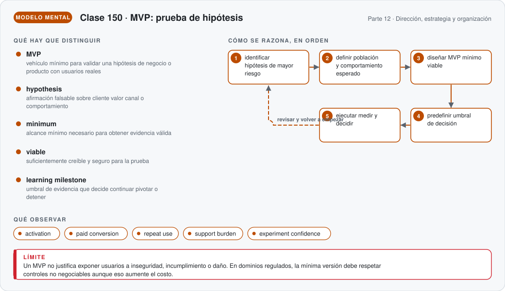

# Clase 150 — MVP: prueba de hipótesis

<!-- nav:inicio -->
> **Parte 12 · Producto e innovación** — clase 6 de 12 · [índice de la parte](../../README.md) · [temario](../../../../SYLLABUS.md)
<!-- nav:fin -->

**Parte:** 12 — Producto e innovación  
**Nivel:** Etapa 3 — Manager → Gerente  
**Duración sugerida:** 150–180 minutos · **Estándar:** deep-class-v2

## 🎯 Propósito

«MVP» es una de las siglas más usadas y peor entendidas de la gestión de producto. Se la interpreta como «la primera versión del producto, recortada», «lo mínimo para lanzar» o «un producto malo que se entrega rápido». Eric Ries la propuso para algo distinto: el **producto mínimo viable** es la versión de un producto que permite completar un ciclo de **construir–medir–aprender** con el mínimo esfuerzo y el máximo aprendizaje validado. No es un producto, sino un **experimento** diseñado para probar una hipótesis crítica del negocio con clientes reales. Un MVP bien definido ahorra meses; uno mal entendido produce lanzamientos mediocres que dañan la marca y no enseñan nada.

La clase se apoya en el método de startup lean de Ries, en el enfoque de producto delgado de Olsen, en el catálogo de experimentos de Bland y Osterwalder y en la validación de hipótesis de Blank. Al terminar sabrás identificar la hipótesis más arriesgada, elegir el tipo de MVP más barato que la pruebe, definir métricas y umbrales de éxito antes de lanzar, interpretar los resultados y decidir entre perseverar, pivotar o detener.

## 📚 Resultados de aprendizaje

Al finalizar podrás:

1. **Formular** las hipótesis críticas de valor y de crecimiento de un negocio o producto.
2. **Elegir** el tipo de MVP más barato que pruebe la hipótesis más arriesgada.
3. **Definir** métricas y umbrales de éxito antes de lanzar.
4. **Interpretar** resultados sin autoengaño y con límites de la muestra.
5. **Decidir** entre perseverar, pivotar o detener, y registrar el aprendizaje.

## 🧭 Agenda

| Tramo | Qué se hace |
|---|---|
| 0–20 min | Recuperación: ¿cuál es la suposición de tu producto que, si fuera falsa, lo invalidaría por completo? |
| 20–60 min | Hipótesis, tipos de MVP, métricas, interpretación y decisión. |
| 60–105 min | Ejemplo trabajado: probar un servicio de mantención doméstica con tres MVP. |
| 105–150 min | Caso ejecutivo y práctica. |
| 150–175 min | Límites y entregable. |

## 🧩 Conceptos centrales

| Concepto | Definición | Cómo se reconoce |
|---|---|---|
| **MVP (producto mínimo viable)** | Versión que permite aprender lo máximo con el menor esfuerzo, probando una hipótesis con clientes reales. | Tiene hipótesis, métrica y umbral. |
| **Hipótesis de valor** | Creencia de que el producto entrega valor a un cliente definido. | «Pagarán por esto». |
| **Hipótesis de crecimiento** | Creencia sobre cómo se adquirirán y retendrán clientes. | «Llegaremos por recomendación». |
| **Aprendizaje validado** | Conocimiento obtenido con datos del comportamiento de clientes. | Cambia una decisión. |
| **Pivote** | Cambio de rumbo estratégico basado en el aprendizaje. | Nuevo cliente, problema, canal o modelo. |
| **Métrica accionable** | Medida que se relaciona con una decisión. | Distinta de la vanidad. |

## 🧠 Modelo mental

**Cómo leer el diagrama.** Dos ejes: cuánto **esfuerzo** exige la prueba y cuánto **aprendizaje** entrega. La **prueba rápida** (entrevistas, página de prueba, maqueta) da mucho aprendizaje con poco esfuerzo y va primero. El **MVP funcional** da mucho aprendizaje con mucho esfuerzo y se justifica solo cuando las pruebas baratas ya sostienen la apuesta. El **ruido** (poco aprendizaje, poco esfuerzo) distrae y lo que **se evita** es construir sin saber qué se prueba. La nota aclara que el MVP es la versión que permite aprender lo máximo con el menor esfuerzo.

## 📖 Desarrollo

### 1. Qué es y qué no es un MVP

Ries define el producto mínimo viable como la versión de un nuevo producto que permite al equipo **recoger la máxima cantidad de aprendizaje validado sobre los clientes con el menor esfuerzo**. Tres aclaraciones: (1) **mínimo** no significa malo; significa lo mínimo para aprender lo que se necesita; (2) **viable** significa que entrega valor real a un cliente real, aunque sea manualmente; (3) un MVP es **parte de un experimento**, no un hito de lanzamiento. Un MVP puede ser una página con un botón de «solicitar», un servicio prestado a mano a diez clientes o una versión con una sola función. Olsen añade que el MVP debe ser «mínimo» en funciones pero lo bastante bueno para que el cliente evalúe el valor.

### 2. Empezar por las hipótesis más arriesgadas

Todo producto descansa en **suposiciones**. Se listan y se ordenan por **riesgo** (qué tan inciertas) y **criticidad** (cuánto se derrumba el negocio si son falsas). Ries distingue la **hipótesis de valor** (¿el producto entrega valor a quienes lo usan?) y la **hipótesis de crecimiento** (¿cómo se descubrirá el producto, y cómo se expandirá?). Bland y Osterwalder proponen clasificar las suposiciones en **deseabilidad** (¿lo quieren?), **viabilidad** (¿podemos hacerlo?) y **factibilidad financiera** (¿funciona el negocio?), y probar primero las más críticas y menos probadas, que suelen ser de deseabilidad. Se escribe cada hipótesis como una frase comprobable.

### 3. Tipos de MVP

Los principales tipos, de menor a mayor esfuerzo: **entrevistas con compromiso** (se pide un siguiente paso); **página de aterrizaje** (describe la propuesta y mide cuántos dejan datos o pagan una reserva); **video explicativo** (mide interés antes de construir); **concierge** (se presta el servicio manualmente a pocos clientes, con total conocimiento de ellos); **mago de Oz** (el cliente cree que es automático y detrás hay personas); **preventa** (se vende antes de producir, lo que prueba el pago); **MVP de una sola función** (producto real con la función central); y **piloto** con clientes reales. Se elige el más barato que ponga a prueba la hipótesis con comportamiento real. Pagos y compromisos de clientes pesan más que opiniones.

### 4. Métricas y umbrales antes de lanzar

Antes de lanzar, se define: **qué se medirá** (métrica principal), **qué valor cuenta como éxito** (umbral), **qué valor cuenta como fracaso** y **cuánto tiempo y cuántos clientes** se necesitan para decidir. Ejemplo: «Si, de 200 visitantes calificados a la página, al menos 10 dejan un anticipo de USD 20 en dos semanas, la hipótesis de pago se acepta». Ries propone **contabilidad de la innovación**: tres pasos —medir el punto de partida con un MVP, ajustar la oferta hacia la meta y decidir si pivotar o perseverar— con **métricas accionables** y no de vanidad. Los umbrales se fijan antes para no interpretar cualquier resultado como éxito.

### 5. Ejecutar y observar

Se lanza el MVP a un grupo acotado de clientes del **segmento objetivo** (clase 135), se recoge comportamiento (uso, pagos, retención, preguntas) y se conversa con ellos. Se cuidan la **calidad mínima** (un MVP debe funcionar para lo que promete) y la **honestidad** con los clientes (se les informa que es una versión inicial, y cumplen las normas de consumo y de datos). Se evita **contaminar** el experimento con atajos (regalar el producto, forzar uso) y **moverse la meta** durante la prueba. Se registra lo inesperado: los hallazgos más valiosos suelen no estar en la métrica prevista.

### 6. Perseverar, pivotar o detener

Con los resultados, el equipo decide: **perseverar** (la hipótesis se confirma; se amplía o se pasa a la siguiente), **pivotar** (la hipótesis central falla, pero hay aprendizajes que sugieren otro cliente, problema, solución, canal o modelo) o **detener** (no hay señal suficiente para seguir). Ries describe varios tipos de pivote (de cliente, de problema, de función, de canal, de modelo de ingresos). Es difícil admitir el fracaso de una idea querida; los **criterios de decisión** definidos de antemano y una **reunión de pivote o perseverancia** periódica ayudan a decidir con evidencia y no por orgullo o inercia (clase 105).

### 7. Errores y ética

Errores frecuentes: **confundir MVP con lanzamiento incompleto**; **no definir hipótesis ni métricas**; **construir demasiado** antes de probar; **interpretar cortesías como validación**; **medir vanidad**; **ignorar la economía** (clientes que usan pero no pagan); **mantener el MVP indefinidamente**. Ética: los clientes participan en un experimento con dinero, datos o tiempo; se les trata con transparencia; no se prometen capacidades inexistentes (en algunos países, publicidad engañosa o ventas de productos no disponibles pueden infringir normas de consumo); y se protege su información.

## 📚 Lectura comparada

| Obra | Qué aporta | Qué no resuelve | Pregunta para contrastar |
|---|---|---|---|
| Ries (*The Lean Startup*) | MVP, aprendizaje validado, pivote y contabilidad de la innovación. | Casos de startups; poco sobre empresas reguladas. | ¿Qué hipótesis prueba tu MVP? |
| Olsen | MVP centrado en ajuste producto–mercado y calidad mínima. | Enfoque en productos de software. | ¿Es lo bastante bueno para evaluar el valor? |
| Bland y Osterwalder | Catálogo de experimentos y clasificación de suposiciones. | Etapa de validación. | ¿Qué experimento es más barato y probatorio? |
| Blank | Validación del modelo de negocio con clientes. | Contexto de startups tecnológicas. | ¿Qué hipótesis del modelo es más arriesgada? |
| Cagan | Riesgos de producto y descubrimiento. | No es un manual de MVP. | ¿Cuál de los cuatro riesgos pruebas? |

## 🧮 Ejemplo trabajado

**Situación (hipotética).** Un emprendedor quiere crear un servicio de mantención doméstica por suscripción (revisiones periódicas de gasfitería, electricidad y calefacción) para propietarios de casas. Presupuesto para probar: USD 15.000 y tres meses.

**Hipótesis críticas (de más a menos arriesgada).** (1) Propietarios pagarían una suscripción mensual (deseabilidad); (2) hay suficientes en una comuna para sostener una ruta eficiente (viabilidad); (3) el margen cubre el costo de técnicos y traslado (factibilidad financiera); (4) llegarán por recomendaciones de vecinos (crecimiento).

**MVP 1: página de prueba y preventa (3 semanas, USD 800).** Página con tres planes y un anticipo de reserva de USD 25. Se invierten USD 600 en publicidad local dirigida a propietarios en dos comunas. Umbral definido: ≥ 15 reservas de 300 visitantes calificados (5 %). Resultado: 11 reservas de 340 visitantes (3,2 %); los comentarios muestran confusión sobre qué incluye cada plan.

**Ajuste y MVP 2: concierge (6 semanas, USD 6.500).** Se ofrecen 20 hogares con un plan único de revisión trimestral a USD 35 al mes; el emprendedor y un técnico hacen todo a mano. Umbral: ≥ 14 de 20 aceptan pagar después de la primera visita y ≥ 70 % renuevan el segundo mes. Resultado: 17 de 20 pagan tras la primera visita; 15 renuevan (75 %).

**Medición de economía.** Costo de la visita (técnico y traslado): USD 52 por hogar; ingreso mensual por hogar USD 35 → trimestral USD 105; margen de contribución de visita ≈ USD 53 por trimestre, antes de adquisición y administración. El costo de adquirir por publicidad fue de unos USD 55 por reserva (USD 600 entre 11 reservas). Con recomendaciones: 4 de los 17 llegaron por referidos de vecinos.

**Interpretación y decisión.** Hay señal de pago y de retención, pero la economía unitaria es débil con adquisición pagada (payback de 3 meses solo considerando la contribución de visita, sin costos fijos). Se decide **perseverar con ajuste**: concentrar en una comuna con alta densidad para reducir traslados, subir el precio a USD 45 con tres planes simples, e invertir en un programa de referidos. Criterio de revisión a los 90 días: payback menor a 6 meses y 30 % de hogares por referidos. Si no se cumple, se pivota a un modelo B2B con administradoras de condominios.

**Honestidad.** Se informó a los clientes que era una versión inicial y se cumplió el contrato ofrecido; los anticipos de la preventa se devolvieron a quienes no fueron atendidos.

**Qué muestra.** (1) Dos MVP baratos probaron hipótesis distintas. (2) La economía unitaria se medió con datos reales. (3) La decisión tenía criterios previos y una alternativa de pivote.

## 🔀 Comparación y límites

**MVP frente a prototipo.** El prototipo aprende sobre uso y comprensión, a menudo sin entregar valor real; el MVP entrega valor real a clientes reales para probar la hipótesis de negocio. Se usan en secuencia (clase 149).

**Límites.** Un MVP puede dar resultados engañosos con muestras pequeñas o con clientes atípicos (early adopters), que no representan al mercado amplio. En productos regulados (salud, finanzas) o de alto riesgo, un MVP «rápido» puede ser inadmisible; se necesita cumplimiento desde el inicio. El concepto de MVP se ha desvirtuado en la práctica. Y los pivotes no garantizan el éxito. Las normas de consumo, publicidad, pagos y datos deben verificarse y cumplirse incluso en pruebas.

## 🪜 De profesional a owner

| Nivel | Cómo participa en un MVP |
|---|---|
| **Profesional** | Ejecuta el experimento con rigor y registra el comportamiento. |
| **Jefe / Team Lead** | Define hipótesis, umbrales y decisiones con el equipo. |
| **Gerente** | Financia experimentos por etapas y exige criterios de decisión. |
| **CEO / Director** | Protege el derecho a pivotar o detener sin estigma. |
| **Founder / Owner** | Prueba el pago y la retención antes de invertir en construir. |

## 🏢 Caso ejecutivo

Una empresa de transporte escolar quiere lanzar una aplicación para que los apoderados vean en tiempo real la ubicación de los buses y reciban avisos. El equipo propone construir en 6 meses y USD 700.000 la aplicación completa, con integración a los sistemas de los colegios, pagos y chat. Los directores de colegios han dicho que «sería muy bueno»; no se ha probado si los apoderados pagarían ni si los conductores usarían el dispositivo de seguimiento. Hay normas de protección de menores y de datos de ubicación que condicionan el proyecto. La dirección dispone de USD 120.000 y 4 meses para aprender antes de decidir.

Entrega un **plan de MVP** que contenga: (a) las hipótesis críticas de deseabilidad, viabilidad y factibilidad financiera, ordenadas por riesgo; (b) los MVP propuestos con costo, tiempo, métricas y umbrales; (c) los criterios para perseverar, pivotar o detener; (d) cómo se medirá la economía unitaria con datos reales; (e) los cuidados éticos y de consumo con los clientes y las normas de protección de menores y de datos de ubicación que se verificarán en su fuente vigente; (f) el uso del presupuesto por fases.

## 🧪 Práctica

1. Lista cinco suposiciones de tu producto y ordénalas por riesgo y criticidad.
2. Elige un tipo de MVP para la más arriesgada y justifícalo.
3. Define métrica, umbral de éxito, umbral de fracaso y plazo.
4. Estima el costo de ejecutar el MVP y compáralo con el costo de construir el producto.
5. Redacta el criterio de decisión entre perseverar, pivotar y detener.

## ⚠️ Errores frecuentes

| Error | Por qué ocurre | Cómo corregirlo |
|---|---|---|
| MVP como lanzamiento recortado | Se confunde con producto | Definir hipótesis y métrica. |
| Construir antes de probar | Se confía en la idea | Pruebas baratas primero. |
| Umbrales después de ver datos | Se busca éxito | Fijarlos antes. |
| Cortesías como validación | Es agradable | Pedir pagos y compromisos. |
| Mantener un MVP sin decidir | Evitar el conflicto | Revisiones de perseverar, pivotar o detener. |
| Ignorar la economía | Se mide uso | Medir CAC, margen y retención. |

## ❓ Preguntas de comprobación

1. ¿Qué es un MVP según Ries?
2. ¿Qué diferencia hay entre hipótesis de valor y de crecimiento?
3. ¿Qué tipos de MVP existen, del más barato al más caro?
4. ¿Por qué se fijan umbrales antes de lanzar?
5. ¿Qué es un pivote?
6. ¿Qué diferencia hay entre prototipo y MVP?
7. ¿Qué límites tiene un MVP?

Claves de respuesta

1. La versión que permite recoger el máximo aprendizaje validado sobre los clientes con el menor esfuerzo; es parte de un experimento.
2. La de valor pregunta si el producto entrega valor a quienes lo usan; la de crecimiento, cómo se descubrirá y expandirá.
3. Entrevistas con compromiso, página de aterrizaje, video, concierge, mago de Oz, preventa, MVP de una función y piloto.
4. Para no interpretar cualquier resultado como éxito ni mover la meta después de ver los datos.
5. Un cambio de rumbo estratégico (cliente, problema, función, canal o modelo) basado en el aprendizaje.
6. El prototipo aprende sobre uso y comprensión; el MVP entrega valor real a clientes reales para probar la hipótesis de negocio.
7. Muestras pequeñas o atípicas engañan, en productos regulados un MVP rápido puede ser inadmisible y los pivotes no garantizan el éxito.

## 📥 Entregable

Guarda en `portfolio/150-mvp-prueba-de-hipotesis/`:

- `product-evidence-brief.md` (plantilla [Product evidence brief](../../../../templates/product-evidence-brief.md)) con el plan de MVP del caso ejecutivo;
- `product-experiment.md` (plantilla [Product experiment](../../../../templates/product-experiment.md)) con las hipótesis, métricas y umbrales;
- `decision-journal.md` con los resultados, la decisión y los aprendizajes.

## 📗 Fuentes y verificación

- Eric Ries — *The Lean Startup* (Crown Business, 2011). **Uso en esta clase:** MVP, aprendizaje validado, pivote y contabilidad de la innovación. Lectura selectiva sobre **mvp: prueba de hipótesis**. **Localizador:** [ISBN-13 9780307887894](https://openlibrary.org/isbn/9780307887894).
- Dan Olsen — *The Lean Product Playbook* (Wiley, 2015). **Uso en esta clase:** MVP centrado en ajuste producto–mercado y calidad mínima. Lectura selectiva sobre **mvp: prueba de hipótesis**. **Localizador:** [ISBN-13 9781118960875](https://openlibrary.org/isbn/9781118960875).
- David J. Bland & Alexander Osterwalder — *Testing Business Ideas* (Wiley, 2019). **Uso en esta clase:** catálogo de experimentos y clasificación de suposiciones. Lectura selectiva sobre **mvp: prueba de hipótesis**. **Localizador:** [ISBN-13 9781119551447](https://openlibrary.org/isbn/9781119551447).
- Steve Blank — *The Four Steps to the Epiphany* ([Steve Blank?], 2013). **Uso en esta clase:** validación del modelo de negocio con clientes. Lectura selectiva sobre **mvp: prueba de hipótesis**. **Localizador:** [ISBN-13 9780989200509](https://openlibrary.org/isbn/9780989200509).
- Marty Cagan — *Inspired* (Shroff, 2008). **Uso en esta clase:** riesgos de producto y descubrimiento. Lectura selectiva sobre **mvp: prueba de hipótesis**. **Localizador:** [ISBN-13 9789352131501](https://openlibrary.org/isbn/9789352131501).

> **Regla de fuentes para MVP: prueba de hipótesis:** las obras anteriores estructuran las perspectivas de esta materia; cualquier norma, ley o estándar vivo mencionado debe comprobarse nuevamente en su fuente primaria vigente, incluidas las de consumo, publicidad, pagos, protección de menores y datos de ubicación. Los ejemplos y casos son hipotéticos, con cifras ilustrativas. El desarrollo es original y no reproduce capítulos protegidos.

<!-- pie:inicio -->
---

| Anterior | Índice | Siguiente |
|---|---|---|
| [← 149 · Prototipos y aprendizaje temprano](../149-prototipos-y-aprendizaje-temprano/README.md) | [Parte 12](../../README.md) · [Programa](../../../../SYLLABUS.md) | [151 · Roadmap orientado a outcomes →](../151-roadmap-orientado-a-outcomes/README.md) |
<!-- pie:fin -->
